# The Ninth Lamp

<header class="bleed">

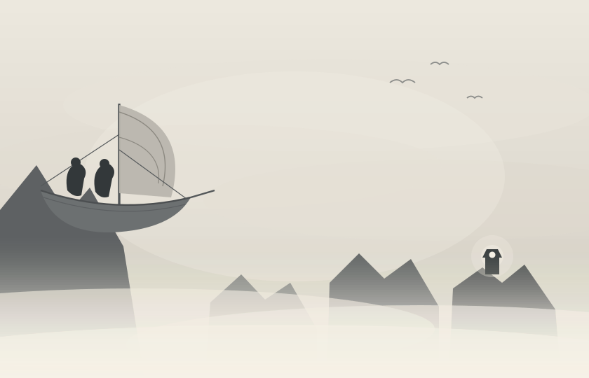

</header>

The last lamp in Umberdale went out on a Tuesday evening at seven minutes past
nine, and there were only two people in the whole world watching when it
happened.

Elspin was one of them. She was lying flat on the foredeck of the _Pennywhistle_
with her chin on the bottom rail and her boots hooked under a coil of rope,
because Captain Sennet had said that anybody who fell off a sky-ship after dark
should not expect to be fetched back before breakfast.

Tobrin was the other. He was sitting up properly, the way he did almost
everything, with his notebook open on his knees.

Below them the fog lay from one wall of the valley to the other, white and level
and perfectly still, like a river that had forgotten how to move. It had come in
the first week of autumn and it would not lift until spring. Out of it, here and
there, the tops of the crags stood up like the backs of sleeping animals.

And far off, on the last crag but one, a light was burning.

"Thistleback," said Elspin. "Still going."

"It is dimmer than it was last night," said Tobrin.

"It isn't."

"I wrote down how bright it was. It is."

He had a notebook full of things like that. On the cover he had printed, in his
very best letters, THINGS THAT ARE TRUE, and inside were the heights of nine
crags, the names of eleven knots, the number of steps between the galley and the
wheel (nineteen), and a list of the nine cloud-lamps of Umberdale with a date
written beside each one. The date was the night that lamp had stopped.

Nine lamps. Eight dates.

They watched. The little light shivered, the way a candle does when somebody
walks past it. Then it steadied. Then it grew small. Then it simply was not
there any more.

Elspin waited for it to come back. She counted slowly to sixty, and then to
sixty again, which is a very long time to lie still on a cold deck at night.

"Write it down," she said at last.

Tobrin did not move. "I don't want to."

"Write it down anyway."

So he did.

Behind them a door banged and the deck leaned over a little, the way it always
did when Captain Sennet came up from below. She was a tall, wide, unhurried
woman who had to go through most doorways sideways and had stopped minding about
it years ago. She came and stood at the rail between them and looked out at the
place where the light had been.

"Ah," she said.

That was all she said. But she said it in the way grown-ups do when they have
just seen the one thing they were hoping not to see.

The _Pennywhistle_ was a small ship with a patched sail and a brass bell beside
the wheel, and she was carrying the winter stores for Sallowford: eleven sacks
of flour, four barrels of lamp oil, a crate of medicine packed in straw, and one
hundred and six letters. Sallowford was down there somewhere underneath the
white, along with its two hundred chimneys and its school and its bakery and
everybody Elspin had ever known.

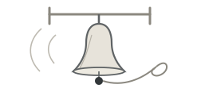

"Can we go down?" said Elspin.

"I can sail over Umberdale all winter," said Captain Sennet. "I cannot sail into
it. Not blind. There are nine crags in this valley and every single one of them
would be glad of a ship."

That was what the cloud-lamps were for. Nine great lamps on nine high rocks, lit
at dusk and minded until dawn, so that a ship coming home could feel her way
down through the white the way you feel for the rail of a stair in the dark.
There had been a keeper on every crag once, with a cottage and a stove and a
barrel of oil, and Elspin's grandmother used to say that on a good night the
lamps came on one after another down the valley like somebody laying a table.

"Then somebody has to go and light it," said Elspin.

"Somebody does," Captain Sennet agreed.

"Us."

The captain looked at her for a while. Then she looked at Tobrin, who had gone
very still, which was what he did instead of saying no.

"The stair up Thistleback is three hundred and forty-one steps and nobody has
swept it in six years," she said. "There is a rope bridge over the gorge and I
would not put a goat on it. And I cannot come down after you — because if I
could come down after you I could land the ship, and if I could land the ship we
would not be having this conversation."

"Yes," said Elspin.

"I am not saying no," said Captain Sennet. "I am saying that I want you to have
heard all of it first."

Elspin put her hand in her coat pocket, where she kept the only valuable thing
she owned.

It was a compass, brass, about the size of a duck's egg, and it had belonged to
her grandmother, who had flown the valley for forty years and had made it out of
a broken barometer and a great deal of stubbornness. Its needle did not point
north. It had never once pointed north. It pointed the way home, which had meant
Sallowford every day of Elspin's life.

She opened it now and held it flat so that all three of them could see.

The needle swung, thought about it, and settled. It was pointing straight across
the gorge at the black shape of Thistleback, exactly as it had done every
morning for three weeks.

Nobody said anything for a moment.

"Well," said Captain Sennet at last. "That is a nuisance."

They spent the rest of the evening arguing about it in the galley, which is the
warmest room on any sky-ship and therefore the room where everything gets
decided. Captain Sennet was against it and said so eleven times. Then she got
out the chart of Umberdale and put her thumb on Thistleback and left it there
for a long while without saying anything at all, and Elspin understood that the
arguing part was over.

Tobrin packed. He was extremely good at packing, in the way that people are good
at things they can do instead of worrying. He laid everything out on the galley
table in rows and then took half of it away again, and what was left was: a
coil of line, a knife, two blankets, a tin cup, and his notebook.

"You have not packed anything to eat," said Elspin.

"I was coming to that."

She set them down at first light on the shoulder of Grellow Head, where the fog
lay thin enough to see your own boots. She gave them a coil of line, a
storm-lantern, a box of matches, and a bag of bread and cheese and dried apple,
and she gave them three days.

"Two rings on the bell means _I am here_," she said. "Listen for it. I will ring
at noon and at dusk. And if you hear nothing at all, that only means the wind is
in the wrong place. It does not mean anything else. Are we clear?"

"We're clear," said Elspin.

The _Pennywhistle_ lifted away and was gone in about nine seconds, which was far
too fast.

Then it was very quiet on Grellow Head. Ahead of them the ground fell away into
the gorge, and the gorge was full of white, and somewhere out in the middle of
the white there was a bridge.

Tobrin opened his notebook, wrote the date, and underneath it wrote, because it
was true: _We are going down._

# The Bridge in the Mist

<header class="bleed">

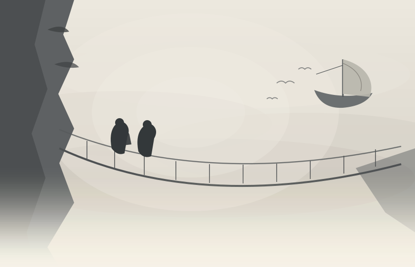

</header>

Morning came slowly to the valley of Umberdale, and it brought a mist so thick
that Elspin could not see the far side of the gorge. She reached back for
Tobrin's hand and found it already waiting, cold and certain, the way it always
was when the two of them were frightened.

They had found the bridge by walking along the edge until the ground ran out. It
was not much of a bridge. Two hand-ropes, one foot-rope, a great many planks,
and a certain number of gaps where planks used to be. Somebody had cut a date
into the post at the near end. Tobrin looked at the date for rather a long time
and then decided not to say what he thought it meant.

"Eleven knots," he said instead, crouching down at the post. "Every one of them
still tight."

"Is that true?"

"It's true," said Tobrin, "or I wouldn't have said it."

The rope bridge swayed with every gust. Below there was only white — no river,
no rocks, no bottom that either of them cared to imagine. Elspin counted the
planks out loud to keep her voice from shaking.

One, then another, then a third that groaned like an old door. Tobrin said
nothing at all, which was exactly how she knew that he was frightened too.

The trick, they discovered, was not to look down, which everybody tells you, and
also not to look up, which nobody ever mentions. Looking up showed you how far
the ropes went before the mist ate them, and that was worse.

A small grey bird came out of the white and landed on the hand-rope a little way
ahead of Elspin's fingers. It was round and rumpled and not at all impressed.
Fogfinches spend their whole lives inside the cloud, and the valley people say
they can hear the difference between one bank of fog and another. This one
looked at Elspin with its left eye, and then with its right eye, and then hopped
three feet further along the rope and waited.

"It wants us to follow it," said Elspin.

"It wants your bread," said Tobrin.

Far above the fog a bell rang twice, patient and clear. It was the
_Pennywhistle_, their small sky-ship, circling and circling and waiting for them
to cross.

Elspin let out a breath she had been holding on to for some while. "Noon," she
said.

"Noon," Tobrin agreed. And then, "Twenty-nine."

"What?"

"Planks. You stopped counting out loud at twenty-two. I kept going."

Halfway over, the wind fell away and the mist turned bright. For one long breath
Elspin could see the whole bridge, swinging gently between two cliffs of pale
grey stone. She could see the far side as well: a shelf of rock, an iron gate,
and a path climbing away out of sight. And above the path, very high up and very
faint, a shape like a chimney standing on the end of the world.

Then the mist folded over again and took all of it back.

She took the compass from her pocket. The needle no longer pointed north; it
pointed the way home, which today happened to mean straight ahead.

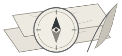

"Grandmother used to say a compass is only a promise," said Elspin. "She said it
doesn't tell you where you are. It only tells you that somewhere exists."

"That is a very unhelpful kind of promise," said Tobrin.

"She was a very unhelpful kind of grandmother."

The bridge did four things, and it did them over and over in no particular
order. It swung sideways, which was the one you got used to. It bounced, which
was the one you did not. Every so often the whole of it turned a little on its
own axis, so that for a second you were walking along the side of it rather than
the top, and once — only once — it did all three at the same time, and Elspin
found that she had stopped moving altogether and was holding the hand-ropes so
hard that her knuckles ached for an hour afterwards.

"Still eleven knots," said Tobrin behind her.

"That is not as comforting as you think it is."

"It is a bit comforting," said Tobrin.

Twelve planks from the far end there were no planks at all. Someone had taken up
a whole armful of them, long ago, and left a gap about the length of a kitchen
table with nothing across it but the foot-rope, thin as a wrist.

They stood and looked at it.

"I'll go first," said Elspin, "because it was my idea."

"That isn't a reason," said Tobrin. "That's just guilt."

But he let her go first. She put both hands on the rope above her head and both
boots on the rope below and went across sideways, like a crab, one shuffle at a
time, and did not count anything, because there was nothing left to count. The
rope hummed. The white went on being white.

Tobrin came after her, faster than she had, with his eyes fixed on the post
ahead and his jaw set hard — and halfway across the gap his boot swung and
knocked the box of matches out of his coat pocket.

They both watched it go. It turned over twice, very neatly, and the fog took it
without a sound.

Neither of them said anything for a moment. Then Tobrin finished the gap, and
sat down on the boards, and looked at his hands.

"Well," he said.

"We'll find some," said Elspin. "Keepers keep matches. That is practically what
the word means."

"That is not what the word means."

"It is practically what it means," said Elspin, "and you are going to have to let
me have this one."

"If we get across," said Tobrin at last, "I am never setting foot on a bridge
again." Elspin laughed, and the sound of it surprised them both. So they went
on, plank by plank, into the pale and shifting light, and the mist closed gently
behind them.

# The Keeper's House

<header class="bleed">

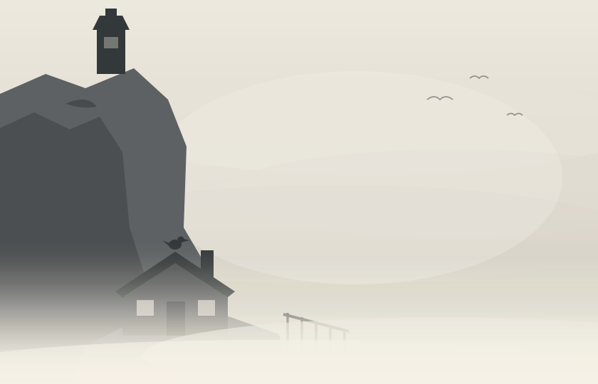

</header>

The far side of the gorge had a gate.

It was iron, and taller than either of them, and it had rusted long ago into a
shape that would never close again. A slate hung on it by a wire, and on the
slate, in white paint gone the colour of old milk, somebody had written:

THISTLEBACK LAMP. KEEPER'S PATH. RING BEFORE CLIMBING.

There was a post beside the gate for the bell to hang from. There was no bell.
There was only a short piece of green rope, chewed off, swinging a little in the
wind.

"Ring what?" said Tobrin.

"That's what I was thinking," said Elspin.

The path went up through wet grass and turned twice and brought them, quite
suddenly, to a house.

It was a small house of grey stone with a slate roof and a green door, and it
was built into the side of the rock as though it had been growing there. Two
windows. One chimney. Nothing at all coming out of the chimney.

Elspin knocked. Nobody came. She knocked again, more politely, in case.

The door opened on its own, the way doors do when nobody has bothered to lock
them for a long time.

Inside there was one room, and everything in it was cold.

The stove was cold. The kettle on the stove was cold, and when Elspin lifted it,
it was full of water with a thin skin of ice across the top. The bed in the
corner was made up neatly with a grey blanket folded at the foot. A very large
patched coat hung on a nail behind the door, and there were two cups set out on
the table, and beside them a third cup standing upside down.

"Why is that one turned over?" said Tobrin.

"For whoever comes," said Elspin. Her grandmother had done exactly the same
thing, every evening of her life, on a shelf by the door. "You turn it up when
they get here."

Tobrin wrote that down. He wrote down the cups, and the coat, and the ice in the
kettle, and then he stopped writing, because he had found the book.

It was on the table under a stone, to keep the wind off it: a fat leather
logbook with a pencil tied to it on a string. Every page was ruled into columns,
and every line was filled in with the same small careful hand.

_14th of Ninthmonth. Lit at 5.40. Clear until midnight. Wind south. One ship
passing up-valley. Waved. She did not see me._

_2nd of Tenthmonth. Lit at 5.10. Stair worse at the ninetieth step. Must ask
somebody._

_11th of Tenthmonth. Lit at 5.00. Nobody to ask._

The dates went on and on, hundreds of them, tidy as bricks. And then, on the
very last written page, the writing changed. It was bigger, and shakier, and it
slanted downhill.

_The ninetieth step is gone. I cannot get down it again and I do not think I
shall try. If anybody reads this, I am up at the lamp. Please knock._

Underneath, where the column for the date should have been, was a name:
_H. Ombrey, Keeper, Thistleback._

There was one more thing on that page. Somebody had pinned a drawing to the
inside of the back cover: a child's drawing, on the back of a flour label, of a
tower with an enormous yellow scribble on the top of it and four stick people
standing at the bottom holding hands. In one corner, in the wobbling capitals of
a person who has only just learned them, it said THANK YOU FOR THE LIGHT.

It was very old. The paper had gone the colour of weak tea. Elspin looked at it
for a while and then closed the book very gently, the way you close a door on
somebody who is asleep.

The date beside it was six years old.

Elspin read it twice. Then she read it out loud, which was worse.

"Six years," said Tobrin.

"He's been up there six years," said Elspin, "and the lamp was still lit on
Tuesday."

They looked at each other. Neither of them said the next part, which was: _and
then on Tuesday it wasn't._

The room told them the rest of it, in the small flat way that rooms do. There
was a sock on the arm of the chair with a needle still in it. There was a shelf
of jars with paper labels in that same careful hand — SALT, TEA, NAILS, STRING,
and one that said BUTTONS ETC. and had four buttons in it and a great deal of
etcetera. There was a chalk line on the door frame with three heights marked on
it and no names, which meant somebody's children, a long time ago, standing
very straight against the wood.

They searched the cottage properly after that, and they were not shy about it,
because a man who leaves a cup upside down for visitors is not a man who minds
being searched. In the cupboard they found a jar of flour, a jar of salt, a jar
of tea with three leaves left in the bottom, and a tin.

The tin was the size of a brick and it had a label on the lid:

SAFETY MATCHES. THISTLEBACK LAMP. SPARE.

Elspin's hands were not quite steady when she opened it.

There had been three hundred matches in that tin. There were three hundred
matches in it now. But the roof above the cupboard had let in six winters of
water, one slow drip at a time, and every single match had swollen and softened
and pressed into every other match, and what lay in the tin was one grey brick of
ruined wood that smelled faintly of pond.

Tobrin poked it with a finger. His finger went in.

"Right," he said, in a very level voice.

Elspin put the tin down on the table and sat on the end of the bed and looked at
the floor for a while, and outside the wind came round the corner of the house
and made a low sound in the empty bell-post.

It was Tobrin who found it, in the end, because Tobrin was the sort of person
who tidied a shelf when he was upset. He lifted the flour jar to wipe under it,
and something small rolled out from behind and dropped on to the boards with a
tap.

One match. Whole, and pale, and dry as a summer afternoon.

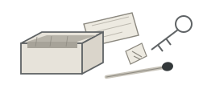

Neither of them touched it for a second. Then Elspin picked it up as though it
were made of glass and put it into the empty tea jar, and screwed the lid down,
and buttoned the jar into the inside pocket of her coat, over her ribs, where
it was warm.

By the door there was a nail, and on the nail there was a key, and on the key
there was a paper tag that said LAMP.

Elspin took it. Then she went back to the table and turned the third cup the
right way up, and left it standing there, which felt important, although she
could not have explained why.

"Please knock," she said.

"Then we had better go up," said Tobrin.

# The Whistling Stair

<header class="bleed">

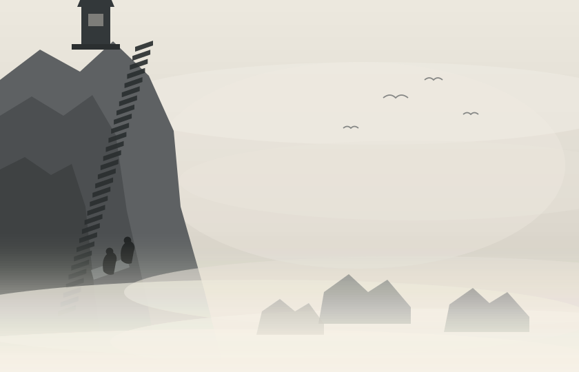

</header>

Three hundred and forty-one steps had been cut into the face of Thistleback by
somebody with a hammer, a chisel, and no sense whatever of how far up was too
far up. There was no rail. There was, on the outside edge of each step, a small
worn hollow, scooped out by two hundred years of boots and rain.

That was why they called it the Whistling Stair. When the wind came from the
south and lay along the cliff, it ran over the hollows one after another, and the
whole staircase sang a single low note, like somebody blowing across the top of
a bottle. It was a friendly sound at the bottom. It was a much less friendly
sound at step two hundred.

Elspin counted. Tobrin did not talk. This was how it always went: when Elspin was
frightened she made noise, and when Tobrin was frightened he took his voice and
put it away somewhere and shut the lid.

So Elspin talked for both of them. She talked about the bakery in Sallowford and
whether Mrs. Ashby would have kept them any of the flat brown cakes with the
burnt edges. She talked about what she would say to Captain Sennet when they got
back. She talked about how her grandmother had once flown a sky-ship through a
thunderstorm on purpose, which Elspin had believed absolutely until she was nine
and still believed a little bit now.

At step ninety the stair stopped.

Not gradually. It simply ended, the way a sentence ends when somebody stops
speaking. A whole span of the cliff had come away — steps, ledge and all — and
gone down into the white, and left behind a smooth grey slope about twelve feet
across, wet, and tilted exactly the wrong way.

On the far side of it the steps started again as though nothing had happened.

"That's it, then," said Tobrin. It was the first thing he had said in a hundred
and twelve steps. "That's the ninetieth step."

"That's the ninetieth step," Elspin agreed.

Above the gap, driven into the rock, there was a ring of iron, and hanging from
the ring there was a rope, and hanging from the rope there was a basket big
enough for a sack of flour. It was the keeper's hoist: the way a man on top of a
crag gets his winter up to him without carrying it. Elspin reached out and took
hold of the rope, and it came apart in her hand like wet paper.

They stood there and let that sink in.

Six years of no post, no flour, no oil, no matches, no letters. Six years of a
man who could not get down, and a hoist that could not bring anything up, and a
lamp that had gone on being lit every single evening anyway.

"He must have run out of everything," said Tobrin.

"Not everything," said Elspin. "The lamp was burning on Tuesday."

They got across the gap with the coil of line and a great deal of arguing.
Elspin went first — she was lighter — with the line round her waist and both
palms flat on the slope, and Tobrin braced against the last good step and paid
the rope out an inch at a time and never once looked away from her hands. It took
eleven minutes. Tobrin knew that, because Tobrin looked at his watch afterwards
and wrote it down.

Then it was three hundred and forty-one steps minus ninety, and the wind, and
the note the stair made.

After that the steps went on being steps. There is not a great deal to say about
three hundred and forty-one of anything, which is exactly the trouble with them.
Elspin's legs stopped being legs somewhere around step one hundred and forty and
became two long complaints instead. The bag got heavier every fifty steps in a
way that could not be explained by anything in it.

And the fogfinches came out to watch.

They lived in the stair, it turned out. Every so often one of the worn hollows
on the outside edge of a step was not a hollow at all but a little dry cave
going back into the rock, and in it there would be three or four round grey
birds sitting in a row with their feet tucked up, entirely out of the weather,
looking at the two of them going past with the mild interest of people at a
window watching somebody else's removal van.

"There must be hundreds," said Tobrin, who had begun talking again somewhere
around step one hundred and sixty.

"Two hundred and six," said Elspin, "so far," which was a lie, and he knew it
was a lie, and it made him laugh, which was the whole point of it.

Somewhere around step two hundred the fog began to thin.

It did not happen all at once. First the white went from grey to pearl. Then
there was a brightness above them that had no shape. Then Elspin, who had her
head down and was counting under her breath, walked up out of the top of the
cloud into a morning so clear and so blue and so enormously wide that she
forgot the number she was on and had to sit down.

Below her the fog lay across the whole valley from wall to wall, and the sun was
on it, and it was not white at all from up here — it was gold, and it moved,
very slowly, the way a sleeping animal moves when it breathes. Out of it stood
the eight other crags of Umberdale, dark and small and quiet, each one with its
cold lamp on top.

And above her, close now, was Thistleback: a fist of black rock, and on it a
round stone tower with a glass crown.

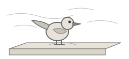

Tobrin came up beside her and sat down too, without a word, and they stayed
there rather longer than they needed to.

At step three hundred and eleven there was a tin mug standing on the step with a
stone on top of it to keep the wind from taking it, and half an inch of rain
water inside. It had been there a long time. Elspin thought about a man setting
a mug down on the stairs, six years ago, on his way up, meaning to come back for
it.

At step three hundred and forty-one there was a door.

It was small and low and painted the same green as the cottage door, and nailed
to it, at exactly the height of a knuckle, there was a card in a small careful
hand.

PLEASE KNOCK.

Elspin looked at Tobrin. Tobrin looked at Elspin.

She knocked.

# The Last Keeper

<header class="bleed">

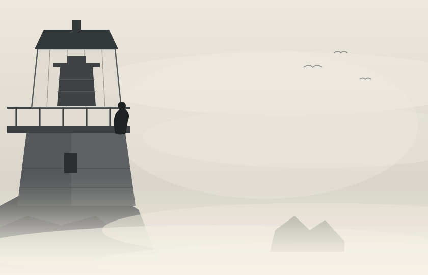

</header>

Nothing happened for so long that Elspin lifted her hand to knock again.

Then, from the other side of the green door, somebody said: "Just a minute."

It was an old voice, and a dry one, and it sounded as though it had not been
used on anybody for some time. There were slow footsteps. There was a bolt. Then
the door came open about the width of a hand, and a face looked out at them from
about the height of Elspin's shoulder — a small, weathered, whiskery face with
enormous pale eyebrows and two extremely surprised eyes.

"Oh," said the keeper of the Thistleback lamp. "Oh, my word."

His name was Hollis Ombrey and he was ninety-one years old, and he had been the
keeper of that lamp for sixty-one years, and for the last six of them he had not
spoken to another human being.

He was terribly pleased about the knock. He was so pleased that he had to sit
down in the middle of getting the kettle on, and he apologised for it twice.

The lamp-room was round, and warmer than outside, and it smelled of oil and
stone and old wool. There was a hammock, and a chair, and a shelf of books that
had all been read a great many times, and a stove with three pieces of driftwood
beside it. In the middle of the floor a ladder went up through a hatch into the
glass crown, and up there, dark and huge and patient, sat the lamp.

Elspin had never seen a cloud-lamp close to. It was taller than she was. It had
a burner like a brass tree, and a wick as broad as her two hands, and round the
whole of it stood a lens made of a hundred rings of glass, so that when you
moved your head the whole thing swam.

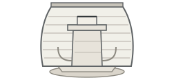

"She is a good lamp," said Mr. Ombrey, following her eyes. "There is nothing
wrong with her. I want that said first, because people always assume."

"We didn't assume anything," said Elspin.

"No," he agreed. "You knocked." He seemed to find this very satisfactory.

Tobrin, who could not help himself, had got out the notebook. "Sir," he said,
"the lamp went out on Tuesday."

The old man's hands went still on the kettle.

"Yes," he said. "It did."

Then he told them, in the flat and careful way that people use when they have
been over a thing many times alone.

He had gone up the ladder on Tuesday evening, the same as always. It was the
same ladder he had gone up eleven thousand times. But he was ninety-one, and the
rung was slick, and his foot went out from under him, and he came down four feet
on to the stone floor and caught his shoulder on the corner of the stove.

He had knocked the stove over. The fire had gone out on the wet floor. His own
matches — the last four of them — had been in the little dish on top of the
stove, and they had gone into the puddle with everything else.

So he had not lit the lamp on Tuesday. He had not lit it on Wednesday. He had
sat in the dark with his arm strapped to his chest with a bootlace, and he had
listened to the sky-ship going over and over above the fog, ringing her bell
twice, and he had had no way at all of telling her that he was here.

"Sixty-one years," he said, "and it took four matches."

While the kettle came to the boil they found out the rest of it, mostly by
looking. There was a tally scratched into the stone beside the door in groups of
five, and it went round the corner and along the wall and stopped, and Elspin
did not try to count it. There were eleven books on the shelf and every one of
them had been read so many times that the corners had gone soft as cloth. There
was a jar of tea on the table with about a spoonful in it, and a sack of flour
propped in the corner with the bottom two inches gone hard, and a row of empty
oil tins by the stove that had been washed out and stacked, because a man on his
own does not stop being tidy just because there is nobody to be tidy for.

And on the wall above the hammock, pinned up with a bent nail, there was a
drawing on the back of a flour label: a tower with an enormous yellow scribble
on the top of it and four stick people at the bottom holding hands.

"There is one of those in the logbook," said Elspin.

"There are nine of them altogether," said Mr. Ombrey. "That is the last one. She
would be about fifty now." He said it without any particular sadness, the way
you would give somebody directions.

Nobody said anything for a bit. Tobrin was writing very fast and not looking up,
which was what Tobrin did instead of crying.

"There is a whole barrel of oil," said Mr. Ombrey, waving his good hand at the
wall. "There is wick enough for ten years. The glass wants a wipe. That is all
that is the matter with her. That is all that has ever been the matter with
her." He stopped, and then he said, in a completely different voice, "I should
have asked somebody. Six years ago, when the stair went. I should have shouted
down at a ship. I could have. I did not."

"Why not?" said Elspin.

He thought about it honestly, which she liked him for.

"Because I did not want to be the keeper who could not manage," he said.

Elspin took out her grandmother's compass and put it on the table between the
cups, and opened it.

Mr. Ombrey looked at it. Then he picked it up, very carefully, in his one good
hand, and turned it over, and looked at the three letters scratched into the
back of the case, which Elspin had known her whole life and had never once
thought about.

"Sedge," he said. "That is Alba Sedge's compass. She used to bring me my flour."

"She was my grandmother."

"I know she was," said Mr. Ombrey. "You have got her chin."

Outside, quite suddenly, the light in the little windows changed.

All three of them turned to look. Away down the valley, over the shoulder of
Grellow Head, the blue had gone out of the morning and something the colour of a
bruise was coming up the sky, dragging a long grey skirt of rain, and coming
fast.

Mr. Ombrey put the compass down.

"Well," he said. "That will be here by five."

"And the ship?" said Elspin.

"The ship," said the old man, "will be looking for a lamp."

# The Longest Match

<header class="bleed">

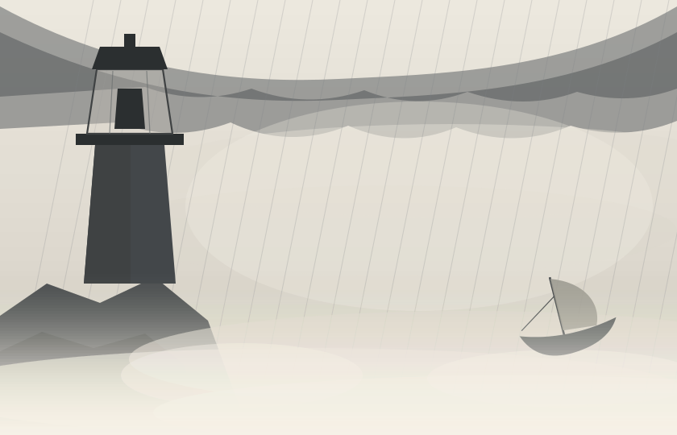

</header>

They had four hours, one match, and a man who could only use one arm. Mr. Ombrey
divided the work up as though he had been waiting six years to give somebody a
job, which he had.

Tobrin got the glass. There were ninety-six rings in the great lens and every
one of them had six years of salt and smoke on it, and Tobrin went round them
all with a rag and a bottle of vinegar, twice, on his knees, saying nothing.

Elspin got the oil. The barrel was against the wall and the reservoir was up
through the hatch, and the only way between them was a two-quart can and the
ladder. She did it eleven times. On the eighth she stopped counting out loud,
because there was nobody down there to hear it any more; Mr. Ombrey had gone up
into the crown to trim the wick, one-handed, with a pair of scissors he had
sharpened himself in about 1970.

The wick came off in a long grey curl and underneath it the new wick was white
and soft and perfect.

"There," he said. "Look at her. Nothing wrong with her at all."

By four o'clock the storm had got as far as the fifth crag. They watched it eat
the crag, quite calmly, the way weather does.

By half past four the wind had found the Whistling Stair, and the note it made
was not a low friendly hum any more. It was a shriek that came up through the
floor of the lamp-room and went round the walls.

At twenty to five they heard the bell.

It was very far off, and thin, and coming in pieces. Two rings. _I am here._ A
long gap. Two rings again — and then, on the third time, three rings, quick and
wrong.

Mr. Ombrey's face did something complicated.

"Three is _I cannot see_," he said.

Elspin unbuttoned her coat and took out the tea jar and unscrewed the lid, and
tipped the one match out into her palm.

They went up the ladder together: Elspin first, then Tobrin, then Mr. Ombrey,
who took a long time and would not be helped. Up in the glass crown the noise
was enormous. The rain had arrived and it was going sideways, and every so often
the whole tower took a shove from the wind and the hundred rings of the lens
rang, very faintly, all at once.

The burner stood open and ready. The wick was white. The oil was up.

"Now then," said Mr. Ombrey, close to her ear. "Two things. First: strike it
away from you, not towards. Second — and this is the one people get wrong — do
not wait to see if it has caught. It has caught. Give it to the wick before it
knows it is lit."

"What if the wind takes it?"

"Then it takes it," said Mr. Ombrey. "And we shall think of something else, and
in the meantime you will not have done anything wrong."

Tobrin had taken his coat off. He got himself between the match and the open
side of the crown and held the coat out wide with both arms, like a boy being a
wall, and the rain went straight through it and down his back and he did not
move at all.

Elspin knelt down. The match was warm from being against her ribs all day. She
put it against the striker, and she thought, absurdly, about a box of matches
turning over twice in the air above the gorge.

She struck it away from her.

It caught. It made a small ordinary spitting flame, the most ordinary thing in
the world, and the wind came round Tobrin's elbow and reached for it — and
Elspin did not wait to see anything at all. She put it straight into the
white wick, the way she had been told, and took her hand out of the way.

The wick took the flame the way dry grass takes it. It ran along the whole broad
edge in one movement, blue and then yellow, and stood up, and steadied.

And then the lens caught it.

Elspin was never afterwards able to describe what that was like. All hundred
rings of glass filled at once, and the light went out of the tower in two great
flat beams, east and west, and where they hit the rain the rain turned white,
and the fog five hundred feet below them lit up from the inside like a lamp in a
paper bag, all the way down the valley, for miles.

Mr. Ombrey stood with his one good hand against the glass and did not say
anything for a long moment.

"Sixty-one years," he said, "and I have never once seen her from up here at the
start. I was always still climbing."

Down in the lamp-room there was a bell-pull that Elspin had taken for a curtain
cord. Tobrin, soaked through and shaking, pulled it twice.

They waited.

Out in the roaring dark, very small and quite unmistakable, a bell answered:
two rings, patient and clear.

# The Way Home

<header class="bleed">

</header>

The storm blew itself out somewhere around three in the morning and took most of
the fog with it, which the valley people will tell you happens perhaps twice in
a winter and is nothing to rely on.

Elspin woke up on the floor of the lamp-room under Mr. Ombrey's enormous patched
spare blanket, with the light still turning slowly overhead, and for a moment
she could not think where she was. Then she heard Tobrin, on the other side of
the stove, saying numbers in his sleep.

At about seven o'clock there was a noise outside like a sheet being shaken, and
a shadow went over the little windows, and somebody a long way up shouted a word
that Elspin's grandmother would not have approved of.

The _Pennywhistle_ came down on to Thistleback the way a large woman sits down
on a small chair — carefully, and with a certain amount of comment. Captain
Sennet got a line round the mooring ring on the second try. Then she came down
the tower steps two at a time, and stopped at the green door, and looked at it,
and had to come in sideways and mostly folded, which is how she came into every
building she had ever entered.

She stood up inside, and looked at the three of them, and at the lamp turning
above, and at the old man in the chair with his arm in a proper sling now
because Tobrin had made him one out of a flour sack.

"Mr. Ombrey," she said.

"Captain," said Mr. Ombrey.

"You are supposed to be dead. It says so in the office at Sallowford. There is a
card."

"I should like to see that card," said Mr. Ombrey.

They got the winter stores down to Sallowford that afternoon, all of it: the
flour, the oil, the medicine in its straw, and the one hundred and six letters,
of which two, it turned out, were for a Mr. H. Ombrey, Thistleback, and had been
in a sack in the Sallowford post office since the spring before last.

He read them by the lamp that night and would not say what was in them, except
that one was from his sister and one was a bill.

The plan was Tobrin's, and he wrote it in the back of THINGS THAT ARE TRUE with
a ruler, because it was the sort of plan that wanted a ruler.

There were eight cold lamps left in Umberdale, and one man who could not climb,
and — as of that week — a great many children in Sallowford who had heard the
whole story and had immediately begun asking loud questions at supper. So: two
of them to a crag, in turns, a fortnight each. Mr. Ombrey to teach them, all of
them, up in the lamp-room, four at a time. The stair to be mended in the spring
by everybody, including the ones who complained. The hoist rope to be replaced
at once, and then replaced again every four years for ever, which Tobrin
underlined.

"One lamp a week," said Captain Sennet, reading it over his shoulder. "That is
eight weeks."

"That is if nothing goes wrong," said Tobrin.

"Something will go wrong."

"I know," said Tobrin. "I left a column for it."

On the last morning Elspin went down to the cottage on her own and lit the
stove, and swept the floor, and put a bowl under the drip in the roof until
somebody could get up there with a slate. She emptied the ice out of the kettle
and filled it fresh, and set it on to boil.

Then she took the two cups off the table and washed them, and washed the third
one as well, and set all three of them out the right way up, side by side,
because it seemed to her that a house where three people were expected ought to
look like one.

She stood in the doorway for a while afterwards. Down below, the fog had come
back into the bottom of the valley the way it always does, white and level and
patient, and out of it the eight dark crags stood up like the backs of sleeping
animals. Eight to go. It was going to take the whole winter and probably some of
the spring.

She took her grandmother's compass out of her pocket and opened it, and held it
flat on her palm.

The needle came off Thistleback for the first time in three weeks. It swung, and
thought about it, and settled — down the valley, and to the south, and home.

"All right," said Elspin. "We're coming."

Behind her, up on the crag, the great lamp turned in the daylight where nobody
needed it at all, because Mr. Ombrey had said that after six years he did not
much feel like putting it out just yet, and nobody in the valley of Umberdale
had been able to think of a single good reason why he should.
