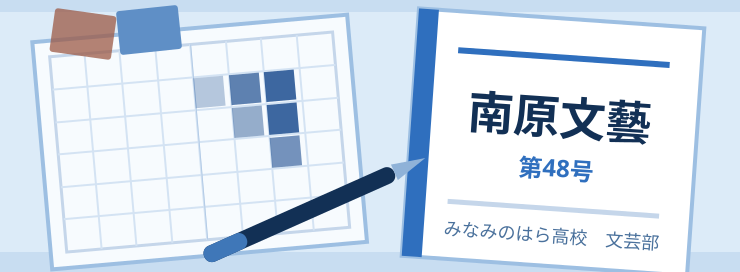

<header class="headline">
<h1>文芸部　年間活動報告</h1>

みなみのはら高校　文芸部

</header>

文芸部は、書くことと読むことを両輪に活動する部です。部員は12名。毎週火曜と金曜の放課後に部室へ集まり、作品を持ち寄って読み合っています。今年度の活動を五つに分けて報告します。

## 部誌「南原文藝」の発行

年二回の部誌を、今年度も予定どおり夏号と冬号として発行しました。第48号は小説5編・随筆3編・短歌と俳句あわせて41首を収め、96ページになりました。表紙と扉の版下も部員が組み、印刷は市内の印刷所にお願いしています。

## 読書会と句会

月のはじめの火曜は読書会、月末の金曜は句会と決めています。読書会は一冊を全員で読む形をやめ、同じ主題の本を各自が選んで紹介する形に変えました。手に取る本の幅がひろがり、部誌の随筆にも変化が出ました。句会は毎回その場で題を決め、三十分で三句をつくります。うまい句を目指すより、まず数をつくることを大切にしています。

<h3>年間活動記録</h3>

| 月   | 活動内容                 | 参加 |
| ---- | ------------------------ | ---- |
| 5月  | 新入部員歓迎句会         | 12名 |
| 7月  | 部誌「南原文藝」夏号発行 | 11名 |
| 9月  | 市立図書館との合同読書会 | 9名  |
| 10月 | 文化祭展示・朗読会       | 12名 |
| 12月 | 部誌「南原文藝」冬号発行 | 12名 |
| 2月  | 一年の作品を読み直す会   | 10名 |

<h3>部誌「南原文藝」の記録</h3>

| 号     | 発行     | 収録 | 頁数 |
| ------ | -------- | ---- | ---- |
| 第45号 | 2024年夏 | 38点 | 80頁 |
| 第46号 | 2024年冬 | 45点 | 88頁 |
| 第47号 | 2025年夏 | 41点 | 84頁 |
| 第48号 | 2025年冬 | 49点 | 96頁 |

## 文化祭の展示と朗読会

文化祭では部室を開放し、歴代の部誌と部員の原稿を展示しました。あわせて、視聴覚室で三十分の朗読会を二回行いました。自分の書いたものを声に出して読むのは勇気がいりますが、聞き手の反応がそのまま返ってくる貴重な機会でした。展示した部誌は第20号までさかのぼり、四十年分の表紙を年代順に並べました。

## 市立図書館との合同読書会

九月には、みなみのはら市立図書館の主催する読書会に部として参加しました。中学生や社会人の方と同じ卓を囲み、一冊の随筆について二時間話しました。同じ文章でも立場によって引っかかる場所がちがうと知ったことは、その後の推敲会にも生きています。

## 推敲会という習慣

今年度からはじめた取り組みが、締切の二週間前に開く推敲会です。書き手は自分の作品を読み上げ、ほかの部員は良かった箇所を先に挙げてから、わかりにくかった箇所を伝えます。直しの理由が本人に残るので、次の作品に生きるようになりました。原稿の締切に遅れる人も減りました。

<h3>コンクールへの応募と結果</h3>

| コンクール             | 応募      | 結果     |
| ---------------------- | --------- | -------- |
| 市高校生文芸コンクール | 小説3編   | 佳作1編  |
| 同・短歌の部           | 短歌18首  | 入選2首  |
| 南原学生俳句賞         | 俳句24句  | 選外佳作 |
| 高校生随筆コンクール   | 随筆2編   | 応募     |
| 県高校文芸誌交流展     | 第47号    | 出品     |
| 図書館読書感想文の集い | 感想文6編 | 掲載3編  |

<aside class="note">
<h3>部長のひとこと</h3>

部誌ができあがって、印刷所から届いた箱を開ける瞬間が、一年でいちばん好きな時間です。半年かけて直した文章が、そこでようやく他人のものになります。

推敲会をはじめてから、書き上げることより直すことのほうが長い作業だとわかりました。その時間を一緒に過ごしてくれた部員に感謝しています。

読んでくださった皆さま、感想を書いてくださった皆さま、ありがとうございました。

部長　苅田　志乃（2年）

</aside>

