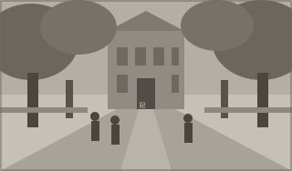

# 母校だより

母校からいただいた便りをもとに、この一年の動きをお伝えいたします。

## 欅並木の再整備が始まりました

正門から記念館へ続く欅並木のうち、樹勢の衰えが見られた四本について、本年度から順に手当てを行うことになりました。根を痛めぬよう舗装を一部土に戻し、若木を三本、並木の切れ目に補植する計画です。

工事は在校生の登下校に配慮し、長期休業の期間に分けて進められます。並木の姿が整うまでには十年ほどを要すると伺いました。急がず、次の世代へ渡していく仕事だと思います。

あわせて記念館一階の展示室も、秋の学園祭に合わせて模様替えを行います。往年の校章や制帽、歴代の会報を並べる予定と伺っております。

本会からは、若木の補植と展示の設えに要する費用の一部を、周年記念寄付より支出することといたしました。

# 奨学基金だより

本会の奨学基金は、会員の皆さまからのご寄付によって支えられております。令和五年度は十二名の在校生に給付を行いました。給付を受けた在校生の内訳は、家計の急変によるものが五名、下宿を要する遠隔地からの通学が四名、資格取得のための費用が三名でございます。

## 令和五年度　収支の概要

| 区分 | 項目                 | 金額（円） |
| ---- | -------------------- | ---------: |
| 収入 | 一般寄付（214件）    |  1,712,000 |
|      | 周年記念寄付（63件） |    945,000 |
|      | 支部拠出金（6支部）  |    480,000 |
|      | 前年度からの繰越     |  1,238,400 |
| 支出 | 給付奨学金（12名）   |  2,880,000 |
|      | 図書購入助成         |    300,000 |
|      | 事務費               |     96,300 |
|      | 次年度への繰越       |  1,099,100 |

ご寄付は同封の払込取扱票のほか、各支部の窓口でも受け付けております。ご芳名の掲載を希望されない場合は、その旨をお書き添えください。会計監査を経た決算の全文は、記念館の事務局にて閲覧いただけます。

二月十五日（土）には、記念館にて奨学生報告会を開きます。給付を受けた在校生が、この一年の学びについて話す場です。会員のどなたでもご参加いただけます。
