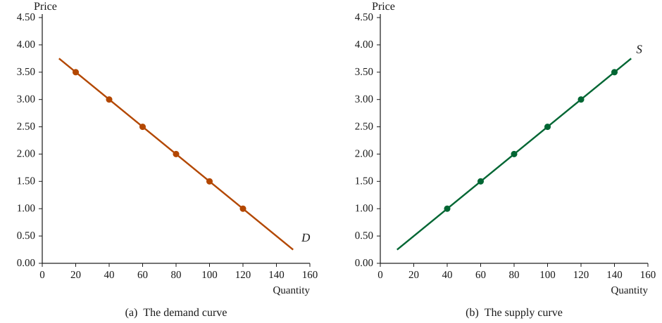
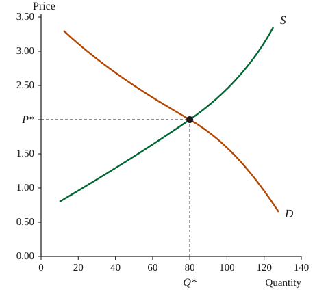
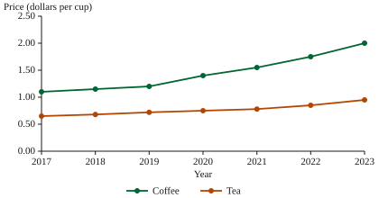
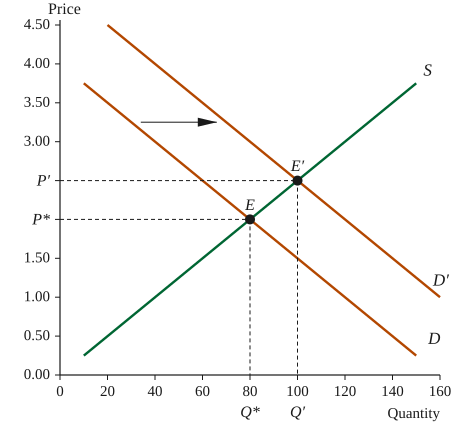
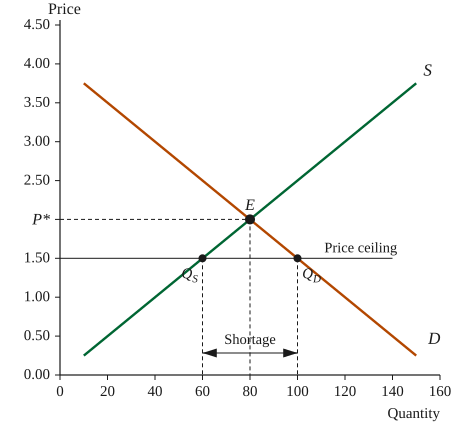
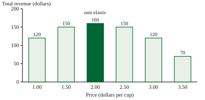

## Demand, Supply, and the Market {#sec-market}

Economics studies how a society allocates scarce resources among competing uses. In a market economy most of that allocation is carried out not by a planner but by prices, which emerge from the separate decisions of buyers and sellers who never meet. This chapter develops the standard apparatus for describing that process: demand, supply, equilibrium, and elasticity.

Throughout the chapter we follow a single market, the brewed coffee sold by the cafés of the Ardenport University district. The market is small enough to describe with a handful of numbers and competitive enough to satisfy our assumptions: there are many cafés and many customers, the product is close to uniform, and no participant sells enough to set the price alone. Quantities are measured in cups per day and prices in dollars per cup.

Buyers purchase less of a good when its price rises, provided nothing else changes. This regularity is called the law of demand. Two terms must be kept apart. The quantity demanded is a single number, the amount buyers would purchase at one particular price. Demand is the entire relationship between price and quantity demanded, the whole schedule rather than one entry in it. The qualification that nothing else changes, conventionally written ceteris paribus, does a great deal of work; &nbsp;examines what happens when the other conditions do change.

For the Ardenport market the demand relationship is well approximated by a straight line,

$$
Q_d = 160 - 40P
$$

where $P$ is the price in dollars per cup and $Q_d$ the number of cups buyers would purchase per day. The coefficient on $P$ records the strength of the response: each ten-cent increase in price costs the district's cafés four cups of daily sales.

Sellers, in contrast, offer more of a good when its price rises. Brewing additional cups requires longer hours, extra staff, and beans bought on less favorable terms, so the cost of the marginal cup increases with output, and a higher price is needed to make that cup worth brewing. This is the law of supply. In Ardenport the supply relationship is

$$
Q_s = 40P
$$

so that at \$1.00 per cup the cafés are willing to brew 40 cups a day, and at \$3.00 per cup they are willing to brew 120.

&nbsp;plots the two relationships. Panel&nbsp;(a) shows the demand curve, which slopes downward; panel&nbsp;(b) shows the supply curve, which slopes upward. The marked points are the entries of the underlying schedules, and each curve is drawn through them. Note the convention of the axes: price appears on the vertical axis even though it is the variable we hold in mind when we ask how much will be bought or sold.

{#fig-schedules}

Neither curve alone determines anything. Buyers would prefer a price of zero and sellers a price without limit; what actually happens depends on both sides of the market at once. The next section brings the two curves together.

## Market Equilibrium {#sec-equilibrium}

Markets are mechanisms through which buyers and sellers interact to determine the price of a good and the quantity that will be exchanged. Each participant enters the market with preferences and goals: buyers seek to obtain goods at the lowest possible price, while sellers seek to receive the highest possible price. The price that emerges in a market reflects the balance of these opposing interests.

Demand refers to the quantities of a good that buyers are willing and able to purchase at various prices during a given period. As the price of a good rises, the quantity demanded typically falls, ceteris paribus, because the good becomes more expensive relative to alternative uses of income. &nbsp;shows a demand schedule for coffee, illustrating this inverse relationship.

<figure class="tbl" id="tbl-demand">

| Price (dollars) | Quantity Demanded (cups) |
| --------------- | ------------------------ |
| 1.00            | 120                      |
| 1.50            | 100                      |
| 2.00            | 80                       |
| 2.50            | 60                       |
| 3.00            | 40                       |
| 3.50            | 20                       |

<figcaption>Demand Schedule for Coffee</figcaption>

</figure>

Supply refers to the quantities that sellers are willing and able to offer for sale at various prices during a given period. As the price of a good rises, the quantity supplied typically increases, ceteris paribus, because higher prices raise the potential profits from production. The interaction of supply and demand determines the market outcome.

Market equilibrium occurs at the price and quantity at which the quantity demanded equals the quantity supplied. At this point, there is no tendency for price to change because neither buyers nor sellers have an incentive to alter their behavior. Algebraically the equilibrium is the solution of

$$
160 - 40P = 40P \quad\Longrightarrow\quad P^* = 2.00, \; Q^* = 80 .
$$

&nbsp;illustrates the supply and demand curves for coffee. The demand curve slopes downward, indicating that consumers demand less coffee as price increases. The supply curve slopes upward, indicating that producers supply more coffee as price increases. The intersection of the two curves determines the market equilibrium.

{#fig-supply-demand}

In , the equilibrium price, $P^*$, is \$2.00 per cup, and the equilibrium quantity, $Q^*$, is 80 cups. At prices above \$2.00, the quantity supplied exceeds the quantity demanded, creating a surplus and putting downward pressure on price. At prices below \$2.00, the quantity demanded exceeds the quantity supplied, creating a shortage and putting upward pressure on price. These forces drive the market toward the equilibrium point.

At equilibrium, the interests of buyers and sellers are aligned. Buyers obtain the quantity they desire at the prevailing price, and sellers sell the quantity they are willing to produce. Although individual participants may prefer a different price, no single participant can change the market price on their own.

Equilibrium is not necessarily a static concept. Shifts in either supply or demand will lead to a new equilibrium (see ). Understanding how markets adjust to changes is essential for analyzing real-world outcomes.

The chart shows average retail prices for coffee and tea in the Ardenport district from 2017 to 2023. Prices for both beverages have trended upward over this period, with coffee prices rising more rapidly.

Markets are characterized by constant interaction. Information about prices, preferences, technology, and resources is transmitted through the market, guiding decisions. As conditions change, markets adjust, leading to new equilibria. This dynamic process helps allocate resources efficiently in a market economy.

In the next section, we examine how shifts in the demand or supply curves affect equilibrium price and quantity.

## Shifts in Demand and Supply {#sec-shifts}

The analysis of &nbsp;held constant everything except the price of coffee. That assumption is what allows a single curve to be drawn at all. When one of the constant conditions changes, the curve itself moves, and the equilibrium moves with it.

The distinction deserves restating. A change in the price of coffee produces a movement along the demand curve, from one point on it to another; the curve itself does not move. A change in anything else that matters to buyers shifts the whole curve to a new position. The first is a change in quantity demanded, the second a change in demand.

Five conditions are conventionally listed as the determinants of demand: the incomes of buyers; the prices of related goods, whether substitutes such as tea or complements such as pastries; tastes; expectations about future prices; and the number of buyers in the market.

Suppose the university expands its evening programs and the number of customers in the district rises. At every price buyers now want 40 more cups per day than before, so the demand relationship becomes

$$
Q_d' = 200 - 40P
$$

while supply is unchanged. &nbsp;sets the two demand schedules beside the supply schedule.

<figure class="tbl wide" id="tbl-schedules">

| Price (dollars) | Quantity Demanded, Before | Quantity Demanded, After | Quantity Supplied | Excess Demand, After |
| --------------- | ------------------------- | ------------------------ | ----------------- | -------------------- |
| 1.00            | 120                       | 160                      | 40                | 120                  |
| 1.50            | 100                       | 140                      | 60                | 80                   |
| 2.00            | 80                        | 120                      | 80                | 40                   |
| 2.50            | 60                        | 100                      | 100               | 0                    |
| 3.00            | 40                        | 80                       | 120               | −40                  |
| 3.50            | 20                        | 60                       | 140               | −80                  |

<figcaption>Market Schedules Before and After an Increase in Demand</figcaption>

</figure>

{#fig-demand-shift}

Setting the new demand equal to supply gives the new equilibrium,

$$
200 - 40P = 40P \quad\Longrightarrow\quad P' = 2.50, \; Q' = 100 .
$$

which is the point at which the last column of &nbsp;changes sign. &nbsp;shows the same result graphically: the demand curve shifts to the right, from $D$ to $D'$, and the equilibrium travels up the unchanged supply curve from $E$ to $E'$.

The adjustment is worth following step by step. At the old price of \$2.00 buyers now want 120 cups while sellers still offer 80, so 40 cups of excess demand appear. Disappointed buyers bid the price up; the rising price both discourages some of them and draws out additional supply, and the gap closes only when the price has reached \$2.50 and the quantity traded has risen to 100 cups.

Supply shifts work the same way from the other side of the market. The determinants of supply include the prices of inputs, such as the wholesale price of green beans, wages, and rent; the state of technology; the prices of other goods the same sellers could produce; expectations; and the number of sellers. A fall in the wholesale price of beans shifts the supply curve to the right, and the equilibrium price falls while the equilibrium quantity rises.

Two results are worth memorizing. An increase in demand raises both the equilibrium price and the equilibrium quantity; an increase in supply lowers the price and raises the quantity. When both curves shift at once, one of the two changes is generally ambiguous, and which way it goes depends on the relative sizes of the shifts.

## Price Controls {#sec-controls}

Governments sometimes decide that an equilibrium price is too high or too low and legislate a different one. A price ceiling is a legal maximum, a price floor a legal minimum. A ceiling set above the equilibrium price, or a floor set below it, changes nothing, because the market outcome already obeys the law. Only binding controls are interesting.

Suppose the Ardenport council, concerned that students cannot afford their morning coffee, caps the price at \$1.50 per cup. At that price buyers want

$$
Q_d = 160 - 40 \times 1.50 = 100
$$

cups per day, while sellers are willing to brew only

$$
Q_s = 40 \times 1.50 = 60 .
$$

A shortage of 40 cups per day is the result, and it does not go away. &nbsp;draws the ceiling as a horizontal line below the equilibrium price; the horizontal distance between the two curves measured along that line is the shortage.

{#fig-price-ceiling}

The lower the ceiling, the wider the gap, as &nbsp;shows. A ceiling at the equilibrium price itself leaves the market undisturbed; every ceiling below it creates a shortage that grows as the control tightens.

<figure class="tbl" id="tbl-ceilings">

| Ceiling (dollars) | Demanded | Supplied | Shortage |
| ----------------- | -------- | -------- | -------- |
| 1.00              | 120      | 40       | 80       |
| 1.50              | 100      | 60       | 40       |
| 2.00              | 80       | 80       | 0        |

<figcaption>Shortages under Alternative Price Ceilings</figcaption>

</figure>

Because the price is no longer permitted to ration the good, something else must. Queues form, cafés sell out before the morning is over, portions shrink, quality slips, and regular customers are served ahead of strangers. Each of these is a genuine cost borne by buyers, and none of them appears on the posted price. The control lowers what buyers pay in money, but not necessarily what they pay in all.

Price floors produce the mirror image. A minimum price above equilibrium leaves sellers offering more than buyers will take, and the resulting surplus must be stored, exported, destroyed, or bought up by the authority that imposed the floor. Minimum prices for agricultural products and minimum wages in labor markets are the standard examples.

The general lesson is that a control fixes a price but not a quantity. The quantity actually traded is the smaller of the quantity demanded and the quantity supplied at the controlled price, which is why both ceilings and floors reduce the volume of trade below its equilibrium level.

## The Price Elasticity of Demand {#sec-elasticity}

Knowing that quantity demanded falls when price rises is not enough for most practical questions. A café raising its price wants to know by how much its sales will fall, and whether the extra revenue per cup will more than make up for the cups it no longer sells. The price elasticity of demand answers both questions.

Elasticity is the ratio of the percentage change in quantity demanded to the percentage change in price, taken in absolute value. Percentages computed from a starting point give different answers depending on the direction of travel, so we use the midpoint formula, which divides each change by the average of the two endpoints:

$$
E_d = \left| \frac{\Delta Q}{\Delta P} \right| \cdot \frac{P_1 + P_2}{Q_1 + Q_2} .
$$

Between \$2.00 and \$2.50 the quantity demanded falls from 80 cups to 60, so

$$
E_d = \frac{20}{0.50} \cdot \frac{4.50}{140} = 1.29 .
$$

Demand is called elastic when $E_d > 1$, inelastic when $E_d < 1$, and unit elastic when $E_d = 1$. &nbsp;reports the elasticity over each interval of the schedule of .

<figure class="tbl" id="tbl-elasticity">

| Price Range (dollars) | Elasticity | Demand Is |
| --------------------- | ---------- | --------- |
| 1.00–1.50             | 0.45       | inelastic |
| 1.50–2.00             | 0.78       | inelastic |
| 2.00–2.50             | 1.29       | elastic   |
| 2.50–3.00             | 2.20       | elastic   |
| 3.00–3.50             | 4.33       | elastic   |

<figcaption>Elasticity along the Demand Curve</figcaption>

</figure>

Elasticity is not a property of the curve as a whole. Along a straight-line demand curve the slope never changes, yet the elasticity falls steadily as one moves down the curve, because elasticity depends on the ratio $P/Q$ as well as on the slope, and that ratio falls as price falls and quantity rises. The upper reaches of a linear demand curve are elastic, the lower reaches inelastic.

The link to revenue is what makes the measure worth computing. Total revenue is price times quantity,

$$
\mathrm{TR} = P \times Q_d = P \,(160 - 40P),
$$

so a price increase pulls revenue in two directions at once. When demand is inelastic the quantity effect is the weaker of the two and revenue rises with price; when demand is elastic the quantity effect dominates and revenue falls. Revenue therefore reaches its maximum where demand is unit elastic, as &nbsp;shows for the Ardenport schedule.

{#fig-total-revenue}

At $P = 2.00$ and $Q = 80$, the midpoint of this demand curve, the point elasticity is

$$
E_d = \left| \frac{dQ_d}{dP} \right| \frac{P}{Q} = 40 \times \frac{2.00}{80} = 1.00,
$$

and total revenue attains its maximum of \$160 per day. A café already charging \$2.00 gains nothing from a price change in either direction; one charging \$3.00 faces elastic demand and would raise its revenue by cutting the price.

Four considerations govern how elastic a demand curve is. Goods with close substitutes are elastic, because buyers can leave; a single café's coffee is far more elastic than coffee as a whole. Goods that take a large share of the budget are elastic, since buyers notice the price. Necessities are inelastic and luxuries elastic. Finally, demand is more elastic over long periods than short ones, because habits, equipment, and suppliers can all be changed given time.

The apparatus assembled in this chapter takes the demand and supply curves as given and asks what follows from them. The next chapter asks where the demand curve itself comes from, by examining how a household with a limited budget chooses among the goods available to it.

## Summary {.closing}

- A competitive market is described by a demand relationship and a supply relationship. Demand slopes downward and supply upward, both stated ceteris paribus.
- Equilibrium is the price at which quantity demanded equals quantity supplied. Above it a surplus pushes the price down; below it a shortage pushes the price up.
- A change in the price of the good moves the market along a curve. A change in any other relevant condition shifts the curve and establishes a new equilibrium.
- Binding price ceilings create shortages and binding price floors create surpluses. Both reduce the quantity traded and force non-price rationing.
- The price elasticity of demand measures the responsiveness of quantity to price. Revenue rises with price when demand is inelastic, falls when demand is elastic, and peaks where demand is unit elastic.

## Key Terms {.closing}

- **market** an arrangement that brings buyers and sellers of a good into contact
- **quantity demanded** the amount buyers would purchase at one particular price
- **demand** the whole relationship between price and quantity demanded
- **law of demand** the proposition that quantity demanded falls as price rises, ceteris paribus
- **law of supply** the proposition that quantity supplied rises as price rises, ceteris paribus
- **equilibrium** the price and quantity at which quantity demanded equals quantity supplied
- **surplus** the excess of quantity supplied over quantity demanded at a given price
- **shortage** the excess of quantity demanded over quantity supplied at a given price
- **price ceiling** a legal maximum price
- **price floor** a legal minimum price
- **price elasticity of demand** the percentage change in quantity demanded divided by the percentage change in price, in absolute value
- **total revenue** price multiplied by the quantity sold

## Review Questions {.closing}

1. Explain why a surplus pushes the market price down and a shortage pushes it up. In each case, identify which side of the market takes the initiative.
2. Distinguish a change in quantity demanded from a change in demand, and give one example of each for the Ardenport coffee market.
3. Using the schedules of , verify that the new equilibrium price is \$2.50. What is the excess demand at the old price of \$2.00?
4. Suppose an improvement in roasting technology raises the quantity supplied by 40 cups at every price, while demand remains $Q_d = 160 - 40P$. Find the new equilibrium price and quantity, and state the direction in which each has moved.
5. The council replaces its ceiling of \$1.50 with a ceiling of \$1.00. Compute the new shortage and explain why tightening the control widens the gap.
6. Compute the midpoint elasticity of demand between \$1.00 and \$2.00 using the schedule of , and state whether a café charging \$1.00 could raise its revenue by raising the price.
7. A café observes that a ten percent price increase reduces its sales by twenty percent, while the same increase applied by every café in the district reduces total sales by four percent. Explain the difference.

## Problems {.closing}

1. The demand for pastries at the same cafés is $Q_d = 90 - 30P$ and the supply is $Q_s = 20P$. Find the equilibrium price and quantity.
2. In the market of Problem 1, compute the quantity demanded and the quantity supplied at a price of \$2.50, and report the resulting surplus or shortage.
3. Return to the coffee market of this chapter. A tax on roasters reduces the quantity supplied by 20 cups at every price, so that $Q_s = 40P - 20$. Find the new equilibrium price and quantity, and state how far the quantity traded has fallen.
4. Compute total revenue in the coffee market at prices of \$1.00, \$2.00, and \$3.00. Use the three figures to decide whether demand is elastic or inelastic between \$1.00 and \$2.00, and between \$2.00 and \$3.00.
5. A single café finds that cutting its price from \$2.50 to \$2.00 raises its own daily sales from 40 cups to 56. Compute the midpoint elasticity of the demand facing this café and compare it with the elasticity of market demand over the same range, given in .
6. The council sets a price floor of \$3.00 per cup. Compute the quantity demanded, the quantity supplied, and the surplus, and state how many cups are actually traded.

