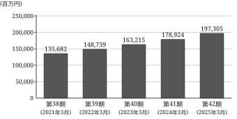
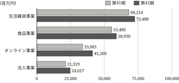
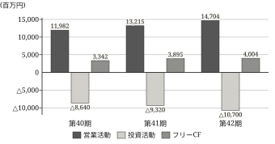

# 事業の状況

## 経営方針、経営環境及び対処すべき課題等

### 会社の経営の基本方針

当社グループ（当社及び当社の関係会社）は、「社会に必要とされる価値を創造し、持続的な成長を通じて豊かな未来の実現に貢献する」を経営理念として掲げております。

この理念のもと、株式会社アオバホールディングスは、グループ各社の経営を統括し、経営資源の最適配分とシナジーの最大化を図ることで、株主価値の向上を目指してまいります。

当社グループは、持続的な成長と中長期的な企業価値の向上を実現するため、以下の基本方針に基づく経営を推進してまいります。

第一に、顧客価値の創造を経営の原点とし、常にお客様の視点に立った製品・サービスの提供を通じて、社会的課題の解決と豊かな生活の実現に貢献してまいります。

第二に、イノベーションの促進を成長の原動力とし、技術開発や業務プロセスの革新を積極的に推進することで、競争優位性の確立と新たな事業領域の開拓に取り組んでまいります。

第三に、健全で透明性の高い経営を徹底し、コーポレート・ガバナンスの強化、コンプライアンスの徹底及びリスク管理の充実を図ることで、社会からの信頼に応えてまいります。

第四に、多様な人材の活躍を支援し、安全で働きやすい職場環境を整備することで、従業員の成長と企業の持続的な発展を両立してまいります。

第五に、環境保全への取組みを経営の重要課題と位置づけ、気候変動対策や資源の有効活用を推進し、持続可能な社会の実現に貢献してまいります。

また、当社グループは、持株会社制のもとで各事業会社に事業運営の権限を委譲する一方、資本の配分、人材の配置及びリスク管理については当社が統括する体制とし、意思決定の迅速性と統制の実効性の両立を図ってまいります。

当社グループは、これらの基本方針をグループ全体で共有し、ステークホルダーの皆様との対話を重視しながら、持続的な成長と企業価値の向上に努めてまいります。

<figure class="tbl tbl-highlights" id="tbl-highlights">

<figcaption>主要な連結経営指標等の推移</figcaption>

| 回次                                               | 第38期          | 第39期          | 第40期          | 第41期          | 第42期          |
| -------------------------------------------------- | --------------- | --------------- | --------------- | --------------- | --------------- |
| 決算年月                                           | 2021年 3月 | 2022年 3月 | 2023年 3月 | 2024年 3月 | 2025年 3月 |
| 売上高 (百万円)                               | 135,682         | 148,739         | 163,215         | 178,924         | 197,305         |
| 経常利益 (百万円)                             | 11,256          | 12,347          | 13,892          | 15,478          | 16,842          |
| 親会社株主に帰属 する当期純利益 (百万円) | 7,305           | 8,102           | 9,134           | 10,274          | 11,372          |
| 純資産額 (百万円)                             | 74,321          | 81,026          | 89,142          | 98,567          | 109,345         |
| 総資産額 (百万円)                             | 152,847         | 166,980         | 182,541         | 199,876         | 219,548         |
| 1株当たり 当期純利益 (円)                | 164.21          | 182.36          | 204.95          | 229.80          | 254.25          |

</figure>

1. 記載金額は、百万円未満を切り捨てて表示しております。
2. 1株当たり当期純利益は、期中平均株式数に基づき算出しております。
3. 当社は、2022年10月1日付で普通株式1株につき2株の割合で株式分割を行っております。第38期の期首に当該株式分割が行われたと仮定して、1株当たり当期純利益を算定しております。
4. 潜在株式調整後1株当たり当期純利益については、潜在株式が存在しないため記載しておりません。なお、算定に用いた期中平均株式数は、自己株式の取得及び処分により各回次で異なっております。

### 経営環境

わが国経済は、緩やかな回復基調が続いているものの、海外経済の不確実性や原材料価格の高騰、円安の進行、さらには人手不足の深刻化など、先行き不透明な状況が継続しております。

当社グループが事業を展開する各市場においては、デジタル化の進展、脱炭素社会の実現に向けた取組みの加速、消費者ニーズの多様化など、構造的な変化が進行しており、企業には迅速な対応と継続的な変革が求められております。

特に、当社グループの主要な市場である国内小売市場においては、生活防衛意識の高まりを背景に価格訴求力の高い商品への需要が強まる一方、環境配慮や利便性に対する付加価値需要も拡大しており、市場の二極化が進行しております。

このような環境のもと、当社グループは、中長期的な成長機会を確実に捉えるとともに、リスクの適切な管理を行い、持続的な企業価値の向上に取り組んでまいります。

### 対処すべき課題

当社グループは、経営環境の変化を踏まえ、以下の課題に重点的に取り組んでまいります。

#### 成長戦略の推進

中核事業の拡大とともに、新規事業の創出や海外展開の加速を図り、持続的な成長を実現してまいります。

#### 生産性の向上と効率化

デジタル技術の活用や業務プロセスの見直しを進め、収益性の向上と競争力の強化に努めてまいります。

#### 人材の確保と育成

多様な人材の確保と育成を強化し、従業員一人ひとりが能力を最大限に発揮できる組織づくりを推進してまいります。

#### サステナビリティの推進

環境・社会・ガバナンスの各側面における取組みを強化し、持続可能な社会の実現と企業価値の向上を両立してまいります。

<figure class="chart" id="fig-sales">
<figcaption>連結売上高の推移</figcaption>

</figure>

### 経営上の目標の達成状況を判断するための客観的な指標等

当社グループは、中期経営計画「AOBA NEXT 2028」において、第45期（2028年3月期）を最終年度とする経営目標として、売上高250,000百万円、営業利益25,000百万円（営業利益率10.0%）及び自己資本利益率（ROE）12.0%以上を掲げております。

当連結会計年度における実績は、売上高197,305百万円、営業利益16,412百万円（営業利益率8.3%）、自己資本利益率11.5%となり、計画の進捗はおおむね順調に推移しております。

営業利益率の改善に向けては、オンライン事業の売上構成比の引上げ、生産拠点の再編による原価低減及び間接業務の標準化による販売費及び一般管理費の抑制を、引き続き重点的に進めてまいります。

1. 上記の経営目標は、本報告書提出日現在において入手可能な情報に基づき当社グループが判断したものであり、実際の業績等は様々な要因により異なる結果となる可能性があります。
2. 営業利益率は、営業利益を売上高で除して算出しております。
3. 自己資本利益率は、親会社株主に帰属する当期純利益を期首及び期末の自己資本の平均額で除して算出しております。

## サステナビリティに関する考え方及び取組

当社グループのサステナビリティに関する考え方及び取組は、次のとおりであります。なお、文中の将来に関する事項は、当連結会計年度末現在において当社グループが判断したものであります。

### ガバナンス

当社グループは、サステナビリティを巡る課題への対応を重要な経営課題と位置づけ、代表取締役社長を委員長とし、各事業会社の社長及び本社主要部門の担当役員を委員とするサステナビリティ委員会を設置しております。

同委員会は、原則として四半期に一度開催し、気候変動、人的資本、人権の尊重、サプライチェーン管理並びに製品の品質及び安全に関する方針の策定、目標の設定及び進捗の管理を行っております。

同委員会において審議された事項のうち重要なものは、速やかに取締役会へ報告され、取締役会がその執行状況を監督する体制としております。当連結会計年度においては、同委員会を4回開催し、取締役会に対して2回の報告を行っております。

また、事業会社ごとにサステナビリティ推進責任者を配置し、グループ全体の方針を各社の事業計画へ落とし込むとともに、その実施状況を四半期ごとに同委員会へ報告する運用としております。

### 戦略

#### 気候変動への対応

当社グループは、気候変動が事業活動に及ぼす影響を把握するため、TCFD提言の枠組みに基づくシナリオ分析を実施しております。

分析にあたっては、1.5℃シナリオ及び4℃シナリオを用い、2031年3月期を想定時点として、移行リスク、物理的リスク及び機会を特定したうえで、財務影響の程度を定性的に評価しております。

移行リスクとしては、炭素価格の導入等による原材料費及び物流費用の上昇並びに環境配慮型製品への需要シフトへの対応の遅れを、物理的リスクとしては、大規模な風水害による生産拠点の被災及び物流網の寸断を、それぞれ重要なものとして認識しております。

一方、機会としては、省資源型製品及び再生素材を用いた製品に対する需要の拡大並びに輸配送の共同化による燃料使用量及び費用の低減を見込んでおります。

これらの評価を踏まえ、当社グループは、生産拠点における再生可能エネルギー電力への切替え、物流拠点の再編と積載効率の改善及び製品設計段階からの環境配慮の織込みを進めております。

#### 人的資本に関する方針及び社内環境整備に関する方針

当社グループは、多様な人材の確保と育成が中長期的な競争力の源泉であるとの認識のもと、人材育成方針及び社内環境整備方針を定め、グループ全体で共有しております。

人材育成については、階層別研修に加え、デジタル技術に関する社内認定制度及び公募型の異動制度を運用し、専門性と幅広い職務経験を併せ持つ人材の計画的な育成に取り組んでおります。

当連結会計年度においては、事業会社の枠を越えた配置転換を78名について実施したほか、社内認定制度の初級課程を1,246名が修了しております。

社内環境整備については、勤務地及び勤務時間の選択肢の拡充、育児及び介護と就業との両立支援並びに健康経営の推進を柱とし、従業員が能力を最大限に発揮できる環境の整備を進めております。

加えて、年1回の従業員エンゲージメント調査を実施し、その結果を事業会社ごとの改善計画へ反映させることで、施策の実効性を高めております。

#### サプライチェーンにおける人権の尊重

当社グループは、人権方針に基づき、原材料の調達から製造及び販売に至るサプライチェーン全体において、人権への負の影響を防止し、又は軽減することを基本方針としております。

主要な取引先に対しては、労働環境、安全衛生及び環境負荷に関する調査票による自己評価を毎年依頼し、回答内容に応じて個別の改善対話を実施しております。

当連結会計年度における調査票の回収率は92.4%であり、改善対話を実施した取引先は14社であります。

### リスク管理

当社グループは、サステナビリティを巡るリスクについて、全社的なリスク管理体制の一部として識別、評価及び管理を行っております。

各事業会社は、事業環境の変化を踏まえて年1回リスクの洗い出しを行い、発生可能性と影響度の二軸により評価したうえで、重要と判断されるリスクをリスク管理委員会へ報告しております。

リスク管理委員会は、内部統制及びコンプライアンスを所管する部門を事務局とし、四半期に一度、グループ全体のリスクの状況を取りまとめて取締役会へ報告しております。

このうちサステナビリティに関連するリスクについては、サステナビリティ委員会において対応方針及び目標を審議し、その進捗を四半期ごとに確認しております。

気候変動に関しては、シナリオ分析により特定した移行リスク及び物理的リスクを既存のリスク管理プロセスへ統合し、他の事業リスクと同一の基準により優先順位づけを行っております。

### 指標及び目標

当社グループは、前記「(2)　戦略」に記載した方針に関し、次の指標を設定し、その達成に向けた取組みを進めております。これらの指標は、事業会社ごとの実績値を本社において集計したものであります。

<figure class="tbl tbl-esg" id="tbl-esg">

<figcaption>サステナビリティに関する主要な指標</figcaption>

| 指標                                       | 第41期  | 第42期  | 目標                       |
| ------------------------------------------ | ------- | ------- | -------------------------- |
| 温室効果ガス排出量 (Scope1・2、t-CO2) | 128,400 | 119,600 | 2021年3月期比 50%削減 |
| 再生可能エネルギー 電力比率(%)        | 24.6    | 31.8    | 60.0以上                   |
| 女性管理職比率(%)                          | 12.4    | 14.1    | 20.0以上                   |
| 男性の育児休業 取得率(%)              | 46.2    | 61.5    | 85.0以上                   |
| 廃棄物リサイクル率(%)                      | 78.4    | 82.1    | 95.0以上                   |

</figure>

1. 温室効果ガス排出量は、当社及び連結子会社を対象とし、Scope1及びScope2（マーケット基準）の合計値であります。
2. 女性管理職比率及び男性の育児休業取得率は、当社及び国内連結子会社を対象として算出しております。
3. 目標は、いずれも2031年3月期を達成時点として設定しております。

当連結会計年度における温室効果ガス排出量は119,600t-CO2となり、前連結会計年度に比べ6.9%減少し、基準年である2021年3月期の152,300t-CO2に対して21.5%の削減となりました。

再生可能エネルギー電力比率は31.8%となり、主要な生産拠点3か所における電力調達契約の切替え及び自家消費型太陽光発電設備の導入により、前連結会計年度に比べ7.2ポイント上昇いたしました。翌連結会計年度以降は、物流拠点及び店舗への導入を順次進める予定であります。

廃棄物リサイクル率は82.1%となりました。食品事業における製造工程由来の副産物の飼料化及び生活雑貨事業における包装資材の見直しが寄与しております。一方、複合素材を用いた製品の廃材については再資源化の手段が限られており、素材構成の単純化を設計段階からの課題として認識しております。

女性管理職比率は14.1%となり、前連結会計年度に比べ1.7ポイント上昇いたしましたが、2031年3月期の目標である20.0%に対しては、なお相応の隔たりがあると認識しております。このため、管理職候補者を対象とした育成プログラムの対象範囲を拡大するとともに、選抜及び登用の過程における透明性の確保に引き続き取り組んでまいります。

男性の育児休業取得率は61.5%となりました。取得期間の下限を設定した社内制度の見直し及び管理職を対象とした説明会の実施が寄与しております。

## 事業等のリスク

有価証券報告書に記載した事業の状況、経理の状況等に関する事項のうち、投資者の判断に重要な影響を及ぼす可能性があると当社グループが認識している主要なリスクは、次のとおりであります。

これらのリスクは、各事業会社が年1回実施するリスクの洗い出しの結果を、発生可能性と影響度の二軸により評価したうえで、リスク管理委員会及び取締役会における審議を経て特定したものであります。

当社グループは、これらのリスクの発生可能性を認識したうえで、その発生の回避及び発生した場合の影響の低減に努めております。なお、文中の将来に関する事項は、当連結会計年度末現在において当社グループが判断したものであります。

### 経済環境及び消費動向の変化

当社グループの売上高の大部分は国内市場に依存しており、景気の後退、実質所得の減少又は消費者の選好の変化により需要が縮小した場合には、当社グループの業績及び財政状態に影響を及ぼす可能性があります。

特に生活雑貨事業及び食品事業においては、価格訴求型の商品へ需要が集中した場合、販売数量を確保できたとしても売上総利益率が低下する可能性があります。

当社グループは、消費動向の把握と商品構成の機動的な見直しにより影響の低減に努めておりますが、これらの対応が奏功しない可能性があります。

なお、当社グループの売上高のうち海外向けの売上高が占める割合は僅少であり、国内市場の動向が業績に直接的な影響を及ぼす構造となっております。

### 原材料価格及び調達の変動

当社グループが取り扱う製品の製造には、樹脂、紙、金属及び農水産物等の原材料を使用しており、これらの市況、為替相場又は物流費用の変動は製造原価に影響を及ぼします。

原材料価格の上昇分を販売価格へ適時に転嫁できない場合、又は転嫁により販売数量が減少した場合には、当社グループの業績に影響を及ぼす可能性があります。

また、特定の原材料については供給元が限定されており、供給元における事故、災害又は事業方針の変更等により調達が困難となった場合には、生産及び販売に支障が生じる可能性があります。

当社グループは、主要な原材料について複数の調達先の確保を進めるとともに、価格変動の大きい品目については一定期間の数量及び価格を定めた契約を締結することにより、影響の低減に努めております。

### 海外における事業活動

当社グループは、生活雑貨事業を中心にアジア地域からの製品調達を行っており、当該地域における政治情勢の不安定化、法令及び規制の変更、労働争議又は感染症の流行等が生じた場合には、調達費用の上昇又は納期の遅延が生じる可能性があります。

また、外貨建取引の割合が高まった場合には、為替相場の変動が当社グループの業績に影響を及ぼす可能性があります。当社グループは、外貨建ての予定取引の一部について為替予約を利用しておりますが、その全てを対象とするものではありません。

当社グループは、調達地域の分散及び国内調達への一部切替えを進めておりますが、品質及び価格の条件を満たす調達先の確保には相応の期間を要します。

### 情報セキュリティ

当社グループは、オンライン事業を中心に、顧客情報を含む多数の個人情報を取り扱っております。

サイバー攻撃、不正アクセス、コンピュータウイルスの感染又は従業員の過失等により、情報の漏えい、改ざん又はシステムの停止が生じた場合には、損害賠償、信用の毀損及び事業の中断により、当社グループの業績及び財政状態に影響を及ぼす可能性があります。

当社グループは、多層的な防御措置の導入、監視体制の整備及び従業員に対する定期的な教育を実施しておりますが、これらの措置により全ての事象を防止できる保証はありません。

また、基幹システム及び受注システムについては外部の事業者が提供する役務に依存しており、当該事業者における障害が長期にわたる場合には、受注及び出荷の業務に支障が生じる可能性があります。

### 人材の確保及び育成

当社グループの事業活動は、商品開発、店舗運営、物流及びシステム開発の各分野における専門人材に支えられております。

労働需給の逼迫により必要な人材を計画どおりに確保できない場合、又は人件費が想定を超えて上昇した場合には、事業計画の進捗及び収益性に影響を及ぼす可能性があります。

当社グループは、処遇制度の見直し、勤務形態の柔軟化及び社内公募による配置の最適化を進めておりますが、これらの施策が採用及び定着に十分な効果をもたらさない可能性があります。

### 自然災害及び事故等

大規模な地震、風水害、火災又は感染症の流行等により、生産拠点、物流拠点若しくは店舗が被災し、又は事業活動の継続が困難となった場合には、当社グループの業績及び財政状態に影響を及ぼす可能性があります。

当社グループは、事業継続計画の策定、拠点の分散及び定期的な訓練の実施により影響の低減に努めておりますが、想定を超える事象が発生した場合には、その影響を完全に回避できない可能性があります。

### 法的規制等

当社グループは、事業活動を行う各国及び地域において、製品の安全、食品衛生、環境、労働、個人情報の保護、競争及び税制等に関する法令上の規制を受けております。

これらの規制の新設又は改廃により、追加的な費用の発生、事業活動の制限又は対応の遅延が生じた場合には、当社グループの業績及び財政状態に影響を及ぼす可能性があります。

また、法令違反その他の不適切な事象が発生した場合には、行政処分又は社会的信用の低下により、当社グループの事業活動が制約を受ける可能性があります。

### のれん及び固定資産の減損

当社グループは、事業の拡大にあたり企業買収を実施しており、当連結会計年度末におけるのれんの残高は12,486百万円であります。

買収した事業の収益性が当初の想定を下回った場合、又は事業環境が著しく悪化した場合には、のれん及び固定資産について減損損失を計上し、当社グループの業績及び財政状態に影響を及ぼす可能性があります。

なお、当連結会計年度においては、収益性が低下した一部の店舗資産について、減損損失425百万円を計上しております。

### 訴訟等

当社グループは、事業活動に関連して、製造物責任、知的財産権又は労働問題等に係る訴訟その他の法的手続の対象となる可能性があります。

重要な訴訟等が提起され、当社グループにとって不利な結果となった場合には、当社グループの業績及び財政状態に影響を及ぼす可能性があります。

なお、当連結会計年度末において、当社グループの業績に重要な影響を及ぼす訴訟等は係属しておりません。

### 特定の販売先への依存

当連結会計年度における当社グループの売上高のうち、上位2社に対する販売の割合は合計で19.0%であります。

これらの販売先の購買方針の変更、経営環境の悪化又は取引条件の見直しが生じた場合には、当社グループの業績に影響を及ぼす可能性があります。

当社グループは、オンライン事業における直接販売の拡大等により販売経路の分散を進めておりますが、短期間で依存度を大きく引き下げることは困難であります。

### 製品の品質及び安全

当社グループは、品質管理規程に基づき、原材料の受入れから出荷に至る各工程において検査を実施しております。

しかしながら、予期し得ない事由により製品の欠陥又は表示の誤りが生じ、大規模な回収又は製造物責任の追及に至った場合には、当社グループの業績及び信用に影響を及ぼす可能性があります。

## 経営者による財政状態、経営成績及びキャッシュ・フローの状況の分析

当連結会計年度における当社グループの財政状態、経営成績及びキャッシュ・フロー（以下「経営成績等」という。）の状況の概要並びに経営者の視点による当該状況に関する分析・検討内容は、次のとおりであります。なお、文中の将来に関する事項は、当連結会計年度末現在において判断したものであります。

### 経営成績等の状況の概要

#### 経営成績の状況 {#sec-results}

当連結会計年度における当社グループの売上高は197,305百万円（前連結会計年度比10.3%増）となりました。オンライン事業における会員基盤の拡大及び法人事業の受注増加が牽引したことに加え、生活雑貨事業及び食品事業においても価格改定の浸透により増収となりました。

売上原価は137,562百万円（同9.8%増）となり、売上総利益は59,743百万円（同11.3%増）となりました。売上高総利益率は30.3%となり、前連結会計年度から0.3ポイント改善しております。

販売費及び一般管理費は43,331百万円（同11.5%増）となりました。物流費及び人件費の増加に加え、オンライン事業における広告宣伝費の積み増しが主な要因であります。

この結果、営業利益は16,412百万円（同10.9%増）、経常利益は16,842百万円（同8.8%増）、親会社株主に帰属する当期純利益は11,372百万円（同10.7%増）となり、いずれも過去最高となりました。

経常利益の増加率が営業利益の増加率を下回りましたのは、前連結会計年度に計上した為替差益が減少したことによるものであります。

なお、特別利益として固定資産売却益312百万円を、特別損失として減損損失425百万円及び固定資産除却損259百万円をそれぞれ計上した結果、税金等調整前当期純利益は16,470百万円となりました。法人税等合計4,562百万円を控除した当期純利益は11,908百万円であり、このうち非支配株主に帰属する当期純利益は536百万円であります。

<figure class="tbl tbl-4 tbl-total" id="tbl-segment-sales">

<figcaption>セグメント別売上高</figcaption>

| 区分           | 第41期  | 第42期  | 前期比  |
| -------------- | ------- | ------- | ------- |
| 生活雑貨事業   | 68,214  | 72,480  | 6.3%増  |
| 食品事業       | 55,486  | 58,930  | 6.2%増  |
| オンライン事業 | 33,905  | 41,268  | 21.7%増 |
| 法人事業       | 21,319  | 24,627  | 15.5%増 |
| 合計           | 178,924 | 197,305 | 10.3%増 |

</figure>

<figure class="tbl tbl-4 tbl-total" id="tbl-segment-profit">

<figcaption>セグメント別セグメント利益</figcaption>

| 区分           | 第41期 | 第42期 | 前期比  |
| -------------- | ------ | ------ | ------- |
| 生活雑貨事業   | 6,438  | 6,842  | 6.3%増  |
| 食品事業       | 4,306  | 4,517  | 4.9%増  |
| オンライン事業 | 4,182  | 5,264  | 25.9%増 |
| 法人事業       | 1,905  | 2,105  | 10.5%増 |
| 計             | 16,831 | 18,728 | 11.3%増 |
| 調整額         | △2,029 | △2,316 | －      |
| 営業利益       | 14,802 | 16,412 | 10.9%増 |

</figure>

1. 金額の単位は百万円であり、百万円未満を切り捨てて表示しております。
2. セグメント間の内部売上高又は振替高はありません。
3. 調整額は、各報告セグメントに配分していない全社費用であり、主に持株会社である当社の管理部門に係る費用であります。

#### セグメントごとの状況

（生活雑貨事業）

生活雑貨事業におきましては、連結子会社であるアオバリビング株式会社を中心に、収納用品及び調理器具の主力シリーズを刷新し、あわせて価格改定を実施いたしました。

量販店向けの棚割獲得が進んだ一方、下期には競合他社の価格施策の影響を受け、販売数量の伸びは想定をやや下回りました。

また、生産拠点の統合に伴う一時的な費用を計上したものの、再生樹脂の採用拡大による原材料費の抑制がこれを吸収しております。一方、主力シリーズの刷新に伴う旧品番の在庫処分を上期に実施したことは、売上総利益率の押下げ要因となりました。

この結果、売上高は72,480百万円（前連結会計年度比6.3%増）、セグメント利益は6,842百万円（同6.3%増）となりました。

（食品事業）

食品事業におきましては、アオバフードサービス株式会社において、常温加工食品及び冷凍食品の新規取引先の開拓を進めるとともに、生産設備の更新による歩留まりの改善に取り組みました。

原材料価格の上昇に対しては段階的な価格改定により対応いたしましたが、転嫁は一部にとどまりました。なお、原材料の一部については複数年の数量契約を締結し、価格変動の影響の平準化を図っております。

冷凍食品につきましては、下期に稼働を開始した新ラインにより供給能力が向上し、業務用向けの受注増加に対応しております。

この結果、売上高は58,930百万円（同6.2%増）、セグメント利益は4,517百万円（同4.9%増）となりました。

（オンライン事業）

オンライン事業におきましては、アオバデジタルコマース株式会社において、定期購入サービスの取扱品目を拡充するとともに会員向け先行販売を実施し、有料会員数は前連結会計年度末に比べ21.4%増加いたしました。

広告宣伝費の積み増しにより新規会員の獲得単価は上昇したものの、購入頻度の向上により収益性は改善しております。

また、2024年10月に連結子会社とした株式会社リブネクストの業績を第3四半期連結会計期間より取り込んでおります。物流拠点の自動化投資が寄与し、出荷1件当たりの物流費は前連結会計年度に比べ4.8%低下しております。

この結果、売上高は41,268百万円（同21.7%増）、セグメント利益は5,264百万円（同25.9%増）となりました。

（法人事業）

法人事業におきましては、アオバビジネスソリューションズ株式会社において、オフィス向け消耗品の一括供給及び業務用什器の受注が堅調に推移いたしました。

一括供給契約の新規獲得が進んだ一方、什器の受注案件については納期の平準化が課題となっており、外注費の増加が利益率を押し下げております。

また、官公庁向けの入札案件につきましては、受注件数は増加したものの、価格競争の影響により1件当たりの採算は前連結会計年度を下回っております。

この結果、売上高は24,627百万円（同15.5%増）、セグメント利益は2,105百万円（同10.5%増）となりました。

<figure class="chart" id="fig-segment">
<figcaption>セグメント別売上高の比較</figcaption>

</figure>

1. は、外部顧客への売上高を表示しております。
2. 各セグメントに属する主要な会社は、「第1　企業の概況　4　関係会社の状況」に記載のとおりであります。

#### 財政状態の状況

当連結会計年度末における総資産は219,548百万円となり、前連結会計年度末に比べ19,672百万円増加いたしました。

流動資産は121,486百万円となり、11,144百万円増加しております。売上の拡大に伴い受取手形及び売掛金が3,874百万円、商品及び製品が3,114百万円それぞれ増加したことに加え、現金及び預金が1,662百万円増加したことが主な要因であります。

なお、棚卸資産はオンライン事業における取扱品目の拡充により商品及び製品が増加した一方、原材料及び貯蔵品が減少したため、全体では2,436百万円の増加にとどまり、売上原価を基準とした回転期間は2.3か月（前連結会計年度末2.3か月）と前連結会計年度末並みの水準であります。

固定資産は98,062百万円となり、8,528百万円増加しております。物流拠点の再編に伴う建物の取得により有形固定資産が4,982百万円、基幹システムの更新に係るソフトウエアの計上等により無形固定資産が2,084百万円、子会社の取得によりのれんが1,462百万円それぞれ増加したことによるものであります。

また、当連結会計年度末におけるのれんの残高は12,486百万円であり、総資産に占める割合は5.7%であります。当該のれんは、主としてオンライン事業に係るものであります。

負債合計は110,203百万円となり、8,894百万円増加いたしました。その内訳は、流動負債が68,415百万円（前連結会計年度末62,073百万円）、固定負債が41,788百万円（同39,236百万円）であり、流動負債の増加は主として支払手形及び買掛金の増加、固定負債の増加は主として長期借入金の純増によるものであります。当連結会計年度末における借入金の残高は46,820百万円（同45,240百万円）であります。

純資産合計は109,345百万円となり、10,778百万円増加いたしました。親会社株主に帰属する当期純利益11,372百万円の計上に対し、剰余金の配当3,308百万円を実施したことが主な変動要因であり、このほかその他の包括利益累計額が1,936百万円、非支配株主持分が778百万円それぞれ増加しております。

このうち自己資本は103,500百万円（前連結会計年度末93,500百万円）となり、10,000百万円増加しております。

この結果、自己資本比率は47.1%（前連結会計年度末46.8%）、流動比率は177.6%（同177.8%）となり、財務の健全性は前連結会計年度末と同水準を維持しております。

なお、総資産の増加率9.8%は売上高の増加率10.3%を下回っており、資産の効率性についても前連結会計年度末と同程度の水準を維持しているものと認識しております。

#### キャッシュ・フローの状況

当連結会計年度における各キャッシュ・フローの状況はのとおりであります。

<figure class="tbl tbl-wide" id="tbl-cashflow">

<figcaption>キャッシュ・フローの状況</figcaption>

| 区分                                   | 第40期 | 第41期 | 第42期  |
| -------------------------------------- | ------ | ------ | ------- |
| 営業活動による キャッシュ・フロー | 11,982 | 13,215 | 14,704  |
| 投資活動による キャッシュ・フロー | △8,640 | △9,320 | △10,700 |
| 財務活動による キャッシュ・フロー | △2,105 | △2,410 | △2,628  |
| フリー・ キャッシュ・フロー       | 3,342  | 3,895  | 4,004   |
| 現金及び現金同等物 の期末残高     | 26,742 | 28,450 | 30,112  |

</figure>

1. 金額の単位は百万円であり、百万円未満を切り捨てて表示しております。
2. フリー・キャッシュ・フローは、営業活動によるキャッシュ・フローと投資活動によるキャッシュ・フローの合計額であります。
3. 期末残高は、現金及び現金同等物に係る換算差額を加減した後の金額であります。

営業活動によるキャッシュ・フローは14,704百万円の収入（前連結会計年度は13,215百万円の収入）となりました。税金等調整前当期純利益16,470百万円及び減価償却費6,238百万円の計上に対し、売上債権の増加額3,874百万円、棚卸資産の増加額2,436百万円及び法人税等の支払額4,242百万円があったことによるものであります。

投資活動によるキャッシュ・フローは10,700百万円の支出（同9,320百万円の支出）となりました。有形固定資産の取得による支出7,845百万円、無形固定資産の取得による支出1,562百万円及び連結の範囲の変更を伴う子会社株式の取得による支出1,205百万円が主なものであります。

財務活動によるキャッシュ・フローは2,628百万円の支出（同2,410百万円の支出）となりました。長期借入れによる収入8,000百万円に対し、長期借入金の返済による支出6,420百万円及び配当金の支払額3,308百万円があったことによるものであります。

投資活動によるキャッシュ・フローのうち有形固定資産の取得による支出の主な内容は、関東及び関西における物流拠点の再編に係る建物及び構築物の取得であります。

この結果、現金及び現金同等物の当連結会計年度末残高は30,112百万円となり、前連結会計年度末に比べ1,662百万円増加いたしました。なお、当該増減額には、現金及び現金同等物に係る換算差額286百万円の増加を含んでおります。

また、営業活動によるキャッシュ・フローと投資活動によるキャッシュ・フローを合計したフリー・キャッシュ・フローは4,004百万円の収入となり、3期連続で増加しております。

<figure class="chart" id="fig-cashflow">
<figcaption>キャッシュ・フローの推移</figcaption>

</figure>

<figure class="tbl tbl-wide" id="tbl-cf-indicators">

<figcaption>キャッシュ・フロー関連指標の推移</figcaption>

| 区分                                         | 第40期 | 第41期 | 第42期 |
| -------------------------------------------- | ------ | ------ | ------ |
| 自己資本比率(%)                              | 47.1   | 46.8   | 47.1   |
| キャッシュ・フロー 対有利子負債比率(年) | 3.7    | 3.4    | 3.2    |
| インタレスト・カバレッジ ・レシオ(倍)   | 28.9   | 30.2   | 31.8   |

</figure>

1. 自己資本比率は、自己資本を総資産で除して算出しております。
2. キャッシュ・フロー対有利子負債比率は、有利子負債を営業活動によるキャッシュ・フローで除して算出しており、有利子負債は連結貸借対照表に計上されている借入金の合計額であります。
3. インタレスト・カバレッジ・レシオは、営業活動によるキャッシュ・フローを利息の支払額で除して算出しております。

有利子負債の返済年数は3.2年へ短縮し、インタレスト・カバレッジ・レシオも改善しております。当社グループは、成長投資を継続しつつ、これらの指標を現行の水準に維持することを財務運営の目安としております。

また、当社グループは、営業活動によるキャッシュ・フローの範囲内で成長投資と株主還元を行うことを基本方針としており、当連結会計年度における設備投資額9,407百万円及び配当金の支払額3,308百万円の合計額は、営業活動によるキャッシュ・フロー14,704百万円の範囲内にとどまっております。

#### 生産、受注及び販売の実績

##### 生産実績

当連結会計年度における生産実績をセグメントごとに示すとのとおりであります。

<figure class="tbl tbl-4 tbl-total" id="tbl-production">

<figcaption>セグメント別生産実績</figcaption>

| 区分         | 第41期 | 第42期 | 前期比 |
| ------------ | ------ | ------ | ------ |
| 生活雑貨事業 | 39,022 | 41,286 | 5.8%増 |
| 食品事業     | 36,548 | 38,682 | 5.8%増 |
| 合計         | 75,570 | 79,968 | 5.8%増 |

</figure>

1. 金額の単位は百万円であり、製造原価により算定しております。
2. 生産実績には、外部の事業者へ委託した加工に係る費用を含めております。
3. オンライン事業及び法人事業については、生産活動を行っていないため記載しておりません。

生産実績の増加は、食品事業における冷凍食品の生産能力の増強及び生活雑貨事業における主力シリーズの刷新に伴う生産数量の増加によるものであります。

##### 仕入実績

当連結会計年度における仕入実績をセグメントごとに示すとのとおりであります。

<figure class="tbl tbl-4 tbl-total" id="tbl-purchase">

<figcaption>セグメント別仕入実績</figcaption>

| 区分           | 第41期 | 第42期 | 前期比  |
| -------------- | ------ | ------ | ------- |
| 生活雑貨事業   | 7,940  | 8,462  | 6.6%増  |
| 食品事業       | 4,102  | 4,318  | 5.3%増  |
| オンライン事業 | 24,762 | 30,184 | 21.9%増 |
| 法人事業       | 14,806 | 17,066 | 15.3%増 |
| 合計           | 51,610 | 60,030 | 16.3%増 |

</figure>

1. 金額の単位は百万円であり、仕入価格により算定しております。
2. 生産実績と仕入実績の合計額と売上原価との差額は、主として棚卸資産の増減によるものであります。

仕入実績の増加は、主としてオンライン事業における取扱品目の拡充によるものであり、同事業が仕入実績の合計に占める割合は50.3%（前連結会計年度48.0%）となっております。

主要な仕入先との取引条件につきましては年1回の見直しを行っており、当連結会計年度において重要な変更はありません。

##### 受注実績

当社グループは、需要予測に基づく見込生産を行っており、受注生産は僅少であるため、受注実績の記載を省略しております。

なお、業務用什器の一部については、個別の仕様に基づく製造を外部の事業者へ委託しておりますが、その金額は軽微であります。

##### 販売実績

当連結会計年度における販売実績をセグメントごとに示すと、前記に記載ののとおりであります。

主要な相手先別の販売実績及び当該販売実績の総販売実績に対する割合はのとおりであります。

<figure class="tbl tbl-5" id="tbl-customers">

<figcaption>主要な相手先別の販売実績</figcaption>

| 相手先                       | 第41期 金額 | 第41期 割合 | 第42期 金額 | 第42期 割合 |
| ---------------------------- | ---------------- | ---------------- | ---------------- | ---------------- |
| 株式会社 ミナトリテール | 19,860           | 11.1%            | 21,703           | 11.0%            |
| ホクセイ流通 株式会社   | 14,672           | 8.2%             | 15,784           | 8.0%             |

</figure>

1. 金額の単位は百万円であり、百万円未満を切り捨てて表示しております。
2. 割合は、連結売上高に対する当該相手先への売上高の比率であります。

上位2社への依存度は、前連結会計年度の19.3%から19.0%へ低下しております。これは、オンライン事業における消費者向けの直接販売が拡大したことによるものであります。なお、上記以外に総販売実績の10%以上を占める相手先はありません。

### 経営者の視点による経営成績等の状況に関する認識及び分析・検討内容

#### 重要な会計上の見積り及び当該見積りに用いた仮定

連結財務諸表の作成に当たっては、資産、負債、収益及び費用の報告額に影響を及ぼす見積り及び仮定を用いております。

当社グループが特に重要と考える会計上の見積りは、固定資産及びのれんの減損、棚卸資産の評価並びに繰延税金資産の回収可能性であります。

固定資産及びのれんの減損の判定においては、資産グループごとの将来キャッシュ・フローを、取締役会が承認した事業計画を基礎として見積もっております。当該事業計画は、市場規模の見通し、販売数量及び販売単価の前提を含んでおり、これらの前提が変動した場合には、翌連結会計年度以降の連結財務諸表に影響を及ぼす可能性があります。

当連結会計年度においては、収益性が低下した一部の店舗資産について減損の兆候が認められたため、割引前将来キャッシュ・フローの総額と帳簿価額との比較を行い、回収可能価額まで減額しております。

棚卸資産については、収益性の低下の有無を品目ごとの販売実績及び在庫回転期間に基づき判定しており、一定期間を超えて滞留している品目には正味売却価額を反映しております。

繰延税金資産については、将来の課税所得の見積りに基づき回収可能性を判断しており、当該見積りは事業計画における将来の利益水準を基礎としております。

#### 経営成績等の状況に関する認識及び分析・検討内容

当連結会計年度は、原材料価格及び物流費用の上昇が継続する厳しい事業環境でありましたが、価格改定の浸透と商品構成の見直しにより、売上高総利益率は0.3ポイント改善いたしました。

一方、販売費及び一般管理費は売上高の増加率を上回る11.5%の増加となり、営業利益率は8.3%と、前連結会計年度の8.3%からほぼ横ばいにとどまりました。

販売費及び一般管理費の増加額4,456百万円の内訳は、物流費1,684百万円、人件費1,352百万円及び広告宣伝費962百万円が主なものであります。

セグメント別では、オンライン事業がセグメント利益で25.9%の増益となり、全社のセグメント利益に占める構成比は28.1%（前連結会計年度24.8%）まで高まりました。セグメント利益の増加額1,897百万円のうち、同事業が1,082百万円と57.0%を占めており、当社グループは同事業を営業利益率の改善に向けた中核と位置づけております。

なお、調整額として計上した全社費用は2,316百万円となり、前連結会計年度に比べ287百万円増加しております。これは、グループ共通の基幹システムの更新に係る費用の増加によるものであります。

他方、食品事業のセグメント利益率は7.7%（同7.8%）と小幅ながら低下しており、原材料価格の変動を販売価格へ反映させる仕組みの整備が課題であると認識しております。

生活雑貨事業のセグメント利益率は9.4%（同9.4%）と横ばいであり、生産拠点の統合による費用低減効果は翌連結会計年度以降に本格化する見込みであります。

1株当たり当期純利益は254.25円（前連結会計年度229.80円）となり、10.6%増加しております。

資本効率の面では、自己資本利益率は11.5%（同11.5%）となり、中期経営計画に掲げる12.0%以上の水準に対しては、収益性の一層の改善が必要であると認識しております。財務面では、自己資本比率が47.1%へ上昇する一方、有利子負債の返済年数は3.2年へ短縮しており、成長投資を継続するための財務余力は確保されているものと認識しております。

法人事業につきましては、什器の受注案件における外注費の変動が利益率に与える影響が大きいため、設計の標準化による内製比率の引上げを進めております。

これらの分析を踏まえ、当社グループは、オンライン事業への経営資源の重点配分と、生活雑貨事業及び食品事業における原価低減の両立を、翌連結会計年度の重点課題としております。物流拠点の再編による費用低減効果の発現及びオンライン事業の売上構成比の上昇により、営業利益率の改善を見込んでおります。

#### 経営成績に重要な影響を与える要因

当社グループの経営成績に重要な影響を与える要因は、国内の個人消費の動向、原材料価格及び物流費用の水準並びに人材の確保の状況であります。

これらの要因のうち、原材料価格及び物流費用については、価格改定の実施時期と幅が売上総利益率を大きく左右するため、市況の変動を四半期ごとに検証し、販売政策へ反映させる体制としております。

また、オンライン事業の成長は当社グループの収益性を左右する重要な要素であり、会員基盤の拡大速度及び獲得単価の水準を主要な管理指標として月次で把握しております。

加えて、人材の確保につきましては、物流及びシステム開発の分野における採用競争が激化しており、人件費が継続的に上昇することを前提として事業計画を策定しております。

#### 資本の財源及び資金の流動性

当社グループの運転資金需要のうち主なものは、商品及び原材料の仕入のほか、製造費用並びに販売費及び一般管理費であります。また、設備資金需要のうち主なものは、生産設備の更新、物流拠点の整備及び基幹システムの投資であります。

当連結会計年度における設備投資額は9,407百万円（前連結会計年度比18.6%増）、減価償却費は6,238百万円（同11.1%増）であります。

これらの資金需要につきましては、営業活動によるキャッシュ・フローを基本的な原資とし、必要に応じて金融機関からの借入により調達することを方針としております。なお、金利の変動が資金コストに与える影響を抑制するため、長期借入金の一部は固定金利により調達しております。

当連結会計年度末における借入金の残高は46,820百万円であり、その内訳は短期借入金12,220百万円及び長期借入金34,600百万円であります。自己資本に対する有利子負債の比率は0.45倍であり、財務の健全性は維持されているものと認識しております。

また、当連結会計年度末における現金及び現金同等物の残高は30,112百万円であり、月商の約1.8か月分に相当いたします。これに加えて、取引銀行3行との間で総額15,000百万円のコミットメントライン契約を締結しており、当連結会計年度末における同契約の借入実行残高はありません。

株主還元につきましては、連結配当性向30%を目途とする方針としており、当連結会計年度の1株当たり配当金は年間76円（中間38円、期末38円）、連結配当性向は29.9%であります。

#### 経営上の目標の達成状況

<figure class="tbl tbl-4" id="tbl-midterm">

<figcaption>中期経営計画の目標と実績</figcaption>

| 区分              | 第42期 実績 | 第45期 目標 | 進捗率 |
| ----------------- | ---------------- | ---------------- | ------ |
| 売上高(百万円)    | 197,305          | 250,000          | 78.9%  |
| 営業利益(百万円)  | 16,412           | 25,000           | 65.6%  |
| 営業利益率(%)     | 8.3              | 10.0             | －     |
| 自己資本利益率(%) | 11.5             | 12.0             | －     |
| 連結配当性向(%)   | 29.9             | 30.0             | －     |

</figure>

1. 第45期の目標は、中期経営計画「AOBA NEXT 2028」に掲げる数値であります。
2. 自己資本利益率及び連結配当性向の目標は、いずれも当該水準を下限又は目途とするものであります。

営業利益の進捗が売上高の進捗を下回っておりますが、これは物流拠点の再編及び基幹システムの更新に係る費用を計画の前半に集中して負担していることによるものであり、最終年度の目標達成は可能であると判断しております。

なお、最終年度に向けては、オンライン事業の売上高構成比を当連結会計年度の20.9%から25%程度まで高めることを想定しております。

## 経営上の重要な契約等

### 株式の取得（子会社化）

当社の連結子会社であるアオバデジタルコマース株式会社は、2024年8月20日開催の当社取締役会の決議に基づき、株式会社リブネクストの発行済株式の80%を取得し、2024年10月1日付で同社を連結子会社といたしました。

株式の取得価額は1,480百万円であり、これに伴う支出額は、取得時に同社が保有していた現金及び現金同等物を控除した1,205百万円であります。

### 業務提携契約

当社の連結子会社であるアオバフードサービス株式会社は、2025年2月14日付で、ホクセイ流通株式会社との間において、冷凍食品の共同配送に関する業務提携契約を締結いたしました。

本契約は、両社の配送網を相互に活用することにより、積載効率の向上及び配送費用の低減を図ることを目的としております。契約期間は3年間であり、いずれの当事者からも申出がない場合には、同一の条件で更新されるものとしております。

### コミットメントライン契約

当社は、運転資金の効率的な調達を目的として、取引銀行3行との間で総額15,000百万円のコミットメントライン契約を締結しております。契約期間は2027年3月31日までであり、本契約には連結純資産額及び連結経常損益に関する財務制限条項が付されております。

## 研究開発活動

当社グループの研究開発活動は、持株会社である当社の技術戦略部門が全体方針及び投資配分を策定し、各事業会社の開発部門がこれに基づき実行する体制としております。

当連結会計年度における研究開発費の総額は4,285百万円（前連結会計年度比9.5%増）であり、売上高に対する比率は2.2%であります。

<figure class="tbl tbl-4 tbl-total" id="tbl-rnd">

<figcaption>セグメント別研究開発費</figcaption>

| 区分           | 第41期 | 第42期 | 前期比  |
| -------------- | ------ | ------ | ------- |
| 生活雑貨事業   | 1,548  | 1,682  | 8.7%増  |
| 食品事業       | 968    | 1,043  | 7.7%増  |
| オンライン事業 | 992    | 1,124  | 13.3%増 |
| 法人事業       | 302    | 328    | 8.6%増  |
| 全社（共通）   | 104    | 108    | 3.8%増  |
| 合計           | 3,914  | 4,285  | 9.5%増  |

</figure>

1. 金額の単位は百万円であり、百万円未満を切り捨てて表示しております。
2. 全社（共通）は、特定のセグメントに帰属しない基礎的な研究に係る費用であります。

生活雑貨事業におきましては、再生樹脂の配合比率を高めた成形技術の確立及び収納用品の軽量化に取り組み、主力シリーズの一部について再生材比率を50%まで引き上げております。

食品事業におきましては、常温流通が可能な調理済み食品の製法開発を進めるとともに、減塩と保存性を両立させる配合技術の検討を行っております。

オンライン事業におきましては、需要予測及び在庫配置の最適化に関するアルゴリズムの開発並びに推薦機能の高度化に注力いたしました。

法人事業におきましては、什器の設計標準化及び梱包資材の削減に関する開発を行っております。

なお、当社の技術戦略部門に置く共同研究拠点においては、事業会社の枠を越えた要素技術の開発を行っており、当連結会計年度末における研究開発要員は286名であります。当連結会計年度において、研究開発活動に係る重要な設備の取得はありません。
