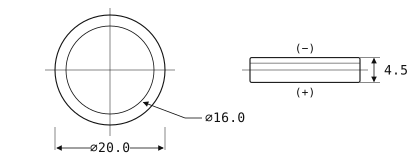
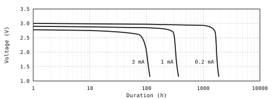
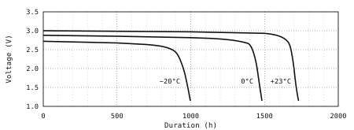
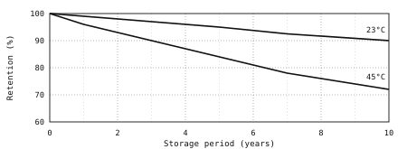

<header>

TALVEN MICROCELL

Lithium Button Cell&nbsp;&nbsp;<strong>TM-20L45</strong>

</header>

TMC-DS-20L45 Rev. 4

## Product Specification

<figure class="fig drawing" id="fig-outline">

<figcaption>Outline dimensions, top and side view.</figcaption>
</figure>

Coin-type lithium manganese dioxide primary cell, 3.0 V nominal, 340 mAh.
Stainless-steel case crimp-sealed over a polymer gasket; nickel-plated positive
can and negative cap, laser-marked polarity. Non-rechargeable.

Type code TM-20L45 is a Talven catalogue designation — TM: microcell lithium
primary series, 20: case diameter in millimetres, L: manganese dioxide cathode,
45: overall height in tenths of a millimetre. It is not an IEC 60086-3 code, and
the IEC system lists no coin cell of this envelope.

## Mechanical Dimensions

| Dimension             | Min  | Max  |
| --------------------- | ---- | ---- |
| D — case diameter     | 19.7 | 20.0 |
| H — overall height    | 4.3  | 4.5  |
| d — negative cap flat | 15.7 | 16.3 |
| R — rim radius        | 0.2  | 0.4  |

Millimetres, measured at 23 °C on an undischarged cell. The positive can forms
the side wall and the base; the negative cap is the inner face shown in the top
view of .

## Electrical Characteristics

| Item                      | Specification |
| ------------------------- | ------------- |
| Nominal voltage           | 3.0 V         |
| Open-circuit voltage, new | 3.20 V max    |
| Nominal capacity          | 340 mAh       |
| End-point voltage         | 2.0 V         |
| Continuous standard drain | 0.2 mA        |
| Maximum continuous drain  | 3.0 mA        |
| Maximum pulse drain, 2 s  | 15 mA         |
| Internal impedance, 1 kHz | 15 Ω typ.     |
| Self-discharge at 23 °C   | < 1 %/year    |
| Operating temperature     | −20 to +70 °C |
| Storage temperature       | −20 to +45 °C |
| Nominal energy            | 1.02 Wh       |
| Lithium metal content     | 0.10 g        |
| Weight                    | 4.2 g         |

Capacity is measured at 0.2 mA continuous drain, 23 °C, to a 2.0 V end point.

## Discharge Characteristics

<figure class="fig chart" id="fig-discharge">

<figcaption>Discharge curves at 23 °C.</figcaption>
</figure>

Continuous discharge at 23 °C on undischarged cells. Service life is the time to
the 2.0 V end point.

| Continuous drain (23 °C) | Service life | Capacity |
| ------------------------ | ------------ | -------- |
| 0.2 mA                   | 1700 h       | 340 mAh  |
| 1.0 mA                   | 330 h        | 330 mAh  |
| 3.0 mA                   | 100 h        | 300 mAh  |

Pulse loads of 15 mA for 2 s at a 5 % duty cycle hold the closed-circuit voltage
above 2.5 V over the first 80 % of the capacity at 23 °C. Below 0 °C, limit
pulses to 8 mA.

Internal impedance, measured at 1 kHz and 23 °C, rises from 15 Ω on an
undischarged cell to 17 Ω at 25 % depth of discharge, 21 Ω at 50 %, 32 Ω at
75 %, and 55 Ω at 90 %; size the load circuit for the end-of-life value.
Intermittent duty recovers part of the voltage lost to polarisation: a cell
drained at 3.0 mA for 1 h in every 24 h delivers about 320 mAh, against 300 mAh
under a continuous 3.0 mA load. The figures above assume a holder with a contact
resistance below 50 mΩ; a higher contact resistance shortens the service life at
drains above 1 mA.

## Temperature Characteristics

<figure class="fig chart" id="fig-temperature">

<figcaption>Discharge curves at 0.2 mA by ambient temperature.</figcaption>
</figure>

Continuous discharge at 0.2 mA to 2.0 V, after 16 h of conditioning at the
stated temperature.

| Discharge temperature | Capacity retention | Plateau voltage |
| --------------------- | ------------------ | --------------- |
| +60 °C                | 101 %              | 3.02 V          |
| +23 °C                | 100 %              | 3.00 V          |
| 0 °C                  | 85 %               | 2.88 V          |
| −20 °C                | 55 %               | 2.72 V          |

Retention is referred to the 340 mAh nominal capacity of
. Continuous
operation above +70 °C shortens the seal life and is outside the rating.

## Storage and Shelf Life

<figure class="fig chart" id="fig-storage">

<figcaption>Capacity retention against storage period.</figcaption>
</figure>

Store unopened stock in a dry, ventilated place away from direct sunlight, at
−20 to +45 °C and 45 to 75 %RH.

| Storage condition | After 1 year | After 10 years |
| ----------------- | ------------ | -------------- |
| 23 °C, 65 %RH     | 99 %         | 90 %           |
| 45 °C, 65 %RH     | 96 %         | 72 %           |

Values are the capacity retained after storage, measured at the standard drain.
Condensation on the crimp promotes corrosion; let cold stock reach room
temperature in its packaging before opening.

## Handling

- Do not solder directly to the cell body; use the solder-tabbed TM-20L45T type
  of &nbsp;for welded or soldered
  assemblies.
- Keep cells in the original packaging until use, and never carry loose cells
  together with coins, keys, or other metal objects.
- Check the polarity mark before closing the holder, and confirm that the
  contact spring bears on the negative cap flat only.
- Wipe the terminals with a dry, lint-free cloth. Do not use solvents, and do
  not touch the sealing face with bare hands.
- Draw stock in order of receipt, and do not return a partly used cell to stock.

## Series Line-up

| Type      | Size (mm)  | Capacity | Weight | Range (°C) |
| --------- | ---------- | -------- | ------ | ---------- |
| TM-16L20  | 16.0 × 2.0 | 90 mAh   | 1.2 g  | −20/+70    |
| TM-20L25  | 20.0 × 2.5 | 180 mAh  | 2.4 g  | −20/+70    |
| TM-20L32  | 20.0 × 3.2 | 240 mAh  | 3.0 g  | −20/+70    |
| TM-20L45  | 20.0 × 4.5 | 340 mAh  | 4.2 g  | −20/+70    |
| TM-20L45W | 20.0 × 4.5 | 320 mAh  | 4.2 g  | −40/+85    |
| TM-24L50  | 24.5 × 5.0 | 570 mAh  | 7.0 g  | −20/+70    |

Size is the nominal diameter × height. Capacity is measured at the standard
drain of each type, 23 °C, to a 2.0 V end point. TM-20L45T is the TM-20L45
fitted with resistance-welded solder tabs and weighs 5.0 g.

## Packaging and Ordering

| Packing form              | Order code    |
| ------------------------- | ------------- |
| Bulk box, 100 cells       | TM-20L45-B100 |
| Blister card, 5 cells     | TM-20L45-C5   |
| Solder-tabbed, tray of 50 | TM-20L45T-T50 |

The minimum order is one packing unit. Cells are date-coded on the positive can
with a four-character lot mark: a year letter, a month letter, and a two-digit
line number.

## Transport and Disposal

Each cell contains 0.10 g of lithium metal. Consignments ship as UN 3090 for
cells alone and UN 3091 for cells packed with or contained in equipment; every
production lot is qualified to the UN 38.3 test series. Insulate the terminals
of used cells with tape and hand them to a battery collection scheme; do not
incinerate them and do not place them in household waste.

## Safety Precautions

**Warning — risk of fire, explosion, and severe burns.**

- Do not recharge, short-circuit, disassemble, crush, deform, or immerse the cell.
- Do not heat above 100 °C, solder directly to the cell body, or incinerate it.
- Keep away from children; if a cell is swallowed, seek medical attention immediately.
- Use only in equipment specified for this cell; do not mix used and new cells, or cells of different types.
- Stop using the cell if it leaks, swells, or discolours; ventilate the area and avoid contact with the electrolyte.
- Dispose of used cells in accordance with local regulations.

## Revision History

| Rev. | Date       | Description                                                            |
| ---- | ---------- | :--------------------------------------------------------------------- |
| 4    | 2026-03-12 | Added the TM-20L45W wide-temperature type and the 45 °C storage curve. |
| 3    | 2025-07-04 | Capacity re-rated to 340 mAh; discharge family extended to 3.0 mA.     |
| 2    | 2024-11-18 | Dimension tolerances tightened; packaging and order codes revised.     |
| 1    | 2024-02-06 | First release.                                                         |
