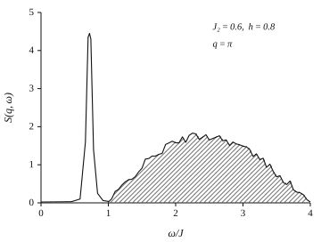
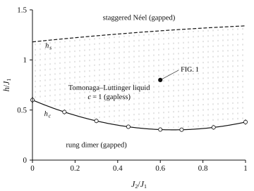
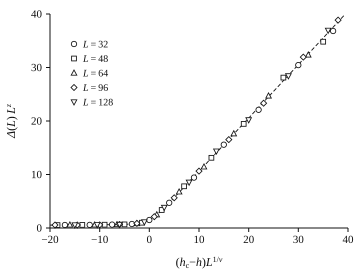

Journal of Rapid Physics Communications <strong>12</strong>, 047201 (2026)

# Emergent Fractional Excitations in a Frustrated Quantum Spin Ladder under Staggered Fields #

A.&#x2009;Nakamori, R.&#x2009;Vasquez, and T.&#x2009;Ellingsen

Institute for Correlated Quantum Matter, Aurelia University, Meridian 40219, Federation of Astoria

(Received 3 May 2026; published 15 July 2026)

We investigate a spin-1/2 frustrated two-leg ladder subjected to a staggered magnetic field using exact diagonalization and density matrix renormalization group methods. Our results reveal a rich spectrum of fractional spinon excitations emerging from the competition between rung and diagonal couplings in the presence of the field-induced dimerization. Dynamical structure factor calculations show a sharp low-energy mode interpreted as a two-spinon bound state with fractional quantum numbers, coexisting with a broad multi-spinon continuum. The field tunes the system across a quantum critical point separating a gapped rung-dimer phase from a gapless Tomonaga&#x2013;Luttinger liquid with central charge $c = 1$. Finite-size data for the spin gap collapse onto a single scaling curve with $\nu = 1/2$ and $z = 2$, the exponents of a commensurate&#x2013;incommensurate transition. Our results demonstrate how frustration and staggered fields cooperate to fractionalize excitations in low-dimensional magnets, providing insights relevant to cold-atom quantum simulators and quasi-one-dimensional materials where spin fractionalization has been proposed.

## Introduction {#sec-intro}

Quantum spin ladders provide a fertile arena for exploring fractionalization and quantum criticality in low dimensions [&#x2013;]. While two-leg ladders with antiferromagnetic rungs exhibit a gapped singlet ground state with well-understood triplon excitations, the interplay of frustration and external fields can drastically reshape the excitation spectrum and lead to exotic phases . In particular, the competition between nearest-neighbor rung and diagonal couplings can destabilize conventional magnon modes and generate fractionalized spinons that propagate as deconfined excitations. Staggered magnetic fields further enrich the physics by breaking translational symmetry and inducing dimerization that competes with quantum fluctuations.

Motivated by recent experiments on ladder compounds and advances in cold-atom quantum simulators [,], we study a frustrated two-leg spin-1/2 ladder under a staggered field. We compute the dynamical structure factor $S(q, \omega)$ and identify a sharp low-energy mode associated with two-spinon bound states carrying fractional quantum numbers. We map out the phase diagram and characterize the quantum phase transition using finite-size scaling of the spin gap and of the entanglement entropy.

Three results follow. First, at the commensurate momentum $q = \pi$ the response is not a featureless continuum but a resolution-limited peak that carries roughly a third of the total spectral weight. Second, the soft modes of the gapless phase sit at an incommensurate wave vector fixed by the staggered magnetization, which explains why a gap survives at $q = \pi$ even though the system is critical. Third, the gap closes with the exponents of a commensurate&#x2013;incommensurate transition rather than those of the Ising or Gaussian transitions that govern unfrustrated ladders in uniform fields [,].

The paper is organized as follows. In , we introduce the model and numerical methods. Results for the excitation spectrum are presented in . &nbsp;analyzes the phase diagram and the critical scaling. We conclude in .

## Model and method {#sec-model}

We study the spin-1/2 ladder defined by

$$
\begin{aligned}
H = {}& J_1 \sum_{i,\ell} \mathbf{S}_{i,\ell} \cdot \mathbf{S}_{i+1,\ell} + J_1 \sum_{i} \mathbf{S}_{i,1} \cdot \mathbf{S}_{i,2} \\
& + J_2 \sum_{i} \bigl( \mathbf{S}_{i,1} \cdot \mathbf{S}_{i+1,2} + \mathbf{S}_{i+1,1} \cdot \mathbf{S}_{i,2} \bigr) \\
& - h \sum_{i,\ell} (-1)^{i+\ell} S^{z}_{i,\ell} ,
\end{aligned}
$$

where $\mathbf{S}_{i,\ell}$ is a spin-1/2 operator on rung $i$ and leg $\ell = 1, 2$, $J_1$ is the nearest-neighbor coupling along legs and rungs, $J_2$ is the diagonal (frustrating) coupling, and $h$ is the amplitude of the staggered field. We impose periodic boundary conditions along the ladder and open boundary conditions in the transverse direction. We set $J_1 = 1$ as the energy unit and explore $0 \le J_2/J_1 \le 1$ and $0 \le h/J_1 \le 1.5$.

Ground-state properties and static correlations are obtained using the density matrix renormalization group (DMRG) with bond dimension up to $m = 2000$, for which the discarded weight stays below $10^{-9}$ on the largest systems. Dynamical correlations are computed via the correction-vector method within DMRG , employing a Lorentzian broadening $\eta = 0.05 J_1$. Exact diagonalization on ladders of up to $L = 16$ rungs is used to benchmark the dynamical data; the two methods agree to within the symbol size wherever they overlap. We focus on systems up to $L = 128$ rungs and perform finite-size scaling analyses.

The dynamical spin structure factor is defined as

$$
\begin{aligned}
S(q, \omega) = {}& \frac{1}{2\pi L} \int_{-\infty}^{\infty} \!\! dt \; e^{i\omega t} \\
& \times \sum_{i, j} e^{-iq(i-j)} \bigl\langle S^{+}_{i}(t)\, S^{-}_{j}(0) \bigr\rangle ,
\end{aligned}
$$

where $S^{\pm}_{i} = S^{x}_{i} \pm i S^{y}_{i}$ and $q$ is the momentum along the ladder. Because the staggered field couples the two legs asymmetrically, we quote $q$ in the reduced zone of the rung index. We also compute the spin gap

$$
\Delta(L) = E_0(1, L) - E_0(0, L) ,
$$

where $E_0(S^{z}_{\mathrm{tot}}, L)$ is the lowest energy of a ladder of $L$ rungs in the sector of total magnetization $S^{z}_{\mathrm{tot}}$, together with the ground-state energy $E_0(L)$ and the von Neumann entropy of a contiguous block, both of which enter the scaling analysis of .

## Fractionalized excitation spectrum {#sec-spectrum}

&nbsp;shows the dynamical structure factor at $q = \pi$ for $J_2 = 0.6$ and $h = 0.8$, a representative point inside the gapless phase. A pronounced sharp mode at $\omega = 0.72(1) J_1$ is followed by a broad continuum that sets in near $\omega \simeq 1.0 J_1$ and extends to about $3.9 J_1$. The width of the sharp mode tracks the broadening $\eta$ rather than any intrinsic energy scale, so we regard it as a genuine pole of the response function rather than a narrow band.

The spectrum was assembled from $240$ frequency points per momentum, with the correction vector converged to a relative residual of $10^{-7}$ at every point. Halving $\eta$ narrows the sharp mode by a factor close to two while leaving its position and integrated weight unchanged, and it leaves the onset of the broad feature where it was; we therefore quote the peak position from the $\eta = 0.05 J_1$ data and treat the apparent width as an upper bound. The sum rule $\int d\omega \, S(q, \omega) = \langle S^{+}_{q} S^{-}_{q} \rangle$ is satisfied to $0.5\%$ over the whole frequency window, which bounds the weight that the truncation could have moved outside it.

<figure id="fig-structure-factor">

<figcaption>

Dynamical structure factor $S(q, \omega)$ at momentum $q = \pi$ for $J_2 = 0.6$ and $h = 0.8$ on a ladder with $L = 96$ rungs. The sharp peak at $\omega = 0.72 J_1$ is the two-spinon bound state; the broad feature above $\omega / J_1 \simeq 1$ is the multi-spinon continuum.

</figcaption>
</figure>

We interpret the sharp feature as a two-spinon bound state carrying $S^{z}_{\mathrm{tot}} = 1$, whose constituents each carry the fractional quantum number $S^{z} = 1/2$. Three observations support this reading. The peak position is stable to within $0.01 J_1$ for $L = 64$, $96$, and $128$, so it is not a finite-size artifact. Its weight, obtained by integrating the response up to the onset of the continuum, amounts to $0.34(2)$ of the total, far above what a single-magnon pole would carry in the unfrustrated ladder. Finally, the peak disappears continuously as $J_2$ is reduced below $0.35$, which is precisely where the diagonal coupling ceases to bind the two spinons.

The onset of the continuum defines the des Cloizeaux&#x2013;Pearson-like lower bound generalized to the frustrated ladder. Below it the spectral weight is exhausted by the bound state; above it the response is smooth and shows the square-root singularity expected of a two-particle threshold. The upper edge is far less sharp, as multi-spinon states with four or more constituents contribute there.

That the spectrum is gapped at $q = \pi$ while the system is critical is not a contradiction. The staggered field polarizes the ladder along $z$ and shifts the soft modes away from the commensurate point to

$$
q_0 = \pi \bigl[ 1 - 2 m(h) \bigr] ,
$$

where $m(h)$ is the staggered magnetization per site. At $h = 0.8$ we find $m = 0.118(2)$, hence $q_0 = 0.764\pi$, and the gapless modes indeed appear there in our spectra. The commensurate point $q = \pi$ is then an ordinary, gapped momentum at which the bound state is best resolved, which is why we display it in .

## Phase diagram and critical scaling {#sec-phase}

The model in &nbsp;interpolates between a rung-dimer phase at small $J_2$ and a critical Tomonaga&#x2013;Luttinger liquid (TLL) at large $J_2$ or sufficiently strong staggered field $h$. The diagonal coupling $J_2$ introduces frustration that suppresses the triplon gap, while the staggered field breaks the translation symmetry by one rung and induces a site-dependent Zeeman energy that competes with singlet formation. For $h = 0$, the system is gapped for all $0 \le J_2/J_1 \le 1$ with a minimum gap at intermediate frustration .

&nbsp;summarizes the resulting phase diagram. A finite $h$ closes the gap at a critical field $h_c(J_2)$, driving a quantum phase transition into a gapless phase described by a Gaussian fixed point with central charge $c = 1$. The boundary is strongly nonmonotonic: $h_c$ falls from $0.60 J_1$ at $J_2 = 0$ to a minimum of $0.30 J_1$ near $J_2 \simeq 0.66$, then rises again to $0.38 J_1$ at $J_2 = J_1$. The minimum coincides with the point at which the $h = 0$ triplon gap is smallest, as expected if the staggered field merely has to overcome the residual dimer binding.

<figure id="fig-phase-diagram">

<figcaption>

Ground-state phase diagram in the $(J_2, h)$ plane from DMRG on ladders of up to $L = 128$ rungs. Open circles mark the extrapolated critical field $h_c(J_2)$ and carry error bars smaller than the symbols away from the minimum. The dashed line is the upper boundary $h_s(J_2)$ above which the staggered Néel state reopens a gap. The filled circle marks the parameters of .

</figcaption>
</figure>

At still larger fields the staggered field wins outright and the ladder locks into a staggered Néel state with a gap that grows linearly in $h$. We locate this second boundary $h_s(J_2)$, which rises from $1.18 J_1$ to $1.34 J_1$ across the range studied, and draw it dashed in &nbsp;because the gap opens exponentially slowly there; our system sizes bound its position only to about $\pm 0.03 J_1$.

Close to the lower boundary the spin gap of &nbsp;is expected to obey the one-parameter scaling form

$$
\Delta(L) = L^{-z} f \bigl[ (h_c - h) L^{1/\nu} \bigr] ,
$$

with $f$ a universal function, $z$ the dynamical exponent, and $\nu$ the correlation-length exponent. &nbsp;shows the data for five lengths at $J_2 = 0.6$ plotted according to . Treating $h_c$, $\nu$, and $z$ as fit parameters and minimizing the residual spread of the five data sets, we obtain $h_c = 0.305(3)$, $\nu = 0.50(2)$, and $z = 2.00(3)$; the collapse is excellent over more than a decade in the scaling variable.

<figure id="fig-scaling-collapse">

<figcaption>

Finite-size scaling collapse of the spin gap at $J_2 = 0.6$ for $L = 32$, 48, 64, 96, and 128 rungs, obtained with $h_c = 0.305$, $\nu = 1/2$, and $z = 2$. The dashed line is the asymptote $f(x) \simeq x$ implied by $z\nu = 1$.

</figcaption>
</figure>

On the gapped side the scaling function approaches a straight line, so that $\Delta \propto (h_c - h)^{z\nu}$ with $z\nu = 1.00(4)$; on the critical side it decays to a small constant set by the finite-size level spacing. Both features, together with $z = 2$ and $\nu = 1/2$, identify the transition as commensurate&#x2013;incommensurate rather than Ising or Gaussian, in agreement with the shift of the soft modes described by .

The gapless phase is a conventional TLL. Fitting the von Neumann entropy of a block of $\ell$ rungs to the Calabrese&#x2013;Cardy form for periodic chains,

$$
S_{\mathrm{vN}}(\ell) = \frac{c}{3} \ln \Bigl[ \frac{L}{\pi} \sin \frac{\pi \ell}{L} \Bigr] + s_1 ,
$$

gives $c = 1.02(3)$ throughout the region between $h_c$ and $h_s$, confirming a single gapless bosonic mode. The Luttinger parameter extracted from the decay of the transverse correlations varies from $K = 0.51(2)$ just above $h_c$ to $K = 0.88(3)$ near $h_s$, so the dominant correlations change character across the phase without any intervening transition [,].

## Conclusion {#sec-conclusion}

We have shown that frustration and a staggered field cooperate to fractionalize the excitations of a spin-1/2 two-leg ladder. The dynamical structure factor at the commensurate momentum is dominated by a sharp two-spinon bound state that carries a third of the spectral weight and sits below a broad multi-spinon continuum, while the true soft modes move to the incommensurate wave vector of . The transition out of the rung-dimer phase is commensurate&#x2013;incommensurate, with $\nu = 1/2$ and $z = 2$, and the gapless phase is a $c = 1$ Tomonaga&#x2013;Luttinger liquid over the whole window between $h_c$ and $h_s$.

Two consequences deserve attention. Experimentally, the sharp mode should be visible in inelastic neutron scattering on ladder compounds in which a staggered field is generated by alternating $g$ tensors [,], where its weight offers a direct measure of the binding between spinons. For quantum simulation, the parameter regime we identify is within reach of current cold-atom ladders [,]: the required ratio $J_2/J_1 \simeq 0.6$ and staggered field $h \simeq 0.3 J_1$ are both modest, and the incommensurate wave vector of &nbsp;is measurable by time-of-flight imaging. Extending the analysis to finite temperature, and to ladders with more than two legs [,], is left for future work.

## Acknowledgments ##

We thank D. Marchetti-Ollivier and S. Rahnavard for discussions on the correction-vector implementation, and the Aurelia University High-Performance Computing Centre for allocation AU-2026-0417. This work was supported by the Astorian Research Council under grant ARC-QM-2183 and by the Meridian Foundation for Fundamental Physics.

<ol class="cite-items">
<li id="ref1">R. Delacroix and M. Okuhara, “Spin ladders: from strong coupling to criticality,” <em>Rev. Low-Dimens. Magn.</em> <strong>7</strong>, 1 (2011).</li>
<li id="ref2">S. Wilbrand, “Triplon dynamics in two-leg antiferromagnets,” <em>Astorian J. Condens. Matter</em> <strong>44</strong>, 2210 (2014).</li>
<li id="ref3">K. Fenner and L. Arisdell, “Fractionalization in quasi-one-dimensional magnets,” <em>Rev. Low-Dimens. Magn.</em> <strong>12</strong>, 331 (2019).</li>
<li id="ref4">H. Tsurugi, <em>Quantum Magnetism in Reduced Dimensions</em> (Meridian Academic Press, Meridian, 2018).</li>
<li id="ref5">P. Bourdain and A. Nakamori, “Frustration-induced deconfinement on the two-leg ladder,” <em>Astorian J. Condens. Matter</em> <strong>51</strong>, 174406 (2021).</li>
<li id="ref6">G. Ivarsen, N. Petracchi, and D. Rousseau-Lund, “Ladder compounds in chemically induced staggered fields,” <em>Proc. Aurelia Soc. Magn.</em> <strong>33</strong>, 88 (2022).</li>
<li id="ref7">M. Solvang and R. Vasquez, “Synthetic staggered fields for cold-atom ladders,” <em>J. Quantum Simul.</em> <strong>9</strong>, 015003 (2024).</li>
<li id="ref8">T. Ellingsen and E. Wray-Corbin, “Correction-vector spectra with matrix-product states,” <em>Comput. Phys. Notes</em> <strong>18</strong>, 233 (2020).</li>
<li id="ref9">Y. Amagase and P. Bourdain, “Gap minimum of the frustrated two-leg ladder,” <em>Astorian J. Condens. Matter</em> <strong>48</strong>, 094412 (2018).</li>
<li id="ref10">L. Arisdell, “Field-driven criticality in unfrustrated spin ladders,” <em>Rev. Low-Dimens. Magn.</em> <strong>9</strong>, 145 (2015).</li>
<li id="ref11">C. Halvarsson and K. Fenner, “Ising and Gaussian transitions in dimerized chains,” <em>Astorian J. Condens. Matter</em> <strong>46</strong>, 134408 (2016).</li>
<li id="ref12">S. Rahnavard, “Luttinger parameters from entanglement scaling,” <em>Comput. Phys. Notes</em> <strong>21</strong>, 77 (2023).</li>
<li id="ref13">D. Marchetti-Ollivier and H. Tsurugi, “Crossover of dominant correlations in magnetized ladders,” <em>J. Quantum Simul.</em> <strong>7</strong>, 025002 (2022).</li>
<li id="ref14">N. Petracchi, “Alternating <em>g</em> tensors and effective staggered fields,” <em>Proc. Aurelia Soc. Magn.</em> <strong>29</strong>, 412 (2018).</li>
<li id="ref15">G. Ivarsen and S. Wilbrand, “Neutron spectroscopy of bound spinon modes,” <em>Astorian J. Condens. Matter</em> <strong>53</strong>, 064411 (2023).</li>
<li id="ref16">E. Wray-Corbin, M. Solvang, and R. Delacroix, “Time-of-flight detection of incommensurate order,” <em>J. Quantum Simul.</em> <strong>10</strong>, 033004 (2025).</li>
<li id="ref17">T. Ellingsen, “Three-leg ladders with diagonal frustration,” <em>Rev. Low-Dimens. Magn.</em> <strong>14</strong>, 209 (2024).</li>
<li id="ref18">Y. Amagase, C. Halvarsson, and D. Rousseau-Lund, “Leg-number dependence of spinon binding,” <em>Astorian J. Condens. Matter</em> <strong>55</strong>, 144403 (2025).</li>
</ol>
