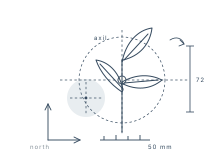

<time datetime="2026-10-08">08 OCT</time>

# DAYFIELD

## Tasks

- [x] ~~Finish the Marlowe & Fen letter, post it before four~~
- [ ] Ring Ashgrove Bindery about the linen samples → 09 OCT
- [ ] Redraw the sprig study at half scale → 09 OCT
- [x] ~~Order seed for the north bed~~
- [x] ~~Read two chapters of _The Quiet Meridian_~~
- [ ] Pack for Saturday's train to Pentlebridge → 10 OCT

## Notes

- The north room holds its light until about half past eight. Move the drawing
  table over before the clocks turn.
- Ashgrove quote eleven days for the linen. Long, but the grain is right.
- The fig cutting has taken — third leaf opened overnight. Repot once the roots
  reach the glass.
- Pentlebridge, platform four, 07:40. Take the folding rule.
- Wrote nothing yesterday and it showed all day. Twenty minutes before
  breakfast, no exceptions.

## Sketch

