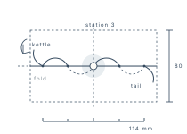

<time datetime="2026-10-10">10 OCT</time>

# DAYFIELD

## Tasks

- [x] ~~07:40, platform four. Folding rule in the left pocket.~~
- [x] ~~Ashgrove Bindery: choose linen, thread and board~~
- [x] ~~Cut two mounts for the redrawn study~~
- [x] ~~Walk the river path before the 18:05~~
- [ ] Write up the sewing stations while it is still fresh → 11 OCT

## Notes

- The bindery is one long room over a joiner's shop, and it smells of paste and
  sawdust in equal parts.
- Middle-weight linen, unbleached. Thread waxed on a block by the window, which
  is apparently the only correct place to do it.
- Five stations, marked off a folded strip rather than a rule. Kettle stitches a
  thumb's width from head and tail.
- The river path floods to the ankle after Pentlebridge lock. Boots next time,
  and an hour earlier.
- Home at half past seven, ink on both hands, nothing written down yet.

## Sketch

