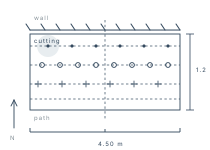

<time datetime="2026-10-11">11 OCT</time>

# DAYFIELD

## The Bed

- Four and a half metres along the wall, one metre twenty deep. Measured twice,
  because the first figure was a guess wearing a number.
- The wall holds the day's heat until nine or so. Everything tender goes within
  a hand's width of it.
- Four rows, three hundred apart. The back row shades the third by August, so
  nothing tall goes there again.
- Soil turned over on the ninth. Two barrows of compost, one of leaf mould.

## Sowing

- [x] ~~Broad beans, back row, under the wall~~
- [x] ~~Garlic, second row, cloves a hand apart~~
- [ ] Winter salad, third row, once the frame is repaired
- [ ] Bulbs along the front edge → 25 OCT
- [ ] Fig cutting into its own pot, foot of the wall → 12 OCT

## Sketch

