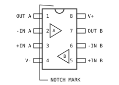
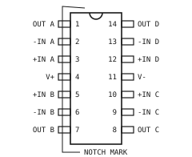
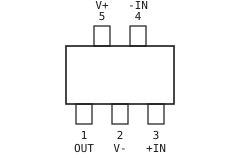
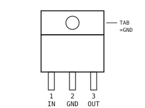
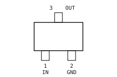
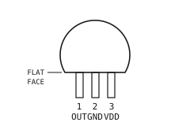
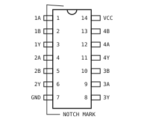
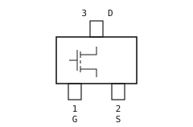

## GUIDE TO PART NUMBERS

型番の構成: KX-4001D

1. KX:シリーズ記号。製品分類を表す2文字。
2. 4001:機種番号。回路数・特性・出力電圧などの違いごとに1番ずつ繰り上がる。
3. D:パッケージ記号。末尾記号だけが異なる型番はパッケージのみが異なり、チップと電気的特性は共通。
4. 動作温度範囲を広げた品種は、機種番号のうしろにグレード記号を挿入する(例:KX-4001HD)。
5. 発注時は梱包形態記号を付す(例:KX-4001D-T2)。

### SERIES CODES

| SERIES  | PRODUCT CATEGORY       | SECT.                                         |
| ------- | ---------------------- | --------------------------------------------- |
| KX-40xx | OPERATIONAL AMPLIFIER  |       |
| CP-41xx | COMPARATOR             |  |
| VR-42xx | VOLTAGE REFERENCE      |        |
| RG-43xx | LINEAR REGULATOR       |      |
| SR-44xx | SWITCHING REGULATOR    |       |
| SV-45xx | VOLTAGE DETECTOR/RESET |        |
| LC-02xx | STANDARD LOGIC (TTL)   |       |
| LC-03xx | STANDARD LOGIC (CMOS)  |       |
| QF-61xx | MOSFET N-CHANNEL       |      |
| QF-62xx | MOSFET P-CHANNEL       |      |
| QF-63xx | MOSFET DUAL/COMPLEM.   |      |
| DS-64xx | SWITCHING DIODE        |       |
| DS-65xx | SCHOTTKY DIODE         |       |
| DS-66xx | ZENER DIODE            |       |
| DS-67xx | TVS DIODE              |       |
| CV-71xx | A/D CONVERTER          |         |
| CV-72xx | D/A CONVERTER          |         |
| CV-73xx | SIGNAL CONDITIONING    |         |
| IF-81xx | INTERFACE / ISOLATOR   |   |
| DR-82xx | DRIVER / POWER SWITCH  |      |

### PACKAGE CODES

| CODE | PACKAGE OUTLINE        | LEADS |
| ---- | ---------------------- | ----- |
| N    | DUAL IN-LINE PLASTIC   | 8-28  |
| D    | SMALL OUTLINE (SOIC)   | 8-28  |
| P    | THIN SHRINK SO (TSSOP) | 8-24  |
| M    | MINI SMALL OUTLINE     | 8     |
| T    | SOT-23 / SOT-23-5 / -6 | 3-6   |
| F    | SC-70-5 / SOD-523      | 3-5   |
| H    | SOT-323 / SOD-323      | 3     |
| V    | SOT-523                | 3     |
| X    | SOT-363                | 6     |
| Q    | DFN (WETTABLE FLANK)   | 4-10  |
| W    | QFN 4.0 x 4.0mm        | 16    |
| S    | TO-92 / DO-35          | 2-3   |
| B    | SOT-89                 | 3     |
| C    | SOT-223 / SMA          | 2-4   |
| K    | TO-252 (DPAK)          | 3     |
| R    | TO-220 / DO-41         | 2-3   |
| G    | TO-220 FULL-MOLD       | 3     |

### TEMPERATURE GRADES

| CODE   | OPERATING RANGE  | MARK |
| ------ | ---------------- | ---- |
| (none) | -40 to +85 degC  | I    |
| H      | -40 to +125 degC | H    |
| L      | 0 to +70 degC    | L    |
| W      | -55 to +125 degC | W    |

### PACKING FORMS

| CODE | PACKING FORM            | QTY   |
| ---- | ----------------------- | ----- |
| -T   | EMBOSSED TAPE 7in REEL  | 3000  |
| -T2  | EMBOSSED TAPE 13in REEL | 10000 |
| -E   | STICK MAGAZINE (TUBE)   | 50    |
| -E2  | STICK MAGAZINE (TUBE)   | 100   |
| -A   | AMMO PACK (RADIAL)      | 2000  |
| -B   | ANTI-STATIC BULK BAG    | 1000  |

### SYMBOLS AND UNITS

| SYMBOL   | DESCRIPTION             | UNIT    |
| -------- | ----------------------- | ------- |
| Vcc      | Operating supply range  | V       |
| Iq       | Quiescent current       | uA/mA   |
| GBW      | Gain-bandwidth product  | MHz     |
| SR       | Slew rate               | V/us    |
| Vos      | Input offset voltage    | uV/mV   |
| Ib       | Input bias current      | pA/nA   |
| en       | Input noise density     | nV/rtHz |
| CMRR     | Common-mode rejection   | dB      |
| PSRR     | Supply rejection ratio  | dB      |
| THD      | Total harmonic distort. | %       |
| RRIO     | Rail-to-rail in and out | -       |
| RRO      | Rail-to-rail output     | -       |
| ZD       | Zero-drift (chopper)    | -       |
| CSA      | Current-sense amplifier | -       |
| BUF      | Unity-gain buffer       | -       |
| tpd      | Propagation delay       | ns/us   |
| Hys      | Built-in hysteresis     | mV      |
| OD       | Open-drain output       | -       |
| PP       | Push-pull output        | -       |
| SER      | Series (3-terminal) ref | -       |
| SHU      | Shunt (2-terminal) ref  | -       |
| FIX      | Fixed output regulator  | -       |
| ADJ      | Adjustable output       | -       |
| LDO      | Low-dropout regulator   | -       |
| LNA      | Low-noise LDO           | -       |
| HV       | High-voltage input LDO  | -       |
| Vdo      | Dropout voltage         | mV/V    |
| DET      | Detect threshold        | V       |
| RST      | Reset output with delay | -       |
| WDT      | Watchdog timer period   | s       |
| Nch      | N-channel MOSFET        | -       |
| Pch      | P-channel MOSFET        | -       |
| Id       | Continuous drain curr.  | A       |
| R / mR   | Ohm / milliohm (Ron)    | Ohm     |
| SW       | Small-signal switching  | -       |
| SCH      | Schottky barrier        | -       |
| ZD (3.8) | Zener diode             | -       |
| TVS      | Transient voltage supp. | -       |
| Vf       | Forward voltage         | V       |
| trr      | Reverse recovery time   | ns      |
| SAR      | Successive-approx. ADC  | -       |
| DS       | Delta-sigma ADC         | -       |
| R2R      | R-2R ladder DAC         | -       |
| HD / FD  | Half / full duplex      | -       |
| SS       | Slew-rate controlled    | -       |
| HB       | Half-bridge output      | -       |
| CC       | Constant-current output | -       |

### HOW TO USE THIS LIST

GENERAL NOTES:

1. 記載値は特記なき限りTa = 25 degCにおける代表値。
2. KEY SPECS欄には選定に必要な代表特性だけを載せている。全定格は各製品のデータシートを参照。
3. 最大定格は1項目でも超えてはならない。瞬時であっても素子を破壊するおそれがある。
4. 同じ機種番号でPACKAGE欄だけが異なる行は、同一チップの別パッケージ品。
5. 「-」は規定していないことを示す。
6. すべての品種は無鉛はんだ(Sn-Ag-Cu)のリフローに対応する。

ORDERING EXAMPLE:

1. KX-4001D-T2=単回路オペアンプ/SOIC-8/13インチリール10000個。
2. KX-4001HN-E=同一機種の125 degCグレード/DIP-8/チューブ50本。
3. 最小発注単位は梱包形態の数量に準じる。

### CROSS REFERENCE

| SERIES  | REPLACES (INTERNAL)     | STATUS |
| ------- | ----------------------- | ------ |
| KX-40xx | KX-38xx GENERAL PURPOSE | ACTIVE |
| CP-41xx | CP-39xx COMPARATOR      | ACTIVE |
| VR-42xx | VR-40xx REFERENCE       | ACTIVE |
| RG-43xx | RG-41xx REGULATOR       | ACTIVE |
| SR-44xx | SR-42xx SWITCHING REG   | ACTIVE |
| SV-45xx | SV-43xx DETECTOR        | ACTIVE |
| LC-03xx | LC-01xx CMOS LOGIC      | ACTIVE |
| QF-61xx | QF-58xx SMALL-SIGNAL    | ACTIVE |
| DS-64xx | DS-60xx SWITCHING       | ACTIVE |
| CV-71xx | CV-68xx CONVERTER       | ACTIVE |
| KX-37xx | SEE 8.2 REPLACEMENT     | EOL    |
| RG-40xx | SEE 8.2 REPLACEMENT     | EOL    |
| LC-01xx | SEE 8.2 REPLACEMENT     | EOL    |

## OPERATIONAL AMPLIFIERS {#sec-opamp}

| PART NO. | KEY SPECS               | PACKAGE  |
| -------- | ----------------------- | -------- |
| KX-4001D | 1ch 3-36V GBW 1.2MHz    | SOIC-8   |
| KX-4001N | 1ch 3-36V GBW 1.2MHz    | DIP-8    |
| KX-4001M | 1ch 3-36V GBW 1.2MHz    | MSOP-8   |
| KX-4001T | 1ch 3-36V GBW 1.2MHz    | SOT-23-5 |
| KX-4001F | 1ch 3-36V GBW 1.2MHz    | SC-70-5  |
| KX-4002D | 2ch 3-36V GBW 1.2MHz    | SOIC-8   |
| KX-4002N | 2ch 3-36V GBW 1.2MHz    | DIP-8    |
| KX-4002M | 2ch 3-36V GBW 1.2MHz    | MSOP-8   |
| KX-4002P | 2ch 3-36V GBW 1.2MHz    | TSSOP-8  |
| KX-4003D | 4ch 3-36V GBW 1.2MHz    | SOIC-14  |
| KX-4003N | 4ch 3-36V GBW 1.2MHz    | DIP-14   |
| KX-4003P | 4ch 3-36V GBW 1.2MHz    | TSSOP-14 |
| KX-4004D | 1ch 3-36V GBW 3.0MHz    | SOIC-8   |
| KX-4004N | 1ch 3-36V GBW 3.0MHz    | DIP-8    |
| KX-4004M | 1ch 3-36V GBW 3.0MHz    | MSOP-8   |
| KX-4004T | 1ch 3-36V GBW 3.0MHz    | SOT-23-5 |
| KX-4004F | 1ch 3-36V GBW 3.0MHz    | SC-70-5  |
| KX-4005D | 2ch 3-36V GBW 3.0MHz    | SOIC-8   |
| KX-4005N | 2ch 3-36V GBW 3.0MHz    | DIP-8    |
| KX-4005M | 2ch 3-36V GBW 3.0MHz    | MSOP-8   |
| KX-4005P | 2ch 3-36V GBW 3.0MHz    | TSSOP-8  |
| KX-4006D | 4ch 3-36V GBW 3.0MHz    | SOIC-14  |
| KX-4006N | 4ch 3-36V GBW 3.0MHz    | DIP-14   |
| KX-4006P | 4ch 3-36V GBW 3.0MHz    | TSSOP-14 |
| KX-4007D | 1ch 3-36V GBW 5.5MHz    | SOIC-8   |
| KX-4007N | 1ch 3-36V GBW 5.5MHz    | DIP-8    |
| KX-4007M | 1ch 3-36V GBW 5.5MHz    | MSOP-8   |
| KX-4007T | 1ch 3-36V GBW 5.5MHz    | SOT-23-5 |
| KX-4007F | 1ch 3-36V GBW 5.5MHz    | SC-70-5  |
| KX-4008D | 2ch 3-36V GBW 5.5MHz    | SOIC-8   |
| KX-4008N | 2ch 3-36V GBW 5.5MHz    | DIP-8    |
| KX-4008M | 2ch 3-36V GBW 5.5MHz    | MSOP-8   |
| KX-4008P | 2ch 3-36V GBW 5.5MHz    | TSSOP-8  |
| KX-4009D | 4ch 3-36V GBW 5.5MHz    | SOIC-14  |
| KX-4009N | 4ch 3-36V GBW 5.5MHz    | DIP-14   |
| KX-4009P | 4ch 3-36V GBW 5.5MHz    | TSSOP-14 |
| KX-4010D | 1ch 3-36V GBW 10MHz     | SOIC-8   |
| KX-4010N | 1ch 3-36V GBW 10MHz     | DIP-8    |
| KX-4010M | 1ch 3-36V GBW 10MHz     | MSOP-8   |
| KX-4010T | 1ch 3-36V GBW 10MHz     | SOT-23-5 |
| KX-4010F | 1ch 3-36V GBW 10MHz     | SC-70-5  |
| KX-4011D | 2ch 3-36V GBW 10MHz     | SOIC-8   |
| KX-4011N | 2ch 3-36V GBW 10MHz     | DIP-8    |
| KX-4011M | 2ch 3-36V GBW 10MHz     | MSOP-8   |
| KX-4011P | 2ch 3-36V GBW 10MHz     | TSSOP-8  |
| KX-4012D | 4ch 3-36V GBW 10MHz     | SOIC-14  |
| KX-4012N | 4ch 3-36V GBW 10MHz     | DIP-14   |
| KX-4012P | 4ch 3-36V GBW 10MHz     | TSSOP-14 |
| KX-4013D | 1ch 4.5-36V GBW 20MHz   | SOIC-8   |
| KX-4013N | 1ch 4.5-36V GBW 20MHz   | DIP-8    |
| KX-4013M | 1ch 4.5-36V GBW 20MHz   | MSOP-8   |
| KX-4013T | 1ch 4.5-36V GBW 20MHz   | SOT-23-5 |
| KX-4013F | 1ch 4.5-36V GBW 20MHz   | SC-70-5  |
| KX-4014D | 2ch 4.5-36V GBW 20MHz   | SOIC-8   |
| KX-4014N | 2ch 4.5-36V GBW 20MHz   | DIP-8    |
| KX-4014M | 2ch 4.5-36V GBW 20MHz   | MSOP-8   |
| KX-4014P | 2ch 4.5-36V GBW 20MHz   | TSSOP-8  |
| KX-4015D | 4ch 4.5-36V GBW 20MHz   | SOIC-14  |
| KX-4015N | 4ch 4.5-36V GBW 20MHz   | DIP-14   |
| KX-4015P | 4ch 4.5-36V GBW 20MHz   | TSSOP-14 |
| KX-4016D | 1ch en2.8nV 5-36V 8MHz  | SOIC-8   |
| KX-4016N | 1ch en2.8nV 5-36V 8MHz  | DIP-8    |
| KX-4016M | 1ch en2.8nV 5-36V 8MHz  | MSOP-8   |
| KX-4016T | 1ch en2.8nV 5-36V 8MHz  | SOT-23-5 |
| KX-4016F | 1ch en2.8nV 5-36V 8MHz  | SC-70-5  |
| KX-4017D | 2ch en2.8nV 5-36V 8MHz  | SOIC-8   |
| KX-4017N | 2ch en2.8nV 5-36V 8MHz  | DIP-8    |
| KX-4017M | 2ch en2.8nV 5-36V 8MHz  | MSOP-8   |
| KX-4017P | 2ch en2.8nV 5-36V 8MHz  | TSSOP-8  |
| KX-4018D | 4ch en2.8nV 5-36V 8MHz  | SOIC-14  |
| KX-4018N | 4ch en2.8nV 5-36V 8MHz  | DIP-14   |
| KX-4018P | 4ch en2.8nV 5-36V 8MHz  | TSSOP-14 |
| KX-4019D | 1ch en1.6nV 5-36V 16MHz | SOIC-8   |
| KX-4019N | 1ch en1.6nV 5-36V 16MHz | DIP-8    |
| KX-4019M | 1ch en1.6nV 5-36V 16MHz | MSOP-8   |
| KX-4019T | 1ch en1.6nV 5-36V 16MHz | SOT-23-5 |
| KX-4019F | 1ch en1.6nV 5-36V 16MHz | SC-70-5  |
| KX-4020D | 2ch en1.6nV 5-36V 16MHz | SOIC-8   |
| KX-4020N | 2ch en1.6nV 5-36V 16MHz | DIP-8    |
| KX-4020M | 2ch en1.6nV 5-36V 16MHz | MSOP-8   |
| KX-4020P | 2ch en1.6nV 5-36V 16MHz | TSSOP-8  |
| KX-4021D | 4ch en1.6nV 5-36V 16MHz | SOIC-14  |
| KX-4021N | 4ch en1.6nV 5-36V 16MHz | DIP-14   |
| KX-4021P | 4ch en1.6nV 5-36V 16MHz | TSSOP-14 |
| KX-4022D | 1ch en1.1nV 5-12V 45MHz | SOIC-8   |
| KX-4022M | 1ch en1.1nV 5-12V 45MHz | MSOP-8   |
| KX-4022T | 1ch en1.1nV 5-12V 45MHz | SOT-23-5 |
| KX-4022F | 1ch en1.1nV 5-12V 45MHz | SC-70-5  |
| KX-4023D | 2ch en1.1nV 5-12V 45MHz | SOIC-8   |
| KX-4023M | 2ch en1.1nV 5-12V 45MHz | MSOP-8   |
| KX-4023P | 2ch en1.1nV 5-12V 45MHz | TSSOP-8  |
| KX-4024D | 1ch 1.8-5.5V RRIO 1MHz  | SOIC-8   |
| KX-4024M | 1ch 1.8-5.5V RRIO 1MHz  | MSOP-8   |
| KX-4024T | 1ch 1.8-5.5V RRIO 1MHz  | SOT-23-5 |
| KX-4024F | 1ch 1.8-5.5V RRIO 1MHz  | SC-70-5  |
| KX-4025D | 2ch 1.8-5.5V RRIO 1MHz  | SOIC-8   |
| KX-4025M | 2ch 1.8-5.5V RRIO 1MHz  | MSOP-8   |
| KX-4025P | 2ch 1.8-5.5V RRIO 1MHz  | TSSOP-8  |
| KX-4026D | 4ch 1.8-5.5V RRIO 1MHz  | SOIC-14  |
| KX-4026P | 4ch 1.8-5.5V RRIO 1MHz  | TSSOP-14 |
| KX-4027D | 1ch 1.8-5.5V RRIO 3MHz  | SOIC-8   |
| KX-4027M | 1ch 1.8-5.5V RRIO 3MHz  | MSOP-8   |
| KX-4027T | 1ch 1.8-5.5V RRIO 3MHz  | SOT-23-5 |
| KX-4027F | 1ch 1.8-5.5V RRIO 3MHz  | SC-70-5  |
| KX-4028D | 2ch 1.8-5.5V RRIO 3MHz  | SOIC-8   |
| KX-4028M | 2ch 1.8-5.5V RRIO 3MHz  | MSOP-8   |
| KX-4028P | 2ch 1.8-5.5V RRIO 3MHz  | TSSOP-8  |
| KX-4029D | 4ch 1.8-5.5V RRIO 3MHz  | SOIC-14  |
| KX-4029P | 4ch 1.8-5.5V RRIO 3MHz  | TSSOP-14 |
| KX-4030D | 1ch 1.8-5.5V RRIO 10MHz | SOIC-8   |
| KX-4030M | 1ch 1.8-5.5V RRIO 10MHz | MSOP-8   |
| KX-4030T | 1ch 1.8-5.5V RRIO 10MHz | SOT-23-5 |
| KX-4030F | 1ch 1.8-5.5V RRIO 10MHz | SC-70-5  |
| KX-4031D | 2ch 1.8-5.5V RRIO 10MHz | SOIC-8   |
| KX-4031M | 2ch 1.8-5.5V RRIO 10MHz | MSOP-8   |
| KX-4031P | 2ch 1.8-5.5V RRIO 10MHz | TSSOP-8  |
| KX-4032D | 4ch 1.8-5.5V RRIO 10MHz | SOIC-14  |
| KX-4032P | 4ch 1.8-5.5V RRIO 10MHz | TSSOP-14 |

| PART NO. | KEY SPECS               | PACKAGE  |
| -------- | ----------------------- | -------- |
| KX-4033D | 1ch 2.5-16V RRIO 6MHz   | SOIC-8   |
| KX-4033N | 1ch 2.5-16V RRIO 6MHz   | DIP-8    |
| KX-4033M | 1ch 2.5-16V RRIO 6MHz   | MSOP-8   |
| KX-4033T | 1ch 2.5-16V RRIO 6MHz   | SOT-23-5 |
| KX-4033F | 1ch 2.5-16V RRIO 6MHz   | SC-70-5  |
| KX-4034D | 2ch 2.5-16V RRIO 6MHz   | SOIC-8   |
| KX-4034N | 2ch 2.5-16V RRIO 6MHz   | DIP-8    |
| KX-4034M | 2ch 2.5-16V RRIO 6MHz   | MSOP-8   |
| KX-4034P | 2ch 2.5-16V RRIO 6MHz   | TSSOP-8  |
| KX-4035D | 4ch 2.5-16V RRIO 6MHz   | SOIC-14  |
| KX-4035N | 4ch 2.5-16V RRIO 6MHz   | DIP-14   |
| KX-4035P | 4ch 2.5-16V RRIO 6MHz   | TSSOP-14 |
| KX-4036D | 1ch 2.5-16V RRIO 22MHz  | SOIC-8   |
| KX-4036M | 1ch 2.5-16V RRIO 22MHz  | MSOP-8   |
| KX-4036T | 1ch 2.5-16V RRIO 22MHz  | SOT-23-5 |
| KX-4036F | 1ch 2.5-16V RRIO 22MHz  | SC-70-5  |
| KX-4037D | 2ch 2.5-16V RRIO 22MHz  | SOIC-8   |
| KX-4037M | 2ch 2.5-16V RRIO 22MHz  | MSOP-8   |
| KX-4037P | 2ch 2.5-16V RRIO 22MHz  | TSSOP-8  |
| KX-4038D | 4ch 2.5-16V RRIO 22MHz  | SOIC-14  |
| KX-4038P | 4ch 2.5-16V RRIO 22MHz  | TSSOP-14 |
| KX-4039D | 1ch 1.6-5.5V Iq 1.2uA   | SOIC-8   |
| KX-4039M | 1ch 1.6-5.5V Iq 1.2uA   | MSOP-8   |
| KX-4039T | 1ch 1.6-5.5V Iq 1.2uA   | SOT-23-5 |
| KX-4039F | 1ch 1.6-5.5V Iq 1.2uA   | SC-70-5  |
| KX-4040D | 2ch 1.6-5.5V Iq 1.2uA   | SOIC-8   |
| KX-4040M | 2ch 1.6-5.5V Iq 1.2uA   | MSOP-8   |
| KX-4040P | 2ch 1.6-5.5V Iq 1.2uA   | TSSOP-8  |
| KX-4041D | 4ch 1.6-5.5V Iq 1.2uA   | SOIC-14  |
| KX-4041P | 4ch 1.6-5.5V Iq 1.2uA   | TSSOP-14 |
| KX-4042D | 1ch 1.6-5.5V Iq 9.5uA   | SOIC-8   |
| KX-4042M | 1ch 1.6-5.5V Iq 9.5uA   | MSOP-8   |
| KX-4042T | 1ch 1.6-5.5V Iq 9.5uA   | SOT-23-5 |
| KX-4042F | 1ch 1.6-5.5V Iq 9.5uA   | SC-70-5  |
| KX-4043D | 2ch 1.6-5.5V Iq 9.5uA   | SOIC-8   |
| KX-4043M | 2ch 1.6-5.5V Iq 9.5uA   | MSOP-8   |
| KX-4043P | 2ch 1.6-5.5V Iq 9.5uA   | TSSOP-8  |
| KX-4044D | 4ch 1.6-5.5V Iq 9.5uA   | SOIC-14  |
| KX-4044P | 4ch 1.6-5.5V Iq 9.5uA   | TSSOP-14 |
| KX-4045D | 1ch 3-36V Iq 17uA       | SOIC-8   |
| KX-4045N | 1ch 3-36V Iq 17uA       | DIP-8    |
| KX-4045M | 1ch 3-36V Iq 17uA       | MSOP-8   |
| KX-4045T | 1ch 3-36V Iq 17uA       | SOT-23-5 |
| KX-4045F | 1ch 3-36V Iq 17uA       | SC-70-5  |
| KX-4046D | 2ch 3-36V Iq 17uA       | SOIC-8   |
| KX-4046N | 2ch 3-36V Iq 17uA       | DIP-8    |
| KX-4046M | 2ch 3-36V Iq 17uA       | MSOP-8   |
| KX-4046P | 2ch 3-36V Iq 17uA       | TSSOP-8  |
| KX-4047D | 4ch 3-36V Iq 17uA       | SOIC-14  |
| KX-4047N | 4ch 3-36V Iq 17uA       | DIP-14   |
| KX-4047P | 4ch 3-36V Iq 17uA       | TSSOP-14 |
| KX-4048D | 1ch 1.8-5.5V Vos 5uV ZD | SOIC-8   |
| KX-4048M | 1ch 1.8-5.5V Vos 5uV ZD | MSOP-8   |
| KX-4048T | 1ch 1.8-5.5V Vos 5uV ZD | SOT-23-5 |
| KX-4048F | 1ch 1.8-5.5V Vos 5uV ZD | SC-70-5  |
| KX-4049D | 2ch 1.8-5.5V Vos 5uV ZD | SOIC-8   |
| KX-4049M | 2ch 1.8-5.5V Vos 5uV ZD | MSOP-8   |
| KX-4049P | 2ch 1.8-5.5V Vos 5uV ZD | TSSOP-8  |
| KX-4050D | 4ch 1.8-5.5V Vos 5uV ZD | SOIC-14  |
| KX-4050P | 4ch 1.8-5.5V Vos 5uV ZD | TSSOP-14 |
| KX-4051D | 1ch 4.0-20V Vos 8uV ZD  | SOIC-8   |
| KX-4051M | 1ch 4.0-20V Vos 8uV ZD  | MSOP-8   |
| KX-4051T | 1ch 4.0-20V Vos 8uV ZD  | SOT-23-5 |
| KX-4051F | 1ch 4.0-20V Vos 8uV ZD  | SC-70-5  |
| KX-4052D | 2ch 4.0-20V Vos 8uV ZD  | SOIC-8   |
| KX-4052M | 2ch 4.0-20V Vos 8uV ZD  | MSOP-8   |
| KX-4052P | 2ch 4.0-20V Vos 8uV ZD  | TSSOP-8  |
| KX-4053D | 1ch Ib 5pA J-FET 12MHz  | SOIC-8   |
| KX-4053N | 1ch Ib 5pA J-FET 12MHz  | DIP-8    |
| KX-4053M | 1ch Ib 5pA J-FET 12MHz  | MSOP-8   |
| KX-4053T | 1ch Ib 5pA J-FET 12MHz  | SOT-23-5 |
| KX-4053F | 1ch Ib 5pA J-FET 12MHz  | SC-70-5  |
| KX-4054D | 2ch Ib 5pA J-FET 12MHz  | SOIC-8   |
| KX-4054N | 2ch Ib 5pA J-FET 12MHz  | DIP-8    |
| KX-4054M | 2ch Ib 5pA J-FET 12MHz  | MSOP-8   |
| KX-4054P | 2ch Ib 5pA J-FET 12MHz  | TSSOP-8  |
| KX-4055D | 4ch Ib 5pA J-FET 12MHz  | SOIC-14  |
| KX-4055N | 4ch Ib 5pA J-FET 12MHz  | DIP-14   |
| KX-4055P | 4ch Ib 5pA J-FET 12MHz  | TSSOP-14 |
| KX-4056D | 1ch Ib 3pA J-FET 30MHz  | SOIC-8   |
| KX-4056N | 1ch Ib 3pA J-FET 30MHz  | DIP-8    |
| KX-4056M | 1ch Ib 3pA J-FET 30MHz  | MSOP-8   |
| KX-4056T | 1ch Ib 3pA J-FET 30MHz  | SOT-23-5 |
| KX-4056F | 1ch Ib 3pA J-FET 30MHz  | SC-70-5  |
| KX-4057D | 2ch Ib 3pA J-FET 30MHz  | SOIC-8   |
| KX-4057N | 2ch Ib 3pA J-FET 30MHz  | DIP-8    |
| KX-4057M | 2ch Ib 3pA J-FET 30MHz  | MSOP-8   |
| KX-4057P | 2ch Ib 3pA J-FET 30MHz  | TSSOP-8  |
| KX-4058D | 4ch Ib 3pA J-FET 30MHz  | SOIC-14  |

| PART NO. | KEY SPECS               | PACKAGE  |
| -------- | ----------------------- | -------- |
| KX-4058N | 4ch Ib 3pA J-FET 30MHz  | DIP-14   |
| KX-4058P | 4ch Ib 3pA J-FET 30MHz  | TSSOP-14 |
| KX-4059D | 1ch 4.0-36V Vos 60uV    | SOIC-8   |
| KX-4059N | 1ch 4.0-36V Vos 60uV    | DIP-8    |
| KX-4059M | 1ch 4.0-36V Vos 60uV    | MSOP-8   |
| KX-4059T | 1ch 4.0-36V Vos 60uV    | SOT-23-5 |
| KX-4059F | 1ch 4.0-36V Vos 60uV    | SC-70-5  |
| KX-4060D | 2ch 4.0-36V Vos 60uV    | SOIC-8   |
| KX-4060N | 2ch 4.0-36V Vos 60uV    | DIP-8    |
| KX-4060M | 2ch 4.0-36V Vos 60uV    | MSOP-8   |
| KX-4060P | 2ch 4.0-36V Vos 60uV    | TSSOP-8  |
| KX-4061D | 4ch 4.0-36V Vos 60uV    | SOIC-14  |
| KX-4061N | 4ch 4.0-36V Vos 60uV    | DIP-14   |
| KX-4061P | 4ch 4.0-36V Vos 60uV    | TSSOP-14 |
| KX-4062D | 1ch 4.0-36V Vos 25uV    | SOIC-8   |
| KX-4062M | 1ch 4.0-36V Vos 25uV    | MSOP-8   |
| KX-4062T | 1ch 4.0-36V Vos 25uV    | SOT-23-5 |
| KX-4062F | 1ch 4.0-36V Vos 25uV    | SC-70-5  |
| KX-4063D | 2ch 4.0-36V Vos 25uV    | SOIC-8   |
| KX-4063M | 2ch 4.0-36V Vos 25uV    | MSOP-8   |
| KX-4063P | 2ch 4.0-36V Vos 25uV    | TSSOP-8  |
| KX-4064D | 1ch 10-80V GBW 3MHz     | SOIC-8   |
| KX-4064N | 1ch 10-80V GBW 3MHz     | DIP-8    |
| KX-4064M | 1ch 10-80V GBW 3MHz     | MSOP-8   |
| KX-4064T | 1ch 10-80V GBW 3MHz     | SOT-23-5 |
| KX-4064F | 1ch 10-80V GBW 3MHz     | SC-70-5  |
| KX-4065D | 2ch 10-80V GBW 3MHz     | SOIC-8   |
| KX-4065N | 2ch 10-80V GBW 3MHz     | DIP-8    |
| KX-4065M | 2ch 10-80V GBW 3MHz     | MSOP-8   |
| KX-4065P | 2ch 10-80V GBW 3MHz     | TSSOP-8  |
| KX-4066D | 1ch 10-100V GBW 1MHz    | SOIC-8   |
| KX-4066N | 1ch 10-100V GBW 1MHz    | DIP-8    |
| KX-4066M | 1ch 10-100V GBW 1MHz    | MSOP-8   |
| KX-4066T | 1ch 10-100V GBW 1MHz    | SOT-23-5 |
| KX-4066F | 1ch 10-100V GBW 1MHz    | SC-70-5  |
| KX-4067D | 2ch 10-100V GBW 1MHz    | SOIC-8   |
| KX-4067N | 2ch 10-100V GBW 1MHz    | DIP-8    |
| KX-4067M | 2ch 10-100V GBW 1MHz    | MSOP-8   |
| KX-4067P | 2ch 10-100V GBW 1MHz    | TSSOP-8  |
| KX-4068D | 1ch 2.7-5.5V GBW 100MHz | SOIC-8   |
| KX-4068M | 1ch 2.7-5.5V GBW 100MHz | MSOP-8   |
| KX-4068T | 1ch 2.7-5.5V GBW 100MHz | SOT-23-5 |
| KX-4068F | 1ch 2.7-5.5V GBW 100MHz | SC-70-5  |
| KX-4069D | 2ch 2.7-5.5V GBW 100MHz | SOIC-8   |
| KX-4069M | 2ch 2.7-5.5V GBW 100MHz | MSOP-8   |
| KX-4069P | 2ch 2.7-5.5V GBW 100MHz | TSSOP-8  |
| KX-4070D | 1ch 3.0-12V GBW 200MHz  | SOIC-8   |
| KX-4070M | 1ch 3.0-12V GBW 200MHz  | MSOP-8   |
| KX-4070T | 1ch 3.0-12V GBW 200MHz  | SOT-23-5 |
| KX-4070F | 1ch 3.0-12V GBW 200MHz  | SC-70-5  |
| KX-4071D | 2ch 3.0-12V GBW 200MHz  | SOIC-8   |
| KX-4071M | 2ch 3.0-12V GBW 200MHz  | MSOP-8   |
| KX-4071P | 2ch 3.0-12V GBW 200MHz  | TSSOP-8  |
| KX-4072D | 1ch AUDIO THD 0.0005%   | SOIC-8   |
| KX-4072N | 1ch AUDIO THD 0.0005%   | DIP-8    |
| KX-4072M | 1ch AUDIO THD 0.0005%   | MSOP-8   |
| KX-4072T | 1ch AUDIO THD 0.0005%   | SOT-23-5 |
| KX-4072F | 1ch AUDIO THD 0.0005%   | SC-70-5  |
| KX-4073D | 2ch AUDIO THD 0.0005%   | SOIC-8   |
| KX-4073N | 2ch AUDIO THD 0.0005%   | DIP-8    |
| KX-4073M | 2ch AUDIO THD 0.0005%   | MSOP-8   |
| KX-4073P | 2ch AUDIO THD 0.0005%   | TSSOP-8  |
| KX-4074D | 4ch AUDIO THD 0.0005%   | SOIC-14  |
| KX-4074N | 4ch AUDIO THD 0.0005%   | DIP-14   |
| KX-4074P | 4ch AUDIO THD 0.0005%   | TSSOP-14 |
| KX-4075D | 1ch 2.5-5.5V RRO 1.4MHz | SOIC-8   |
| KX-4075M | 1ch 2.5-5.5V RRO 1.4MHz | MSOP-8   |
| KX-4075T | 1ch 2.5-5.5V RRO 1.4MHz | SOT-23-5 |
| KX-4075F | 1ch 2.5-5.5V RRO 1.4MHz | SC-70-5  |
| KX-4076D | 2ch 2.5-5.5V RRO 1.4MHz | SOIC-8   |
| KX-4076M | 2ch 2.5-5.5V RRO 1.4MHz | MSOP-8   |
| KX-4076P | 2ch 2.5-5.5V RRO 1.4MHz | TSSOP-8  |
| KX-4077D | 4ch 2.5-5.5V RRO 1.4MHz | SOIC-14  |
| KX-4077P | 4ch 2.5-5.5V RRO 1.4MHz | TSSOP-14 |
| KX-4078D | 1ch 3-36V CMRR 110dB    | SOIC-8   |
| KX-4078N | 1ch 3-36V CMRR 110dB    | DIP-8    |
| KX-4078M | 1ch 3-36V CMRR 110dB    | MSOP-8   |
| KX-4078T | 1ch 3-36V CMRR 110dB    | SOT-23-5 |
| KX-4078F | 1ch 3-36V CMRR 110dB    | SC-70-5  |
| KX-4079D | 2ch 3-36V CMRR 110dB    | SOIC-8   |
| KX-4079N | 2ch 3-36V CMRR 110dB    | DIP-8    |
| KX-4079M | 2ch 3-36V CMRR 110dB    | MSOP-8   |
| KX-4079P | 2ch 3-36V CMRR 110dB    | TSSOP-8  |
| KX-4080D | 4ch 3-36V CMRR 110dB    | SOIC-14  |
| KX-4080N | 4ch 3-36V CMRR 110dB    | DIP-14   |
| KX-4080P | 4ch 3-36V CMRR 110dB    | TSSOP-14 |
| KX-4081D | 1ch CSA 4-80V 50V/V     | SOIC-8   |
| KX-4081M | 1ch CSA 4-80V 50V/V     | MSOP-8   |
| KX-4081T | 1ch CSA 4-80V 50V/V     | SOT-23-5 |
| KX-4081F | 1ch CSA 4-80V 50V/V     | SC-70-5  |
| KX-4082D | 2ch CSA 4-80V 50V/V     | SOIC-8   |
| KX-4082M | 2ch CSA 4-80V 50V/V     | MSOP-8   |
| KX-4082P | 2ch CSA 4-80V 50V/V     | TSSOP-8  |
| KX-4083D | 1ch CSA 4-80V 200V/V    | SOIC-8   |
| KX-4083M | 1ch CSA 4-80V 200V/V    | MSOP-8   |
| KX-4083T | 1ch CSA 4-80V 200V/V    | SOT-23-5 |
| KX-4083F | 1ch CSA 4-80V 200V/V    | SC-70-5  |
| KX-4084D | 2ch CSA 4-80V 200V/V    | SOIC-8   |
| KX-4084M | 2ch CSA 4-80V 200V/V    | MSOP-8   |
| KX-4084P | 2ch CSA 4-80V 200V/V    | TSSOP-8  |
| KX-4085D | 1ch INST-AMP G=1-1000   | SOIC-8   |
| KX-4085N | 1ch INST-AMP G=1-1000   | DIP-8    |
| KX-4085M | 1ch INST-AMP G=1-1000   | MSOP-8   |
| KX-4085T | 1ch INST-AMP G=1-1000   | SOT-23-5 |
| KX-4085F | 1ch INST-AMP G=1-1000   | SC-70-5  |
| KX-4086D | 2ch INST-AMP G=1-1000   | SOIC-8   |
| KX-4086M | 2ch INST-AMP G=1-1000   | MSOP-8   |
| KX-4086P | 2ch INST-AMP G=1-1000   | TSSOP-8  |
| KX-4087D | 1ch BUF 5-36V SR 60V/us | SOIC-8   |
| KX-4087N | 1ch BUF 5-36V SR 60V/us | DIP-8    |
| KX-4087M | 1ch BUF 5-36V SR 60V/us | MSOP-8   |
| KX-4087T | 1ch BUF 5-36V SR 60V/us | SOT-23-5 |
| KX-4087F | 1ch BUF 5-36V SR 60V/us | SC-70-5  |
| KX-4088D | 2ch BUF 5-36V SR 60V/us | SOIC-8   |
| KX-4088N | 2ch BUF 5-36V SR 60V/us | DIP-8    |
| KX-4088M | 2ch BUF 5-36V SR 60V/us | MSOP-8   |
| KX-4088P | 2ch BUF 5-36V SR 60V/us | TSSOP-8  |

NOTE (3.1):

1. Ta = 25 degC, Vcc = 5V unless otherwise noted.
2. GBW is measured at Av = 100, RL = 10kR, CL = 20pF.
3. 4ch devices share one supply pin pair; V- is pin 11.
4. Unused amplifiers must be wired as unity-gain buffers.
5. 未使用回路の入力を開放にすると発振する場合がある。

## COMPARATORS {#sec-comparator}

| PART NO. | KEY SPECS               | PACKAGE  |
| -------- | ----------------------- | -------- |
| CP-4101D | 1ch 2-36V tpd 1.3us OD  | SOIC-8   |
| CP-4101N | 1ch 2-36V tpd 1.3us OD  | DIP-8    |
| CP-4101M | 1ch 2-36V tpd 1.3us OD  | MSOP-8   |
| CP-4101T | 1ch 2-36V tpd 1.3us OD  | SOT-23-5 |
| CP-4101F | 1ch 2-36V tpd 1.3us OD  | SC-70-5  |
| CP-4102D | 2ch 2-36V tpd 1.3us OD  | SOIC-8   |
| CP-4102N | 2ch 2-36V tpd 1.3us OD  | DIP-8    |
| CP-4102M | 2ch 2-36V tpd 1.3us OD  | MSOP-8   |
| CP-4102P | 2ch 2-36V tpd 1.3us OD  | TSSOP-8  |
| CP-4103D | 4ch 2-36V tpd 1.3us OD  | SOIC-14  |
| CP-4103N | 4ch 2-36V tpd 1.3us OD  | DIP-14   |
| CP-4103P | 4ch 2-36V tpd 1.3us OD  | TSSOP-14 |
| CP-4104D | 1ch 2-36V tpd 1.0us PP  | SOIC-8   |
| CP-4104N | 1ch 2-36V tpd 1.0us PP  | DIP-8    |
| CP-4104M | 1ch 2-36V tpd 1.0us PP  | MSOP-8   |
| CP-4104T | 1ch 2-36V tpd 1.0us PP  | SOT-23-5 |
| CP-4104F | 1ch 2-36V tpd 1.0us PP  | SC-70-5  |
| CP-4105D | 2ch 2-36V tpd 1.0us PP  | SOIC-8   |
| CP-4105N | 2ch 2-36V tpd 1.0us PP  | DIP-8    |
| CP-4105M | 2ch 2-36V tpd 1.0us PP  | MSOP-8   |
| CP-4105P | 2ch 2-36V tpd 1.0us PP  | TSSOP-8  |
| CP-4106D | 4ch 2-36V tpd 1.0us PP  | SOIC-14  |
| CP-4106N | 4ch 2-36V tpd 1.0us PP  | DIP-14   |
| CP-4106P | 4ch 2-36V tpd 1.0us PP  | TSSOP-14 |
| CP-4107D | 1ch 2-36V tpd 200ns OD  | SOIC-8   |
| CP-4107N | 1ch 2-36V tpd 200ns OD  | DIP-8    |
| CP-4107M | 1ch 2-36V tpd 200ns OD  | MSOP-8   |
| CP-4107T | 1ch 2-36V tpd 200ns OD  | SOT-23-5 |
| CP-4107F | 1ch 2-36V tpd 200ns OD  | SC-70-5  |
| CP-4108D | 2ch 2-36V tpd 200ns OD  | SOIC-8   |
| CP-4108N | 2ch 2-36V tpd 200ns OD  | DIP-8    |
| CP-4108M | 2ch 2-36V tpd 200ns OD  | MSOP-8   |
| CP-4108P | 2ch 2-36V tpd 200ns OD  | TSSOP-8  |
| CP-4109D | 4ch 2-36V tpd 200ns OD  | SOIC-14  |
| CP-4109N | 4ch 2-36V tpd 200ns OD  | DIP-14   |
| CP-4109P | 4ch 2-36V tpd 200ns OD  | TSSOP-14 |
| CP-4110D | 1ch 2.7-5.5V 45ns PP    | SOIC-8   |
| CP-4110M | 1ch 2.7-5.5V 45ns PP    | MSOP-8   |
| CP-4110T | 1ch 2.7-5.5V 45ns PP    | SOT-23-5 |
| CP-4110F | 1ch 2.7-5.5V 45ns PP    | SC-70-5  |
| CP-4111D | 2ch 2.7-5.5V 45ns PP    | SOIC-8   |
| CP-4111M | 2ch 2.7-5.5V 45ns PP    | MSOP-8   |
| CP-4111P | 2ch 2.7-5.5V 45ns PP    | TSSOP-8  |
| CP-4112D | 4ch 2.7-5.5V 45ns PP    | SOIC-14  |
| CP-4112P | 4ch 2.7-5.5V 45ns PP    | TSSOP-14 |
| CP-4113D | 1ch 2.7-5.5V 7ns PP     | SOIC-8   |
| CP-4113M | 1ch 2.7-5.5V 7ns PP     | MSOP-8   |
| CP-4113T | 1ch 2.7-5.5V 7ns PP     | SOT-23-5 |
| CP-4113F | 1ch 2.7-5.5V 7ns PP     | SC-70-5  |
| CP-4114D | 2ch 2.7-5.5V 7ns PP     | SOIC-8   |
| CP-4114M | 2ch 2.7-5.5V 7ns PP     | MSOP-8   |
| CP-4114P | 2ch 2.7-5.5V 7ns PP     | TSSOP-8  |
| CP-4115D | 1ch 1.6-5.5V Iq1.5uA OD | SOIC-8   |
| CP-4115M | 1ch 1.6-5.5V Iq1.5uA OD | MSOP-8   |
| CP-4115T | 1ch 1.6-5.5V Iq1.5uA OD | SOT-23-5 |
| CP-4115F | 1ch 1.6-5.5V Iq1.5uA OD | SC-70-5  |
| CP-4116D | 2ch 1.6-5.5V Iq1.5uA OD | SOIC-8   |
| CP-4116M | 2ch 1.6-5.5V Iq1.5uA OD | MSOP-8   |
| CP-4116P | 2ch 1.6-5.5V Iq1.5uA OD | TSSOP-8  |
| CP-4117D | 4ch 1.6-5.5V Iq1.5uA OD | SOIC-14  |
| CP-4117P | 4ch 1.6-5.5V Iq1.5uA OD | TSSOP-14 |
| CP-4118D | 1ch Hys 20mV 2-36V OD   | SOIC-8   |

| PART NO. | KEY SPECS              | PACKAGE  |
| -------- | ---------------------- | -------- |
| CP-4118N | 1ch Hys 20mV 2-36V OD  | DIP-8    |
| CP-4118M | 1ch Hys 20mV 2-36V OD  | MSOP-8   |
| CP-4118T | 1ch Hys 20mV 2-36V OD  | SOT-23-5 |
| CP-4118F | 1ch Hys 20mV 2-36V OD  | SC-70-5  |
| CP-4119D | 2ch Hys 20mV 2-36V OD  | SOIC-8   |
| CP-4119N | 2ch Hys 20mV 2-36V OD  | DIP-8    |
| CP-4119M | 2ch Hys 20mV 2-36V OD  | MSOP-8   |
| CP-4119P | 2ch Hys 20mV 2-36V OD  | TSSOP-8  |
| CP-4120D | 4ch Hys 20mV 2-36V OD  | SOIC-14  |
| CP-4120N | 4ch Hys 20mV 2-36V OD  | DIP-14   |
| CP-4120P | 4ch Hys 20mV 2-36V OD  | TSSOP-14 |
| CP-4121D | 1ch Vref 2.5V int OD   | SOIC-8   |
| CP-4121M | 1ch Vref 2.5V int OD   | MSOP-8   |
| CP-4121T | 1ch Vref 2.5V int OD   | SOT-23-5 |
| CP-4121F | 1ch Vref 2.5V int OD   | SC-70-5  |
| CP-4122D | 2ch Vref 2.5V int OD   | SOIC-8   |
| CP-4122M | 2ch Vref 2.5V int OD   | MSOP-8   |
| CP-4122P | 2ch Vref 2.5V int OD   | TSSOP-8  |
| CP-4123D | 1ch WINDOW 1.8-5.5V PP | SOIC-8   |
| CP-4123M | 1ch WINDOW 1.8-5.5V PP | MSOP-8   |
| CP-4123T | 1ch WINDOW 1.8-5.5V PP | SOT-23-5 |
| CP-4123F | 1ch WINDOW 1.8-5.5V PP | SC-70-5  |
| CP-4124D | 2ch WINDOW 1.8-5.5V PP | SOIC-8   |
| CP-4124M | 2ch WINDOW 1.8-5.5V PP | MSOP-8   |
| CP-4124P | 2ch WINDOW 1.8-5.5V PP | TSSOP-8  |
| CP-4125D | 1ch 2-36V tpd 600ns PP | SOIC-8   |
| CP-4125N | 1ch 2-36V tpd 600ns PP | DIP-8    |
| CP-4125M | 1ch 2-36V tpd 600ns PP | MSOP-8   |
| CP-4125T | 1ch 2-36V tpd 600ns PP | SOT-23-5 |
| CP-4125F | 1ch 2-36V tpd 600ns PP | SC-70-5  |
| CP-4126D | 2ch 2-36V tpd 600ns PP | SOIC-8   |
| CP-4126N | 2ch 2-36V tpd 600ns PP | DIP-8    |
| CP-4126M | 2ch 2-36V tpd 600ns PP | MSOP-8   |
| CP-4126P | 2ch 2-36V tpd 600ns PP | TSSOP-8  |
| CP-4127D | 4ch 2-36V tpd 600ns PP | SOIC-14  |
| CP-4127N | 4ch 2-36V tpd 600ns PP | DIP-14   |
| CP-4127P | 4ch 2-36V tpd 600ns PP | TSSOP-14 |
| CP-4128D | 1ch 1.6-5.5V 250ns PP  | SOIC-8   |
| CP-4128M | 1ch 1.6-5.5V 250ns PP  | MSOP-8   |
| CP-4128T | 1ch 1.6-5.5V 250ns PP  | SOT-23-5 |
| CP-4128F | 1ch 1.6-5.5V 250ns PP  | SC-70-5  |
| CP-4129D | 2ch 1.6-5.5V 250ns PP  | SOIC-8   |
| CP-4129M | 2ch 1.6-5.5V 250ns PP  | MSOP-8   |
| CP-4129P | 2ch 1.6-5.5V 250ns PP  | TSSOP-8  |
| CP-4130D | 4ch 1.6-5.5V 250ns PP  | SOIC-14  |
| CP-4130P | 4ch 1.6-5.5V 250ns PP  | TSSOP-14 |

NOTE (3.2):

1. OD outputs need a pull-up resistor of 1k to 100kR.
2. tpd is measured with a 100mV step and 5mV overdrive.
3. Devices without built-in hysteresis need 10 to 50mV of external positive feedback for a clean transition.

## VOLTAGE REFERENCES {#sec-vref}

| PART NO. | KEY SPECS              | PACKAGE  |
| -------- | ---------------------- | -------- |
| VR-4201D | SER 1.024V ±0.05% 5ppm | SOIC-8   |
| VR-4201M | SER 1.024V ±0.05% 5ppm | MSOP-8   |
| VR-4201T | SER 1.024V ±0.05% 5ppm | SOT-23-5 |
| VR-4201S | SER 1.024V ±0.05% 5ppm | TO-92    |
| VR-4201Q | SER 1.024V ±0.05% 5ppm | DFN-6    |
| VR-4202D | SER 1.024V ±0.1% 10ppm | SOIC-8   |
| VR-4202M | SER 1.024V ±0.1% 10ppm | MSOP-8   |
| VR-4202T | SER 1.024V ±0.1% 10ppm | SOT-23-5 |
| VR-4202S | SER 1.024V ±0.1% 10ppm | TO-92    |
| VR-4202Q | SER 1.024V ±0.1% 10ppm | DFN-6    |
| VR-4203D | SER 1.024V ±0.5% 25ppm | SOIC-8   |
| VR-4203M | SER 1.024V ±0.5% 25ppm | MSOP-8   |
| VR-4203T | SER 1.024V ±0.5% 25ppm | SOT-23-5 |
| VR-4203S | SER 1.024V ±0.5% 25ppm | TO-92    |
| VR-4203Q | SER 1.024V ±0.5% 25ppm | DFN-6    |
| VR-4204T | SHU 1.250V ±0.05% 5ppm | SOT-23-3 |
| VR-4204D | SHU 1.250V ±0.05% 5ppm | SOIC-8   |
| VR-4204S | SHU 1.250V ±0.05% 5ppm | TO-92    |
| VR-4204B | SHU 1.250V ±0.05% 5ppm | SOT-89   |
| VR-4205T | SHU 1.250V ±0.1% 10ppm | SOT-23-3 |
| VR-4205D | SHU 1.250V ±0.1% 10ppm | SOIC-8   |
| VR-4205S | SHU 1.250V ±0.1% 10ppm | TO-92    |
| VR-4205B | SHU 1.250V ±0.1% 10ppm | SOT-89   |
| VR-4206T | SHU 1.250V ±0.5% 25ppm | SOT-23-3 |
| VR-4206D | SHU 1.250V ±0.5% 25ppm | SOIC-8   |
| VR-4206S | SHU 1.250V ±0.5% 25ppm | TO-92    |
| VR-4206B | SHU 1.250V ±0.5% 25ppm | SOT-89   |
| VR-4207D | SER 2.048V ±0.05% 5ppm | SOIC-8   |
| VR-4207M | SER 2.048V ±0.05% 5ppm | MSOP-8   |
| VR-4207T | SER 2.048V ±0.05% 5ppm | SOT-23-5 |
| VR-4207S | SER 2.048V ±0.05% 5ppm | TO-92    |
| VR-4207Q | SER 2.048V ±0.05% 5ppm | DFN-6    |
| VR-4208D | SER 2.048V ±0.1% 10ppm | SOIC-8   |
| VR-4208M | SER 2.048V ±0.1% 10ppm | MSOP-8   |
| VR-4208T | SER 2.048V ±0.1% 10ppm | SOT-23-5 |
| VR-4208S | SER 2.048V ±0.1% 10ppm | TO-92    |
| VR-4208Q | SER 2.048V ±0.1% 10ppm | DFN-6    |
| VR-4209D | SER 2.048V ±0.5% 25ppm | SOIC-8   |
| VR-4209M | SER 2.048V ±0.5% 25ppm | MSOP-8   |
| VR-4209T | SER 2.048V ±0.5% 25ppm | SOT-23-5 |
| VR-4209S | SER 2.048V ±0.5% 25ppm | TO-92    |
| VR-4209Q | SER 2.048V ±0.5% 25ppm | DFN-6    |
| VR-4210T | SHU 2.500V ±0.05% 5ppm | SOT-23-3 |
| VR-4210D | SHU 2.500V ±0.05% 5ppm | SOIC-8   |
| VR-4210S | SHU 2.500V ±0.05% 5ppm | TO-92    |
| VR-4210B | SHU 2.500V ±0.05% 5ppm | SOT-89   |
| VR-4211T | SHU 2.500V ±0.1% 10ppm | SOT-23-3 |
| VR-4211D | SHU 2.500V ±0.1% 10ppm | SOIC-8   |
| VR-4211S | SHU 2.500V ±0.1% 10ppm | TO-92    |
| VR-4211B | SHU 2.500V ±0.1% 10ppm | SOT-89   |
| VR-4212T | SHU 2.500V ±0.5% 25ppm | SOT-23-3 |
| VR-4212D | SHU 2.500V ±0.5% 25ppm | SOIC-8   |
| VR-4212S | SHU 2.500V ±0.5% 25ppm | TO-92    |
| VR-4212B | SHU 2.500V ±0.5% 25ppm | SOT-89   |
| VR-4213D | SER 3.000V ±0.05% 5ppm | SOIC-8   |
| VR-4213M | SER 3.000V ±0.05% 5ppm | MSOP-8   |
| VR-4213T | SER 3.000V ±0.05% 5ppm | SOT-23-5 |
| VR-4213S | SER 3.000V ±0.05% 5ppm | TO-92    |
| VR-4213Q | SER 3.000V ±0.05% 5ppm | DFN-6    |
| VR-4214D | SER 3.000V ±0.1% 10ppm | SOIC-8   |
| VR-4214M | SER 3.000V ±0.1% 10ppm | MSOP-8   |
| VR-4214T | SER 3.000V ±0.1% 10ppm | SOT-23-5 |
| VR-4214S | SER 3.000V ±0.1% 10ppm | TO-92    |
| VR-4214Q | SER 3.000V ±0.1% 10ppm | DFN-6    |
| VR-4215D | SER 3.000V ±0.5% 25ppm | SOIC-8   |
| VR-4215M | SER 3.000V ±0.5% 25ppm | MSOP-8   |
| VR-4215T | SER 3.000V ±0.5% 25ppm | SOT-23-5 |
| VR-4215S | SER 3.000V ±0.5% 25ppm | TO-92    |
| VR-4215Q | SER 3.000V ±0.5% 25ppm | DFN-6    |
| VR-4216T | SHU 3.300V ±0.05% 5ppm | SOT-23-3 |
| VR-4216D | SHU 3.300V ±0.05% 5ppm | SOIC-8   |
| VR-4216S | SHU 3.300V ±0.05% 5ppm | TO-92    |
| VR-4216B | SHU 3.300V ±0.05% 5ppm | SOT-89   |
| VR-4217T | SHU 3.300V ±0.1% 10ppm | SOT-23-3 |
| VR-4217D | SHU 3.300V ±0.1% 10ppm | SOIC-8   |
| VR-4217S | SHU 3.300V ±0.1% 10ppm | TO-92    |
| VR-4217B | SHU 3.300V ±0.1% 10ppm | SOT-89   |
| VR-4218T | SHU 3.300V ±0.5% 25ppm | SOT-23-3 |
| VR-4218D | SHU 3.300V ±0.5% 25ppm | SOIC-8   |
| VR-4218S | SHU 3.300V ±0.5% 25ppm | TO-92    |
| VR-4218B | SHU 3.300V ±0.5% 25ppm | SOT-89   |
| VR-4219D | SER 4.096V ±0.05% 5ppm | SOIC-8   |
| VR-4219M | SER 4.096V ±0.05% 5ppm | MSOP-8   |
| VR-4219T | SER 4.096V ±0.05% 5ppm | SOT-23-5 |
| VR-4219S | SER 4.096V ±0.05% 5ppm | TO-92    |
| VR-4219Q | SER 4.096V ±0.05% 5ppm | DFN-6    |
| VR-4220D | SER 4.096V ±0.1% 10ppm | SOIC-8   |
| VR-4220M | SER 4.096V ±0.1% 10ppm | MSOP-8   |
| VR-4220T | SER 4.096V ±0.1% 10ppm | SOT-23-5 |
| VR-4220S | SER 4.096V ±0.1% 10ppm | TO-92    |
| VR-4220Q | SER 4.096V ±0.1% 10ppm | DFN-6    |
| VR-4221D | SER 4.096V ±0.5% 25ppm | SOIC-8   |
| VR-4221M | SER 4.096V ±0.5% 25ppm | MSOP-8   |
| VR-4221T | SER 4.096V ±0.5% 25ppm | SOT-23-5 |
| VR-4221S | SER 4.096V ±0.5% 25ppm | TO-92    |
| VR-4221Q | SER 4.096V ±0.5% 25ppm | DFN-6    |
| VR-4222T | SHU 5.000V ±0.05% 5ppm | SOT-23-3 |
| VR-4222D | SHU 5.000V ±0.05% 5ppm | SOIC-8   |
| VR-4222S | SHU 5.000V ±0.05% 5ppm | TO-92    |
| VR-4222B | SHU 5.000V ±0.05% 5ppm | SOT-89   |
| VR-4223T | SHU 5.000V ±0.1% 10ppm | SOT-23-3 |
| VR-4223D | SHU 5.000V ±0.1% 10ppm | SOIC-8   |
| VR-4223S | SHU 5.000V ±0.1% 10ppm | TO-92    |
| VR-4223B | SHU 5.000V ±0.1% 10ppm | SOT-89   |
| VR-4224T | SHU 5.000V ±0.5% 25ppm | SOT-23-3 |
| VR-4224D | SHU 5.000V ±0.5% 25ppm | SOIC-8   |
| VR-4224S | SHU 5.000V ±0.5% 25ppm | TO-92    |
| VR-4224B | SHU 5.000V ±0.5% 25ppm | SOT-89   |
| VR-4225D | SER 10.00V ±0.05% 5ppm | SOIC-8   |
| VR-4225M | SER 10.00V ±0.05% 5ppm | MSOP-8   |
| VR-4225T | SER 10.00V ±0.05% 5ppm | SOT-23-5 |
| VR-4225S | SER 10.00V ±0.05% 5ppm | TO-92    |
| VR-4225Q | SER 10.00V ±0.05% 5ppm | DFN-6    |
| VR-4226D | SER 10.00V ±0.1% 10ppm | SOIC-8   |
| VR-4226M | SER 10.00V ±0.1% 10ppm | MSOP-8   |
| VR-4226T | SER 10.00V ±0.1% 10ppm | SOT-23-5 |
| VR-4226S | SER 10.00V ±0.1% 10ppm | TO-92    |
| VR-4226Q | SER 10.00V ±0.1% 10ppm | DFN-6    |
| VR-4227D | SER 10.00V ±0.5% 25ppm | SOIC-8   |
| VR-4227M | SER 10.00V ±0.5% 25ppm | MSOP-8   |
| VR-4227T | SER 10.00V ±0.5% 25ppm | SOT-23-5 |
| VR-4227S | SER 10.00V ±0.5% 25ppm | TO-92    |
| VR-4227Q | SER 10.00V ±0.5% 25ppm | DFN-6    |

NOTE (3.3):

1. Initial accuracy and drift are specified over the full operating temperature range.
2. SER types operate from 4uA of load current; SHU types need a bias resistor to the supply.

## LINEAR REGULATORS {#sec-linreg}

| PART NO. | KEY SPECS               | PACKAGE |
| -------- | ----------------------- | ------- |
| RG-4301R | FIX 3.3V 1.0A Vdo 1.7V  | TO-220  |
| RG-4301G | FIX 3.3V 1.0A Vdo 1.7V  | TO-220F |
| RG-4301K | FIX 3.3V 1.0A Vdo 1.7V  | TO-252  |
| RG-4301C | FIX 3.3V 1.0A Vdo 1.7V  | SOT-223 |
| RG-4302R | FIX 5.0V 1.0A Vdo 1.7V  | TO-220  |
| RG-4302G | FIX 5.0V 1.0A Vdo 1.7V  | TO-220F |
| RG-4302K | FIX 5.0V 1.0A Vdo 1.7V  | TO-252  |
| RG-4302C | FIX 5.0V 1.0A Vdo 1.7V  | SOT-223 |
| RG-4303R | FIX 6.0V 1.0A Vdo 1.7V  | TO-220  |
| RG-4303G | FIX 6.0V 1.0A Vdo 1.7V  | TO-220F |
| RG-4303K | FIX 6.0V 1.0A Vdo 1.7V  | TO-252  |
| RG-4303C | FIX 6.0V 1.0A Vdo 1.7V  | SOT-223 |
| RG-4304R | FIX 8.0V 1.0A Vdo 1.8V  | TO-220  |
| RG-4304G | FIX 8.0V 1.0A Vdo 1.8V  | TO-220F |
| RG-4304K | FIX 8.0V 1.0A Vdo 1.8V  | TO-252  |
| RG-4304C | FIX 8.0V 1.0A Vdo 1.8V  | SOT-223 |
| RG-4305R | FIX 9.0V 1.0A Vdo 1.8V  | TO-220  |
| RG-4305G | FIX 9.0V 1.0A Vdo 1.8V  | TO-220F |
| RG-4305K | FIX 9.0V 1.0A Vdo 1.8V  | TO-252  |
| RG-4305C | FIX 9.0V 1.0A Vdo 1.8V  | SOT-223 |
| RG-4306R | FIX 12V 1.0A Vdo 1.9V   | TO-220  |
| RG-4306G | FIX 12V 1.0A Vdo 1.9V   | TO-220F |
| RG-4306K | FIX 12V 1.0A Vdo 1.9V   | TO-252  |
| RG-4306C | FIX 12V 1.0A Vdo 1.9V   | SOT-223 |
| RG-4307R | FIX 15V 1.0A Vdo 1.9V   | TO-220  |
| RG-4307G | FIX 15V 1.0A Vdo 1.9V   | TO-220F |
| RG-4307K | FIX 15V 1.0A Vdo 1.9V   | TO-252  |
| RG-4307C | FIX 15V 1.0A Vdo 1.9V   | SOT-223 |
| RG-4308R | FIX 18V 1.0A Vdo 2.0V   | TO-220  |
| RG-4308G | FIX 18V 1.0A Vdo 2.0V   | TO-220F |
| RG-4308K | FIX 18V 1.0A Vdo 2.0V   | TO-252  |
| RG-4308C | FIX 18V 1.0A Vdo 2.0V   | SOT-223 |
| RG-4309R | FIX 24V 1.0A Vdo 2.0V   | TO-220  |
| RG-4309G | FIX 24V 1.0A Vdo 2.0V   | TO-220F |
| RG-4309K | FIX 24V 1.0A Vdo 2.0V   | TO-252  |
| RG-4309C | FIX 24V 1.0A Vdo 2.0V   | SOT-223 |
| RG-4310R | FIX -5.0V 1.0A Vdo 1.1V | TO-220  |
| RG-4310G | FIX -5.0V 1.0A Vdo 1.1V | TO-220F |
| RG-4310K | FIX -5.0V 1.0A Vdo 1.1V | TO-252  |
| RG-4311R | FIX -6.0V 1.0A Vdo 1.1V | TO-220  |
| RG-4311G | FIX -6.0V 1.0A Vdo 1.1V | TO-220F |
| RG-4311K | FIX -6.0V 1.0A Vdo 1.1V | TO-252  |
| RG-4312R | FIX -9.0V 1.0A Vdo 1.1V | TO-220  |
| RG-4312G | FIX -9.0V 1.0A Vdo 1.1V | TO-220F |
| RG-4312K | FIX -9.0V 1.0A Vdo 1.1V | TO-252  |
| RG-4313R | FIX -12V 1.0A Vdo 1.2V  | TO-220  |
| RG-4313G | FIX -12V 1.0A Vdo 1.2V  | TO-220F |
| RG-4313K | FIX -12V 1.0A Vdo 1.2V  | TO-252  |
| RG-4314R | FIX -15V 1.0A Vdo 1.2V  | TO-220  |
| RG-4314G | FIX -15V 1.0A Vdo 1.2V  | TO-220F |
| RG-4314K | FIX -15V 1.0A Vdo 1.2V  | TO-252  |
| RG-4315R | FIX -18V 1.0A Vdo 1.3V  | TO-220  |
| RG-4315G | FIX -18V 1.0A Vdo 1.3V  | TO-220F |
| RG-4315K | FIX -18V 1.0A Vdo 1.3V  | TO-252  |
| RG-4316R | FIX -24V 1.0A Vdo 1.3V  | TO-220  |
| RG-4316G | FIX -24V 1.0A Vdo 1.3V  | TO-220F |
| RG-4316K | FIX -24V 1.0A Vdo 1.3V  | TO-252  |
| RG-4317T | LDO 1.2V 0.1A Vdo 90mV  | SOT-23  |
| RG-4317F | LDO 1.2V 0.1A Vdo 90mV  | SC-70-5 |
| RG-4317B | LDO 1.2V 0.1A Vdo 90mV  | SOT-89  |
| RG-4317S | LDO 1.2V 0.1A Vdo 90mV  | TO-92   |
| RG-4318T | LDO 1.5V 0.1A Vdo 90mV  | SOT-23  |
| RG-4318F | LDO 1.5V 0.1A Vdo 90mV  | SC-70-5 |
| RG-4318B | LDO 1.5V 0.1A Vdo 90mV  | SOT-89  |
| RG-4318S | LDO 1.5V 0.1A Vdo 90mV  | TO-92   |
| RG-4319T | LDO 1.8V 0.1A Vdo 90mV  | SOT-23  |
| RG-4319F | LDO 1.8V 0.1A Vdo 90mV  | SC-70-5 |
| RG-4319B | LDO 1.8V 0.1A Vdo 90mV  | SOT-89  |
| RG-4319S | LDO 1.8V 0.1A Vdo 90mV  | TO-92   |
| RG-4320T | LDO 2.5V 0.1A Vdo 90mV  | SOT-23  |
| RG-4320F | LDO 2.5V 0.1A Vdo 90mV  | SC-70-5 |
| RG-4320B | LDO 2.5V 0.1A Vdo 90mV  | SOT-89  |
| RG-4320S | LDO 2.5V 0.1A Vdo 90mV  | TO-92   |
| RG-4321T | LDO 2.8V 0.1A Vdo 90mV  | SOT-23  |
| RG-4321F | LDO 2.8V 0.1A Vdo 90mV  | SC-70-5 |
| RG-4321B | LDO 2.8V 0.1A Vdo 90mV  | SOT-89  |
| RG-4321S | LDO 2.8V 0.1A Vdo 90mV  | TO-92   |
| RG-4322T | LDO 3.0V 0.1A Vdo 90mV  | SOT-23  |
| RG-4322F | LDO 3.0V 0.1A Vdo 90mV  | SC-70-5 |
| RG-4322B | LDO 3.0V 0.1A Vdo 90mV  | SOT-89  |
| RG-4322S | LDO 3.0V 0.1A Vdo 90mV  | TO-92   |
| RG-4323T | LDO 3.3V 0.1A Vdo 90mV  | SOT-23  |
| RG-4323F | LDO 3.3V 0.1A Vdo 90mV  | SC-70-5 |
| RG-4323B | LDO 3.3V 0.1A Vdo 90mV  | SOT-89  |
| RG-4323S | LDO 3.3V 0.1A Vdo 90mV  | TO-92   |
| RG-4324T | LDO 3.6V 0.1A Vdo 90mV  | SOT-23  |
| RG-4324F | LDO 3.6V 0.1A Vdo 90mV  | SC-70-5 |
| RG-4324B | LDO 3.6V 0.1A Vdo 90mV  | SOT-89  |
| RG-4324S | LDO 3.6V 0.1A Vdo 90mV  | TO-92   |
| RG-4325T | LDO 5.0V 0.1A Vdo 90mV  | SOT-23  |

| PART NO. | KEY SPECS               | PACKAGE  |
| -------- | ----------------------- | -------- |
| RG-4325F | LDO 5.0V 0.1A Vdo 90mV  | SC-70-5  |
| RG-4325B | LDO 5.0V 0.1A Vdo 90mV  | SOT-89   |
| RG-4325S | LDO 5.0V 0.1A Vdo 90mV  | TO-92    |
| RG-4326T | LDO 1.2V 0.3A Vdo 160mV | SOT-23-5 |
| RG-4326B | LDO 1.2V 0.3A Vdo 160mV | SOT-89   |
| RG-4326C | LDO 1.2V 0.3A Vdo 160mV | SOT-223  |
| RG-4326Q | LDO 1.2V 0.3A Vdo 160mV | DFN-6    |
| RG-4327T | LDO 1.5V 0.3A Vdo 160mV | SOT-23-5 |
| RG-4327B | LDO 1.5V 0.3A Vdo 160mV | SOT-89   |
| RG-4327C | LDO 1.5V 0.3A Vdo 160mV | SOT-223  |
| RG-4327Q | LDO 1.5V 0.3A Vdo 160mV | DFN-6    |
| RG-4328T | LDO 1.8V 0.3A Vdo 160mV | SOT-23-5 |
| RG-4328B | LDO 1.8V 0.3A Vdo 160mV | SOT-89   |
| RG-4328C | LDO 1.8V 0.3A Vdo 160mV | SOT-223  |
| RG-4328Q | LDO 1.8V 0.3A Vdo 160mV | DFN-6    |
| RG-4329T | LDO 2.5V 0.3A Vdo 160mV | SOT-23-5 |
| RG-4329B | LDO 2.5V 0.3A Vdo 160mV | SOT-89   |
| RG-4329C | LDO 2.5V 0.3A Vdo 160mV | SOT-223  |
| RG-4329Q | LDO 2.5V 0.3A Vdo 160mV | DFN-6    |
| RG-4330T | LDO 2.8V 0.3A Vdo 160mV | SOT-23-5 |
| RG-4330B | LDO 2.8V 0.3A Vdo 160mV | SOT-89   |
| RG-4330C | LDO 2.8V 0.3A Vdo 160mV | SOT-223  |
| RG-4330Q | LDO 2.8V 0.3A Vdo 160mV | DFN-6    |
| RG-4331T | LDO 3.0V 0.3A Vdo 160mV | SOT-23-5 |
| RG-4331B | LDO 3.0V 0.3A Vdo 160mV | SOT-89   |
| RG-4331C | LDO 3.0V 0.3A Vdo 160mV | SOT-223  |
| RG-4331Q | LDO 3.0V 0.3A Vdo 160mV | DFN-6    |
| RG-4332T | LDO 3.3V 0.3A Vdo 160mV | SOT-23-5 |
| RG-4332B | LDO 3.3V 0.3A Vdo 160mV | SOT-89   |
| RG-4332C | LDO 3.3V 0.3A Vdo 160mV | SOT-223  |
| RG-4332Q | LDO 3.3V 0.3A Vdo 160mV | DFN-6    |
| RG-4333T | LDO 3.6V 0.3A Vdo 160mV | SOT-23-5 |
| RG-4333B | LDO 3.6V 0.3A Vdo 160mV | SOT-89   |
| RG-4333C | LDO 3.6V 0.3A Vdo 160mV | SOT-223  |
| RG-4333Q | LDO 3.6V 0.3A Vdo 160mV | DFN-6    |
| RG-4334T | LDO 5.0V 0.3A Vdo 160mV | SOT-23-5 |
| RG-4334B | LDO 5.0V 0.3A Vdo 160mV | SOT-89   |
| RG-4334C | LDO 5.0V 0.3A Vdo 160mV | SOT-223  |
| RG-4334Q | LDO 5.0V 0.3A Vdo 160mV | DFN-6    |
| RG-4335C | LDO 1.2V 1.0A Vdo 250mV | SOT-223  |
| RG-4335K | LDO 1.2V 1.0A Vdo 250mV | TO-252   |
| RG-4335Q | LDO 1.2V 1.0A Vdo 250mV | DFN-8    |
| RG-4336C | LDO 1.5V 1.0A Vdo 250mV | SOT-223  |
| RG-4336K | LDO 1.5V 1.0A Vdo 250mV | TO-252   |
| RG-4336Q | LDO 1.5V 1.0A Vdo 250mV | DFN-8    |
| RG-4337C | LDO 1.8V 1.0A Vdo 250mV | SOT-223  |
| RG-4337K | LDO 1.8V 1.0A Vdo 250mV | TO-252   |
| RG-4337Q | LDO 1.8V 1.0A Vdo 250mV | DFN-8    |
| RG-4338C | LDO 2.5V 1.0A Vdo 250mV | SOT-223  |
| RG-4338K | LDO 2.5V 1.0A Vdo 250mV | TO-252   |
| RG-4338Q | LDO 2.5V 1.0A Vdo 250mV | DFN-8    |
| RG-4339C | LDO 2.8V 1.0A Vdo 250mV | SOT-223  |
| RG-4339K | LDO 2.8V 1.0A Vdo 250mV | TO-252   |
| RG-4339Q | LDO 2.8V 1.0A Vdo 250mV | DFN-8    |
| RG-4340C | LDO 3.0V 1.0A Vdo 250mV | SOT-223  |
| RG-4340K | LDO 3.0V 1.0A Vdo 250mV | TO-252   |
| RG-4340Q | LDO 3.0V 1.0A Vdo 250mV | DFN-8    |
| RG-4341C | LDO 3.3V 1.0A Vdo 250mV | SOT-223  |
| RG-4341K | LDO 3.3V 1.0A Vdo 250mV | TO-252   |
| RG-4341Q | LDO 3.3V 1.0A Vdo 250mV | DFN-8    |
| RG-4342C | LDO 3.6V 1.0A Vdo 250mV | SOT-223  |
| RG-4342K | LDO 3.6V 1.0A Vdo 250mV | TO-252   |
| RG-4342Q | LDO 3.6V 1.0A Vdo 250mV | DFN-8    |
| RG-4343C | LDO 5.0V 1.0A Vdo 250mV | SOT-223  |
| RG-4343K | LDO 5.0V 1.0A Vdo 250mV | TO-252   |
| RG-4343Q | LDO 5.0V 1.0A Vdo 250mV | DFN-8    |
| RG-4344R | ADJ 1.24-20V 1.5A       | TO-220   |
| RG-4344G | ADJ 1.24-20V 1.5A       | TO-220F  |
| RG-4344C | ADJ 1.24-20V 1.5A       | SOT-223  |
| RG-4345R | ADJ 1.24-25V 1.0A       | TO-220   |
| RG-4345G | ADJ 1.24-25V 1.0A       | TO-220F  |
| RG-4345C | ADJ 1.24-25V 1.0A       | SOT-223  |
| RG-4346R | ADJ 1.24-32V 0.5A       | TO-220   |
| RG-4346G | ADJ 1.24-32V 0.5A       | TO-220F  |
| RG-4346C | ADJ 1.24-32V 0.5A       | SOT-223  |
| RG-4347R | ADJ 1.24-37V 1.5A       | TO-220   |
| RG-4347G | ADJ 1.24-37V 1.5A       | TO-220F  |
| RG-4347C | ADJ 1.24-37V 1.5A       | SOT-223  |
| RG-4348R | ADJ 1.24-12V 0.1A       | TO-220   |
| RG-4348G | ADJ 1.24-12V 0.1A       | TO-220F  |
| RG-4348C | ADJ 1.24-12V 0.1A       | SOT-223  |
| RG-4349T | LNA 1.8V 0.2A 8uVrms    | SOT-23-5 |
| RG-4349Q | LNA 1.8V 0.2A 8uVrms    | DFN-6    |
| RG-4349B | LNA 1.8V 0.2A 8uVrms    | SOT-89   |
| RG-4350T | LNA 2.5V 0.2A 8uVrms    | SOT-23-5 |
| RG-4350Q | LNA 2.5V 0.2A 8uVrms    | DFN-6    |
| RG-4350B | LNA 2.5V 0.2A 8uVrms    | SOT-89   |
| RG-4351T | LNA 3.0V 0.2A 9uVrms    | SOT-23-5 |
| RG-4351Q | LNA 3.0V 0.2A 9uVrms    | DFN-6    |
| RG-4351B | LNA 3.0V 0.2A 9uVrms    | SOT-89   |
| RG-4352T | LNA 3.3V 0.2A 9uVrms    | SOT-23-5 |
| RG-4352Q | LNA 3.3V 0.2A 9uVrms    | DFN-6    |
| RG-4352B | LNA 3.3V 0.2A 9uVrms    | SOT-89   |
| RG-4353T | LNA 5.0V 0.2A 11uVrms   | SOT-23-5 |

| PART NO. | KEY SPECS             | PACKAGE |
| -------- | --------------------- | ------- |
| RG-4353Q | LNA 5.0V 0.2A 11uVrms | DFN-6   |
| RG-4353B | LNA 5.0V 0.2A 11uVrms | SOT-89  |
| RG-4354B | HV 60Vin 3.3V 0.1A    | SOT-89  |
| RG-4354C | HV 60Vin 3.3V 0.1A    | SOT-223 |
| RG-4354S | HV 60Vin 3.3V 0.1A    | TO-92   |
| RG-4355B | HV 60Vin 5.0V 0.1A    | SOT-89  |
| RG-4355C | HV 60Vin 5.0V 0.1A    | SOT-223 |
| RG-4355S | HV 60Vin 5.0V 0.1A    | TO-92   |
| RG-4356B | HV 60Vin 12V 0.1A     | SOT-89  |
| RG-4356C | HV 60Vin 12V 0.1A     | SOT-223 |
| RG-4356S | HV 60Vin 12V 0.1A     | TO-92   |
| RG-4357B | HV 100Vin 5.0V 0.1A   | SOT-89  |
| RG-4357C | HV 100Vin 5.0V 0.1A   | SOT-223 |
| RG-4357S | HV 100Vin 5.0V 0.1A   | TO-92   |
| RG-4358B | HV 100Vin 12V 0.1A    | SOT-89  |
| RG-4358C | HV 100Vin 12V 0.1A    | SOT-223 |
| RG-4358S | HV 100Vin 12V 0.1A    | TO-92   |

NOTE (3.4):

1. Iout is the value guaranteed with an infinite heat sink.
2. Vdo is specified at the rated Iout and Ta = 25 degC.
3. FIX/ADJ types need Cin = 0.33uF and Cout = 0.1uF or more.
4. LDO types need a ceramic Cout of 1.0uF or more.
5. 出力短絡は許容損失の範囲でのみ保護される。

## SWITCHING REGULATORS {#sec-swreg}

| PART NO. | KEY SPECS               | PACKAGE  |
| -------- | ----------------------- | -------- |
| SR-4405T | BUCK 40V 0.5A 500k ADJ  | SOT-23-6 |
| SR-4405M | BUCK 40V 0.5A 500k ADJ  | MSOP-8   |
| SR-4405Q | BUCK 40V 0.5A 500k ADJ  | DFN-8    |
| SR-4406T | BUCK 40V 0.5A 500k 3.3V | SOT-23-6 |
| SR-4406M | BUCK 40V 0.5A 500k 3.3V | MSOP-8   |
| SR-4406Q | BUCK 40V 0.5A 500k 3.3V | DFN-8    |
| SR-4407T | BUCK 40V 0.5A 500k 5.0V | SOT-23-6 |
| SR-4407M | BUCK 40V 0.5A 500k 5.0V | MSOP-8   |
| SR-4407Q | BUCK 40V 0.5A 500k 5.0V | DFN-8    |
| SR-4408T | BUCK 40V 1.0A 500k ADJ  | SOT-23-6 |
| SR-4408M | BUCK 40V 1.0A 500k ADJ  | MSOP-8   |
| SR-4408Q | BUCK 40V 1.0A 500k ADJ  | DFN-8    |
| SR-4409T | BUCK 40V 1.0A 500k 3.3V | SOT-23-6 |
| SR-4409M | BUCK 40V 1.0A 500k 3.3V | MSOP-8   |
| SR-4409Q | BUCK 40V 1.0A 500k 3.3V | DFN-8    |
| SR-4410T | BUCK 40V 1.0A 500k 5.0V | SOT-23-6 |
| SR-4410M | BUCK 40V 1.0A 500k 5.0V | MSOP-8   |
| SR-4410Q | BUCK 40V 1.0A 500k 5.0V | DFN-8    |
| SR-4411D | BUCK 40V 2.0A 500k ADJ  | SOIC-8   |
| SR-4411M | BUCK 40V 2.0A 500k ADJ  | MSOP-8   |
| SR-4411Q | BUCK 40V 2.0A 500k ADJ  | DFN-8    |
| SR-4412D | BUCK 40V 2.0A 500k 3.3V | SOIC-8   |
| SR-4412M | BUCK 40V 2.0A 500k 3.3V | MSOP-8   |
| SR-4412Q | BUCK 40V 2.0A 500k 3.3V | DFN-8    |
| SR-4413D | BUCK 40V 2.0A 500k 5.0V | SOIC-8   |
| SR-4413M | BUCK 40V 2.0A 500k 5.0V | MSOP-8   |
| SR-4413Q | BUCK 40V 2.0A 500k 5.0V | DFN-8    |
| SR-4414D | BUCK 40V 3.0A 350k ADJ  | SOIC-8   |
| SR-4414M | BUCK 40V 3.0A 350k ADJ  | MSOP-8   |
| SR-4414Q | BUCK 40V 3.0A 350k ADJ  | DFN-8    |
| SR-4415D | BUCK 40V 3.0A 350k 3.3V | SOIC-8   |
| SR-4415M | BUCK 40V 3.0A 350k 3.3V | MSOP-8   |
| SR-4415Q | BUCK 40V 3.0A 350k 3.3V | DFN-8    |
| SR-4416D | BUCK 40V 3.0A 350k 5.0V | SOIC-8   |
| SR-4416M | BUCK 40V 3.0A 350k 5.0V | MSOP-8   |
| SR-4416Q | BUCK 40V 3.0A 350k 5.0V | DFN-8    |
| SR-4417T | BUCK 40V 1.0A 1.2M ADJ  | SOT-23-6 |
| SR-4417M | BUCK 40V 1.0A 1.2M ADJ  | MSOP-8   |
| SR-4417Q | BUCK 40V 1.0A 1.2M ADJ  | DFN-8    |
| SR-4418T | BUCK 40V 1.0A 1.2M 3.3V | SOT-23-6 |
| SR-4418M | BUCK 40V 1.0A 1.2M 3.3V | MSOP-8   |
| SR-4418Q | BUCK 40V 1.0A 1.2M 3.3V | DFN-8    |
| SR-4419T | BUCK 40V 1.0A 1.2M 5.0V | SOT-23-6 |
| SR-4419M | BUCK 40V 1.0A 1.2M 5.0V | MSOP-8   |
| SR-4419Q | BUCK 40V 1.0A 1.2M 5.0V | DFN-8    |
| SR-4420D | BUCK 40V 2.0A 1.2M ADJ  | SOIC-8   |
| SR-4420M | BUCK 40V 2.0A 1.2M ADJ  | MSOP-8   |
| SR-4420Q | BUCK 40V 2.0A 1.2M ADJ  | DFN-8    |
| SR-4421D | BUCK 40V 2.0A 1.2M 3.3V | SOIC-8   |
| SR-4421M | BUCK 40V 2.0A 1.2M 3.3V | MSOP-8   |
| SR-4421Q | BUCK 40V 2.0A 1.2M 3.3V | DFN-8    |
| SR-4422D | BUCK 40V 2.0A 1.2M 5.0V | SOIC-8   |
| SR-4422M | BUCK 40V 2.0A 1.2M 5.0V | MSOP-8   |
| SR-4422Q | BUCK 40V 2.0A 1.2M 5.0V | DFN-8    |
| SR-4423T | BUCK 60V 0.5A 500k ADJ  | SOT-23-6 |
| SR-4423M | BUCK 60V 0.5A 500k ADJ  | MSOP-8   |
| SR-4423Q | BUCK 60V 0.5A 500k ADJ  | DFN-8    |
| SR-4424T | BUCK 60V 0.5A 500k 3.3V | SOT-23-6 |
| SR-4424M | BUCK 60V 0.5A 500k 3.3V | MSOP-8   |
| SR-4424Q | BUCK 60V 0.5A 500k 3.3V | DFN-8    |
| SR-4425T | BUCK 60V 0.5A 500k 5.0V | SOT-23-6 |
| SR-4425M | BUCK 60V 0.5A 500k 5.0V | MSOP-8   |
| SR-4425Q | BUCK 60V 0.5A 500k 5.0V | DFN-8    |
| SR-4426T | BUCK 60V 1.0A 500k ADJ  | SOT-23-6 |
| SR-4426M | BUCK 60V 1.0A 500k ADJ  | MSOP-8   |
| SR-4426Q | BUCK 60V 1.0A 500k ADJ  | DFN-8    |
| SR-4427T | BUCK 60V 1.0A 500k 3.3V | SOT-23-6 |
| SR-4427M | BUCK 60V 1.0A 500k 3.3V | MSOP-8   |
| SR-4427Q | BUCK 60V 1.0A 500k 3.3V | DFN-8    |
| SR-4428T | BUCK 60V 1.0A 500k 5.0V | SOT-23-6 |
| SR-4428M | BUCK 60V 1.0A 500k 5.0V | MSOP-8   |
| SR-4428Q | BUCK 60V 1.0A 500k 5.0V | DFN-8    |
| SR-4429D | BUCK 60V 2.0A 350k ADJ  | SOIC-8   |
| SR-4429M | BUCK 60V 2.0A 350k ADJ  | MSOP-8   |
| SR-4429Q | BUCK 60V 2.0A 350k ADJ  | DFN-8    |
| SR-4430D | BUCK 60V 2.0A 350k 3.3V | SOIC-8   |
| SR-4430M | BUCK 60V 2.0A 350k 3.3V | MSOP-8   |
| SR-4430Q | BUCK 60V 2.0A 350k 3.3V | DFN-8    |
| SR-4431D | BUCK 60V 2.0A 350k 5.0V | SOIC-8   |
| SR-4431M | BUCK 60V 2.0A 350k 5.0V | MSOP-8   |
| SR-4431Q | BUCK 60V 2.0A 350k 5.0V | DFN-8    |
| SR-4432T | BUCK 18V 1.0A 2.2M ADJ  | SOT-23-6 |
| SR-4432M | BUCK 18V 1.0A 2.2M ADJ  | MSOP-8   |
| SR-4432Q | BUCK 18V 1.0A 2.2M ADJ  | DFN-8    |
| SR-4433T | BUCK 18V 1.0A 2.2M 3.3V | SOT-23-6 |
| SR-4433M | BUCK 18V 1.0A 2.2M 3.3V | MSOP-8   |
| SR-4433Q | BUCK 18V 1.0A 2.2M 3.3V | DFN-8    |
| SR-4434T | BUCK 18V 1.0A 2.2M 5.0V | SOT-23-6 |
| SR-4434M | BUCK 18V 1.0A 2.2M 5.0V | MSOP-8   |
| SR-4434Q | BUCK 18V 1.0A 2.2M 5.0V | DFN-8    |
| SR-4435D | BUCK 18V 2.0A 2.2M ADJ  | SOIC-8   |
| SR-4435M | BUCK 18V 2.0A 2.2M ADJ  | MSOP-8   |
| SR-4435Q | BUCK 18V 2.0A 2.2M ADJ  | DFN-8    |
| SR-4436D | BUCK 18V 2.0A 2.2M 3.3V | SOIC-8   |
| SR-4436M | BUCK 18V 2.0A 2.2M 3.3V | MSOP-8   |
| SR-4436Q | BUCK 18V 2.0A 2.2M 3.3V | DFN-8    |
| SR-4437D | BUCK 18V 2.0A 2.2M 5.0V | SOIC-8   |
| SR-4437M | BUCK 18V 2.0A 2.2M 5.0V | MSOP-8   |
| SR-4437Q | BUCK 18V 2.0A 2.2M 5.0V | DFN-8    |
| SR-4438D | BUCK 18V 3.0A 1.2M ADJ  | SOIC-8   |
| SR-4438M | BUCK 18V 3.0A 1.2M ADJ  | MSOP-8   |
| SR-4438Q | BUCK 18V 3.0A 1.2M ADJ  | DFN-8    |
| SR-4439D | BUCK 18V 3.0A 1.2M 3.3V | SOIC-8   |
| SR-4439M | BUCK 18V 3.0A 1.2M 3.3V | MSOP-8   |
| SR-4439Q | BUCK 18V 3.0A 1.2M 3.3V | DFN-8    |
| SR-4440D | BUCK 18V 3.0A 1.2M 5.0V | SOIC-8   |
| SR-4440M | BUCK 18V 3.0A 1.2M 5.0V | MSOP-8   |
| SR-4440Q | BUCK 18V 3.0A 1.2M 5.0V | DFN-8    |
| SR-4441D | BUCK 6V 2.0A 2.2M ADJ   | SOIC-8   |
| SR-4441M | BUCK 6V 2.0A 2.2M ADJ   | MSOP-8   |
| SR-4441Q | BUCK 6V 2.0A 2.2M ADJ   | DFN-8    |
| SR-4442D | BUCK 6V 2.0A 2.2M 3.3V  | SOIC-8   |
| SR-4442M | BUCK 6V 2.0A 2.2M 3.3V  | MSOP-8   |
| SR-4442Q | BUCK 6V 2.0A 2.2M 3.3V  | DFN-8    |
| SR-4443D | BUCK 6V 2.0A 2.2M 5.0V  | SOIC-8   |
| SR-4443M | BUCK 6V 2.0A 2.2M 5.0V  | MSOP-8   |
| SR-4443Q | BUCK 6V 2.0A 2.2M 5.0V  | DFN-8    |
| SR-4444P | BUCK 6V 5.0A 1.2M ADJ   | TSSOP-16 |
| SR-4444D | BUCK 6V 5.0A 1.2M ADJ   | SOIC-16  |
| SR-4444W | BUCK 6V 5.0A 1.2M ADJ   | QFN-16   |
| SR-4445P | BUCK 6V 5.0A 1.2M 3.3V  | TSSOP-16 |
| SR-4445D | BUCK 6V 5.0A 1.2M 3.3V  | SOIC-16  |
| SR-4445W | BUCK 6V 5.0A 1.2M 3.3V  | QFN-16   |
| SR-4446P | BUCK 6V 5.0A 1.2M 5.0V  | TSSOP-16 |
| SR-4446D | BUCK 6V 5.0A 1.2M 5.0V  | SOIC-16  |
| SR-4446W | BUCK 6V 5.0A 1.2M 5.0V  | QFN-16   |
| SR-4447D | BUCK CTL 60V 300k ADJ   | SOIC-8   |
| SR-4447M | BUCK CTL 60V 300k ADJ   | MSOP-8   |
| SR-4447Q | BUCK CTL 60V 300k ADJ   | DFN-8    |
| SR-4448D | BUCK CTL 60V 600k ADJ   | SOIC-8   |
| SR-4448M | BUCK CTL 60V 600k ADJ   | MSOP-8   |
| SR-4448Q | BUCK CTL 60V 600k ADJ   | DFN-8    |
| SR-4449P | BUCK CTL 100V 200k ADJ  | TSSOP-16 |
| SR-4449D | BUCK CTL 100V 200k ADJ  | SOIC-16  |
| SR-4449W | BUCK CTL 100V 200k ADJ  | QFN-16   |
| SR-4450D | BUCK CTL 30V 1.0M ADJ   | SOIC-8   |
| SR-4450M | BUCK CTL 30V 1.0M ADJ   | MSOP-8   |
| SR-4450Q | BUCK CTL 30V 1.0M ADJ   | DFN-8    |
| SR-4451T | BOOST 5.5V 0.6A 1.2M    | SOT-23-6 |
| SR-4451M | BOOST 5.5V 0.6A 1.2M    | MSOP-8   |
| SR-4451Q | BOOST 5.5V 0.6A 1.2M    | DFN-8    |
| SR-4452T | BOOST 5.5V 1.2A 1.2M    | SOT-23-6 |
| SR-4452M | BOOST 5.5V 1.2A 1.2M    | MSOP-8   |
| SR-4452Q | BOOST 5.5V 1.2A 1.2M    | DFN-8    |
| SR-4453D | BOOST 5.5V 2.0A 1.2M    | SOIC-8   |
| SR-4453M | BOOST 5.5V 2.0A 1.2M    | MSOP-8   |
| SR-4453Q | BOOST 5.5V 2.0A 1.2M    | DFN-8    |
| SR-4454D | BOOST 18V 1.5A 700k     | SOIC-8   |
| SR-4454M | BOOST 18V 1.5A 700k     | MSOP-8   |
| SR-4454Q | BOOST 18V 1.5A 700k     | DFN-8    |
| SR-4455P | BOOST 18V 3.0A 700k     | TSSOP-16 |
| SR-4455D | BOOST 18V 3.0A 700k     | SOIC-16  |
| SR-4455W | BOOST 18V 3.0A 700k     | QFN-16   |
| SR-4456D | BOOST CTL 40Vout 300k   | SOIC-8   |
| SR-4456M | BOOST CTL 40Vout 300k   | MSOP-8   |
| SR-4456Q | BOOST CTL 40Vout 300k   | DFN-8    |
| SR-4457T | BUCK-BOOST 5.5V 1.0A    | SOT-23-6 |
| SR-4457M | BUCK-BOOST 5.5V 1.0A    | MSOP-8   |
| SR-4457Q | BUCK-BOOST 5.5V 1.0A    | DFN-8    |
| SR-4458D | BUCK-BOOST 18V 2.0A     | SOIC-8   |
| SR-4458M | BUCK-BOOST 18V 2.0A     | MSOP-8   |
| SR-4458Q | BUCK-BOOST 18V 2.0A     | DFN-8    |
| SR-4459D | INV 20V -1.0A 700k      | SOIC-8   |
| SR-4459M | INV 20V -1.0A 700k      | MSOP-8   |
| SR-4459Q | INV 20V -1.0A 700k      | DFN-8    |
| SR-4460T | CHARGE PUMP x2 100mA    | SOT-23-6 |
| SR-4460M | CHARGE PUMP x2 100mA    | MSOP-8   |
| SR-4460Q | CHARGE PUMP x2 100mA    | DFN-8    |
| SR-4461T | CHARGE PUMP INV 50mA    | SOT-23-6 |
| SR-4461M | CHARGE PUMP INV 50mA    | MSOP-8   |
| SR-4461Q | CHARGE PUMP INV 50mA    | DFN-8    |
| SR-4462D | LDO+BUCK 40V 0.3A       | SOIC-8   |
| SR-4462M | LDO+BUCK 40V 0.3A       | MSOP-8   |
| SR-4462Q | LDO+BUCK 40V 0.3A       | DFN-8    |
| SR-4463D | LED BOOST 40Vout 1.0A   | SOIC-8   |
| SR-4463M | LED BOOST 40Vout 1.0A   | MSOP-8   |
| SR-4463Q | LED BOOST 40Vout 1.0A   | DFN-8    |
| SR-4464P | SUPERVISED BUCK 1.0A    | TSSOP-16 |
| SR-4464D | SUPERVISED BUCK 1.0A    | SOIC-16  |
| SR-4464W | SUPERVISED BUCK 1.0A    | QFN-16   |

NOTE (3.5):

1. Iout is the continuous output current at Ta = 25 degC with the recommended inductor on a 2-layer board.
2. CTL types drive an external N-channel MOSFET.
3. ADJ types set Vout with a divider to the 0.80V feedback pin.
4. スイッチング周波数は外部同期入力で±20%まで引き込める。

## VOLTAGE DETECTORS {#sec-vdet}

| PART NO. | KEY SPECS             | PACKAGE  |
| -------- | --------------------- | -------- |
| SV-4501T | DET 1.90V +-1.5% OD   | SOT-23-3 |
| SV-4501F | DET 1.90V +-1.5% OD   | SC-70-5  |
| SV-4501S | DET 1.90V +-1.5% OD   | TO-92    |
| SV-4502T | DET 1.90V +-1.0% CMOS | SOT-23-3 |
| SV-4502F | DET 1.90V +-1.0% CMOS | SC-70-5  |
| SV-4502S | DET 1.90V +-1.0% CMOS | TO-92    |
| SV-4503T | DET 2.10V +-1.5% OD   | SOT-23-3 |
| SV-4503F | DET 2.10V +-1.5% OD   | SC-70-5  |
| SV-4503S | DET 2.10V +-1.5% OD   | TO-92    |
| SV-4504T | DET 2.10V +-1.0% CMOS | SOT-23-3 |
| SV-4504F | DET 2.10V +-1.0% CMOS | SC-70-5  |
| SV-4504S | DET 2.10V +-1.0% CMOS | TO-92    |
| SV-4505T | DET 2.20V +-1.5% OD   | SOT-23-3 |
| SV-4505F | DET 2.20V +-1.5% OD   | SC-70-5  |
| SV-4505S | DET 2.20V +-1.5% OD   | TO-92    |
| SV-4506T | DET 2.20V +-1.0% CMOS | SOT-23-3 |
| SV-4506F | DET 2.20V +-1.0% CMOS | SC-70-5  |
| SV-4506S | DET 2.20V +-1.0% CMOS | TO-92    |
| SV-4507T | DET 2.40V +-1.5% OD   | SOT-23-3 |
| SV-4507F | DET 2.40V +-1.5% OD   | SC-70-5  |
| SV-4507S | DET 2.40V +-1.5% OD   | TO-92    |
| SV-4508T | DET 2.40V +-1.0% CMOS | SOT-23-3 |
| SV-4508F | DET 2.40V +-1.0% CMOS | SC-70-5  |
| SV-4508S | DET 2.40V +-1.0% CMOS | TO-92    |
| SV-4509T | DET 2.60V +-1.5% OD   | SOT-23-3 |
| SV-4509F | DET 2.60V +-1.5% OD   | SC-70-5  |
| SV-4509S | DET 2.60V +-1.5% OD   | TO-92    |
| SV-4510T | DET 2.60V +-1.0% CMOS | SOT-23-3 |
| SV-4510F | DET 2.60V +-1.0% CMOS | SC-70-5  |
| SV-4510S | DET 2.60V +-1.0% CMOS | TO-92    |
| SV-4511T | DET 2.93V +-1.5% OD   | SOT-23-3 |
| SV-4511F | DET 2.93V +-1.5% OD   | SC-70-5  |
| SV-4511S | DET 2.93V +-1.5% OD   | TO-92    |
| SV-4512T | DET 2.93V +-1.0% CMOS | SOT-23-3 |
| SV-4512F | DET 2.93V +-1.0% CMOS | SC-70-5  |
| SV-4512S | DET 2.93V +-1.0% CMOS | TO-92    |
| SV-4513T | DET 3.08V +-1.5% OD   | SOT-23-3 |
| SV-4513F | DET 3.08V +-1.5% OD   | SC-70-5  |
| SV-4513S | DET 3.08V +-1.5% OD   | TO-92    |
| SV-4514T | DET 3.08V +-1.0% CMOS | SOT-23-3 |
| SV-4514F | DET 3.08V +-1.0% CMOS | SC-70-5  |
| SV-4514S | DET 3.08V +-1.0% CMOS | TO-92    |
| SV-4515T | DET 3.30V +-1.5% OD   | SOT-23-3 |
| SV-4515F | DET 3.30V +-1.5% OD   | SC-70-5  |
| SV-4515S | DET 3.30V +-1.5% OD   | TO-92    |
| SV-4516T | DET 3.30V +-1.0% CMOS | SOT-23-3 |
| SV-4516F | DET 3.30V +-1.0% CMOS | SC-70-5  |
| SV-4516S | DET 3.30V +-1.0% CMOS | TO-92    |
| SV-4517T | DET 3.50V +-1.5% OD   | SOT-23-3 |
| SV-4517F | DET 3.50V +-1.5% OD   | SC-70-5  |
| SV-4517S | DET 3.50V +-1.5% OD   | TO-92    |
| SV-4518T | DET 3.50V +-1.0% CMOS | SOT-23-3 |
| SV-4518F | DET 3.50V +-1.0% CMOS | SC-70-5  |
| SV-4518S | DET 3.50V +-1.0% CMOS | TO-92    |
| SV-4519T | DET 3.70V +-1.5% OD   | SOT-23-3 |
| SV-4519F | DET 3.70V +-1.5% OD   | SC-70-5  |
| SV-4519S | DET 3.70V +-1.5% OD   | TO-92    |
| SV-4520T | DET 3.70V +-1.0% CMOS | SOT-23-3 |
| SV-4520F | DET 3.70V +-1.0% CMOS | SC-70-5  |
| SV-4520S | DET 3.70V +-1.0% CMOS | TO-92    |
| SV-4521T | DET 4.00V +-1.5% OD   | SOT-23-3 |
| SV-4521F | DET 4.00V +-1.5% OD   | SC-70-5  |
| SV-4521S | DET 4.00V +-1.5% OD   | TO-92    |
| SV-4522T | DET 4.00V +-1.0% CMOS | SOT-23-3 |
| SV-4522F | DET 4.00V +-1.0% CMOS | SC-70-5  |
| SV-4522S | DET 4.00V +-1.0% CMOS | TO-92    |

| PART NO. | KEY SPECS               | PACKAGE  |
| -------- | ----------------------- | -------- |
| SV-4523T | DET 4.20V +-1.5% OD     | SOT-23-3 |
| SV-4523F | DET 4.20V +-1.5% OD     | SC-70-5  |
| SV-4523S | DET 4.20V +-1.5% OD     | TO-92    |
| SV-4524T | DET 4.20V +-1.0% CMOS   | SOT-23-3 |
| SV-4524F | DET 4.20V +-1.0% CMOS   | SC-70-5  |
| SV-4524S | DET 4.20V +-1.0% CMOS   | TO-92    |
| SV-4525T | DET 4.38V +-1.5% OD     | SOT-23-3 |
| SV-4525F | DET 4.38V +-1.5% OD     | SC-70-5  |
| SV-4525S | DET 4.38V +-1.5% OD     | TO-92    |
| SV-4526T | DET 4.38V +-1.0% CMOS   | SOT-23-3 |
| SV-4526F | DET 4.38V +-1.0% CMOS   | SC-70-5  |
| SV-4526S | DET 4.38V +-1.0% CMOS   | TO-92    |
| SV-4527T | DET 4.63V +-1.5% OD     | SOT-23-3 |
| SV-4527F | DET 4.63V +-1.5% OD     | SC-70-5  |
| SV-4527S | DET 4.63V +-1.5% OD     | TO-92    |
| SV-4528T | DET 4.63V +-1.0% CMOS   | SOT-23-3 |
| SV-4528F | DET 4.63V +-1.0% CMOS   | SC-70-5  |
| SV-4528S | DET 4.63V +-1.0% CMOS   | TO-92    |
| SV-4529T | RST 2.93V td 200ms CMOS | SOT-23-5 |
| SV-4529F | RST 2.93V td 200ms CMOS | SC-70-5  |
| SV-4529Q | RST 2.93V td 200ms CMOS | DFN-4    |
| SV-4530T | RST 4.38V td 200ms CMOS | SOT-23-5 |
| SV-4530F | RST 4.38V td 200ms CMOS | SC-70-5  |
| SV-4530Q | RST 4.38V td 200ms CMOS | DFN-4    |
| SV-4531T | RST 2.93V td 1.6s CMOS  | SOT-23-5 |
| SV-4531F | RST 2.93V td 1.6s CMOS  | SC-70-5  |
| SV-4531Q | RST 2.93V td 1.6s CMOS  | DFN-4    |
| SV-4532T | RST 4.38V td 1.6s CMOS  | SOT-23-5 |
| SV-4532F | RST 4.38V td 1.6s CMOS  | SC-70-5  |
| SV-4532Q | RST 4.38V td 1.6s CMOS  | DFN-4    |
| SV-4533T | WDT 1.6s DET 2.93V OD   | SOT-23-5 |
| SV-4533Q | WDT 1.6s DET 2.93V OD   | DFN-4    |
| SV-4534T | WDT 1.6s DET 4.38V OD   | SOT-23-5 |
| SV-4534Q | WDT 1.6s DET 4.38V OD   | DFN-4    |
| SV-4535T | WDT 6.4s DET 2.93V OD   | SOT-23-5 |
| SV-4535Q | WDT 6.4s DET 2.93V OD   | DFN-4    |

NOTE (3.6):

1. DET is the falling detect threshold; the release threshold is higher by the built-in hysteresis of 5%.
2. OD outputs need a pull-up resistor of 10k to 1MR.
3. WDT types reset the system when the watchdog input stays unchanged for longer than the listed period.

## STANDARD LOGIC ICs {#sec-logic}

| PART NO. | KEY SPECS        | PACKAGE  |
| -------- | ---------------- | -------- |
| LC-0201N | HEX INVERTER     | DIP-14   |
| LC-0201D | HEX INVERTER     | SOIC-14  |
| LC-0201P | HEX INVERTER     | TSSOP-14 |
| LC-0202N | QUAD 2-IN NAND   | DIP-14   |
| LC-0202D | QUAD 2-IN NAND   | SOIC-14  |
| LC-0202P | QUAD 2-IN NAND   | TSSOP-14 |
| LC-0203N | QUAD 2-IN NOR    | DIP-14   |
| LC-0203D | QUAD 2-IN NOR    | SOIC-14  |
| LC-0203P | QUAD 2-IN NOR    | TSSOP-14 |
| LC-0204N | QUAD 2-IN AND    | DIP-14   |
| LC-0204D | QUAD 2-IN AND    | SOIC-14  |
| LC-0204P | QUAD 2-IN AND    | TSSOP-14 |
| LC-0205N | QUAD 2-IN OR     | DIP-14   |
| LC-0205D | QUAD 2-IN OR     | SOIC-14  |
| LC-0205P | QUAD 2-IN OR     | TSSOP-14 |
| LC-0206N | QUAD 2-IN XOR    | DIP-14   |
| LC-0206D | QUAD 2-IN XOR    | SOIC-14  |
| LC-0206P | QUAD 2-IN XOR    | TSSOP-14 |
| LC-0207N | QUAD 2-IN XNOR   | DIP-14   |
| LC-0207D | QUAD 2-IN XNOR   | SOIC-14  |
| LC-0207P | QUAD 2-IN XNOR   | TSSOP-14 |
| LC-0208N | TRIPLE 3-IN NAND | DIP-14   |
| LC-0208D | TRIPLE 3-IN NAND | SOIC-14  |
| LC-0208P | TRIPLE 3-IN NAND | TSSOP-14 |
| LC-0209N | TRIPLE 3-IN AND  | DIP-14   |
| LC-0209D | TRIPLE 3-IN AND  | SOIC-14  |
| LC-0209P | TRIPLE 3-IN AND  | TSSOP-14 |
| LC-0210N | TRIPLE 3-IN NOR  | DIP-14   |
| LC-0210D | TRIPLE 3-IN NOR  | SOIC-14  |
| LC-0210P | TRIPLE 3-IN NOR  | TSSOP-14 |
| LC-0211N | DUAL 4-IN NAND   | DIP-14   |
| LC-0211D | DUAL 4-IN NAND   | SOIC-14  |
| LC-0211P | DUAL 4-IN NAND   | TSSOP-14 |
| LC-0212N | DUAL 4-IN NOR    | DIP-14   |
| LC-0212D | DUAL 4-IN NOR    | SOIC-14  |
| LC-0212P | DUAL 4-IN NOR    | TSSOP-14 |
| LC-0213N | 8-IN NAND        | DIP-14   |
| LC-0213D | 8-IN NAND        | SOIC-14  |

| PART NO. | KEY SPECS            | PACKAGE  |
| -------- | -------------------- | -------- |
| LC-0213P | 8-IN NAND            | TSSOP-14 |
| LC-0214N | HEX BUFFER           | DIP-14   |
| LC-0214D | HEX BUFFER           | SOIC-14  |
| LC-0214P | HEX BUFFER           | TSSOP-14 |
| LC-0215N | HEX SCHMITT INV      | DIP-14   |
| LC-0215D | HEX SCHMITT INV      | SOIC-14  |
| LC-0215P | HEX SCHMITT INV      | TSSOP-14 |
| LC-0216N | QUAD SCHMITT NAND    | DIP-14   |
| LC-0216D | QUAD SCHMITT NAND    | SOIC-14  |
| LC-0216P | QUAD SCHMITT NAND    | TSSOP-14 |
| LC-0217N | HEX OPEN-DRAIN INV   | DIP-14   |
| LC-0217D | HEX OPEN-DRAIN INV   | SOIC-14  |
| LC-0217P | HEX OPEN-DRAIN INV   | TSSOP-14 |
| LC-0218N | DUAL D-TYPE FF       | DIP-14   |
| LC-0218D | DUAL D-TYPE FF       | SOIC-14  |
| LC-0218P | DUAL D-TYPE FF       | TSSOP-14 |
| LC-0219N | DUAL J-K FLIP-FLOP   | DIP-16   |
| LC-0219D | DUAL J-K FLIP-FLOP   | SOIC-16  |
| LC-0219P | DUAL J-K FLIP-FLOP   | TSSOP-16 |
| LC-0220N | QUAD S-R LATCH       | DIP-16   |
| LC-0220D | QUAD S-R LATCH       | SOIC-16  |
| LC-0220P | QUAD S-R LATCH       | TSSOP-16 |
| LC-0221N | HEX D-TYPE FF        | DIP-16   |
| LC-0221D | HEX D-TYPE FF        | SOIC-16  |
| LC-0221P | HEX D-TYPE FF        | TSSOP-16 |
| LC-0222N | OCTAL D-TYPE FF      | DIP-20   |
| LC-0222D | OCTAL D-TYPE FF      | SOIC-20  |
| LC-0223N | OCTAL D-TYPE LATCH   | DIP-20   |
| LC-0223D | OCTAL D-TYPE LATCH   | SOIC-20  |
| LC-0224N | OCTAL 3-ST BUFFER    | DIP-20   |
| LC-0224D | OCTAL 3-ST BUFFER    | SOIC-20  |
| LC-0225N | OCTAL BUS TRANSCVR   | DIP-20   |
| LC-0225D | OCTAL BUS TRANSCVR   | SOIC-20  |
| LC-0226N | OCTAL INV BUFFER     | DIP-20   |
| LC-0226D | OCTAL INV BUFFER     | SOIC-20  |
| LC-0227N | QUAD BUS SWITCH      | DIP-16   |
| LC-0227D | QUAD BUS SWITCH      | SOIC-16  |
| LC-0227P | QUAD BUS SWITCH      | TSSOP-16 |
| LC-0228N | 4-BIT BIN COUNTER    | DIP-14   |
| LC-0228D | 4-BIT BIN COUNTER    | SOIC-14  |
| LC-0228P | 4-BIT BIN COUNTER    | TSSOP-14 |
| LC-0229N | 4-BIT DEC COUNTER    | DIP-16   |
| LC-0229D | 4-BIT DEC COUNTER    | SOIC-16  |
| LC-0229P | 4-BIT DEC COUNTER    | TSSOP-16 |
| LC-0230N | 4-BIT U/D COUNTER    | DIP-16   |
| LC-0230D | 4-BIT U/D COUNTER    | SOIC-16  |
| LC-0230P | 4-BIT U/D COUNTER    | TSSOP-16 |
| LC-0231N | 8-BIT BIN COUNTER    | DIP-16   |
| LC-0231D | 8-BIT BIN COUNTER    | SOIC-16  |
| LC-0231P | 8-BIT BIN COUNTER    | TSSOP-16 |
| LC-0232N | 12-BIT RIPPLE CNTR   | DIP-16   |
| LC-0232D | 12-BIT RIPPLE CNTR   | SOIC-16  |
| LC-0232P | 12-BIT RIPPLE CNTR   | TSSOP-16 |
| LC-0233N | 14-BIT RIPPLE CNTR   | DIP-16   |
| LC-0233D | 14-BIT RIPPLE CNTR   | SOIC-16  |
| LC-0233P | 14-BIT RIPPLE CNTR   | TSSOP-16 |
| LC-0234N | 4-BIT SHIFT REG      | DIP-14   |
| LC-0234D | 4-BIT SHIFT REG      | SOIC-14  |
| LC-0234P | 4-BIT SHIFT REG      | TSSOP-14 |
| LC-0235N | 8-BIT SHIFT REG      | DIP-16   |
| LC-0235D | 8-BIT SHIFT REG      | SOIC-16  |
| LC-0235P | 8-BIT SHIFT REG      | TSSOP-16 |
| LC-0236N | 8-BIT SIPO SHIFT REG | DIP-16   |
| LC-0236D | 8-BIT SIPO SHIFT REG | SOIC-16  |
| LC-0236P | 8-BIT SIPO SHIFT REG | TSSOP-16 |
| LC-0237N | 8-BIT PISO SHIFT REG | DIP-16   |
| LC-0237D | 8-BIT PISO SHIFT REG | SOIC-16  |
| LC-0237P | 8-BIT PISO SHIFT REG | TSSOP-16 |
| LC-0238N | 4-BIT FULL ADDER     | DIP-16   |
| LC-0238D | 4-BIT FULL ADDER     | SOIC-16  |
| LC-0238P | 4-BIT FULL ADDER     | TSSOP-16 |
| LC-0239N | 8-BIT FULL ADDER     | DIP-18   |
| LC-0239D | 8-BIT FULL ADDER     | SOIC-18  |
| LC-0240N | 4-BIT MAGNITUDE CMP  | DIP-16   |
| LC-0240D | 4-BIT MAGNITUDE CMP  | SOIC-16  |
| LC-0240P | 4-BIT MAGNITUDE CMP  | TSSOP-16 |
| LC-0241N | 8-BIT MAGNITUDE CMP  | DIP-20   |
| LC-0241D | 8-BIT MAGNITUDE CMP  | SOIC-20  |
| LC-0242N | 3-TO-8 DECODER       | DIP-16   |
| LC-0242D | 3-TO-8 DECODER       | SOIC-16  |
| LC-0242P | 3-TO-8 DECODER       | TSSOP-16 |
| LC-0243N | 4-TO-16 DECODER      | DIP-24   |
| LC-0243D | 4-TO-16 DECODER      | SOIC-24  |
| LC-0244N | DUAL 2-TO-4 DECODER  | DIP-16   |
| LC-0244D | DUAL 2-TO-4 DECODER  | SOIC-16  |
| LC-0244P | DUAL 2-TO-4 DECODER  | TSSOP-16 |
| LC-0245N | 8-TO-3 PRIORITY ENC  | DIP-16   |
| LC-0245D | 8-TO-3 PRIORITY ENC  | SOIC-16  |
| LC-0245P | 8-TO-3 PRIORITY ENC  | TSSOP-16 |
| LC-0246N | BCD-TO-7SEG DECODER  | DIP-16   |
| LC-0246D | BCD-TO-7SEG DECODER  | SOIC-16  |
| LC-0246P | BCD-TO-7SEG DECODER  | TSSOP-16 |
| LC-0247N | QUAD 2-CH MUX        | DIP-16   |
| LC-0247D | QUAD 2-CH MUX        | SOIC-16  |
| LC-0247P | QUAD 2-CH MUX        | TSSOP-16 |
| LC-0248N | DUAL 4-CH MUX        | DIP-16   |
| LC-0248D | DUAL 4-CH MUX        | SOIC-16  |
| LC-0248P | DUAL 4-CH MUX        | TSSOP-16 |
| LC-0249N | 8-CH MUX             | DIP-16   |
| LC-0249D | 8-CH MUX             | SOIC-16  |
| LC-0249P | 8-CH MUX             | TSSOP-16 |
| LC-0250N | 16-CH MUX            | DIP-24   |
| LC-0250D | 16-CH MUX            | SOIC-24  |
| LC-0251N | 8-CH DEMUX           | DIP-16   |
| LC-0251D | 8-CH DEMUX           | SOIC-16  |
| LC-0251P | 8-CH DEMUX           | TSSOP-16 |
| LC-0252N | PARITY GEN 9-BIT     | DIP-14   |
| LC-0252D | PARITY GEN 9-BIT     | SOIC-14  |
| LC-0252P | PARITY GEN 9-BIT     | TSSOP-14 |
| LC-0253N | MONOSTABLE MULTIVIB  | DIP-14   |
| LC-0253D | MONOSTABLE MULTIVIB  | SOIC-14  |
| LC-0253P | MONOSTABLE MULTIVIB  | TSSOP-14 |
| LC-0254N | DUAL RETRIG MONO     | DIP-16   |
| LC-0254D | DUAL RETRIG MONO     | SOIC-16  |
| LC-0254P | DUAL RETRIG MONO     | TSSOP-16 |
| LC-0255N | CRYSTAL OSC BUFFER   | DIP-14   |
| LC-0255D | CRYSTAL OSC BUFFER   | SOIC-14  |
| LC-0255P | CRYSTAL OSC BUFFER   | TSSOP-14 |
| LC-0256N | QUAD LEVEL SHIFTER   | DIP-16   |
| LC-0256D | QUAD LEVEL SHIFTER   | SOIC-16  |
| LC-0256P | QUAD LEVEL SHIFTER   | TSSOP-16 |
| LC-0257N | OCTAL LEVEL SHIFT    | DIP-20   |
| LC-0257D | OCTAL LEVEL SHIFT    | SOIC-20  |
| LC-0258N | ASYNC FIFO 256x8     | DIP-28   |
| LC-0258D | ASYNC FIFO 256x8     | SOIC-28  |
| LC-0259N | SYNC FIFO 512x9      | DIP-28   |
| LC-0259D | SYNC FIFO 512x9      | SOIC-28  |
| LC-0260N | BUS ARBITER 4-CH     | DIP-20   |
| LC-0260D | BUS ARBITER 4-CH     | SOIC-20  |
| LC-0301N | HEX INVERTER         | DIP-14   |
| LC-0301D | HEX INVERTER         | SOIC-14  |
| LC-0301P | HEX INVERTER         | TSSOP-14 |
| LC-0302N | QUAD 2-IN NAND       | DIP-14   |
| LC-0302D | QUAD 2-IN NAND       | SOIC-14  |
| LC-0302P | QUAD 2-IN NAND       | TSSOP-14 |
| LC-0303N | QUAD 2-IN NOR        | DIP-14   |
| LC-0303D | QUAD 2-IN NOR        | SOIC-14  |
| LC-0303P | QUAD 2-IN NOR        | TSSOP-14 |
| LC-0304N | QUAD 2-IN AND        | DIP-14   |
| LC-0304D | QUAD 2-IN AND        | SOIC-14  |
| LC-0304P | QUAD 2-IN AND        | TSSOP-14 |
| LC-0305N | QUAD 2-IN OR         | DIP-14   |
| LC-0305D | QUAD 2-IN OR         | SOIC-14  |
| LC-0305P | QUAD 2-IN OR         | TSSOP-14 |
| LC-0306N | QUAD 2-IN XOR        | DIP-14   |
| LC-0306D | QUAD 2-IN XOR        | SOIC-14  |
| LC-0306P | QUAD 2-IN XOR        | TSSOP-14 |
| LC-0307N | TRIPLE 3-IN NAND     | DIP-14   |
| LC-0307D | TRIPLE 3-IN NAND     | SOIC-14  |
| LC-0307P | TRIPLE 3-IN NAND     | TSSOP-14 |
| LC-0308N | DUAL 4-IN NAND       | DIP-14   |
| LC-0308D | DUAL 4-IN NAND       | SOIC-14  |
| LC-0308P | DUAL 4-IN NAND       | TSSOP-14 |
| LC-0309N | HEX SCHMITT INV      | DIP-14   |
| LC-0309D | HEX SCHMITT INV      | SOIC-14  |
| LC-0309P | HEX SCHMITT INV      | TSSOP-14 |
| LC-0310N | HEX BUFFER 3-ST      | DIP-16   |
| LC-0310D | HEX BUFFER 3-ST      | SOIC-16  |
| LC-0310P | HEX BUFFER 3-ST      | TSSOP-16 |
| LC-0311N | DUAL D-TYPE FF       | DIP-14   |
| LC-0311D | DUAL D-TYPE FF       | SOIC-14  |
| LC-0311P | DUAL D-TYPE FF       | TSSOP-14 |
| LC-0312N | DUAL J-K FLIP-FLOP   | DIP-16   |
| LC-0312D | DUAL J-K FLIP-FLOP   | SOIC-16  |
| LC-0312P | DUAL J-K FLIP-FLOP   | TSSOP-16 |
| LC-0313N | QUAD D-TYPE LATCH    | DIP-16   |
| LC-0313D | QUAD D-TYPE LATCH    | SOIC-16  |
| LC-0313P | QUAD D-TYPE LATCH    | TSSOP-16 |
| LC-0314N | OCTAL D-TYPE FF      | DIP-20   |
| LC-0314D | OCTAL D-TYPE FF      | SOIC-20  |
| LC-0315N | OCTAL 3-ST BUFFER    | DIP-20   |
| LC-0315D | OCTAL 3-ST BUFFER    | SOIC-20  |
| LC-0316N | OCTAL BUS TRANSCVR   | DIP-20   |
| LC-0316D | OCTAL BUS TRANSCVR   | SOIC-20  |
| LC-0317N | 4-BIT BIN COUNTER    | DIP-16   |
| LC-0317D | 4-BIT BIN COUNTER    | SOIC-16  |
| LC-0317P | 4-BIT BIN COUNTER    | TSSOP-16 |
| LC-0318N | 14-BIT RIPPLE CNTR   | DIP-16   |
| LC-0318D | 14-BIT RIPPLE CNTR   | SOIC-16  |
| LC-0318P | 14-BIT RIPPLE CNTR   | TSSOP-16 |
| LC-0319N | DECADE COUNTER/DIV   | DIP-16   |
| LC-0319D | DECADE COUNTER/DIV   | SOIC-16  |
| LC-0319P | DECADE COUNTER/DIV   | TSSOP-16 |
| LC-0320N | 8-BIT SHIFT REG      | DIP-16   |
| LC-0320D | 8-BIT SHIFT REG      | SOIC-16  |
| LC-0320P | 8-BIT SHIFT REG      | TSSOP-16 |
| LC-0321N | 4-BIT FULL ADDER     | DIP-16   |
| LC-0321D | 4-BIT FULL ADDER     | SOIC-16  |
| LC-0321P | 4-BIT FULL ADDER     | TSSOP-16 |
| LC-0322N | 3-TO-8 DECODER       | DIP-16   |
| LC-0322D | 3-TO-8 DECODER       | SOIC-16  |
| LC-0322P | 3-TO-8 DECODER       | TSSOP-16 |
| LC-0323N | BCD-TO-7SEG LATCH    | DIP-16   |
| LC-0323D | BCD-TO-7SEG LATCH    | SOIC-16  |
| LC-0323P | BCD-TO-7SEG LATCH    | TSSOP-16 |
| LC-0324N | DUAL 4-CH ANALOG MUX | DIP-16   |
| LC-0324D | DUAL 4-CH ANALOG MUX | SOIC-16  |
| LC-0324P | DUAL 4-CH ANALOG MUX | TSSOP-16 |
| LC-0325N | 8-CH ANALOG MUX      | DIP-16   |
| LC-0325D | 8-CH ANALOG MUX      | SOIC-16  |
| LC-0325P | 8-CH ANALOG MUX      | TSSOP-16 |
| LC-0326N | QUAD BILATERAL SW    | DIP-14   |
| LC-0326D | QUAD BILATERAL SW    | SOIC-14  |
| LC-0326P | QUAD BILATERAL SW    | TSSOP-14 |
| LC-0327N | TRIPLE SPDT SWITCH   | DIP-16   |
| LC-0327D | TRIPLE SPDT SWITCH   | SOIC-16  |
| LC-0327P | TRIPLE SPDT SWITCH   | TSSOP-16 |
| LC-0328T | SINGLE INVERTER      | SOT-23-5 |
| LC-0328F | SINGLE INVERTER      | SC-70-5  |
| LC-0329T | SINGLE BUFFER        | SOT-23-5 |
| LC-0329F | SINGLE BUFFER        | SC-70-5  |
| LC-0330T | SINGLE 2-IN NAND     | SOT-23-5 |
| LC-0330F | SINGLE 2-IN NAND     | SC-70-5  |
| LC-0331T | SINGLE 2-IN AND      | SOT-23-5 |
| LC-0331F | SINGLE 2-IN AND      | SC-70-5  |
| LC-0332T | SINGLE 2-IN OR       | SOT-23-5 |
| LC-0332F | SINGLE 2-IN OR       | SC-70-5  |
| LC-0333T | SINGLE SCHMITT INV   | SOT-23-5 |
| LC-0333F | SINGLE SCHMITT INV   | SC-70-5  |
| LC-0334T | SINGLE D-TYPE FF     | SOT-23-6 |
| LC-0334Q | SINGLE D-TYPE FF     | DFN-6    |
| LC-0335T | DUAL SUPPLY XLATOR   | SOT-23-6 |
| LC-0335Q | DUAL SUPPLY XLATOR   | DFN-6    |
| LC-0336T | SINGLE 3-ST BUFFER   | SOT-23-5 |
| LC-0336F | SINGLE 3-ST BUFFER   | SC-70-5  |
| LC-0337T | SINGLE 2-IN XOR      | SOT-23-5 |
| LC-0337F | SINGLE 2-IN XOR      | SC-70-5  |
| LC-0338T | SINGLE 2-CH MUX      | SOT-23-6 |
| LC-0338Q | SINGLE 2-CH MUX      | DFN-6    |
| LC-0339T | SINGLE ANALOG SW     | SOT-23-6 |
| LC-0339Q | SINGLE ANALOG SW     | DFN-6    |
| LC-0340T | SINGLE BUS SWITCH    | SOT-23-5 |
| LC-0340F | SINGLE BUS SWITCH    | SC-70-5  |

NOTE (3.7):

1. All LC-02xx devices operate at Vcc = 4.5 to 5.5V.
2. LC-03xx CMOS devices operate at Vcc = 2.0 to 6.0V.
3. Unused inputs must be tied to a defined logic level to prevent malfunction and excess supply current.
4. Typical propagation delay: tpd = 0.7 x CL (pF) + 8 ns at Vcc = 5V, Ta = 25 degC. CL is the load capacitance.

## SMALL-SIGNAL MOSFETs {#sec-mosfet}

| PART NO. | KEY SPECS           | PACKAGE |
| -------- | ------------------- | ------- |
| QF-6101T | Nch 20V 0.10A 3.5R  | SOT-23  |
| QF-6101H | Nch 20V 0.10A 3.5R  | SOT-323 |
| QF-6101V | Nch 20V 0.10A 3.5R  | SOT-523 |
| QF-6102T | Nch 20V 0.30A 1.6R  | SOT-23  |
| QF-6102H | Nch 20V 0.30A 1.6R  | SOT-323 |
| QF-6102V | Nch 20V 0.30A 1.6R  | SOT-523 |
| QF-6103T | Nch 20V 1.0A 450mR  | SOT-23  |
| QF-6103H | Nch 20V 1.0A 450mR  | SOT-323 |
| QF-6103S | Nch 20V 1.0A 450mR  | TO-92   |
| QF-6104T | Nch 20V 2.5A 95mR   | SOT-23  |
| QF-6104B | Nch 20V 2.5A 95mR   | SOT-89  |
| QF-6104S | Nch 20V 2.5A 95mR   | TO-92   |
| QF-6105B | Nch 20V 6.0A 28mR   | SOT-89  |
| QF-6105Q | Nch 20V 6.0A 28mR   | DFN-6   |
| QF-6105C | Nch 20V 6.0A 28mR   | SOT-223 |
| QF-6106T | Nch 30V 0.20A 2.8R  | SOT-23  |
| QF-6106H | Nch 30V 0.20A 2.8R  | SOT-323 |
| QF-6106V | Nch 30V 0.20A 2.8R  | SOT-523 |
| QF-6107T | Nch 30V 0.60A 900mR | SOT-23  |
| QF-6107H | Nch 30V 0.60A 900mR | SOT-323 |
| QF-6107S | Nch 30V 0.60A 900mR | TO-92   |
| QF-6108T | Nch 30V 2.0A 190mR  | SOT-23  |
| QF-6108B | Nch 30V 2.0A 190mR  | SOT-89  |
| QF-6108S | Nch 30V 2.0A 190mR  | TO-92   |
| QF-6109B | Nch 30V 4.5A 58mR   | SOT-89  |
| QF-6109Q | Nch 30V 4.5A 58mR   | DFN-6   |
| QF-6109C | Nch 30V 4.5A 58mR   | SOT-223 |
| QF-6110B | Nch 30V 8.0A 22mR   | SOT-89  |
| QF-6110Q | Nch 30V 8.0A 22mR   | DFN-6   |
| QF-6110C | Nch 30V 8.0A 22mR   | SOT-223 |
| QF-6111T | Nch 40V 0.15A 4.2R  | SOT-23  |
| QF-6111H | Nch 40V 0.15A 4.2R  | SOT-323 |
| QF-6111V | Nch 40V 0.15A 4.2R  | SOT-523 |
| QF-6112T | Nch 40V 1.0A 620mR  | SOT-23  |
| QF-6112H | Nch 40V 1.0A 620mR  | SOT-323 |
| QF-6112S | Nch 40V 1.0A 620mR  | TO-92   |
| QF-6113T | Nch 40V 3.0A 120mR  | SOT-23  |
| QF-6113B | Nch 40V 3.0A 120mR  | SOT-89  |
| QF-6113S | Nch 40V 3.0A 120mR  | TO-92   |
| QF-6114B | Nch 40V 5.5A 45mR   | SOT-89  |
| QF-6114Q | Nch 40V 5.5A 45mR   | DFN-6   |
| QF-6114C | Nch 40V 5.5A 45mR   | SOT-223 |
| QF-6115T | Nch 60V 0.10A 9.0R  | SOT-23  |
| QF-6115H | Nch 60V 0.10A 9.0R  | SOT-323 |
| QF-6115V | Nch 60V 0.10A 9.0R  | SOT-523 |
| QF-6116T | Nch 60V 0.50A 1.9R  | SOT-23  |
| QF-6116H | Nch 60V 0.50A 1.9R  | SOT-323 |
| QF-6116S | Nch 60V 0.50A 1.9R  | TO-92   |

| PART NO. | KEY SPECS             | PACKAGE |
| -------- | --------------------- | ------- |
| QF-6117T | Nch 60V 2.0A 260mR    | SOT-23  |
| QF-6117B | Nch 60V 2.0A 260mR    | SOT-89  |
| QF-6117S | Nch 60V 2.0A 260mR    | TO-92   |
| QF-6118B | Nch 60V 4.0A 95mR     | SOT-89  |
| QF-6118Q | Nch 60V 4.0A 95mR     | DFN-6   |
| QF-6118C | Nch 60V 4.0A 95mR     | SOT-223 |
| QF-6119T | Nch 100V 0.10A 18R    | SOT-23  |
| QF-6119H | Nch 100V 0.10A 18R    | SOT-323 |
| QF-6119V | Nch 100V 0.10A 18R    | SOT-523 |
| QF-6120T | Nch 100V 0.35A 5.0R   | SOT-23  |
| QF-6120H | Nch 100V 0.35A 5.0R   | SOT-323 |
| QF-6120V | Nch 100V 0.35A 5.0R   | SOT-523 |
| QF-6121T | Nch 100V 1.5A 390mR   | SOT-23  |
| QF-6121B | Nch 100V 1.5A 390mR   | SOT-89  |
| QF-6121S | Nch 100V 1.5A 390mR   | TO-92   |
| QF-6122T | Nch 100V 3.0A 150mR   | SOT-23  |
| QF-6122B | Nch 100V 3.0A 150mR   | SOT-89  |
| QF-6122S | Nch 100V 3.0A 150mR   | TO-92   |
| QF-6123T | Nch 200V 0.05A 55R    | SOT-23  |
| QF-6123H | Nch 200V 0.05A 55R    | SOT-323 |
| QF-6123V | Nch 200V 0.05A 55R    | SOT-523 |
| QF-6124T | Nch 200V 0.25A 9.5R   | SOT-23  |
| QF-6124H | Nch 200V 0.25A 9.5R   | SOT-323 |
| QF-6124V | Nch 200V 0.25A 9.5R   | SOT-523 |
| QF-6125T | Nch 200V 0.90A 1.4R   | SOT-23  |
| QF-6125H | Nch 200V 0.90A 1.4R   | SOT-323 |
| QF-6125S | Nch 200V 0.90A 1.4R   | TO-92   |
| QF-6126B | Nch 20V 4.0A 48mR     | SOT-89  |
| QF-6126Q | Nch 20V 4.0A 48mR     | DFN-6   |
| QF-6126C | Nch 20V 4.0A 48mR     | SOT-223 |
| QF-6127T | Nch 30V 1.2A 320mR    | SOT-23  |
| QF-6127H | Nch 30V 1.2A 320mR    | SOT-323 |
| QF-6127S | Nch 30V 1.2A 320mR    | TO-92   |
| QF-6128B | Nch 30V 6.0A 32mR     | SOT-89  |
| QF-6128Q | Nch 30V 6.0A 32mR     | DFN-6   |
| QF-6128C | Nch 30V 6.0A 32mR     | SOT-223 |
| QF-6129T | Nch 40V 2.0A 210mR    | SOT-23  |
| QF-6129B | Nch 40V 2.0A 210mR    | SOT-89  |
| QF-6129S | Nch 40V 2.0A 210mR    | TO-92   |
| QF-6130B | Nch 60V 6.0A 55mR     | SOT-89  |
| QF-6130Q | Nch 60V 6.0A 55mR     | DFN-6   |
| QF-6130C | Nch 60V 6.0A 55mR     | SOT-223 |
| QF-6131T | Nch 100V 0.60A 2.4R   | SOT-23  |
| QF-6131H | Nch 100V 0.60A 2.4R   | SOT-323 |
| QF-6131S | Nch 100V 0.60A 2.4R   | TO-92   |
| QF-6132T | Nch 150V 0.30A 7.0R   | SOT-23  |
| QF-6132H | Nch 150V 0.30A 7.0R   | SOT-323 |
| QF-6132V | Nch 150V 0.30A 7.0R   | SOT-523 |
| QF-6133T | Nch 150V 1.0A 1.1R    | SOT-23  |
| QF-6133H | Nch 150V 1.0A 1.1R    | SOT-323 |
| QF-6133S | Nch 150V 1.0A 1.1R    | TO-92   |
| QF-6201T | Pch -20V -0.10A 5.5R  | SOT-23  |
| QF-6201H | Pch -20V -0.10A 5.5R  | SOT-323 |
| QF-6201V | Pch -20V -0.10A 5.5R  | SOT-523 |
| QF-6202T | Pch -20V -0.30A 2.4R  | SOT-23  |
| QF-6202H | Pch -20V -0.30A 2.4R  | SOT-323 |
| QF-6202V | Pch -20V -0.30A 2.4R  | SOT-523 |
| QF-6203T | Pch -20V -1.0A 700mR  | SOT-23  |
| QF-6203H | Pch -20V -1.0A 700mR  | SOT-323 |
| QF-6203S | Pch -20V -1.0A 700mR  | TO-92   |
| QF-6204T | Pch -20V -2.5A 140mR  | SOT-23  |
| QF-6204B | Pch -20V -2.5A 140mR  | SOT-89  |
| QF-6204S | Pch -20V -2.5A 140mR  | TO-92   |
| QF-6205B | Pch -20V -5.0A 48mR   | SOT-89  |
| QF-6205Q | Pch -20V -5.0A 48mR   | DFN-6   |
| QF-6205C | Pch -20V -5.0A 48mR   | SOT-223 |
| QF-6206T | Pch -30V -0.20A 4.0R  | SOT-23  |
| QF-6206H | Pch -30V -0.20A 4.0R  | SOT-323 |
| QF-6206V | Pch -30V -0.20A 4.0R  | SOT-523 |
| QF-6207T | Pch -30V -0.60A 1.3R  | SOT-23  |
| QF-6207H | Pch -30V -0.60A 1.3R  | SOT-323 |
| QF-6207S | Pch -30V -0.60A 1.3R  | TO-92   |
| QF-6208T | Pch -30V -1.5A 300mR  | SOT-23  |
| QF-6208B | Pch -30V -1.5A 300mR  | SOT-89  |
| QF-6208S | Pch -30V -1.5A 300mR  | TO-92   |
| QF-6209T | Pch -30V -3.5A 90mR   | SOT-23  |
| QF-6209B | Pch -30V -3.5A 90mR   | SOT-89  |
| QF-6209S | Pch -30V -3.5A 90mR   | TO-92   |
| QF-6210B | Pch -30V -6.0A 38mR   | SOT-89  |
| QF-6210Q | Pch -30V -6.0A 38mR   | DFN-6   |
| QF-6210C | Pch -30V -6.0A 38mR   | SOT-223 |
| QF-6211T | Pch -40V -0.15A 6.5R  | SOT-23  |
| QF-6211H | Pch -40V -0.15A 6.5R  | SOT-323 |
| QF-6211V | Pch -40V -0.15A 6.5R  | SOT-523 |
| QF-6212T | Pch -40V -0.80A 950mR | SOT-23  |
| QF-6212H | Pch -40V -0.80A 950mR | SOT-323 |
| QF-6212S | Pch -40V -0.80A 950mR | TO-92   |
| QF-6213T | Pch -40V -2.0A 210mR  | SOT-23  |
| QF-6213B | Pch -40V -2.0A 210mR  | SOT-89  |
| QF-6213S | Pch -40V -2.0A 210mR  | TO-92   |
| QF-6214T | Pch -60V -0.10A 14R   | SOT-23  |
| QF-6214H | Pch -60V -0.10A 14R   | SOT-323 |
| QF-6214V | Pch -60V -0.10A 14R   | SOT-523 |
| QF-6215T | Pch -60V -0.40A 3.0R  | SOT-23  |
| QF-6215H | Pch -60V -0.40A 3.0R  | SOT-323 |
| QF-6215S | Pch -60V -0.40A 3.0R  | TO-92   |
| QF-6216T | Pch -60V -1.5A 430mR  | SOT-23  |
| QF-6216B | Pch -60V -1.5A 430mR  | SOT-89  |
| QF-6216S | Pch -60V -1.5A 430mR  | TO-92   |
| QF-6217T | Pch -100V -0.08A 28R  | SOT-23  |
| QF-6217H | Pch -100V -0.08A 28R  | SOT-323 |
| QF-6217V | Pch -100V -0.08A 28R  | SOT-523 |
| QF-6218T | Pch -100V -0.30A 7.5R | SOT-23  |
| QF-6218H | Pch -100V -0.30A 7.5R | SOT-323 |
| QF-6218V | Pch -100V -0.30A 7.5R | SOT-523 |
| QF-6219T | Pch -100V -1.0A 620mR | SOT-23  |
| QF-6219H | Pch -100V -1.0A 620mR | SOT-323 |
| QF-6219S | Pch -100V -1.0A 620mR | TO-92   |
| QF-6220B | Pch -20V -4.0A 75mR   | SOT-89  |
| QF-6220Q | Pch -20V -4.0A 75mR   | DFN-6   |
| QF-6220C | Pch -20V -4.0A 75mR   | SOT-223 |
| QF-6221T | Pch -30V -1.0A 480mR  | SOT-23  |
| QF-6221H | Pch -30V -1.0A 480mR  | SOT-323 |
| QF-6221S | Pch -30V -1.0A 480mR  | TO-92   |
| QF-6222T | Pch -40V -3.0A 130mR  | SOT-23  |
| QF-6222B | Pch -40V -3.0A 130mR  | SOT-89  |
| QF-6222S | Pch -40V -3.0A 130mR  | TO-92   |
| QF-6223T | Pch -60V -0.80A 900mR | SOT-23  |
| QF-6223H | Pch -60V -0.80A 900mR | SOT-323 |
| QF-6223S | Pch -60V -0.80A 900mR | TO-92   |
| QF-6224T | Pch -100V -2.0A 340mR | SOT-23  |
| QF-6224B | Pch -100V -2.0A 340mR | SOT-89  |
| QF-6224S | Pch -100V -2.0A 340mR | TO-92   |
| QF-6301X | 2Nch 20V 0.30A 1.6R   | SOT-363 |
| QF-6301D | 2Nch 20V 0.30A 1.6R   | SOIC-8  |
| QF-6301Q | 2Nch 20V 0.30A 1.6R   | DFN-6   |
| QF-6302X | 2Nch 30V 0.60A 900mR  | SOT-363 |
| QF-6302D | 2Nch 30V 0.60A 900mR  | SOIC-8  |
| QF-6302Q | 2Nch 30V 0.60A 900mR  | DFN-6   |
| QF-6303X | 2Nch 60V 0.50A 1.9R   | SOT-363 |
| QF-6303D | 2Nch 60V 0.50A 1.9R   | SOIC-8  |
| QF-6304X | 2Pch -20V -0.3A 2.4R  | SOT-363 |
| QF-6304D | 2Pch -20V -0.3A 2.4R  | SOIC-8  |
| QF-6304Q | 2Pch -20V -0.3A 2.4R  | DFN-6   |
| QF-6305X | 2Pch -30V -0.6A 1.3R  | SOT-363 |
| QF-6305D | 2Pch -30V -0.6A 1.3R  | SOIC-8  |
| QF-6306X | Nch+Pch 30V 0.60A     | SOT-363 |
| QF-6306D | Nch+Pch 30V 0.60A     | SOIC-8  |
| QF-6306Q | Nch+Pch 30V 0.60A     | DFN-6   |
| QF-6307X | Nch+Pch 60V 0.40A     | SOT-363 |
| QF-6307D | Nch+Pch 60V 0.40A     | SOIC-8  |
| QF-6308D | 2Nch 30V 4.5A 58mR    | SOIC-8  |
| QF-6308Q | 2Nch 30V 4.5A 58mR    | DFN-8   |
| QF-6309D | 2Pch -30V -3.5A 90mR  | SOIC-8  |
| QF-6309Q | 2Pch -30V -3.5A 90mR  | DFN-8   |
| QF-6310X | 2Nch 20V 1.0A 450mR   | SOT-363 |
| QF-6310D | 2Nch 20V 1.0A 450mR   | SOIC-8  |
| QF-6311X | 2Pch -40V -0.40A 2.2R | SOT-363 |
| QF-6311D | 2Pch -40V -0.40A 2.2R | SOIC-8  |
| QF-6312X | Nch+Pch 20V 1.0A      | SOT-363 |
| QF-6312D | Nch+Pch 20V 1.0A      | SOIC-8  |
| QF-6313D | 2Nch 100V 0.35A 5.0R  | SOIC-8  |
| QF-6313Q | 2Nch 100V 0.35A 5.0R  | DFN-8   |

NOTE (3.8):

1. Ron is specified at Vgs = 10V, or at Vgs = 4.5V for the logic-level gate types.
2. Id is limited by the package: 0.3A (SOT-523), 1.2A (SOT-323), 3.6A (SOT-23) and 6.0A (SOT-89) at Ta = 25 degC.
3. Pchの電圧・電流は負値で表記する。

## SMALL-SIGNAL DIODES {#sec-diode}

| PART NO. | KEY SPECS              | PACKAGE |
| -------- | ---------------------- | ------- |
| DS-6401H | SW 75V 0.20A trr 4ns   | SOD-323 |
| DS-6401D | SW 75V 0.20A trr 4ns   | SOD-123 |
| DS-6401S | SW 75V 0.20A trr 4ns   | DO-35   |
| DS-6401T | SW 75V 0.20A trr 4ns   | SOT-23  |
| DS-6402H | SW 75V 0.30A trr 4ns   | SOD-323 |
| DS-6402D | SW 75V 0.30A trr 4ns   | SOD-123 |
| DS-6402S | SW 75V 0.30A trr 4ns   | DO-35   |
| DS-6402T | SW 75V 0.30A trr 4ns   | SOT-23  |
| DS-6403H | SW 100V 0.20A trr 6ns  | SOD-323 |
| DS-6403D | SW 100V 0.20A trr 6ns  | SOD-123 |
| DS-6403S | SW 100V 0.20A trr 6ns  | DO-35   |
| DS-6403T | SW 100V 0.20A trr 6ns  | SOT-23  |
| DS-6404H | SW 120V 0.15A trr 8ns  | SOD-323 |
| DS-6404D | SW 120V 0.15A trr 8ns  | SOD-123 |
| DS-6404S | SW 120V 0.15A trr 8ns  | DO-35   |
| DS-6404T | SW 120V 0.15A trr 8ns  | SOT-23  |
| DS-6405H | SW 200V 0.10A trr 50ns | SOD-323 |
| DS-6405D | SW 200V 0.10A trr 50ns | SOD-123 |
| DS-6405S | SW 200V 0.10A trr 50ns | DO-35   |
| DS-6405T | SW 200V 0.10A trr 50ns | SOT-23  |
| DS-6406H | SW 75V 0.50A trr 15ns  | SOD-323 |
| DS-6406D | SW 75V 0.50A trr 15ns  | SOD-123 |
| DS-6406S | SW 75V 0.50A trr 15ns  | DO-35   |
| DS-6406T | SW 75V 0.50A trr 15ns  | SOT-23  |
| DS-6501H | SCH 20V 0.20A Vf 0.32V | SOD-323 |
| DS-6501D | SCH 20V 0.20A Vf 0.32V | SOD-123 |
| DS-6501C | SCH 20V 0.20A Vf 0.32V | SMA     |
| DS-6502H | SCH 30V 0.20A Vf 0.34V | SOD-323 |
| DS-6502D | SCH 30V 0.20A Vf 0.34V | SOD-123 |
| DS-6502C | SCH 30V 0.20A Vf 0.34V | SMA     |
| DS-6503H | SCH 30V 0.50A Vf 0.38V | SOD-323 |
| DS-6503D | SCH 30V 0.50A Vf 0.38V | SOD-123 |
| DS-6503C | SCH 30V 0.50A Vf 0.38V | SMA     |
| DS-6504H | SCH 40V 0.50A Vf 0.42V | SOD-323 |
| DS-6504D | SCH 40V 0.50A Vf 0.42V | SOD-123 |
| DS-6504C | SCH 40V 0.50A Vf 0.42V | SMA     |
| DS-6505D | SCH 40V 1.0A Vf 0.45V  | SOD-123 |
| DS-6505C | SCH 40V 1.0A Vf 0.45V  | SMA     |
| DS-6505R | SCH 40V 1.0A Vf 0.45V  | DO-41   |
| DS-6506D | SCH 60V 1.0A Vf 0.55V  | SOD-123 |
| DS-6506C | SCH 60V 1.0A Vf 0.55V  | SMA     |
| DS-6506R | SCH 60V 1.0A Vf 0.55V  | DO-41   |
| DS-6507D | SCH 60V 2.0A Vf 0.58V  | SOD-123 |
| DS-6507C | SCH 60V 2.0A Vf 0.58V  | SMA     |
| DS-6507R | SCH 60V 2.0A Vf 0.58V  | DO-41   |
| DS-6508D | SCH 100V 1.0A Vf 0.72V | SOD-123 |
| DS-6508C | SCH 100V 1.0A Vf 0.72V | SMA     |
| DS-6508R | SCH 100V 1.0A Vf 0.72V | DO-41   |
| DS-6509H | SCH 20V 0.50A Vf 0.33V | SOD-323 |
| DS-6509D | SCH 20V 0.50A Vf 0.33V | SOD-123 |
| DS-6509C | SCH 20V 0.50A Vf 0.33V | SMA     |
| DS-6510D | SCH 30V 1.0A Vf 0.40V  | SOD-123 |
| DS-6510C | SCH 30V 1.0A Vf 0.40V  | SMA     |
| DS-6510R | SCH 30V 1.0A Vf 0.40V  | DO-41   |
| DS-6511D | SCH 40V 2.0A Vf 0.48V  | SOD-123 |
| DS-6511C | SCH 40V 2.0A Vf 0.48V  | SMA     |
| DS-6511R | SCH 40V 2.0A Vf 0.48V  | DO-41   |
| DS-6512D | SCH 60V 3.0A Vf 0.60V  | SOD-123 |
| DS-6512C | SCH 60V 3.0A Vf 0.60V  | SMA     |
| DS-6512R | SCH 60V 3.0A Vf 0.60V  | DO-41   |
| DS-6513D | SCH 100V 2.0A Vf 0.75V | SOD-123 |
| DS-6513C | SCH 100V 2.0A Vf 0.75V | SMA     |
| DS-6513R | SCH 100V 2.0A Vf 0.75V | DO-41   |
| DS-6601H | ZD 2.4V 500mW +-2%     | SOD-323 |
| DS-6601D | ZD 2.4V 500mW +-2%     | SOD-123 |
| DS-6601S | ZD 2.4V 500mW +-2%     | DO-35   |
| DS-6602H | ZD 2.7V 500mW +-2%     | SOD-323 |
| DS-6602D | ZD 2.7V 500mW +-2%     | SOD-123 |
| DS-6602S | ZD 2.7V 500mW +-2%     | DO-35   |
| DS-6603H | ZD 3.0V 500mW +-2%     | SOD-323 |
| DS-6603D | ZD 3.0V 500mW +-2%     | SOD-123 |
| DS-6603S | ZD 3.0V 500mW +-2%     | DO-35   |
| DS-6604H | ZD 3.3V 500mW +-2%     | SOD-323 |
| DS-6604D | ZD 3.3V 500mW +-2%     | SOD-123 |
| DS-6604S | ZD 3.3V 500mW +-2%     | DO-35   |
| DS-6605H | ZD 3.6V 500mW +-2%     | SOD-323 |
| DS-6605D | ZD 3.6V 500mW +-2%     | SOD-123 |
| DS-6605S | ZD 3.6V 500mW +-2%     | DO-35   |
| DS-6606H | ZD 3.9V 500mW +-2%     | SOD-323 |
| DS-6606D | ZD 3.9V 500mW +-2%     | SOD-123 |
| DS-6606S | ZD 3.9V 500mW +-2%     | DO-35   |
| DS-6607H | ZD 4.3V 500mW +-2%     | SOD-323 |
| DS-6607D | ZD 4.3V 500mW +-2%     | SOD-123 |
| DS-6607S | ZD 4.3V 500mW +-2%     | DO-35   |
| DS-6608H | ZD 4.7V 500mW +-2%     | SOD-323 |
| DS-6608D | ZD 4.7V 500mW +-2%     | SOD-123 |
| DS-6608S | ZD 4.7V 500mW +-2%     | DO-35   |
| DS-6609H | ZD 5.1V 500mW +-2%     | SOD-323 |
| DS-6609D | ZD 5.1V 500mW +-2%     | SOD-123 |
| DS-6609S | ZD 5.1V 500mW +-2%     | DO-35   |
| DS-6610H | ZD 5.6V 500mW +-2%     | SOD-323 |
| DS-6610D | ZD 5.6V 500mW +-2%     | SOD-123 |
| DS-6610S | ZD 5.6V 500mW +-2%     | DO-35   |
| DS-6611H | ZD 6.2V 500mW +-2%     | SOD-323 |
| DS-6611D | ZD 6.2V 500mW +-2%     | SOD-123 |
| DS-6611S | ZD 6.2V 500mW +-2%     | DO-35   |
| DS-6612H | ZD 6.8V 500mW +-2%     | SOD-323 |
| DS-6612D | ZD 6.8V 500mW +-2%     | SOD-123 |
| DS-6612S | ZD 6.8V 500mW +-2%     | DO-35   |
| DS-6613H | ZD 7.5V 500mW +-2%     | SOD-323 |
| DS-6613D | ZD 7.5V 500mW +-2%     | SOD-123 |
| DS-6613S | ZD 7.5V 500mW +-2%     | DO-35   |
| DS-6614H | ZD 8.2V 500mW +-2%     | SOD-323 |
| DS-6614D | ZD 8.2V 500mW +-2%     | SOD-123 |
| DS-6614S | ZD 8.2V 500mW +-2%     | DO-35   |
| DS-6615H | ZD 9.1V 500mW +-2%     | SOD-323 |
| DS-6615D | ZD 9.1V 500mW +-2%     | SOD-123 |
| DS-6615S | ZD 9.1V 500mW +-2%     | DO-35   |
| DS-6616H | ZD 10.0V 500mW +-2%    | SOD-323 |
| DS-6616D | ZD 10.0V 500mW +-2%    | SOD-123 |
| DS-6616S | ZD 10.0V 500mW +-2%    | DO-35   |
| DS-6617H | ZD 11.0V 500mW +-2%    | SOD-323 |
| DS-6617D | ZD 11.0V 500mW +-2%    | SOD-123 |
| DS-6617S | ZD 11.0V 500mW +-2%    | DO-35   |
| DS-6618H | ZD 12.0V 500mW +-2%    | SOD-323 |
| DS-6618D | ZD 12.0V 500mW +-2%    | SOD-123 |
| DS-6618S | ZD 12.0V 500mW +-2%    | DO-35   |
| DS-6619H | ZD 15.0V 500mW +-2%    | SOD-323 |
| DS-6619D | ZD 15.0V 500mW +-2%    | SOD-123 |
| DS-6619S | ZD 15.0V 500mW +-2%    | DO-35   |
| DS-6701H | TVS 3.3V 400W uni-dir  | SOD-323 |
| DS-6701F | TVS 3.3V 400W uni-dir  | SOD-523 |
| DS-6701C | TVS 3.3V 400W uni-dir  | SMA     |
| DS-6702H | TVS 5.0V 400W uni-dir  | SOD-323 |
| DS-6702F | TVS 5.0V 400W uni-dir  | SOD-523 |
| DS-6702C | TVS 5.0V 400W uni-dir  | SMA     |
| DS-6703H | TVS 12V 400W uni-dir   | SOD-323 |
| DS-6703F | TVS 12V 400W uni-dir   | SOD-523 |
| DS-6703C | TVS 12V 400W uni-dir   | SMA     |
| DS-6704H | TVS 24V 400W uni-dir   | SOD-323 |
| DS-6704F | TVS 24V 400W uni-dir   | SOD-523 |
| DS-6704C | TVS 24V 400W uni-dir   | SMA     |
| DS-6705H | TVS 5.0V 600W uni-dir  | SOD-323 |
| DS-6705F | TVS 5.0V 600W uni-dir  | SOD-523 |
| DS-6705C | TVS 5.0V 600W uni-dir  | SMA     |
| DS-6706H | TVS 12V 600W uni-dir   | SOD-323 |
| DS-6706F | TVS 12V 600W uni-dir   | SOD-523 |
| DS-6706C | TVS 12V 600W uni-dir   | SMA     |
| DS-6707H | TVS 15V 400W uni-dir   | SOD-323 |
| DS-6707F | TVS 15V 400W uni-dir   | SOD-523 |
| DS-6707C | TVS 15V 400W uni-dir   | SMA     |
| DS-6708H | TVS 36V 600W uni-dir   | SOD-323 |
| DS-6708F | TVS 36V 600W uni-dir   | SOD-523 |
| DS-6708C | TVS 36V 600W uni-dir   | SMA     |

## DATA CONVERTERS {#sec-adc}

| PART NO. | KEY SPECS               | PACKAGE  |
| -------- | ----------------------- | -------- |
| CV-7101M | ADC 8bit SAR 500ksps    | MSOP-8   |
| CV-7101D | ADC 8bit SAR 500ksps    | SOIC-8   |
| CV-7102M | ADC 10bit SAR 300ksps   | MSOP-8   |
| CV-7102D | ADC 10bit SAR 300ksps   | SOIC-8   |
| CV-7103M | ADC 12bit SAR 200ksps   | MSOP-8   |
| CV-7103D | ADC 12bit SAR 200ksps   | SOIC-8   |
| CV-7103Q | ADC 12bit SAR 200ksps   | DFN-10   |
| CV-7104P | ADC 12bit 4ch 200ksps   | TSSOP-14 |
| CV-7104D | ADC 12bit 4ch 200ksps   | SOIC-14  |
| CV-7105P | ADC 12bit 8ch 100ksps   | TSSOP-16 |
| CV-7105D | ADC 12bit 8ch 100ksps   | SOIC-16  |
| CV-7106M | ADC 14bit SAR 250ksps   | MSOP-8   |
| CV-7106Q | ADC 14bit SAR 250ksps   | DFN-10   |
| CV-7107M | ADC 16bit SAR 100ksps   | MSOP-8   |
| CV-7107Q | ADC 16bit SAR 100ksps   | DFN-10   |
| CV-7108P | ADC 16bit 4ch 100ksps   | TSSOP-16 |
| CV-7108W | ADC 16bit 4ch 100ksps   | QFN-16   |
| CV-7109P | ADC 16bit DS 2ksps      | TSSOP-14 |
| CV-7109D | ADC 16bit DS 2ksps      | SOIC-14  |
| CV-7110P | ADC 18bit DS 2ch 500sps | TSSOP-16 |
| CV-7110W | ADC 18bit DS 2ch 500sps | QFN-16   |
| CV-7111P | ADC 24bit DS 2ch 20sps  | TSSOP-16 |
| CV-7111W | ADC 24bit DS 2ch 20sps  | QFN-16   |
| CV-7112P | ADC 24bit DS 8ch 2ksps  | TSSOP-20 |
| CV-7112W | ADC 24bit DS 8ch 2ksps  | QFN-16   |
| CV-7113M | ADC 10bit SAR 2Msps     | MSOP-8   |
| CV-7113Q | ADC 10bit SAR 2Msps     | DFN-10   |
| CV-7114M | ADC 12bit SAR 1Msps     | MSOP-8   |
| CV-7114Q | ADC 12bit SAR 1Msps     | DFN-10   |
| CV-7115P | ADC 10bit 4ch 300ksps   | TSSOP-14 |
| CV-7115D | ADC 10bit 4ch 300ksps   | SOIC-14  |
| CV-7116P | ADC 10bit 8ch 200ksps   | TSSOP-16 |
| CV-7116D | ADC 10bit 8ch 200ksps   | SOIC-16  |
| CV-7117M | ADC 12bit 2ch 500ksps   | MSOP-8   |
| CV-7117Q | ADC 12bit 2ch 500ksps   | DFN-10   |
| CV-7118P | ADC 14bit 4ch 200ksps   | TSSOP-16 |
| CV-7118W | ADC 14bit 4ch 200ksps   | QFN-16   |
| CV-7119P | ADC 16bit 8ch 50ksps    | TSSOP-20 |
| CV-7119W | ADC 16bit 8ch 50ksps    | QFN-16   |
| CV-7201M | DAC 8bit R2R SPI        | MSOP-8   |
| CV-7201D | DAC 8bit R2R SPI        | SOIC-8   |
| CV-7202M | DAC 10bit R2R SPI       | MSOP-8   |
| CV-7202D | DAC 10bit R2R SPI       | SOIC-8   |
| CV-7203M | DAC 12bit R2R SPI       | MSOP-8   |
| CV-7203D | DAC 12bit R2R SPI       | SOIC-8   |
| CV-7203Q | DAC 12bit R2R SPI       | DFN-10   |
| CV-7204M | DAC 12bit R2R I2C       | MSOP-8   |
| CV-7204D | DAC 12bit R2R I2C       | SOIC-8   |
| CV-7205P | DAC 12bit 4ch SPI       | TSSOP-14 |
| CV-7205D | DAC 12bit 4ch SPI       | SOIC-14  |
| CV-7206P | DAC 12bit 8ch I2C       | TSSOP-16 |
| CV-7206W | DAC 12bit 8ch I2C       | QFN-16   |
| CV-7207M | DAC 16bit R2R SPI       | MSOP-8   |
| CV-7207Q | DAC 16bit R2R SPI       | DFN-10   |
| CV-7208P | DAC 16bit 4ch SPI       | TSSOP-16 |
| CV-7208W | DAC 16bit 4ch SPI       | QFN-16   |
| CV-7209P | DAC 12bit 2ch MULT PAR  | TSSOP-20 |
| CV-7209D | DAC 12bit 2ch MULT PAR  | SOIC-20  |
| CV-7210P | DAC 8bit 8ch I2C        | TSSOP-16 |
| CV-7210D | DAC 8bit 8ch I2C        | SOIC-16  |
| CV-7211P | DAC 10bit 4ch I2C       | TSSOP-14 |
| CV-7211D | DAC 10bit 4ch I2C       | SOIC-14  |
| CV-7212M | DAC 12bit 2ch I2C       | MSOP-8   |
| CV-7212Q | DAC 12bit 2ch I2C       | DFN-10   |
| CV-7213M | DAC 14bit R2R SPI       | MSOP-8   |
| CV-7213Q | DAC 14bit R2R SPI       | DFN-10   |
| CV-7214P | DAC 16bit 8ch SPI       | TSSOP-20 |
| CV-7214W | DAC 16bit 8ch SPI       | QFN-16   |
| CV-7301M | DIGIPOT 8bit 10kR I2C   | MSOP-8   |
| CV-7301D | DIGIPOT 8bit 10kR I2C   | SOIC-8   |
| CV-7302M | DIGIPOT 8bit 50kR I2C   | MSOP-8   |
| CV-7302D | DIGIPOT 8bit 50kR I2C   | SOIC-8   |
| CV-7303M | DIGIPOT 10bit 100k SPI  | MSOP-8   |
| CV-7303Q | DIGIPOT 10bit 100k SPI  | DFN-10   |
| CV-7304D | V/F CONV 100kHz 0.05%   | SOIC-8   |
| CV-7304N | V/F CONV 100kHz 0.05%   | DIP-8    |
| CV-7305D | F/V CONV 100kHz 0.1%    | SOIC-8   |
| CV-7305N | F/V CONV 100kHz 0.1%    | DIP-8    |
| CV-7306T | TEMP SENSOR 12bit I2C   | SOT-23-5 |
| CV-7306M | TEMP SENSOR 12bit I2C   | MSOP-8   |
| CV-7307T | TEMP SENSOR ANALOG      | SOT-23-3 |
| CV-7307S | TEMP SENSOR ANALOG      | TO-92    |
| CV-7308T | TEMP SW 60C OD          | SOT-23-5 |
| CV-7308S | TEMP SW 60C OD          | TO-92    |
| CV-7309T | TEMP SW 85C OD          | SOT-23-5 |
| CV-7309S | TEMP SW 85C OD          | TO-92    |
| CV-7310D | SAMPLE/HOLD 12bit 1us   | SOIC-8   |
| CV-7310N | SAMPLE/HOLD 12bit 1us   | DIP-8    |
| CV-7311P | ANALOG SW 4-CH 15R      | TSSOP-16 |
| CV-7311D | ANALOG SW 4-CH 15R      | SOIC-16  |
| CV-7312P | ANALOG MUX 8-CH 60R     | TSSOP-16 |
| CV-7312D | ANALOG MUX 8-CH 60R     | SOIC-16  |
| CV-7313M | PGA 8-STEP 1-128V/V     | MSOP-8   |
| CV-7313D | PGA 8-STEP 1-128V/V     | SOIC-8   |
| CV-7314D | RMS/DC CONV 200kHz      | SOIC-14  |
| CV-7314P | RMS/DC CONV 200kHz      | TSSOP-14 |
| CV-7315D | LOG AMP 5-DECADE        | SOIC-14  |
| CV-7315P | LOG AMP 5-DECADE        | TSSOP-14 |
| CV-7316M | PWM/DAC 12bit 25kHz     | MSOP-8   |
| CV-7316T | PWM/DAC 12bit 25kHz     | SOT-23-6 |
| CV-7317M | DIGIPOT 7bit 5kR SPI    | MSOP-8   |
| CV-7317D | DIGIPOT 7bit 5kR SPI    | SOIC-8   |
| CV-7318M | DIGIPOT 8bit 100kR SPI  | MSOP-8   |
| CV-7318Q | DIGIPOT 8bit 100kR SPI  | DFN-10   |
| CV-7319D | ISO AMP 2.5kV 100kHz    | SOIC-16  |
| CV-7319P | ISO AMP 2.5kV 100kHz    | TSSOP-16 |
| CV-7320M | CURRENT SENSE 26V I2C   | MSOP-8   |
| CV-7320Q | CURRENT SENSE 26V I2C   | DFN-10   |
| CV-7321D | SAMPLE/HOLD 14bit 2us   | SOIC-8   |
| CV-7321N | SAMPLE/HOLD 14bit 2us   | DIP-8    |
| CV-7322M | ANALOG SW 2-CH 5R       | MSOP-8   |
| CV-7322D | ANALOG SW 2-CH 5R       | SOIC-8   |
| CV-7323P | ANALOG SW 8-CH 25R      | TSSOP-20 |
| CV-7323D | ANALOG SW 8-CH 25R      | SOIC-20  |
| CV-7324P | CROSSPOINT SW 4 x 4     | TSSOP-16 |
| CV-7324W | CROSSPOINT SW 4 x 4     | QFN-16   |
| CV-7325D | PEAK DETECTOR 1MHz      | SOIC-8   |
| CV-7325M | PEAK DETECTOR 1MHz      | MSOP-8   |
| CV-7326D | PRECISION RECTIFIER     | SOIC-8   |
| CV-7326M | PRECISION RECTIFIER     | MSOP-8   |

NOTE (3.10):

1. INL/DNL are guaranteed over the full operating range.
2. SAR types need a reference bypass of 10uF or more.
3. The sampling rate assumes the maximum specified SCLK.

## INTERFACE ICs {#sec-interface}

| PART NO. | KEY SPECS               | PACKAGE  |
| -------- | ----------------------- | -------- |
| IF-8101N | RS-232 2Tx/2Rx 250kbps  | DIP-16   |
| IF-8101D | RS-232 2Tx/2Rx 250kbps  | SOIC-16  |
| IF-8101P | RS-232 2Tx/2Rx 250kbps  | TSSOP-16 |
| IF-8102D | RS-232 3Tx/5Rx 250kbps  | SOIC-28  |
| IF-8102P | RS-232 3Tx/5Rx 250kbps  | TSSOP-20 |
| IF-8103N | RS-485 HD 250kbps 5V    | DIP-8    |
| IF-8103D | RS-485 HD 250kbps 5V    | SOIC-8   |
| IF-8103M | RS-485 HD 250kbps 5V    | MSOP-8   |
| IF-8104D | RS-485 HD 20Mbps 3.3V   | SOIC-8   |
| IF-8104M | RS-485 HD 20Mbps 3.3V   | MSOP-8   |
| IF-8104Q | RS-485 HD 20Mbps 3.3V   | DFN-8    |
| IF-8105D | RS-485 FD 20Mbps 3.3V   | SOIC-14  |
| IF-8105P | RS-485 FD 20Mbps 3.3V   | TSSOP-14 |
| IF-8106D | RS-422 FD 10Mbps 5V     | SOIC-8   |
| IF-8106M | RS-422 FD 10Mbps 5V     | MSOP-8   |
| IF-8107N | CAN 1Mbps 5V ISO-none   | DIP-8    |
| IF-8107D | CAN 1Mbps 5V ISO-none   | SOIC-8   |
| IF-8108D | CAN FD 5Mbps 5V         | SOIC-8   |
| IF-8108Q | CAN FD 5Mbps 5V         | DFN-8    |
| IF-8109D | LIN 20kbps 12V          | SOIC-8   |
| IF-8109M | LIN 20kbps 12V          | MSOP-8   |
| IF-8110D | I2C BUFFER 400kHz 2ch   | SOIC-8   |
| IF-8110M | I2C BUFFER 400kHz 2ch   | MSOP-8   |
| IF-8111P | I2C MUX 4-CH 400kHz     | TSSOP-14 |
| IF-8111D | I2C MUX 4-CH 400kHz     | SOIC-14  |
| IF-8112P | LVDS DRV 4-CH 400Mbps   | TSSOP-16 |
| IF-8112D | LVDS DRV 4-CH 400Mbps   | SOIC-16  |
| IF-8113P | LVDS RCV 4-CH 400Mbps   | TSSOP-16 |
| IF-8113D | LVDS RCV 4-CH 400Mbps   | SOIC-16  |
| IF-8114N | OPTO-ISO 1-CH 10Mbps    | DIP-8    |
| IF-8114D | OPTO-ISO 1-CH 10Mbps    | SOIC-8   |
| IF-8115N | OPTO-ISO 2-CH 1Mbps     | DIP-16   |
| IF-8115D | OPTO-ISO 2-CH 1Mbps     | SOIC-16  |
| IF-8116D | DIGITAL ISO 2-CH 25Mbps | SOIC-8   |
| IF-8116N | DIGITAL ISO 2-CH 25Mbps | DIP-8    |
| IF-8117D | DIGITAL ISO 4-CH 25Mbps | SOIC-16  |
| IF-8117P | DIGITAL ISO 4-CH 25Mbps | TSSOP-16 |
| IF-8118P | LEVEL XLATOR 8-CH 3-ST  | TSSOP-20 |
| IF-8118D | LEVEL XLATOR 8-CH 3-ST  | SOIC-20  |
| IF-8119P | LEVEL XLATOR 4-CH AUTO  | TSSOP-16 |
| IF-8119D | LEVEL XLATOR 4-CH AUTO  | SOIC-16  |
| IF-8120D | I2C ISO 2-CH 1MHz       | SOIC-16  |
| IF-8120P | I2C ISO 2-CH 1MHz       | TSSOP-16 |
| IF-8121D | SPI ISO 4-CH 20Mbps     | SOIC-16  |
| IF-8121P | SPI ISO 4-CH 20Mbps     | TSSOP-16 |
| IF-8122D | IrDA ENCODER 115kbps    | SOIC-14  |
| IF-8122P | IrDA ENCODER 115kbps    | TSSOP-14 |
| IF-8123D | MBUS SLAVE 9.6kbps      | SOIC-16  |
| IF-8123N | MBUS SLAVE 9.6kbps      | DIP-16   |
| IF-8124D | 1-WIRE MASTER I2C       | SOIC-8   |
| IF-8124M | 1-WIRE MASTER I2C       | MSOP-8   |
| IF-8125P | SPI-UART BRIDGE 2-CH    | TSSOP-20 |
| IF-8125D | SPI-UART BRIDGE 2-CH    | SOIC-20  |
| IF-8126D | CAN FD 8Mbps 3.3V       | SOIC-8   |
| IF-8126Q | CAN FD 8Mbps 3.3V       | DFN-8    |
| IF-8127D | RS-485 HD 50Mbps 3.3V   | SOIC-8   |
| IF-8127M | RS-485 HD 50Mbps 3.3V   | MSOP-8   |
| IF-8127Q | RS-485 HD 50Mbps 3.3V   | DFN-8    |
| IF-8128N | RS-485 FD 250kbps 5V    | DIP-14   |
| IF-8128D | RS-485 FD 250kbps 5V    | SOIC-14  |
| IF-8129D | LIN 20kbps 12V + LDO    | SOIC-8   |
| IF-8129Q | LIN 20kbps 12V + LDO    | DFN-8    |
| IF-8130N | OPTO-ISO 4-CH 1Mbps     | DIP-16   |
| IF-8130D | OPTO-ISO 4-CH 1Mbps     | SOIC-16  |
| IF-8131N | RS-485 HD 500kbps 5V    | DIP-8    |
| IF-8131D | RS-485 HD 500kbps 5V    | SOIC-8   |
| IF-8131M | RS-485 HD 500kbps 5V    | MSOP-8   |
| IF-8132D | RS-485 FD 50Mbps 3.3V   | SOIC-14  |
| IF-8132P | RS-485 FD 50Mbps 3.3V   | TSSOP-14 |
| IF-8133D | CAN 1Mbps 3.3V          | SOIC-8   |
| IF-8133M | CAN 1Mbps 3.3V          | MSOP-8   |
| IF-8134D | LIN MASTER 20kbps 12V   | SOIC-8   |
| IF-8134Q | LIN MASTER 20kbps 12V   | DFN-8    |
| IF-8135T | I2C BUFFER 1MHz 1ch     | SOT-23-6 |
| IF-8135M | I2C BUFFER 1MHz 1ch     | MSOP-8   |
| IF-8136P | I2C MUX 8-CH 400kHz     | TSSOP-20 |
| IF-8136D | I2C MUX 8-CH 400kHz     | SOIC-20  |
| IF-8137P | LVDS XCVR 2-CH 400Mbps  | TSSOP-16 |
| IF-8137D | LVDS XCVR 2-CH 400Mbps  | SOIC-16  |
| IF-8138D | OPTO-ISO 1-CH 50Mbps    | SOIC-8   |
| IF-8138N | OPTO-ISO 1-CH 50Mbps    | DIP-8    |
| IF-8139D | DIGITAL ISO 6-CH 25Mbps | SOIC-16  |
| IF-8139P | DIGITAL ISO 6-CH 25Mbps | TSSOP-16 |
| IF-8140D | ISO RS-485 HD 20Mbps    | SOIC-16  |
| IF-8140P | ISO RS-485 HD 20Mbps    | TSSOP-16 |
| IF-8141D | ISO CAN FD 5Mbps        | SOIC-16  |
| IF-8141P | ISO CAN FD 5Mbps        | TSSOP-16 |
| IF-8142P | USB 2.0 FS TRANSCEIVER  | TSSOP-14 |
| IF-8142D | USB 2.0 FS TRANSCEIVER  | SOIC-14  |
| IF-8143D | UART 16C550 4-CH        | SOIC-28  |
| IF-8143N | UART 16C550 4-CH        | DIP-28   |

NOTE (3.11):

1. Data rates are the maximum guaranteed values with the specified load and cable length.
2. ISO types are rated for 2.5kVrms of isolation for 1 minute.

## DRIVER ICs {#sec-driver}

| PART NO. | KEY SPECS              | PACKAGE  |
| -------- | ---------------------- | -------- |
| DR-8201D | GATE LS 1-CH 4.0A      | SOIC-8   |
| DR-8201M | GATE LS 1-CH 4.0A      | MSOP-8   |
| DR-8201Q | GATE LS 1-CH 4.0A      | DFN-8    |
| DR-8202D | GATE LS 2-CH 2.5A      | SOIC-8   |
| DR-8202M | GATE LS 2-CH 2.5A      | MSOP-8   |
| DR-8203D | GATE HS 1-CH 100V 2A   | SOIC-8   |
| DR-8203N | GATE HS 1-CH 100V 2A   | DIP-8    |
| DR-8204D | GATE HB 1-CH 200V 2A   | SOIC-8   |
| DR-8204N | GATE HB 1-CH 200V 2A   | DIP-8    |
| DR-8205D | GATE HB 3-PH 600V 0.5A | SOIC-28  |
| DR-8205N | GATE HB 3-PH 600V 0.5A | DIP-28   |
| DR-8206D | LED CC 1-CH 350mA PWM  | SOIC-8   |
| DR-8206Q | LED CC 1-CH 350mA PWM  | DFN-8    |
| DR-8207P | LED CC 4-CH 100mA I2C  | TSSOP-16 |
| DR-8207W | LED CC 4-CH 100mA I2C  | QFN-16   |
| DR-8208D | LED CC 16-CH 45mA SPI  | SOIC-24  |
| DR-8208P | LED CC 16-CH 45mA SPI  | TSSOP-20 |
| DR-8209M | LED CHARGE-PUMP 4-CH   | MSOP-8   |
| DR-8209Q | LED CHARGE-PUMP 4-CH   | DFN-10   |
| DR-8210D | DC MOTOR HB 40V 2.0A   | SOIC-16  |
| DR-8210P | DC MOTOR HB 40V 2.0A   | TSSOP-16 |
| DR-8211D | DC MOTOR HB 18V 1.2A   | SOIC-8   |
| DR-8211Q | DC MOTOR HB 18V 1.2A   | DFN-8    |
| DR-8212P | STEPPER 40V 1.5A 1/16  | TSSOP-20 |
| DR-8212W | STEPPER 40V 1.5A 1/16  | QFN-16   |
| DR-8213P | BLDC 3-PH 40V 1.5A     | TSSOP-20 |
| DR-8213D | BLDC 3-PH 40V 1.5A     | SOIC-20  |
| DR-8214N | RELAY 8-CH 50V 500mA   | DIP-18   |
| DR-8214D | RELAY 8-CH 50V 500mA   | SOIC-18  |
| DR-8215D | SOLENOID 2-CH 60V 1A   | SOIC-16  |
| DR-8215N | SOLENOID 2-CH 60V 1A   | DIP-16   |
| DR-8216N | PERIPHERAL 4-CH 100V   | DIP-16   |
| DR-8216D | PERIPHERAL 4-CH 100V   | SOIC-16  |
| DR-8217T | LOAD SW 5.5V 2.0A SS   | SOT-23-6 |
| DR-8217Q | LOAD SW 5.5V 2.0A SS   | DFN-6    |
| DR-8218T | LOAD SW 18V 1.0A SS    | SOT-23-6 |
| DR-8218Q | LOAD SW 18V 1.0A SS    | DFN-6    |
| DR-8219T | LOAD SW 40V 0.5A SS    | SOT-23-6 |
| DR-8219Q | LOAD SW 40V 0.5A SS    | DFN-6    |
| DR-8220D | HOT-SWAP 12V 5.0A      | SOIC-8   |
| DR-8220M | HOT-SWAP 12V 5.0A      | MSOP-8   |
| DR-8221D | IDEAL DIODE 28V 3.0A   | SOIC-8   |
| DR-8221Q | IDEAL DIODE 28V 3.0A   | DFN-8    |
| DR-8222D | GATE LS 2-CH 4.0A      | SOIC-8   |
| DR-8222Q | GATE LS 2-CH 4.0A      | DFN-8    |
| DR-8223D | GATE HB 1-CH 600V 1A   | SOIC-8   |
| DR-8223N | GATE HB 1-CH 600V 1A   | DIP-8    |
| DR-8224P | LED CC 8-CH 60mA SPI   | TSSOP-20 |
| DR-8224D | LED CC 8-CH 60mA SPI   | SOIC-20  |
| DR-8225M | LED BOOST 40V 1.0A     | MSOP-8   |
| DR-8225Q | LED BOOST 40V 1.0A     | DFN-8    |
| DR-8226P | DC MOTOR FB 40V 3.0A   | TSSOP-24 |
| DR-8226D | DC MOTOR FB 40V 3.0A   | SOIC-24  |
| DR-8227P | STEPPER 40V 2.5A 1/32  | TSSOP-24 |
| DR-8227W | STEPPER 40V 2.5A 1/32  | QFN-16   |
| DR-8228P | BLDC 3-PH 60V 3.0A     | TSSOP-24 |
| DR-8228D | BLDC 3-PH 60V 3.0A     | SOIC-24  |
| DR-8229N | RELAY 4-CH 50V 500mA   | DIP-16   |
| DR-8229D | RELAY 4-CH 50V 500mA   | SOIC-16  |
| DR-8230N | DISPLAY 7SEG 4-DIGIT   | DIP-28   |
| DR-8230D | DISPLAY 7SEG 4-DIGIT   | SOIC-28  |
| DR-8231N | PERIPHERAL 7-CH 50V    | DIP-16   |
| DR-8231D | PERIPHERAL 7-CH 50V    | SOIC-16  |
| DR-8232D | GATE LS 1-CH 9.0A      | SOIC-8   |
| DR-8232Q | GATE LS 1-CH 9.0A      | DFN-8    |
| DR-8233D | GATE HB 1-CH 100V 4A   | SOIC-8   |
| DR-8233N | GATE HB 1-CH 100V 4A   | DIP-8    |
| DR-8234D | GATE HB 3-PH 1200V 1A  | SOIC-28  |
| DR-8234N | GATE HB 3-PH 1200V 1A  | DIP-28   |
| DR-8235M | LED CC 3-CH 30mA I2C   | MSOP-8   |
| DR-8235Q | LED CC 3-CH 30mA I2C   | DFN-10   |
| DR-8236P | LED CC 24-CH 45mA SPI  | TSSOP-24 |
| DR-8236D | LED CC 24-CH 45mA SPI  | SOIC-28  |
| DR-8237P | DC MOTOR HB 60V 5.0A   | TSSOP-24 |
| DR-8237D | DC MOTOR HB 60V 5.0A   | SOIC-24  |
| DR-8238P | STEPPER 60V 3.5A 1/64  | TSSOP-24 |
| DR-8238W | STEPPER 60V 3.5A 1/64  | QFN-16   |
| DR-8239P | BLDC 3-PH 24V 1.0A     | TSSOP-20 |
| DR-8239D | BLDC 3-PH 24V 1.0A     | SOIC-20  |
| DR-8240D | SOLENOID 4-CH 60V 1A   | SOIC-16  |
| DR-8240N | SOLENOID 4-CH 60V 1A   | DIP-16   |
| DR-8241Q | LOAD SW 5.5V 5.0A SS   | DFN-8    |
| DR-8241M | LOAD SW 5.5V 5.0A SS   | MSOP-8   |
| DR-8242D | HOT-SWAP 48V 3.0A      | SOIC-8   |
| DR-8242M | HOT-SWAP 48V 3.0A      | MSOP-8   |
| DR-8243D | IDEAL DIODE 60V 5.0A   | SOIC-8   |
| DR-8243Q | IDEAL DIODE 60V 5.0A   | DFN-8    |
| DR-8244Q | eFUSE 12V 4.0A         | DFN-8    |
| DR-8244M | eFUSE 12V 4.0A         | MSOP-8   |

NOTE (3.12):

1. Output current is the peak value; the continuous value depends on the package thermal resistance.
2. All outputs have thermal shutdown and current limiting.

## ORDERING INFORMATION

ORDER CODE:

1. 発注型番=型番+グレード記号+パッケージ記号+梱包形態記号。
2. グレード記号を省いた発注型番はIグレード(-40 to +85 degC)として扱う。
3. 梱包形態記号を省いた発注は、標準梱包(SMDはテープ&リール、挿入部品はチューブ)で出荷する。
4. 同一の発注型番であれば、製造拠点によらず電気的特性は同一である。

QUALITY GRADE:

1. 本カタログの品種はすべて一般民生・産業機器向けの標準品である。
2. 車載・医療・航空宇宙など、故障が人命に直結する用途に用いる場合は、事前に当社営業窓口へ照会すること。
3. 信頼性試験の条件と結果は「信頼性ハンドブック2026」に掲載している。

HANDLING:

1. 全品種が静電気に対して敏感である。作業者・工具・作業台を接地し、導電性のトレイまたは静電気防止袋で搬送すること。
2. 推奨リフロープロファイルのピーク温度は260 degC、10秒以内(2回まで)。
3. 開封後は30 degC/60%RH以下で168時間以内に実装すること。超過した場合は125 degCで24時間ベークする。

## TEST CONDITIONS

| ITEM     | CONDITION              | VALUE   |
| -------- | ---------------------- | ------- |
| Ta       | Ambient temperature    | 25 degC |
| RH       | Relative humidity      | 65 %    |
| Vcc      | Op amp and comparator  | 5.0 V   |
| Vcc      | Standard logic (TTL)   | 5.0 V   |
| Vcc      | Standard logic (CMOS)  | 5.0 V   |
| RL       | Op amp output load     | 10 kR   |
| CL       | Logic output load      | 15 pF   |
| Vin      | Regulator input        | Vo+5 V  |
| Cin/Cout | Regulator bypass       | 0.1 uF  |
| Iout     | LDO test load          | rated   |
| Vgs      | MOSFET Ron test        | 10 V    |
| If       | Diode Vf test          | rated   |
| fs       | Switching regulator    | nominal |
| SCLK     | Converter serial clock | max     |

## REVISION HISTORY

| REV | REVISION DESCRIPTION    | DATE    |
| --- | ----------------------- | ------- |
| A   | FIRST ISSUE             | 2024.04 |
| B   | ADD LC-03xx CMOS SERIES | 2025.04 |
| C   | ADD QF-63xx DUAL MOSFET | 2025.04 |
| D   | ADD SR-44xx SWITCHING   | 2025.10 |
| E   | ADD CV-73xx AND IF-81xx | 2026.04 |

## RELATED SECTIONS

| SECT. | PRODUCT GROUP / TOPIC   | PAGE |
| ----- | ----------------------- | ---- |
| 4     | POWER MOSFET AND IGBT   | 261  |
| 5     | OPTOELECTRONIC DEVICE   | 289  |
| 6     | MEMORY (SRAM/EEPROM)    | 317  |
| 7     | MICROCONTROLLER         | 341  |
| 8.1   | PACKAGE DIMENSIONS      | 402  |
| 8.2   | REPLACEMENT LIST        | 418  |
| 8.3   | QUALITY AND RELIABILITY | 431  |
| 8.4   | PART NUMBER INDEX       | 461  |
