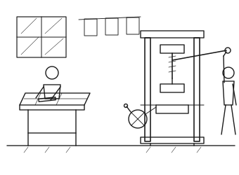
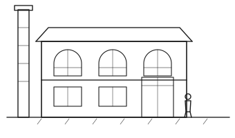

# The Founding Decades

## The Charter and the First Imprints

From an act of incorporation to the first printed sheets.

When the Board of Curators gathered in the spring of 1876, the question before them was not
whether Ashcombe University should keep a press, but whether a press could be made to pay its own
way within a decade. The founding statute, sealed on the ninth of May, granted the university
leave “to keep and maintain a printing house, and to print, publish, and vend books, sheets, and
pamphlets for the advancement of learning.”
On its face it was a modest instrument, no longer than a page and a half, yet it settled a debate
that had run through three successive Boards.

The charter did more than license machinery. It created an office—the Printer to the
University—and fixed its holder within the hierarchy of the institution, answerable to the
Curators through the Delegate for Learning rather than to any commercial
partner.Ashcombe University, Minutes of the Board of Curators,
vol.&nbsp;III, fol.&nbsp;12r–16v. The distinction mattered. Where the older college presses
had leased their equipment to tradesmen who printed on their own account, Ashcombe resolved from the
outset that the imprint should belong to the university and to no one else.

The first appointment went to William Harbert, a journeyman compositor who had served seven years
in a commercial house at Corstead before presenting himself to the Curators with a case of pica type
and a folded letter of recommendation.Register of the Bibliotheca
Ashcombiensis, Chest of Charters, Box&nbsp;III, fol.&nbsp;3.

<aside>Harbert’s annotated proof of the first title sheet survives as Bibliotheca MS 3, its margins crowded with a small upright hand.</aside>

He was neither a scholar nor a man of means, and the Curators seem to have valued him precisely
for that: he asked for a fixed stipend, a house near the works, and the promise of an apprentice,
and he pressed for nothing more.

<figure id="fig-printing-house">

<figcaption>The first printing house, from a wood engraving of c.&nbsp;1878: a compositor sets from the upper case while the pressman works the
screw.</figcaption>
</figure>

The works themselves were lodged in two low rooms off the Old Almonry, a stone building the
university already owned and could spare. The larger room held a single wooden screw press of the
common pattern, secondhand and lately rebuilt; the smaller held the type cases, the imposing
stone, and a narrow bed for the apprentice.Diary of the Printing Office,
Notes on Expenditure, fol.&nbsp;3. Damp was the constant enemy: the earliest accounts record
more shillings spent on charcoal to dry the sheets than on ink.

The first imprints were, as one might expect, occasional and slight: a sermon preached at the
opening of term, a table of the university statutes, and two broadsheets of verses for a public
commemoration. None ran to more than a few leaves, and none was offered for sale beyond the
university gates. They served instead to prove the press—to show the Curators that sheets could be set,
corrected, printed, and folded within the walls.

Only in the second year did anything resembling a book appear. Harbert set, over the winter, a
small octavo of moral philosophy—the _Elements of Demonstrative Reasoning_, drawn from a lecturer’s notes and
printed at the author’s charge.Preface to the _Elements of Demonstrative Reasoning_
(Ashcombe: University Press, 1878).

<aside>The impression ran to three hundred copies, of which the Bibliotheca still holds eleven, two of them uncut.</aside>

Its preface announced that the university now possessed “the means of committing its own learning
to the press, that the labour of the schools might not perish with the voice that uttered it.”

The figures gathered in &nbsp;tell the story of the founding decades more plainly than any
prospectus. Growth was steady rather than sudden: the output of the first ten years barely
exceeded ninety titles, most of them slight, while the decade before the semicentenary passed two hundred and fifty. Yet the
proportions are as telling as the totals. Scholarly works never overtook the pamphlets in number,
and it was the steady traffic of texts and manuals that kept the press solvent through the leaner
years.

By the close of its first half-century the press had become, if not a source of profit, at least a
settled charge that no Board proposed to abolish. Harbert had long since been succeeded by a master trained
within the house, and the two low rooms had given way to a purpose-built works with a steam machine and a warehouse, and the charter of 1876 lay in the
muniment room, its clauses long outgrown; but the principle it fixed proved the most durable of
all the founders’ imprints.

<figure class="full-width" id="tbl-titles-published">

<figcaption>Titles Published, 1876–1926</figcaption>

| Period    | Scholarly Works | Texts &amp; Manuals | Pamphlets | Total Titles |
| --------- | --------------- | ------------------- | --------- | ------------ |
| 1876–1885 | 28              | 16                  | 51        | 95           |
| 1886–1895 | 46              | 28                  | 74        | 148          |
| 1896–1905 | 63              | 37                  | 81        | 181          |
| 1906–1915 | 79              | 45                  | 92        | 216          |
| 1916–1926 | 94              | 58                  | 107       | 259          |
| Total     | 310             | 184                 | 405       | 899          |

</figure>

## The Almonry Works and the Apprentice Book

Twenty-five years of one printer, four apprentices, and a single refusal.

Harbert kept the works for twenty-five years, and almost everything that can be known about how the
press was run in that time comes from two sources: the Diary of the Printing Office, which he wrote
up weekly in a hand that grows steadily smaller, and the Apprentice Book, a vellum-bound register
in which every indenture, wage, and completed term was entered until 1947.Apprentice Book of the University Press, 1877–1947, Bibliotheca
MS&nbsp;41. Between them they describe a house of remarkable stability and remarkable
smallness. At no point before 1901 did the press employ more than five people at once.

The apprenticeship was the whole of its training system. A boy was taken at fourteen on a seven-year
indenture, paid three shillings a week rising to eleven, and taught the case first, the stone
second, and the press last; the Delegates paid a premium of five pounds on the completion of the
term, and the Diary records with satisfaction that all four of Harbert’s apprentices completed
theirs.Diary of the Printing Office, entries for 24&nbsp;June 1884,
2&nbsp;July 1891, 19&nbsp;June 1896, and 7&nbsp;July 1900. Two of the four stayed for their
whole working lives. One of them, Thomas Ferrand, succeeded to the office.

<aside>The premium was raised to ten pounds in 1902 and abolished, along with the indenture system, in 1947.</aside>

The Delegates met four times a year and read everything. Their minute books for the eighteen-eighties
show a body taking a close, unhurried, and occasionally severe interest in matters that a modern
committee would delegate: the weight of paper for a mathematical text, whether a plate should be
engraved or lithographed, and — repeatedly — whether a proposed book would sell enough copies to
recover its composition. Of the two hundred and eleven proposals put to them between 1878 and 1900,
they approved a hundred and sixty-three, deferred thirty-four, and declined
fourteen.Minutes of the Delegates of the Press, vols.&nbsp;I–III, tabulated
in Appendix D.

The fourteenth refusal was the one that mattered. In the spring of 1893 the Delegates declined to
print a monograph on the geology of the county by a Professor of the university, on the ground —
minuted with a bluntness that reads badly now — that the work “rests upon observation insufficiently
distinguished from inference.” The Professor printed it in the town at his own charge, sold rather
well, and did not speak to two of the Delegates again. The episode is worth recording because it
established, in practice, the principle the Delegates’ Report of 1875 had asserted only in theory:
that the imprint was a judgement and not a
service.Minutes of the Delegates of the Press, vol.&nbsp;II, 11&nbsp;April
1893; and see Ferrand’s memorandum of 1921 on the incident.

<aside>The monograph is now thought to have been substantially right about the county’s clays and substantially wrong about everything else.</aside>

What the house did possess, and what its size made possible, was a style. Harbert settled the
Ashcombe page within his first five years and did not afterwards alter it: a single old-face
roman in three sizes, a measure of twenty-six ems, no display type at all, and chapter openings
distinguished by nothing more than a dropped line and small capitals. The Diary shows him refusing,
in 1886, to buy a fount of the ornamented capitals then universal in the trade, on the ground that
“they must be used when they are had.” The judgement now looks like taste and was probably
economy; the effect was the same either way, and Ashcombe imprints of the eighteen-nineties are
recognisable across a room.

<aside>The house measure of twenty-six ems survived until Prowse narrowed it by two in 1941, and the narrowed measure survives still.</aside>

Proof-reading was the other thing the house did unusually well, and it did it because it was small
enough to do it slowly. Every sheet was read twice in the office and once by the author, and the
Diary records the schedule with a precision that becomes comic: forty-eight hours between the
reader’s first and second passes, on the theory — Harbert’s, and never explained — that a proof read
twice in a day is read once.

Money was a constant anxiety and never quite a crisis. The press was carried on the university’s
books as a charge, not as a trading concern, and its accounts before 1901 do not separate the cost
of composition from the cost of the building. What can be reconstructed suggests a house running at
a deficit of between forty and ninety pounds a year through the eighteen-eighties, closing to
within twenty pounds of its costs by 1897, and turning its first recorded surplus — eleven pounds
and some shillings — in the year of Harbert’s
retirement.Accounts of the Printing Office, 1878–1901, summarised by the
Bursar’s clerk in 1902.

Harbert himself remains, at this distance, a figure of great competence and almost no personality.
He published nothing, sat on nothing, and appears in no photograph. What survives of him is the
work: some six hundred and twenty title sheets, a house style that his successors kept for forty
years after his death, and a set of proofs whose corrections show a compositor’s eye for the shape
of a page rather than a scholar’s for the sense of it. When he retired in 1901 the Delegates voted
him a pension of sixty pounds and the freedom of the works, and he was seen about the Almonry, the
Diary notes, “most mornings, until the winter.”

## Fire, Steam, and the Semicentenary

How the loss of the Almonry works gave the press the building it had failed to ask for.

The fire began in the drying loft on the night of 3 February 1908 and was out by four in the
morning. Nobody was hurt. The larger room, the standing type for two texts in the press, and rather
more than half the paper stock were destroyed; the type cases in the smaller room, being nearest
the door, were carried out into the court by the apprentice and two porters and survived with the
loss of a single case of long primer.Diary of the Printing Office,
4&nbsp;February 1908; Report of the Surveyor to the Curators, 19&nbsp;February 1908. The
university’s insurers paid eleven hundred and forty pounds.

<aside>The salvaged long primer was made up from three founts and remained visibly mismatched in Ashcombe imprints until 1931.</aside>

Ferrand, who had been Printer for seven years and had twice asked for more room, put a memorandum
before the Delegates within the fortnight. It did not propose repairing the Almonry. It proposed
abandoning it, on the ground that the works had outgrown the building before the fire and would
outgrow the repaired building within five years; and it asked for something the press had never
had, which was a floor laid out for the sequence of the work rather than for the shape of the rooms
that happened to be
available.Ferrand, _Memorandum on the Rebuilding of the Works_
(Ashcombe, 1908), §§&nbsp;2–7.

The Curators, who had refused a new works twice in the previous decade, agreed in nine weeks. The
insurance money, a second Ninham benefaction, and a loan against the press’s accumulated surpluses
bought a site and a shell on Fennel Row, two streets from the inner court, and the works opened
there on 29 September 1910.

<figure id="fig-fennel-row-works">

<figcaption>The Fennel Row works as opened in 1910, from the surveyor’s elevation: composing room above, machine room and warehouse below, with the boiler chimney at the left.</figcaption>
</figure>

What Fennel Row brought was not chiefly space but power. The wooden screw press had been retired in
1889 in favour of a hand-fed platen; the new machine room took a steam-driven flat-bed of a
commercial pattern, and with it the press could for the first time print an edition of a thousand
without the operation becoming, as Ferrand drily put it, “a question of stamina rather than of
printing.” Output rose by half within four years, and the character of the list changed with it:
the long runs of examination papers and prescribed texts that would carry the house through the
nineteen-twenties date from this
period.Accounts of the Printing Office, 1908–1915; and see .

<aside>The flat-bed machine of 1910 was kept, latterly for proofing, until the move to offset in 1966.</aside>

The building was also, for the first time, laid out as an argument. Ferrand’s memorandum had asked
for the work to move in one direction, and it did: paper came in at the Fennel Row end, went up to
the composing room on the first floor, came down to the machine room, and went out through the
warehouse at the far end into the yard. The composing room took the long north light of the arched
windows; the machine room, which needed the floor and not the light, took the ground. Nothing about
this was original — it was the standard plan of a small commercial works of the period — and that
was Ferrand’s point. The press had spent thirty-four years arranging its work around a building
designed for a bindery.

<aside>The warehouse at Fennel Row held stock for the whole list until 1968 and was, from 1929, the only part of the works with electric light throughout.</aside>

The staff doubled between 1908 and 1914, from five to eleven, and changed in kind as well as in
number. The press took on its first full-time reader in 1911 and its first woman employee, a
proof-reader, in 1912; by 1920 the reading room had three staff and was the only department with a
written procedure. It is a small irony of the house’s history that the department created last
under Ferrand produced his successor but one.

The war years checked the growth without reversing it. Paper was scarce and dear from 1916,
two of the six compositors were called up, and the Delegates suspended new scholarly titles for
nineteen months in favour of work for the university and the county. The list of 1917 is the
shortest between 1881 and 1942. But the press had by then acquired something it had not had in
1876, which was a body of work in print that continued to sell whether or not anything new was
added to it, and the reprint income of those years covered the wages of the men who stayed.

The semicentenary of 1926 was marked with a supper in the machine room, a commemorative octavo of
which four hundred copies were printed, and an address by the Chair of the Delegates that is the
first public statement of what the press thought it was for. Fifty years, he observed, had produced
eight hundred and ninety-nine titles, of which not one had been printed for profit and rather more
than four hundred had been printed at a
loss._An Address Delivered at the Semicentenary of the University Press_
(Ashcombe, 1926), pp.&nbsp;9–11. He considered this the proper proportion, and commended it
to his successors, who would shortly have cause to reconsider it.
