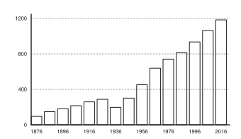

# Chronology

The dates on which the press turned, from the bindery of 1563 to the sesquicentenary.

<figure class="full-width" id="fig-output-by-decade">

<figcaption>Titles issued in each decade, 1876–2025. The fall of 1936–1945 is the effect of paper control; the total for the hundred and fifty years is 7,508.</figcaption>
</figure>

**1547** The university is founded by charter.

**1551** The first accession register of the Bibliotheca is begun.

**1563** A binder’s shop is established in the Old Almonry, and pays rent to the university for the next two hundred and eighty years.

**1584** The first stationers’ bonds are taken from booksellers trading within the university’s liberties.

**1631** Gervase Ninham leaves two hundred pounds for a printing house. A press stands in the Almonry for four years and prints nothing that survives.

**1636** The press is sold and the proceeds applied to the roof of the hall.

**1834** The Curators receive the first of three complaints on the price of prescribed texts bought from the trade.

**1868** Josiah Ledwell puts a paper before the Board proposing a press. It is referred to a committee.

**1871–1874** Nineteen pamphlets on the question are printed in Ashcombe, eleven for and eight against.

**1874** Charlotte Ninham offers a thousand pounds towards a printing house, on condition that it be established within three years.

**1875** The Delegates’ Report recommends a press of one press, one printer, and one apprentice.

**1876** The statute of incorporation is sealed on 9 May. William Harbert is appointed the first Printer to the University.

**1877** The Apprentice Book is begun. It is kept until 1947.

**1878** The first book bearing the university’s imprint, the _Elements of Demonstrative Reasoning_, is printed at the author’s charge in an impression of three hundred.

**1889** The wooden screw press is retired in favour of a hand-fed platen.

**1893** The Delegates decline a monograph on the geology of the county, and establish in practice that the imprint is a judgement.

**1897** The annual deficit of the printing office closes to within twenty pounds.

**1901** Harbert retires on a pension of sixty pounds. Thomas Ferrand, the first Printer trained inside the house, succeeds him.

**1903** The press begins printing the university’s two learned periodicals, which it does not publish.

**1908** Fire destroys the drying loft and the larger room of the Almonry works on the night of 3 February.

**1910** The new works open at Fennel Row on 29 September, with a steam-driven flat-bed machine.

**1917** The shortest list between 1881 and 1942 is issued. Two of the six compositors are called up.

**1919** Ferrand retires. Josiah Vane is appointed.

**1926** The semicentenary is marked in the machine room. Eight hundred and ninety-nine titles have been issued in fifty years.

**1931** Retrenchment. Two series are suspended and runs are shortened.

**1934** Vane dies at the works in November. Edith Prowse, head reader, becomes the first woman to hold the office.

**1938** The fourth edition of the _Rules of the House_ is issued. It remains in use until 1996.

**1940** Paper comes under control, on an allocation calculated from the press’s worst years.

**1941** Prowse issues her _Note on the Economy of the Page_, narrowing the standard measure by two ems.

**1946** Fourteen approved titles stand unprinted for want of paper, some of them for three years.

**1947** Prowse retires. Alfred Cousens is appointed, the first Printer since Harbert trained outside the house.

**1949** The _Concordance to the Prose of the Fourteenth Century_ is begun, to be printed a sheet at a time as funds allow.

**1953** The Committee on the University Press reports against closure by four votes to one, and recommends a capital grant and a declining subvention.

**1954** The first editorial secretary to the Delegates is appointed.

**1958** The Concordance is completed in three volumes, at a recorded loss of four thousand two hundred pounds.

**1961** Cousens retires. Selina Marchant is appointed, and is the first holder styled Director of the Press.

**1964** The paperback series is begun with twelve titles as an experiment.

**1966** Offset lithography replaces the flat-bed machines.

**1967** A standing distribution agreement takes export sales from eleven to thirty-eight per cent of turnover in six years.

**1968** The works move to a single-storey building on Gattersby Road.

**1972** The journals division is constituted with its own staff and accounts.

**1978** Marchant retires. Douglas Kerrich is appointed.

**1979** Hot-metal composition ceases. Setting passes to a filmsetting bureau.

**1983** The machine room is closed and the printing contracted to the trade for the first time since 1876.

**1990** Kerrich retires. Margaret Ledgard is appointed.

**1992** The editor of the _Ashcombe Review of Historical Method_ declines to renew the composition contract without a machine-readable back file.

**1993** Structured composition is adopted for the three journals, and made the house standard in 1999.

**1997** The retrospective conversion of eleven hundred out-of-print titles begins.

**1998** The sixth edition of the _Rules of the House_ appears, twice the length of the fifth and containing almost no typographic instruction.

**2002** Print on demand is adopted for the converted titles.

**2003** Ledgard retires. Peter Anselm Roe is appointed, and the editorial department returns to the Old Almonry.

**2008** The first two journals go to open access on an article charge, the third in 2010.

**2011** The second charter is sealed on 9 May, a hundred and thirty-five years to the day after the first.

**2012** Roe retires. Nadia Farrant is appointed.

**2013** The monograph list moves to a mixed open-access arrangement.

**2014** The press moves from Gattersby Road to the Ninham Building on the north campus.

**2019** Farrant retires. Imogen Braithe, the eleventh holder of the office, is appointed.

**2026** The sesquicentenary. Seven thousand five hundred and eight titles have been issued in a hundred and fifty years.
