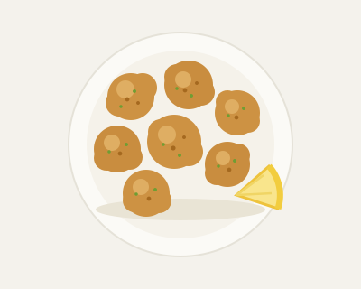
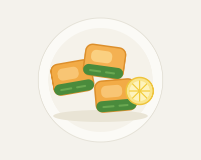
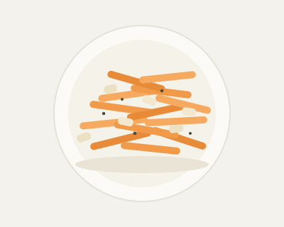
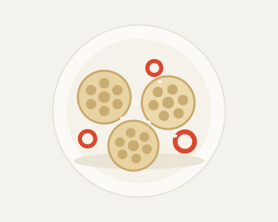
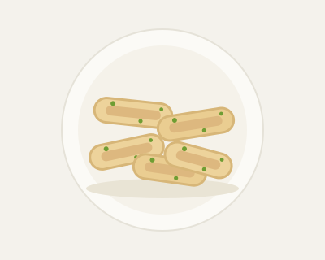
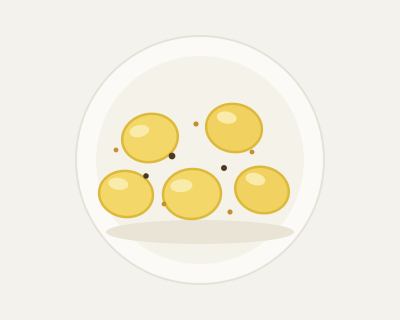

## ふんわり卵焼き

-  **10分**
-  **2人分**
-  _冷蔵_ **3日**
-  _冷凍_ **2週間**

| 材料（2人分） | 分量       |
| ------------- | ---------- |
| 卵            | 3個        |
| 砂糖          | 大さじ1    |
| しょうゆ      | 小さじ1    |
| みりん        | 小さじ1    |
| 塩            | ひとつまみ |
| サラダ油      | 適量       |

1. ボウルに卵を割り入れ、砂糖、しょうゆ、みりん、塩を加えてよく溶きほぐす。
2. 卵焼き器を中火で熱し、薄く油をひく。卵液の1/3量を流し入れ、半熟状になったら手前に巻く。
3. あいた部分に再び油を薄くひき、卵液の1/3量を流し入れて巻く。これをもう一度繰り返す。
4. 形を整え、弱火で1〜2分焼く。食べやすい大きさに切る。

## 鶏むねの青のり唐揚げ

-  **10分**
-  **2人分**
-  _冷蔵_ **3日**
-  _冷凍_ **2週間**

| 材料（2人分）      | 分量        |
| ------------------ | ----------- |
| 鶏むね肉（皮なし） | 1枚（250g） |
| 酒                 | 大さじ1     |
| しょうゆ           | 大さじ1     |
| おろししょうが     | 小さじ1     |
| 片栗粉             | 大さじ3     |
| 青のり             | 小さじ1     |
| サラダ油           | 適量        |

1. 鶏肉はそぎ切りにして、酒、しょうゆ、おろししょうがをもみ込み、10分ほど置く。
2. ポリ袋に片栗粉と青のりを入れて混ぜ、鶏肉を加えてまぶす。
3. フライパンに1cmほどの油を入れて中火で熱し、鶏肉を並べる。
4. 表面がカリッときつね色になるまで揚げ焼きにする。油をきって器に盛る。

## 鮭のみそマヨ焼き

-  **15分**
-  **2人分**
-  _冷蔵_ **3日**
-  _冷凍_ **2週間**

| 材料（2人分） | 分量          |
| ------------- | ------------- |
| 生鮭          | 2切れ（200g） |
| 塩            | 少々          |
| みそ          | 小さじ2       |
| マヨネーズ    | 大さじ1       |
| みりん        | 小さじ1       |
| 白いりごま    | 小さじ1/2     |

1. 鮭は1切れを半分に切り、塩をふって5分置き、出た水気をペーパーで拭く。
2. みそ、マヨネーズ、みりんを混ぜ合わせる。
3. アルミホイルに鮭を並べ、2を等分に塗って白ごまをふる。
4. トースターで8分、表面に焼き色がつくまで焼く。

## 豚こまとピーマンのしょうが炒め

-  **10分**
-  **2人分**
-  _冷蔵_ **3日**
-  _冷凍_ **2週間**

| 材料（2人分）  | 分量    |
| -------------- | ------- |
| 豚こま切れ肉   | 150g    |
| ピーマン       | 3個     |
| おろししょうが | 小さじ1 |
| しょうゆ       | 大さじ1 |
| 酒             | 大さじ1 |
| 砂糖           | 小さじ1 |
| ごま油         | 小さじ2 |

1. ピーマンは縦8mm幅に切る。しょうゆ、酒、砂糖、しょうがは合わせておく。
2. フライパンにごま油を中火で熱し、豚肉を2分炒める。
3. ピーマンを加え、しんなりするまで1分炒める。
4. 合わせ調味料を回し入れ、汁気がなくなるまで炒める。

## かぼちゃのレモン煮

-  **20分**
-  **4人分**
-  _冷蔵_ **4日**
-  _冷凍_ **3週間**

| 材料（4人分） | 分量          |
| ------------- | ------------- |
| かぼちゃ      | 1/4個（300g） |
| 水            | 150ml         |
| 砂糖          | 大さじ2       |
| レモン汁      | 大さじ1       |
| 塩            | ひとつまみ    |

1. かぼちゃは種とわたを除き、3cm角に切る。皮を所々そぎ落とす。
2. 鍋に皮を下にして並べ、水、砂糖、塩を加える。
3. 落としぶたをして中火で10分、竹串がすっと通るまで煮る。
4. レモン汁を加えてひと煮立ちさせ、火を止めて冷ましながら味を含ませる。

## ブロッコリーのおかかバター

-  **10分**
-  **2人分**
-  _冷蔵_ **3日**
-  _冷凍_ **2週間**

| 材料（2人分） | 分量          |
| ------------- | ------------- |
| ブロッコリー  | 1/2株（150g） |
| バター        | 10g           |
| しょうゆ      | 小さじ1       |
| かつお節      | 2g            |
| 塩            | 少々          |

1. ブロッコリーは小房に分け、塩を加えた湯で1分30秒ゆでる。
2. ざるに広げて粗熱を取り、水気をしっかりきる。
3. フライパンにバターを溶かし、中火でさっと炒める。
4. しょうゆを回し入れ、火を止めてかつお節を和える。

## にんじんとツナのラペ

-  **15分**
-  **4人分**
-  _冷蔵_ **4日**
-  _冷凍_ **×**

| 材料（4人分）    | 分量        |
| ---------------- | ----------- |
| にんじん         | 1本（150g） |
| ツナ缶（油漬け） | 1缶（70g）  |
| 酢               | 大さじ1     |
| 砂糖             | 小さじ1     |
| 塩               | 小さじ1/4   |
| 粗びき黒こしょう | 少々        |

1. にんじんは皮をむき、スライサーで細切りにする。
2. 塩をふって5分置き、しんなりしたら水気を絞る。
3. ツナは軽く油をきり、酢と砂糖を合わせる。
4. にんじんと3を和え、黒こしょうをふる。10分置くと味がなじむ。

## れんこんのきんぴら

-  **15分**
-  **4人分**
-  _冷蔵_ **4日**
-  _冷凍_ **3週間**

| 材料（4人分） | 分量    |
| ------------- | ------- |
| れんこん      | 200g    |
| 赤唐辛子      | 1/2本   |
| ごま油        | 小さじ2 |
| 酒            | 大さじ1 |
| しょうゆ      | 大さじ1 |
| 砂糖          | 小さじ2 |
| 白いりごま    | 少々    |

1. れんこんは皮をむいて3mm厚の半月切りにし、水に3分さらして水気をきる。
2. フライパンにごま油と、種を除いた赤唐辛子を入れて弱火で香りを出す。
3. れんこんを加えて中火で2分炒め、酒、しょうゆ、砂糖を加える。
4. 汁気がなくなるまで炒め、白ごまをふる。

## ちくわの磯辺揚げ

-  **10分**
-  **2人分**
-  _冷蔵_ **2日**
-  _冷凍_ **2週間**

| 材料（2人分） | 分量    |
| ------------- | ------- |
| ちくわ        | 4本     |
| 小麦粉        | 大さじ3 |
| 水            | 大さじ2 |
| 青のり        | 小さじ1 |
| サラダ油      | 適量    |

1. ちくわは長さを半分に切り、さらに縦半分に切る。
2. 小麦粉、水、青のりを混ぜて衣を作る。
3. フライパンに1cm深さの油を入れ、中火で熱する。
4. 衣をつけたちくわを両面1分ずつ揚げ焼きにし、油をきる。

## うずら卵のカレーピクルス

-  **10分**
-  **4人分**
-  _冷蔵_ **5日**
-  _冷凍_ **×**

| 材料（4人分）      | 分量      |
| ------------------ | --------- |
| うずらの卵（水煮） | 12個      |
| 酢                 | 大さじ3   |
| 水                 | 大さじ3   |
| 砂糖               | 大さじ1   |
| 塩                 | 小さじ1/3 |
| カレー粉           | 小さじ1/2 |

1. 小鍋に酢、水、砂糖、塩、カレー粉を入れ、中火で砂糖が溶けるまで温める。
2. 火を止めて粗熱を取る。
3. 保存容器にうずらの卵を入れ、2を注ぐ。
4. 冷蔵庫で3時間以上漬け、汁気をきってから詰める。
