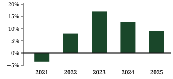
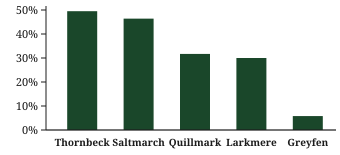
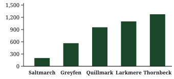

<header>Chapter 4 — Where the Numbers Come From</header>

## Four Documents, One Fund {#sec-documents}

Almost every figure you will ever read about a fund originates in one of four documents, and each of them is written for a different purpose. Knowing which document a number came from tells you how it was calculated, how old it is, and how much weight it can carry. A return quoted on a product page and the same return in an audited annual report are not interchangeable, even when the digits happen to agree.

The prospectus is the rulebook. It states what the fund is permitted to buy, what it may charge, and which risks the manager is obliged to disclose. It is a legal document rather than a performance record, so it answers questions of the form "may the fund do this?" rather than "how did the fund do?"

The annual report is the audited account of a completed financial year. It carries the statement of net assets, the statement of operations, and the statement of changes in net assets — the three tables from which nearly every published ratio is ultimately derived. Where a figure elsewhere disagrees with the annual report, the annual report is the one to keep.

Folded inside the annual report is a compact table called the financial highlights, which restates the same year on a per-share basis. The fact sheet, by contrast, is the monthly or quarterly summary: convenient, current, and entirely derived. Every number on it has been recomputed from the reports, occasionally under a different convention.

One complication cuts across all four documents. A single portfolio is often sold in several share classes, identical in what they hold and different in what they charge, and a document may quote any one of them. Two lines of the same table can therefore show one fund earning two returns, with no error anywhere; only the class differs.

<figure class="tbl" id="tbl-sources">

<figcaption>Where each kind of number is published</figcaption>

| Document      | Published        | Settles                       |
| ------------- | ---------------- | ----------------------------- |
| Prospectus    | Yearly           | Mandate, fees, risk limits    |
| Annual report | Yearly, audited  | Net assets, income, expenses  |
| Highlights    | In annual report | Per-share NAV, total return   |
| Fact sheet    | Monthly          | Trailing returns, holdings    |
| Product page  | Continuous       | Nothing; it quotes the others |

</figure>

The five funds in &nbsp;are used throughout this chapter. They are invented, and so is every figure attached to them; the arithmetic, however, is the arithmetic of a real report. Each fund was placed at a different point on the cost and risk spectrum, so that one calculation applied to all five yields visibly different answers.

Net assets record how much money a fund manages, not how well it manages it. Size matters chiefly for what it makes possible. A large index trust spreads its fixed audit, custody, and registration costs across a wide base, while a small specialist fund carries comparable bills on a fraction of the assets, and the difference shows up in the expense ratio long before it shows up anywhere else.

<figure class="tbl" id="tbl-funds">

<figcaption>The five sample funds, at the 2025 year end</figcaption>

| Fund                    | Mandate                | Net assets |
| ----------------------- | ---------------------- | ---------- |
| Thornbeck Growth Fund   | Large-cap growth       | 450        |
| Saltmarch Index Trust   | Broad market index     | 2,840      |
| Quillmark Balanced Fund | 60/40 equity and bonds | 1,120      |
| Larkmere Dividend Fund  | Dividend-paying equity | 690        |
| Greyfen Bond Fund       | Intermediate bonds     | 1,375      |

</figure>

Net assets are stated in millions of dollars. Two of the five funds do most of the work in the pages that follow. Thornbeck Growth Fund supplies the worked ledger in , because a fund with large flows in and out shows the mechanics most plainly. Larkmere Dividend Fund supplies the distribution history in , where income and total return part company in an instructive way.

Every figure in every document also carries two dates, and they are seldom the same. One is the date the data closes; the other is the date the document was released. A fact sheet published in February on figures closing on 31 December is six weeks stale before anyone reads it, which is harmless for a five-year return and misleading for a list of holdings.

Nothing in this chapter is advice about what to own. The aim is narrower and more durable: to take a page of fund data, work out what each figure is measuring, and confirm that the figures agree with one another before drawing any conclusion from them at all.

## Reading a Fund Ledger {#sec-ledger}

A fund ledger records what happened to a pool of money over a stated period: what came in, what it earned, what it cost to run, what was paid out, and what remained at the end. However long the statement runs, everything in it hangs on one identity,

$$
A_1 = A_0 + O - D + S
$$

in which $A_0$ and $A_1$ are the opening and closing net assets, $O$ is the net increase from operations, $D$ is the total distributed to shareholders, and $S$ is the net of share sales against redemptions.

The first check is the one the auditor has already made, and it costs nothing to repeat: 400,000 plus 34,000 less 9,000 plus 25,000 is 450,000. Where a published summary of the same fund reports a different closing figure, the difference is a definition rather than a discovery, and it is worth learning which definition moved.

The identity also works backwards. Given any four of the five quantities the fifth is determined, so a line missing from a summary can usually be recovered rather than guessed at.

<figure class="tbl" id="tbl-net-assets">

<figcaption>Thornbeck Growth Fund: changes in net assets</figcaption>

| Thousands of dollars     | 2025    | 2024    |
| ------------------------ | ------- | ------- |
| Net assets, 1 January    | 400,000 | 337,000 |
| Investment income        | 5,940   | 5,200   |
| Expenses                 | (3,315) | (2,860) |
| Net investment income    | 2,625   | 2,340   |
| Net realized gain        | 17,875  | 12,600  |
| Change in unrealized     | 13,500  | 21,660  |
| Increase from operations | 34,000  | 36,600  |
| Distributions paid       | (9,000) | (7,400) |
| Net share transactions   | 25,000  | 33,800  |
| Net assets, 31 December  | 450,000 | 400,000 |

</figure>

Two lines inside operations deserve to be read separately. Net investment income is what the portfolio collected in dividends and interest less what it cost to run the fund: 5,940 less 3,315 is 2,625. Realized gains are profits actually taken by selling, while the change in unrealized appreciation is a revaluation of what is still held. The three lines sum to the 34,000 shown as the increase from operations in 2025, and to 36,600 in 2024.

The mix of those lines matters more than the total. Thornbeck booked 21,660 of unrealized appreciation in 2024 against 13,500 in 2025, so a larger share of the earlier year's result was a mark rather than a sale, and marks can reverse.

The last line before the closing balance is the one most often mistaken for performance. Net share transactions of 25,000 mean investors put more money in than they took out. That is a fact about the fund's popularity, not about its skill, and it is exactly why net assets alone can never stand in for a return.

<figure class="tbl" id="tbl-highlights">

<figcaption>Thornbeck Growth Fund: financial highlights</figcaption>

| Per share             | 2025   | 2024   |
| --------------------- | ------ | ------ |
| NAV, 1 January        | 24.00  | 21.90  |
| Net investment income | 0.15   | 0.14   |
| Realized + unrealized | 2.01   | 2.60   |
| Total from operations | 2.16   | 2.74   |
| Distributions, income | (0.13) | (0.12) |
| Distributions, gains  | (0.40) | (0.52) |
| Total distributions   | (0.53) | (0.64) |
| NAV, 31 December      | 25.63  | 24.00  |
| Total return          | 9.0%   | 12.5%  |

</figure>

The per-share table restates the same year on the scale a shareholder actually experiences, and it obeys the same identity: 24.00 plus 2.16 less 0.53 is 25.63. Dividing the 2.16 earned per share by the 24.00 it started from gives 9.0 per cent, the total return printed on the final line.

One caution before leaving the table. The realized-and-unrealized line is a balancing figure struck after the income and distribution lines are fixed, so it will not scale up to the fund-level gains in . Shares were issued and redeemed all year, and the per-share view cannot know when.

## Returns Are Never One Number {#sec-returns}

A total return combines two things a fund does: it changes in price, and it pays out. Ignore either half and the figure stops meaning anything. A fund whose net asset value fell while it distributed generously may have earned its holders more than one whose value climbed and paid nothing, and only the combined figure will say so.

&nbsp;gives the annual total return of all five sample funds for each of the last five calendar years, with distributions assumed to be reinvested on the day they were paid. Read across a row and you learn about a fund; read down a column and you learn about a year. Both readings are needed, because a single number cannot separate the manager from the market.

The rows behave as their mandates suggest. Thornbeck, the growth fund, has the widest spread: a loss of 3.5 per cent in 2021 and a gain of 17.0 in 2023, a range of more than twenty points. Greyfen, the bond fund, moves in a band under half as wide and spent two years in the red. Neither pattern is a verdict; they are what the two mandates were built to produce.

<figure class="tbl" id="tbl-annual-return">

<figcaption>Annual total return, per cent, by calendar year</figcaption>

| Fund      | 2021 | 2022 | 2023 | 2024 | 2025 |
| --------- | ---- | ---- | ---- | ---- | ---- |
| Thornbeck | −3.5 | 8.0  | 17.0 | 12.5 | 9.0  |
| Saltmarch | 2.0  | 6.5  | 14.0 | 10.0 | 7.5  |
| Quillmark | 1.0  | 4.5  | 10.5 | 7.0  | 5.5  |
| Larkmere  | 5.0  | 3.0  | 8.5  | 6.0  | 4.5  |
| Greyfen   | −1.5 | −4.0 | 5.5  | 3.5  | 2.5  |

</figure>

One caution applies to the whole table. These are the funds' returns, not any holder's. Someone who bought in March and sold in October experienced neither the annual figure nor any part of it that can be recovered from the row. A published return describes a unit of the fund held for the entire period, and nothing else.

Precision deserves a word as well. The figures are carried to one decimal place because that is as far as the source data can honestly be taken, and a fund quoting a return to three decimals is describing its own rounding rather than its skill. Nor does a row say anything about how its result was produced: two funds can post the same 9.0 per cent, one from a portfolio that barely moved and one from a portfolio that doubled and halved, and the table will not tell them apart.

Reading down the columns is the quicker lesson. Every fund in the table did better in 2023 than in 2022, and every fund did worse in 2025 than in 2023. When five different mandates move together, the common factor is the market, and a manager who looks brilliant in such a year is mostly holding the right asset class.

Annual figures do not add up, and they do not average. To compress a run of years into one number the growth factors must be multiplied and the product rooted, which gives the annualized, or compound, return

$$
R_n = \left[(1+r_1)(1+r_2)\cdots(1+r_n)\right]^{1/n} - 1
$$

for yearly returns $r_1$ through $r_n$. For Thornbeck the five factors multiply to 1.4953, so the fund grew by 49.5 per cent over the period; the fifth root of that product is 1.0838, an annualized 8.4 per cent. The arithmetic mean of the same five numbers is 8.6 per cent, and it is wrong, because it credits the fund with a base it never had.

<figure id="fig-annual-return">

<figcaption>Annual total return, Thornbeck Growth Fund</figcaption>
</figure>

The chart plots the Thornbeck row of &nbsp;against a zero line, which is the one convention worth insisting on. A bar chart of returns drawn from a truncated baseline exaggerates every difference on the page, and it is the most common way an honest set of figures is made to tell a dishonest story.

Two conventions decide what a row like this can be compared with. The first is the calendar. These are calendar years, but a fund whose financial year closes in June will report its own twelve-month periods, and the two series cannot be laid side by side however similar the labels look.

The second concerns which price is being measured. For a fund quoted on an exchange there are two returns, one computed from net asset value and one from the traded price, and they differ whenever the shares trade away from the value of what they hold. The gap is usually small and occasionally not, and it widens exactly when the market is least willing to trade what the fund owns. Reports state which of the two they are quoting in a footnote, and the footnote is worth reading.

Before compressing the years, it is worth summarizing them. &nbsp;reduces each row of &nbsp;to four statistics, none of which needs anything the previous page did not already print: the best year, the worst year, the distance between them, and the count of years that finished above zero.

<figure class="tbl" id="tbl-dispersion">

<figcaption>Dispersion of the annual returns in&nbsp;</figcaption>

| Fund      | Best | Worst | Spread | Positive |
| --------- | ---- | ----- | ------ | -------- |
| Thornbeck | 17.0 | −3.5  | 20.5   | 4 of 5   |
| Saltmarch | 14.0 | 2.0   | 12.0   | 5 of 5   |
| Quillmark | 10.5 | 1.0   | 9.5    | 5 of 5   |
| Larkmere  | 8.5  | 3.0   | 5.5    | 5 of 5   |
| Greyfen   | 5.5  | −4.0  | 9.5    | 3 of 5   |

</figure>

The spread column is the crudest measure of variability there is, and its single virtue is that a reader can check it by eye. Thornbeck's twenty and a half points against Larkmere's five and a half says something real about the two mandates; it says nothing about the order in which the years arrived, and order is what a holder actually lives through.

Applying the compound formula to every row of &nbsp;now produces , which is the shape most fact sheets use. The one-year column is simply the 2025 figure copied across; the three-year and five-year columns are annualized; the last column is cumulative growth over the whole period, and it is the only one of the four that can be compared directly with a bank balance.

<figure class="tbl" id="tbl-trailing">

<figcaption>Trailing total return to 31 December 2025, per cent</figcaption>

| Fund      | 1 yr | 3 yr | 5 yr | 5 yr cum. |
| --------- | ---- | ---- | ---- | --------- |
| Thornbeck | 9.0  | 12.8 | 8.4  | 49.5      |
| Saltmarch | 7.5  | 10.5 | 7.9  | 46.4      |
| Quillmark | 5.5  | 7.6  | 5.7  | 31.7      |
| Larkmere  | 4.5  | 6.3  | 5.4  | 30.0      |
| Greyfen   | 2.5  | 3.8  | 1.1  | 5.8       |

</figure>

The four columns rank the funds identically and describe them quite differently, and the difference is the useful part. Thornbeck leads Saltmarch by 2.3 points over three years and by only half a point over five, because the growth fund spent 2021 recovering from a loss the index trust never took.

Greyfen shows the same effect at its extreme. Three years of 3.8 per cent a year is a respectable result for an intermediate bond fund, but stretch the window back two years to include 2021 and 2022 and the annualized figure collapses to 1.1. Nothing changed except where the window began.

That is the whole difficulty with trailing returns: the start date is chosen, and whoever chooses it decides much of the answer. A fund quoting only its three-year record is not necessarily hiding anything, but the reader has no way to tell without the annual series, which is why &nbsp;comes first in this chapter and &nbsp;second.

<figure id="fig-cumulative">

<figcaption>Five-year cumulative total return, 2021–2025</figcaption>
</figure>

Plotted against a zero baseline, the cumulative column separates the five funds into three groups rather than five: two equity funds near fifty per cent, two middle funds near thirty, and the bond fund far below. The ranking is unsurprising, and so it should be. Over a period in which the broad index rose in every one of the five years, a fund that held more equity finished ahead of one that held less.

The comparison to insist on is not between these five funds but between each fund and the benchmark named in its own prospectus. Saltmarch is meant to track a broad index, so a five-year gap of a point or two against that index would be a real finding; Thornbeck is meant to beat one, and its 49.5 per cent means very little until the index it chose is written beside it.

A table of survivors carries one more bias worth naming. Funds that closed or were merged away during the five years are not in , because there is nothing left to report, and the funds that close are rarely the ones that did well. Any list assembled from what still exists flatters the group it describes.

Two conventions remain. Returns are quoted after the fund's own expenses but before the holder's tax, and they assume distributions were reinvested rather than spent — the first taken up in , the second in .

## What Costs Actually Cost {#sec-costs}

The expense ratio is the one figure in a fund report that is known in advance. Returns are a forecast dressed as history; costs are a subtraction that has already been agreed. That asymmetry is the reason a careful reader spends more time on the smaller number.

It is computed as the year's operating expenses divided by average net assets. Thornbeck’s ledger in &nbsp;gives both terms: expenses of 3,315 thousand against average net assets of 425,000 thousand, the mean of the 400,000 it opened with and the 450,000 it closed with. The quotient is 0.78 per cent.

A single ratio conceals a list. &nbsp;breaks that 3,315 thousand into the components an annual report is required to itemize, each shown in dollars and as a share of the same 425,000 thousand.

<figure class="tbl" id="tbl-expense-components">

<figcaption>What Thornbeck's 0.78 per cent is made of</figcaption>

| Component       | Thousands | Per cent |
| --------------- | --------- | -------- |
| Management fee  | 2,550     | 0.60     |
| Administration  | 340       | 0.08     |
| Custody         | 170       | 0.04     |
| Audit and legal | 145       | 0.03     |
| Transfer agency | 110       | 0.03     |
| Total expenses  | 3,315     | 0.78     |

</figure>

The management fee is just over three-quarters of the total and is the only line set by choice rather than by contract with a third party. The remainder is the cost of being a fund at all, and much of it is close to fixed in dollars: an audit costs what it costs whether the fund holds fifty million or five hundred. Those lines fall as a share of assets as a fund grows, which is one reason the largest funds in &nbsp;are the cheapest.

Two further costs sit outside the ratio altogether. Sales charges are paid by the buyer rather than by the fund, so they never enter this calculation at all; the dealing costs of running the portfolio are paid inside it, deducted from returns before any return is reported. The expense ratio is a complete account of one kind of cost and no account whatever of the other two.

Turnover is computed on the same base, as the lesser of purchases and sales over average net assets. Thornbeck bought 352,000 thousand of securities during 2025 and sold 331,500 thousand, so its turnover is 331,500 over 425,000, or 78 per cent. The fund replaced roughly four-fifths of its portfolio in a year.

Turnover is not itself a charge, and no report will bill you for it. It is a signal of charges that are real but unreported: the dealing spreads and market impact paid inside the portfolio, which are already deducted from the returns you see and appear nowhere in the expense ratio.

<figure class="tbl" id="tbl-cost-turnover">

<figcaption>Annual cost and portfolio turnover, 2025</figcaption>

| Fund      | Expense | Turnover | Per 10,000 |
| --------- | ------- | -------- | ---------- |
| Thornbeck | 0.78%   | 78%      | 78.00      |
| Saltmarch | 0.12%   | 8%       | 12.00      |
| Quillmark | 0.58%   | 42%      | 58.00      |
| Larkmere  | 0.67%   | 35%      | 67.00      |
| Greyfen   | 0.34%   | 15%      | 34.00      |

</figure>

The last column converts each ratio into the sum a holder of ten thousand dollars pays in a single year, which is the form in which costs stop sounding abstract. Seventy-eight dollars against twelve is a difference most readers can weigh; 0.78 per cent against 0.12 per cent is not, and the percentage is the form nearly every document chooses.

One year understates the case badly, because money paid away is also money that never compounds. Suppose all five funds earned exactly six per cent a year before expenses for ten years, and that the only thing separating them was the ratio in . Ten thousand dollars would grow to 17,908 with no costs at all. &nbsp;shows what each fund’s ratio removes from that total.

<figure id="fig-fee-drag">

<figcaption>Ten-year cost of fees on 10,000 invested</figcaption>
</figure>

The gap between the cheapest and the dearest fund is 1,073 dollars, more than a tenth of the sum originally invested, and it is produced entirely by a difference of two-thirds of one percentage point a year.

&nbsp;sets out the same calculation fund by fund. The net return column is six per cent less the expense ratio; the value column compounds it over ten years; the last column is the shortfall against the 17,908 that no costs at all would have produced.

<figure class="tbl" id="tbl-ten-year">

<figcaption>10,000 invested for ten years at 6.00 per cent gross</figcaption>

| Fund      | Net  | Value  | Cost  |
| --------- | ---- | ------ | ----- |
| Saltmarch | 5.88 | 17,707 | 202   |
| Greyfen   | 5.66 | 17,342 | 566   |
| Quillmark | 5.42 | 16,952 | 956   |
| Larkmere  | 5.33 | 16,808 | 1,100 |
| Thornbeck | 5.22 | 16,633 | 1,275 |

</figure>

Notice that the cost column is not proportional to the ratio. Thornbeck's expense ratio is six and a half times Saltmarch's, but its ten-year cost is more than six times as large in dollars, and larger still with every year that passes. Costs compound in the same way returns do, and against the holder.

Lengthen the period to twenty-five years and the same two funds finish at 41,720 and 35,683, a gap of 6,038 dollars on an original ten thousand. The ratio never changed; only the number of years it was applied to.

One simplification is worth naming. The calculation holds each ratio still for the whole period, and published ratios move. Managers waive part of a fee to launch a fund and let the waiver lapse; large funds cut fees as they grow. A prospectus states both the gross ratio and the net one actually charged, together with the date the waiver expires, and it is the second figure that belongs in a projection.

The table is a controlled experiment, not a forecast. Every fund was handed the same gross return so that cost could be isolated, which is the one thing a real comparison can never do. A dear fund that genuinely earns more than a cheap one is worth its price; the point is that the price is certain and the extra return is not.

None of this argues for buying whatever is cheapest. It argues for treating cost as the part of a comparison that is already known, and for requiring the rest of the comparison to justify itself against a figure that will be paid whether or not the fund performs.

## Income Is Not Return {#sec-income}

Distributions are the cash a fund passes through to its holders: the dividends and interest it collected, and the realized gains it is required to hand on. They are visible, regular, and easy to admire, which is why they are the most frequently misread figures in fund data.

&nbsp;traces five years of Larkmere Dividend Fund. The distribution per share rose every year, from 1.28 to 1.60, an increase of 25 per cent over the period, or about 5.7 per cent a year. The distribution yield, which is that payment divided by the year-end net asset value, rose in each of the four years that followed.

<figure class="tbl" id="tbl-larkmere">

<figcaption>Larkmere Dividend Fund, per share and per cent</figcaption>

| Year | Paid | NAV   | Yield | Return |
| ---- | ---- | ----- | ----- | ------ |
| 2021 | 1.28 | 42.82 | 2.99  | 5.0    |
| 2022 | 1.36 | 42.74 | 3.18  | 3.0    |
| 2023 | 1.44 | 44.93 | 3.20  | 8.5    |
| 2024 | 1.52 | 46.11 | 3.30  | 6.0    |
| 2025 | 1.60 | 46.58 | 3.43  | 4.5    |

</figure>

Set the yield column beside the total return column and the two disagree in every year. In 2023 the fund yielded 3.20 per cent and returned 8.5; in 2025 it yielded more, 3.43 per cent, and returned less, 4.5. A yield is a ratio, and a ratio has a denominator that moves for reasons of its own.

The two halves of a distribution also differ in kind. Income passed on from dividends and interest is a genuine transfer of what the portfolio earned. Realized gains handed on are a transfer of value the holder already owned through the net asset value, converted into cash by an act of selling.

Reports separate the two, and the separation is the first thing to look for when a payment jumps. &nbsp;does it for Thornbeck: of the 0.53 distributed per share in 2025, 0.13 came from income and 0.40 from realized gains, a proportion that says a good deal about the year's selling and very little about the portfolio's yield.

Larkmere’s payments in &nbsp;rise smoothly, which is itself a fact worth noticing rather than admiring. A fund can smooth a distribution by choosing when to realize gains, and a line that never falls has usually been managed to look that way.

The mechanics explain the disagreement. On the day a distribution is paid, the net asset value falls by the amount paid; the cash has left the fund and arrived in the holder's account. A distribution therefore moves value from one column to another and creates none. Total return already contains it, which is why the two figures cannot be added together.

It follows that buying a fund shortly before a large distribution gains nothing. The purchase price includes the payment about to be made, the payment arrives, and the net asset value drops by the same amount on the same day. The holder is left where they started, and in a taxable account slightly behind.

That also settles what a rising yield does and does not tell you. It can rise because the payment grew, as it did at Larkmere; it can equally rise because the price fell, which is the same ratio delivering the opposite news. The numerator and the denominator have to be read separately before the quotient means anything.

Two funds holding identical portfolios can report different yields simply by paying on different schedules, monthly against annually, and the more frequent payer will look like the better income holding while earning the same total return.

A yield far above its peers deserves the same treatment. It may reflect what the portfolio genuinely earns, or a payment topped up out of capital, or simply a price that has fallen faster than the payment was cut. The three look identical in the ratio and quite different in the statement the ratio was computed from.

Reinvestment is the last piece. Adding the five payments in &nbsp;gives 7.20 per share, and the net asset value rose from 42.00 at the end of 2020 to 46.58, a gain of 4.58. Taken together that is 11.78 on a starting price of 42.00, or 28.0 per cent — while &nbsp;records a five-year cumulative total return of 30.0 per cent for the same fund.

The missing two points are not an error in either figure. They are what the distributions earned after they were reinvested. A holder who spent the cash instead received the 28.0 per cent; a holder who bought more shares with it received the 30.0. Published total returns always assume the second, and the assumption is stated in the footnotes rather than the headline.

Read the yield and the total return, then, as answers to two different questions. The yield says how much cash arrived and when; the total return says how much the holding grew. A holder who needs the cash cares about both figures; a holder who does not, only about the second.

## A Checklist for the Next Report {#sec-checklist}

None of the arithmetic in this chapter is difficult, and none of it needs to be done from scratch a second time. What it needs is an order, so that a figure is never used before the figures it depends on have been checked.

1. **Name the source.** Prospectus, annual report, or fact sheet. Note the date the figures close, not the date they were published.
2. **Name the share class.** One portfolio can be sold at several prices, and only one of them is the one in front of you.
3. **Close the ledger.** Opening net assets, plus operations, less distributions, plus share transactions, must equal closing net assets.
4. **Split operations.** Separate net investment income, realized gains, and the change in unrealized value. A result built mostly on marks is a provisional result.
5. **Recompute the ratios.** Expenses over average net assets, and the lesser of purchases and sales over the same base.
6. **Open up the ratio.** Ask which part of the expense is the management fee and which part is the cost of being a fund at all.
7. **Find the annual series.** Trailing returns alone cannot show you which years the window excluded.
8. **Annualize by multiplying.** Compound the growth factors and take the root; never average the yearly percentages.
9. **Separate yield from return.** Read the payment and the price apart before reading the ratio they form.
10. **Name the benchmark.** A return without the index it was meant to track is a number without a claim.

Work through the list once on a report you already own. The first pass is slow, the second is not, and by the third the exceptions start to announce themselves — which is the only part of the process that cannot be printed in a table.

The order is deliberately about arithmetic rather than judgement. Judgement is what the remaining chapters are for, and it is worth spending on figures that have already been made to agree with one another. A page of fund data that survives all ten steps is not thereby a good investment; it is merely a page that says what it appears to say, which is the least a reader is owed and rather more than a reader is usually given.
