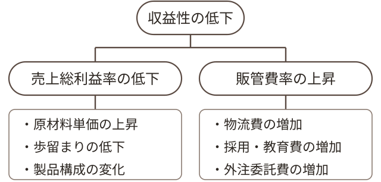

# 経営診断の進め方

経営診断とは、企業の現状を体系的に調べ、事実に基づいて課題を特定し、実行可能な改善の道筋を示す一連の作業である。決算書を読むだけでも、現場で話を聞くだけでも診断は完結しない。両者を突き合わせ、数値の背後にある仕組みを言葉で説明できて初めて、提言は相手に届く。

<aside class="sidenote">

用語解説：

<dl>
<dt>経営診断</dt>
<dd>企業の経営状態を体系的に調査・分析し、課題を明らかにしたうえで改善の方向を示す一連の活動。外部の専門家が担う場合と、社内の担当者が自ら行う場合とがある。</dd>
</dl>

</aside>

本章では、診断の流れを「現状把握」「課題整理」「施策立案」の三つの工程に分け、それぞれの工程で何を見るのか、どのような順序で進めるのかを述べる。説明にあたっては、みなみのはら市に本社を置く中堅食品メーカー、みなみのはら食品工業株式会社（以下「M社」）の診断を例として用いる。なお、本書に登場する企業・団体・調査資料はいずれも架空のものである。

読み進めるにあたっては、手順そのものよりも、各工程で何を確かめようとしているのかに注意を向けてほしい。手順は対象企業の規模や業種によって変わるが、確かめるべき事柄の骨格は変わらない。

## 現状分析の視点

経営診断の出発点は、対象企業の現状を正確に把握することにある。現在の姿を多面的・客観的に捉えることなくして、的確な課題の抽出も、実効性のある施策の立案も実現しない。

現状分析では、外部環境と内部環境の双方をバランスよく見極める必要がある。外部環境については、市場動向、競合の状況、技術変化、規制・制度、ステークホルダー※の期待などを体系的に整理する。

<aside class="sidenote">

用語解説：

<dl>
<dt>ステークホルダー</dt>
<dd>企業活動によって影響を受ける、または企業活動に影響を与える利害関係者のこと。顧客、従業員、株主、取引先、地域社会、行政などが含まれる。</dd>
</dl>

</aside>

内部環境については、事業構造、経営資源、業務プロセス、組織体制、財務状況、人材の質と量、企業文化など、多角的な視点から分析を進める。

情報収集の際には、定量データと定性情報の双方を活用することが重要である。財務諸表や業績指標などの数値データは客観性に優れる一方で、インタビューや現場観察から得られる定性情報は、数値の背景にある構造や文脈を理解するうえで欠かせない。

<aside class="sidenote">

参考資料：

三雲宗久<cite>『経営診断の実務――現場で使えるフレームワーク』</cite>（匙屋書林、2021年）第2章「現状分析の基本アプローチ」を参照。

</aside>

また、過去との比較や同業他社とのベンチマーキングを通じて、強み・弱みや位置づけを明確にすることが求められる。単年度の結果に一喜一憂するのではなく、中長期のトレンドを踏まえた分析が不可欠である。

現状分析の視点は、目的とする診断の範囲や深度によって異なるが、本書では「全体最適の実現」を常に意識することを基本とする[（→第3章参照）](#ch03)。

<aside class="sidenote">

用語解説：

<dl>
<dt>バリューチェーン</dt>
<dd>企業の価値創造活動を、原材料の調達から製造、販売、アフターサービスに至るまでの一連の連鎖として捉える考え方。競争優位の源泉を特定するうえで有効な分析視点である。</dd>
</dl>

</aside>

部分最適に陥らないためには、バリューチェーン※全体を俯瞰し、各活動のつながりや相互作用を把握することが有効である。ある工程の効率化が、別の工程の負担増を招いていないか。ある部門の目標達成が、全社の利益を損なっていないか。分析の単位を意図的に広げたり狭めたりしながら、影響の及ぶ範囲を見定めていく。

{#fig-process}

三つの工程は一方向に進むとは限らない。課題を整理する段階で情報の不足に気づき、現状把握へ立ち戻ることは珍しくない。むしろ、行きつ戻りつしながら理解を深めていく過程そのものが診断であると考えたほうがよい。ただし、後戻りの回数を減らすためにも、最初の情報収集はできるだけ広く網をかけておきたい。

以上のプロセスを通じて、事実に基づく問題認識を形成し、次のステップである課題の整理へとつなげていく。現状分析は、診断全体の精度と説得力を左右する根幹工程であり、十分な時間と労力をかけて取り組む価値がある。

## 情報収集の設計

診断の初期に集めた情報は、その後の工程すべての土台となる。しかし実務では、限られた期間と人員のなかで情報を集めなければならない。闇雲に資料を求めるのではなく、何を明らかにするために何を集めるのかを、あらかじめ決めておく必要がある。

情報源は大きく四つに分けられる。決算書・組織図・業務手順書・販売実績などの社内資料、経営者や従業員への聞き取り、工場や店舗における現場観察、そして統計や業界資料などの外部資料である。それぞれ得意とする領域が異なるため、単独ではなく組み合わせて用いる。

<aside class="sidenote">

用語解説：

<dl>
<dt>一次情報</dt>
<dd>調査者が自ら収集した情報。聞き取りや現場観察の記録がこれにあたる。他者がまとめた統計や報告書などは二次情報と呼び、前提条件の違いに注意して用いる。</dd>
</dl>

</aside>

<figure class="tbl" id="tbl-sources">

<figcaption>情報源と得られる情報の性質</figcaption>

| 情報源   | 主に得られること             | 留意すべき点                         |
| -------- | ---------------------------- | ------------------------------------ |
| 社内資料 | 実績の推移、制度や手続の建前 | 更新されず実態と離れていることがある |
| 聞き取り | 判断の理由、部門間の認識差   | 話し手の立場により強調点が偏る       |
| 現場観察 | 実際の作業手順、滞留や手待ち | 観察される側が普段と異なる行動をとる |
| 外部資料 | 業界の相場観、市場の趨勢     | 自社と前提条件が異なる場合がある     |

</figure>

聞き取りでは、質問項目をあらかじめ用意しつつ、話の流れに応じて掘り下げる半構造化※の形式が扱いやすい。すべてを台本どおりに尋ねると、想定していなかった論点を取りこぼす。逆に何も用意せずに臨むと、部門ごとの回答を比較できなくなる。

<aside class="sidenote">

用語解説：

<dl>
<dt>半構造化インタビュー</dt>
<dd>主要な質問項目だけを定め、回答に応じて質問の順序や深さを調整する聞き取りの形式。比較可能性と柔軟性を両立させやすい。</dd>
</dl>

</aside>

対象者の選定にも配慮がいる。経営層だけに聞けば方針は分かるが、実際の運用は分からない。現場だけに聞けば運用は分かるが、その背景にある判断が分からない。階層と部門の双方に目配りし、少なくとも経営層・管理者層・実務担当者の三層から話を聞くようにしたい。

聞き取りの場では、評価や助言を急がないことが肝要である。診断者が早い段階で見解を述べると、以後の回答がその見解に引きずられる。まずは相手の説明を最後まで聞き、事実と意見の境目を確かめる質問だけを重ねていく。

<aside class="sidenote">

用語解説：

<dl>
<dt>トライアンギュレーション</dt>
<dd>同一の事柄を複数の情報源や手法から確かめ、結論の確からしさを高める考え方。資料・聞き取り・観察の三者が一致しない箇所には、たいてい重要な論点が潜む。</dd>
</dl>

</aside>

得られた情報は、できるかぎり複数の経路で裏づけ※を取るようにしたい。ある部門長が「受注は直前に変更されることが多い」と述べたなら、受注変更の記録を確認し、生産現場で段取り替えの様子を観察する。三者が一致すれば事実として扱ってよい。一致しなければ、なぜ食い違うのかを次の問いとして立てる。

<aside class="sidenote">

参考資料：

郡司多惠<cite>『現場観察の技法――事実を見るための作法』</cite>（匙屋書林、2019年）第4章に、観察記録の様式と記入例が示されている。

</aside>

現場観察では、あらかじめ見る対象を絞っておく。工程間に仕掛品がどれだけ滞留しているか、作業者が手待ちになる時間帯はいつか、標準の手順と実際の手順がどこで食い違うか。観察の視点を定めておけば、短時間の巡回でも比較可能な記録が残る。

集めた情報には、その場で出所と日付を付す。診断報告書では、根拠のない記述は一行も許されない。どの資料の何ページか、誰にいつ聞いたか、いつ何を観察したか。この記録の手間を惜しむと、報告の段階で裏づけを取り直すことになる。

## 財務指標による収益性の把握

数値による把握は、現状分析の骨格をなす。ここではM社を例に、収益性の推移をたどってみよう。M社は、チルド惣菜と冷凍調理品の受託製造を主力とする従業員210名の食品メーカーである。第40期の売上高は3,806百万円、営業利益は118百万円であった。

<figure class="tbl" id="tbl-financials">

<figcaption>M社の主要財務指標の推移（金額の単位：百万円）</figcaption>

| 項目                  | 第38期 | 第39期 | 第40期 |
| --------------------- | -----: | -----: | -----: |
| 売上高                |  3,620 |  3,750 |  3,806 |
| 売上総利益            |    898 |    885 |    852 |
| 販売費及び一般管理費  |    717 |    727 |    734 |
| 営業利益              |    181 |    158 |    118 |
| 総資本                |  2,890 |  3,050 |  3,210 |
| 売上高総利益率（%）   |   24.8 |   23.6 |   22.4 |
| 売上高営業利益率（%） |    5.0 |    4.2 |    3.1 |
| 総資本回転率（回）    |   1.25 |   1.23 |   1.19 |
| 総資本営業利益率（%） |    6.3 |    5.2 |    3.7 |

</figure>

<aside class="sidenote">

用語解説：

<dl>
<dt>総資本営業利益率</dt>
<dd>営業利益を総資本で除した比率。事業に投じた資金の全体が、どれだけの利益を生んでいるかを示す。</dd>
</dl>

</aside>

売上高は三期を通じて増加し、第38期に対して5.1%の伸びを示した。ところが営業利益は181百万円から118百万円へと34.8%減少している。売上が伸びているのに利益が減る。この食い違いこそが、M社の診断の入口である。

収益性の全体像は、総資本営業利益率※で捉える。この指標は、売上高営業利益率と総資本回転率※の積に分解できる。分解して眺めれば、収益性の低下が「利幅の問題」なのか「資産の使い方の問題」なのかを切り分けられる。

<aside class="sidenote">

用語解説：

<dl>
<dt>総資本回転率</dt>
<dd>売上高を総資本で除した値。投じた資金が一年間に何回転して売上に変わったかを表し、資産の使用効率を示す。</dd>
</dl>

</aside>

{#fig-roa}

第40期の総資本営業利益率3.7%は、売上高営業利益率3.1%と総資本回転率1.19回の積として説明される。第38期の6.3%と比べると、利益率は5.0%から、回転率は1.25回から、いずれも低下している。すなわちM社の収益性低下は、利幅と資産効率の双方に原因がある。

利幅の側から見ると、売上高総利益率は24.8%から22.4%へ2.4ポイント下がった。一方、販売費及び一般管理費の売上高に対する比率は19.8%、19.4%、19.3%とほぼ横ばいである。粗利の段階ですでに利益が失われていることが分かる。

<aside class="sidenote">

用語解説：

<dl>
<dt>棚卸資産回転期間</dt>
<dd>棚卸資産が売上高の何日分にあたるかを示す指標。日数が延びるほど、原材料や製品が在庫として滞留していることを意味する。</dd>
</dl>

</aside>

資産効率の側では、棚卸資産※の増加が目立つ。棚卸資産は312百万円、358百万円、402百万円と積み上がり、売上高に対する回転期間は31.5日、34.8日、38.6日へと延びた。売上の伸びを上回る速さで在庫が増えている。

粗利率の低下がどこで起きているかを見るには、全社の平均をさらに分解する必要がある。M社の製品群別の内訳はのとおりである。

<figure class="tbl" id="tbl-products">

<figcaption>M社の製品群別売上高と採算（第40期）</figcaption>

| 製品群           | 売上高 | 構成比（%） | 売上総利益率（%） |
| ---------------- | -----: | ----------: | ----------------: |
| チルド惣菜       |  1,752 |        46.0 |              20.6 |
| 冷凍調理品       |  1,104 |        29.0 |              25.8 |
| 常温加工品       |    646 |        17.0 |              23.1 |
| 受託開発・その他 |    304 |         8.0 |              18.6 |
| 合計             |  3,806 |       100.0 |              22.4 |

</figure>

売上の46.0%を占めるチルド惣菜の売上総利益率は20.6%で、全社平均の22.4%を下回る。他方、冷凍調理品は25.8%と最も高い。構成比の大きい製品群ほど採算が低いという構図があり、売上が伸びるほど平均利幅が薄まる関係になっている。

<aside class="sidenote">

参考資料：

みなみのはら地域産業センター<cite>『県内食品製造業の経営動向調査』</cite>（2025年）によれば、県内の同規模事業者の売上高営業利益率の中央値は3.9%である。

</aside>

数値は、比較して初めて意味を持つ。M社の売上高営業利益率3.1%という値も、それ自体では高低を判断できない。同規模の同業者の中央値3.9%と並べ、さらに自社の過去三期と並べることで、「同業者の水準を下回り、かつ低下傾向にある」という読み取りが可能になる。

ただし、指標が示すのは結果であって原因ではない。回転期間が延びたという事実は、なぜ在庫が積み上がったのかを教えてくれない。数値は問いの出発点にすぎず、その先は現場に確かめに行くほかない。

## 問題から課題への翻訳

現状把握を終えたら、次は課題の整理に移る。ここで注意したいのは、「問題」と「課題」を区別することである。問題とは、あるべき姿と現状との差そのものを指す。課題とは、その差を埋めるために取り組むべき事柄を指す。

<aside class="sidenote">

用語解説：

<dl>
<dt>問題と課題</dt>
<dd>問題は「望ましい状態との差」、課題は「その差を埋めるために取り組む事柄」。両者を混同すると、現象の指摘だけで提言が終わってしまう。</dd>
</dl>

</aside>

「営業利益が減少している」は問題であって課題ではない。これを課題に翻訳するには、なぜ減少したのかを分解し、手を打てる単位まで降りていく必要がある。この分解にはロジックツリー※と呼ばれる図法を用いる。

<aside class="sidenote">

用語解説：

<dl>
<dt>ロジックツリー</dt>
<dd>一つの事柄を、その構成要素や原因へと樹形状に分解して整理する図法。上位と下位の関係が「なぜ」「どのように」で結ばれているかを確かめながら描く。</dd>
</dl>

</aside>

{#fig-issue-tree}

M社の場合、収益性の低下は売上総利益率の低下と販管費率の上昇に分けられる。前節で確認したとおり販管費率はほぼ横ばいであったから、枝の重みは売上総利益率の側にある。そこをさらに、原材料単価の上昇、歩留まりの低下、製品構成の変化へと展開する。

分解にあたっては、漏れと重なり※のない状態を保つ。同じ要因が二つの枝に現れていれば、どちらかの定義が曖昧である。逆に、数値の変化を各枝の寄与に足し合わせても説明しきれないなら、枝が足りていない。

<aside class="sidenote">

用語解説：

<dl>
<dt>MECE</dt>
<dd>「漏れがなく、重なりもない」状態を指す整理の原則。分解した要素を足し合わせると、もとの全体にちょうど戻ることを確かめる。</dd>
</dl>

</aside>

M社では、聞き取りと現場観察により、三つの枝それぞれについて次の事実が確かめられた。原材料である鶏肉と食用油の仕入単価は二期で上昇していた。チルド惣菜の主力ラインでは、規格外品の発生率が第38期の2.1%から第40期の3.4%へ上がっていた。そして、採算の高い冷凍調理品の構成比は32.5%から29.0%へ下がっていた。

ここまで降りて、ようやく課題を書ける。「主力ラインの規格外品発生率を第38期の水準に戻す」「冷凍調理品の構成比を回復させる」といった形である。課題は、達成されたかどうかを後から判定できる言葉で書く。判定できない課題は、実行されたかどうかも確かめられない。

要因の分解は、必ずしも一つに定まらない。工程別に分けることも、顧客別に分けることも、費目別に分けることもできる。どの切り口を選ぶかは、打ち手が存在する単位はどこかという問いから逆算して決めるとよい。

## 優先順位のつけ方

課題を洗い出すと、たいていは実行可能な数を超える。中堅企業の診断では、十を超える課題が並ぶことも珍しくない。すべてに同時に着手すれば、どれも中途半端に終わる。優先順位をつけることは、診断者の重要な仕事である。

順位づけの軸は、原則として二つでよい。効果の大きさと、実現の容易さである。効果は、その課題を解決したときに得られる利益の増加や損失の回避で測る。実現の容易さは、必要な投資額、期間、関係部門の数、経営層の関与の度合いで測る。

<aside class="sidenote">

用語解説：

<dl>
<dt>クイックウィン</dt>
<dd>短期間かつ小さな負担で実現でき、効果が目に見える施策。改革の初期に置くことで、関係者の納得と勢いを得やすくなる。</dd>
</dl>

</aside>

この二軸で並べたとき、効果が大きく実現も容易な課題は当然に最優先となる。効果が小さく実現も難しい課題は、当面見送ってよい。判断を要するのは残りの二群である。ここでは、まず実現が容易な側から着手し、早い段階で目に見える成果※を出すことを勧めたい。

効果の見積もりは、金額に換算できるものばかりではない。事故の防止や離職の抑制のように、起きなかった損失として現れる効果は数値化しにくい。無理に金額を当てはめるより、「大・中・小」の三段階で評価し、その判断の根拠を一行添えておくほうが、後の議論に耐える。

<figure class="tbl" id="tbl-priority">

<figcaption>M社の課題の優先順位（評価例）</figcaption>

| 課題                     | 効果 | 実現の容易さ | 着手時期   |
| ------------------------ | :--: | :----------: | ---------- |
| 完成品在庫の基準見直し   |  中  |      大      | 直ちに     |
| 主力ラインの歩留まり改善 |  大  |      中      | 第41期上期 |
| 受注情報と生産計画の連携 |  大  |      中      | 第41期上期 |
| 配送ルートの再編         |  中  |      中      | 第41期下期 |
| 冷凍調理品の販路拡大     |  大  |      小      | 第42期以降 |

</figure>

では、効果が中程度であっても実現が容易な「完成品在庫の基準見直し」を最初に置いた。棚卸資産回転期間の延伸に直接効き、判断も社内で完結する。この着手が成果を示せば、より難度の高い歩留まり改善への協力も得やすくなる。

順位づけの過程は、必ず相手企業と共有する。診断者が一人で決めた順位は、実行段階でしばしば覆される。評価の軸と、各課題をどう評価したかを示したうえで、経営層の判断を仰ぐ。順位そのものよりも、順位を決めた理由が共有されていることのほうが重要である。

なお、優先順位は固定されたものではない。市場の変化や経営方針の転換により、後回しにした課題が急に重みを増すこともある。少なくとも半期に一度は、評価をやり直す機会を設けておきたい[（→第4章参照）](#ch04)。

## 診断結果の伝え方

どれほど周到な分析も、伝わらなければ実行に結びつかない。報告書の作成は、診断の付随作業ではなく、診断そのものの一部である。

報告書を書くときの原則は一つ、事実と解釈と提言を書き分けることである。「棚卸資産回転期間が38.6日に延びた」は事実である。「需要予測の精度が下がり、見込み生産が過剰になっている」は解釈である。「完成品在庫の基準を製品群別に定める」は提言である。この三者を一つの段落に混ぜて書くと、読み手は根拠と主張の境目を見失う。

<aside class="sidenote">

用語解説：

<dl>
<dt>エグゼクティブサマリー</dt>
<dd>報告書の冒頭に置く要約。結論・根拠・提言を数百字程度にまとめ、本文を読まずとも判断の骨子が分かるようにする。</dd>
</dl>

</aside>

構成は、結論から書く。冒頭に要約※を置き、そこで診断の結論と主要な提言を述べる。以下、現状把握、課題の整理、施策の提案、実行計画の順に展開し、詳細な数表や記録は巻末の資料編に回す。経営層が最初に読むのは要約だけであると考えて構成するのがよい。

<aside class="sidenote">

参考資料：

三雲宗久<cite>『経営診断の実務――現場で使えるフレームワーク』</cite>（匙屋書林、2021年）第7章に、報告書の章立ての例と、報告会の進行表が収録されている。

</aside>

数値を示すときは、単位と期間を必ず添える。「利益率が2.4ポイント低下」とだけ書けば、何の利益率が、いつからいつまでに、どれだけ下がったのかが伝わらない。「売上高総利益率が第38期の24.8%から第40期の22.4%へ2.4ポイント低下」と書けば、読み手は自分で検算できる。

提言には、実行の主体と時期を書き添える。誰が、いつまでに、何をするのか。この三点が欠けた提言は、報告会の場では歓迎されても、翌週には忘れられる。実行計画への接続を意識した書き方が、報告書の値打ちを決める。

批判的な指摘を書く際にも、人ではなく仕組みに向ける。「担当者の管理が甘い」ではなく「在庫水準を判断する基準が定められていない」と書く。前者は反発を招くだけだが、後者は改善の対象になる。診断の目的は評価ではなく改善であることを、書きながら思い返したい。

報告会の場では、書いたものをそのまま読み上げない。要約に沿って結論と根拠を述べ、残りの時間は質疑に充てる。想定される反論には、あらかじめ資料編で答えを用意しておく。診断結果に対する異論は、多くの場合、分析の誤りではなく前提の置き方の違いから生じる。どの前提を置いたのかを明示しておけば、議論は前提の当否に集中し、実行の可否まで一度に進められる。

## 本章のまとめ

本章では、経営診断を現状把握・課題整理・施策立案の三工程に分けて述べた。要点は次のとおりである。

- 現状分析は外部環境と内部環境の双方を対象とし、定量データと定性情報を組み合わせて行う。
- 情報は複数の経路で裏づけを取り、出所と日付を記録に残す。
- 財務指標は分解して読む。総資本営業利益率は利益率と回転率の積に分けられる。
- 問題を課題に翻訳するには、手を打てる単位まで要因を分解する。
- 優先順位は効果と実現の容易さで評価し、その理由を相手企業と共有する。
- 報告書では事実・解釈・提言を書き分け、提言に主体と時期を添える。

現状分析を終えた段階で、次の項目を確かめておきたい。

<ul class="checklist">
<li>分析の目的と範囲を、依頼者と文書で確認したか。</li>
<li>直近三期以上の財務数値を、同じ基準で並べたか。</li>
<li>主要な指標について、同業他社または業界平均と比較したか。</li>
<li>経営層・管理者層・実務担当者の三層から話を聞いたか。</li>
<li>聞き取りで得た事実を、資料または観察で裏づけたか。</li>
<li>数値の変化について、要因を分解して説明できるか。</li>
<li>課題を、達成の可否を判定できる言葉で書いたか。</li>
</ul>

これらの項目のうち一つでも欠けていれば、その先の工程は砂の上に建つ。特に、事実の裏づけと、判定できる言葉で書かれた課題の二つは、後から取り戻すことが難しい。急いでいるときほど、この二点だけは省かないようにしたい。

次章では、整理した課題を具体的な施策へと組み立てる方法を扱う。施策の設計にあたっては、本章で得た事実の裏づけが繰り返し参照されることになる。現状分析の記録は、診断が終わるまで手元に置いておきたい。
