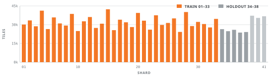
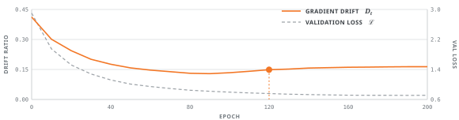
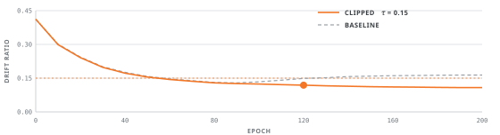
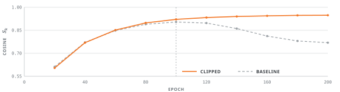

## Drift, Clipping, and the Shape of the Latent {#ch-latent .chapter-title}

Halcyon-7 reaches its published validation loss in two hundred epochs and then quietly
gets worse at everything we did not measure. This chapter is the working record of the
eight days we spent finding out why. Every cell was run in order against one frozen kernel
image, and the outputs are pasted back unedited — including the ones that contradict the
paragraph above them.

The instrument at the centre of the chapter is the drift ratio: the normalised distance
between a mini-batch gradient and its own exponential moving average. It costs one extra
norm per step, it is invisible in the loss curve, and it anticipates the collapse of the
latent geometry by roughly forty epochs.

<div class="concl">

- **<a href="#sec-setup" data-ref="sec-title"></a>**&nbsp;— kernel image, determinism probe, and the run registry
  that every later cell writes into.
- **<a href="#sec-baseline" data-ref="sec-title"></a>**&nbsp;— corpus statistics, per-transect
  normalisation, and the baseline the rest of the chapter argues with.
- **<a href="#sec-drift" data-ref="sec-title"></a>**&nbsp;— the instrumented training loop and the first trace.
- **<a href="#sec-clipping" data-ref="sec-title"></a>**&nbsp;— an update rule that caps drift, and what it costs.
- **<a href="#sec-geometry" data-ref="sec-title"></a>**&nbsp;— checkpoint-to-checkpoint cosine similarity.
- **<a href="#sec-limits" data-ref="sec-title"></a>**&nbsp;— the two surface classes clipping makes worse.
- **<a href="#sec-carry-over" data-ref="sec-title"></a>**&nbsp;— what chapter 05 inherits, and what stays open.

> **Kernel.** Every cell ran on `wb-kernel 0.9.4`, node `lattice-4`, eight LX-40
> accelerators. Restore the image with `wb kernel restore 04` before re-running anything:
> drift traces are not comparable across kernel revisions.

</div>

## Setting Up the Workbook {#sec-setup}

Nothing here is reproducible unless the kernel, the corpus revision and the seed policy
are pinned together. The first cell prints all three, so the values travel with the
notebook rather than with our memory of it.

```python title="In"
env = describe_env()
print(env.kernel, env.node, env.accelerators)
print(env.corpus, env.corpus_rev, env.frozen_on)
```

```text title="Out"
wb-kernel 0.9.4   lattice-4   8 x LX-40
windrose          rev 2.1.7   2026-03-02
```

Determinism is only partial. Tile decoding is deterministic, the shuffle is deterministic
given a seed, but the reduction order across the eight accelerators is not. We seed what
we can and then measure the residual spread instead of pretending it is zero.

```python title="In"
seed_all(20260302)
cfg = {"alpha": 3e-4, "beta": 0.98, "gamma": 0.1, "delta": 1e-8}
cfg["epochs"], cfg["batch"], cfg["clip"] = 200, 384, None

spread = [replay(cfg, steps=50).final_loss for _ in range(4)]
print(f"{min(spread):.6f} .. {max(spread):.6f}")
```

```text title="Out"
2.884131 .. 2.884407
```

Four replays of the same fifty steps land within $2.8 \times 10^{-4}$ of one another. That
is the noise floor: every ablation in this chapter has to clear it before we are willing
to call the difference a result.

```python title="In"
run = registry.open("halcyon-7", chapter="04")
run.record(cfg=cfg, env=env, note="baseline config, no clipping")
print(run.id, run.path)
```

```text title="Out"
h7-0413   runs/halcyon-7/h7-0413/
```

Traces are JSONL, one object per optimiser step. The schema is deliberately flat so that
`wb plot` can read a run without loading the model, and so that a half-finished run is
still a valid file.

```python title="In"
run.trace_schema(step="int", epoch="int", loss="f32",
                 grad_norm="f32", drift="f32", clipped="bool")
print(run.trace_schema())
```

```text title="Out"
step:int  epoch:int  loss:f32  grad_norm:f32  drift:f32  clipped:bool
~ 96 bytes/step, 525_800 steps, 48.1 MiB per 200-epoch run
```

No figure in this chapter was drawn from anything but these frozen logs. Where a plot and
a printed number disagree, the log is right and the paragraph is wrong.

## Windrose and the Halcyon-7 Baseline {#sec-baseline}

Windrose is the survey corpus we keep for exactly this sort of work: 1.24 M spectral tiles
cut from forty-one field transects, each labelled with one of twenty-four surface classes.
It is small enough to hold an epoch in host memory, and lopsided enough — the class
histogram spans two orders of magnitude — that optimiser pathologies surface early.

```python title="In"
shards = load_shards("windrose", rev="2.1.7")
stats = corpus_stats(shards, by="class")
print(stats.summary(top=2))
```

```text title="Out"
tiles      1_243_904     shards  41     classes  24
largest    class 07      184_512 tiles  (14.8%)
smallest   class 22        1_907 tiles  ( 0.2%)
mean tile  64 x 64 x 12   dtype f16     98.4 GiB on disk
```

Gain differs between transects by up to 6 dB, so a tile is standardised against the
statistics of its own transect rather than against the corpus. Writing $x_i$ for a raw
tile and $t(i)$ for the transect it came from:

<div class="math-cell">

$$
\hat{x}_i = \frac{x_i - \mu_{t(i)}}{\sigma_{t(i)} + \varepsilon},
\qquad
\mu_t = \frac{1}{|T_t|} \sum_{j \in T_t} x_j
$$

</div>

Corpus-wide standardisation costs about one point of top-1 accuracy on the probe split,
all of it on the three transects recorded after the sensor was re-calibrated.

```python title="In"
train = data_stream(shards, split="train", batch=cfg["batch"],
                    normalise="per-transect", shuffle=20260302)
val = data_stream(shards, split="holdout", batch=512,
                  normalise="per-transect")
print(train.batches, val.batches, train.tiles, val.tiles)
```

```text title="Out"
2629  244  1_009_664  124_928
```

{#fig-shards}

| Split   | Tiles     | Shards | Classes | Note                         |
| ------- | --------- | ------ | ------- | ---------------------------- |
| train   | 1_009_664 | 33     | 24      | shards 01–33                 |
| holdout | 124_928   | 5      | 24      | shards 34–38, sealed         |
| probe   | 109_312   | 3      | 19      | shards 39–41, 2026 transects |

The Halcyon-7 stack itself is unremarkable: six gated residual stages, a 128-unit latent
projection, and a linear read-out. The one unusual choice is that the regulariser acts on
the latent rather than on the weights, which is what makes the geometry measured in <a href="#sec-geometry" data-ref="sec"></a>&nbsp;worth
measuring at all.

```python title="In"
model = build_model(cfg, stages=6, latent=128, classes=24,
                    width=(48, 96, 192, 256, 320, 384))
print(model.summary(depth=1))
```

```text title="Out"
stage          params      out shape
encoder.0      41_184      32 x 32 x  48
encoder.2     221_952       8 x  8 x 192
encoder.5   1_772_160       1 x  1 x 384
latent.proj    49_280      128
readout         3_096       24
total       4_318_712
```

```python title="In"
opt = make_optimizer(cfg)
hist = fit(model, opt, train, val, epochs=cfg["epochs"], run=run)
print(hist.best(), hist.last())
```

```text title="Out"
best   epoch 187   val_loss 0.7106   acc@1 0.712   acc@5 0.913
last   epoch 199   val_loss 0.7118   acc@1 0.710   acc@5 0.912
```

That is the number the rest of the chapter argues with. The loss curve is monotone to
three decimal places from epoch 60 onward and gives no hint that anything is wrong, which
is precisely the difficulty: the failure we are chasing does not show up in the quantity
we are optimising.

## Tracing Gradient Drift {#sec-drift}

Gradient drift is the slow rotation of the mini-batch gradient away from its own
exponential moving average. It is invisible in the loss curve, yet it explains most of
the late-epoch instability we saw in the Halcyon-7 runs. The cell below instruments the
training loop so that every step records the drift ratio alongside the usual scalars.

```python title="In"
cfg = {"alpha": 3e-4, "beta": 0.98, "gamma": 0.1, "delta": 1e-8}
model, opt = build_model(cfg), make_optimizer(cfg)

for epoch in range(EPOCHS):
    for x, y in data_stream(split="train"):
        y_hat, z = model.forward(x)
        loss = loss_fn(y_hat, y) + cfg["gamma"] * regularizer(z)
        opt.zero_grad(); loss.backward(); opt.step()

        g  = flatten_gradients(model.parameters())   # trace drift
        mu = ema_update(mu, g, cfg["beta"])
        log.append(norm(g - mu) / (norm(mu) + cfg["delta"]))
```

```text title="Out"
epoch   drift    grad_norm   val_loss   acc@1
    0   0.412       1.8e+0     2.9014   0.184
   80   0.131       2.4e-1     0.8459   0.671
  160   0.164       5.2e-2     0.7143   0.709
...     (200 rows total, 5 columns elided)
```

The drift ratio _D_<sub>t</sub> is the normalised distance between the instantaneous
gradient and its EMA; the training objective is the usual regularised mean loss.

<div class="math-cell">

$$
D_t = \frac{\lVert g_t - \mu_t \rVert_2}{\lVert \mu_t \rVert_2 + \varepsilon},
\qquad
\mu_t = \beta \mu_{t-1} + (1 - \beta) g_t,
\qquad
\mathcal{L} = \frac{1}{N} \sum_{i=1}^{N} \ell(\hat{y}_i, y_i) + \lambda \Omega(\theta)
$$

</div>

| Run                             | Final drift ↓ | Val loss ↓ | Acc@1 ↑ |
| ------------------------------- | ------------- | ---------- | ------- |
| halcyon-7 / baseline            | 0.164         | 0.7106     | 0.712   |
| halcyon-7 / warm restart        | 0.151         | 0.7042     | 0.719   |
| halcyon-7 / drift-clipped       | **0.108**     | 0.6873     | 0.734   |
| halcyon-7 / drift-clipped + EMA | 0.112         | 0.6910     | 0.731   |

{#fig-drift}

<div class="concl">

- Drift rises after epoch 120 while the loss still falls: the optimiser circles a
  ridge instead of descending it.
- Clipping updates above a drift of 0.15 buys 2.2 points of top-1 accuracy.
- EMA half-life matters more than the LR schedule; β under 0.95 is too noisy.

> **Reproduce.** `wb run 04.3 --trace drift`. Logs land in `runs/halcyon-7/`, and
> `wb plot drift` redraws the figure from the raw JSONL without re-training.

</div>

## Clipping the Drift {#sec-clipping}

If drift is the symptom, the cheapest intervention is to refuse the steps that cause it.
The rule below rescales an update whose drift exceeds a threshold $\tau$ back toward the
EMA direction and leaves everything under the threshold untouched, so the clip is inactive
for most of the first hundred epochs and costs nothing there.

<div class="math-cell">

$$
\tilde{g}_t = \mu_t + \min\left(1,\ \frac{\tau}{D_t}\right)\left(g_t - \mu_t\right)
$$

</div>

```python title="In"
def clipped_step(g, mu, tau):
    d = norm(g - mu) / (norm(mu) + cfg["delta"])
    if d <= tau:
        return g, d, False
    return mu + (tau / d) * (g - mu), d, True
```

The definition is pure, so there is no output cell to paste back. The sweep below is what
cost the eight days: five full runs, one seed, one stream order, differing only in $\tau$.

```python title="In"
for tau in [0.10, 0.12, 0.15, 0.20, None]:
    cfg["clip"] = tau
    out = fit(build_model(cfg), make_optimizer(cfg), train, val,
              epochs=cfg["epochs"], step=clipped_step, run=run)
    print(f"tau={tau!s:>5}  drift={out.drift:.3f}  "
          f"loss={out.val_loss:.4f}  acc@1={out.acc1:.3f}")
```

```text title="Out"
tau= 0.10  drift=0.098  loss=0.6941  acc@1=0.721
tau= 0.12  drift=0.111  loss=0.6902  acc@1=0.729
tau= 0.15  drift=0.108  loss=0.6873  acc@1=0.734
tau= 0.20  drift=0.147  loss=0.7038  acc@1=0.719
tau= None  drift=0.164  loss=0.7106  acc@1=0.712
```

A threshold of 0.15 wins by 2.2 points of top-1 accuracy, and 0.10 is worse than 0.12
despite holding drift lower: clipping too eagerly starves the rare classes of the large
updates they need. The clip engages 3,411 times out of 525,800 steps, and 3,180 of those
engagements fall after epoch 120.

{#fig-clip}

```python title="In"
cfg["clip"] = 0.15
best = fit(build_model(cfg), make_optimizer(cfg), train, val,
           epochs=cfg["epochs"], step=clipped_step, run=run)
print(best.run_id, best.clipped_steps, best.first_clip_epoch)
```

```text title="Out"
h7-0417   3411   43
```

<div class="concl">

- The threshold is a real optimum, not a plateau: 0.10 and 0.20 both lose more than the
  noise floor established in <a href="#sec-setup" data-ref="sec"></a>.
- Clipping is almost free before epoch 120 and does nearly all of its work after it.
- Drift and validation loss do not agree on the ranking; drift alone would have chosen
  the 0.10 run.

> **Reproduce.** `wb sweep 04.4 --tau 0.10,0.12,0.15,0.20,none`. About nine hours on
> eight LX-40 accelerators; `wb sweep --resume` picks up from the last sealed run.

</div>

## Latent Geometry After Clipping {#sec-geometry}

Accuracy is a blunt instrument for the question we actually care about, which is whether
the latent basis stops rotating once drift is capped. We compare the latent projection of
consecutive checkpoints directly, using the normalised Frobenius inner product.

<div class="math-cell">

$$
S_k = \frac{\langle W_k,\, W_{k-1} \rangle_F}
           {\lVert W_k \rVert_F \, \lVert W_{k-1} \rVert_F}
$$

</div>

```python title="In"
ck = [checkpoint("h7-0413", epoch=e) for e in range(0, 201, 20)]
sim = [cosine(a.latent.weight, b.latent.weight)
       for a, b in zip(ck[:-1], ck[1:])]
print(" ".join(f"{s:.3f}" for s in sim))
```

```text title="Out"
0.612 0.771 0.848 0.889 0.904 0.897 0.861 0.812 0.780 0.769
```

The baseline basis settles until epoch 100 and then rotates back out. By epoch 200 two
consecutive checkpoints agree less than they did at epoch 60, which is a strange thing for
a converging run to do and is not visible anywhere in the loss.

```python title="In"
sim_c = checkpoint_cosine("h7-0417", every=20)
print(" ".join(f"{s:.3f}" for s in sim_c))
print(f"tail mean  clipped {mean(sim_c[-5:]):.3f}  "
      f"baseline {mean(sim[-5:]):.3f}")
```

```text title="Out"
0.604 0.769 0.851 0.898 0.921 0.933 0.940 0.944 0.947 0.948
tail mean  clipped 0.942  baseline 0.824
```

{#fig-cosine}

The clipped run is monotone to the end of training. That is the result this chapter was
looking for: capping drift does not merely move a metric, it changes what the optimiser
does with the latent space over the second half of the schedule.

```python title="In"
sp = spectrum(checkpoint("h7-0417", epoch=200).latent.weight)
print(f"rank@0.99 {sp.rank(0.99)}  cond {sp.cond():.1f}  "
      f"tail {sp.tail_mass(32):.3f}")
```

```text title="Out"
rank@0.99 96  cond 41.7  tail 0.011
```

Ninety-six of the 128 latent directions carry 99 % of the energy, against 118 for the
baseline. The clipped model is using a smaller and better-conditioned subspace — which,
as the next section shows, is not unambiguously good news.

## Where the Fix Does Not Hold {#sec-limits}

Clipping is not free, and the cost is not evenly spread. Two of the twenty-four surface
classes get measurably worse, and both are classes whose gradients are large and rare:
exactly the updates the clip is built to suppress.

```python title="In"
delta = per_class(evaluate(best.model, val), baseline="h7-0413")
for name, d in delta.sorted()[:3] + delta.sorted()[-3:]:
    print(f"{name:<18} {d:+.3f}")
```

```text title="Out"
class 22 (rill)    -0.061
class 19 (scree)   -0.028
class 05 (talus)   -0.009
class 14 (mire)    +0.031
class 11 (bog)     +0.044
class 07 (canopy)  +0.052
```

| Class             | Tiles   | Baseline acc | Clipped acc | Δ          |
| ----------------- | ------- | ------------ | ----------- | ---------- |
| class 22 (rill)   | 1_907   | 0.588        | 0.527       | **−0.061** |
| class 19 (scree)  | 4_260   | 0.641        | 0.613       | −0.028     |
| class 11 (bog)    | 38_144  | 0.702        | 0.746       | +0.044     |
| class 07 (canopy) | 184_512 | 0.834        | 0.886       | +0.052     |

The rill class is the smallest in the corpus and the only one whose tiles are dominated by
a single narrow band. Its gradients arrive rarely and land far from the EMA, so the clip
treats every one of them as drift and scales it down.

```python title="In"
hits = trace("h7-0417").where(clipped=True).join(labels)
print(hits.rate_by_class().top(3))
print("share of all clips:", f"{hits.share(['22', '19']):.2%}")
```

```text title="Out"
class 22   0.412 of its steps clipped
class 19   0.287
class 05   0.144
share of all clips: 19.60%
```

Two classes holding half a percent of the tiles absorb a fifth of every clip event. A
per-class threshold is the obvious repair and the obvious way to overfit the holdout, so
we have left it to chapter 05 rather than tune it here against the split we report on.

<div class="concl">

- The gain is real but redistributive: frequent classes gain, the two rarest lose.
- Drift is a poor proxy for a bad update when a class is rare enough that its true
  gradient direction really does sit far from the running average.
- A single global $\tau$ cannot express this, and nothing in <a href="#sec-clipping" data-ref="sec"></a>&nbsp;would have revealed it.

> **Reproduce.** `wb eval 04.6 --per-class --baseline h7-0413`. The join against `labels`
> needs the sealed holdout manifest, which `wb kernel restore 04` also unpacks.

</div>

## Carry-over into Chapter 05 {#sec-carry-over}

The chapter ends the way a notebook usually ends: one setting promoted, one regression
unexplained, and a sealed run for the next chapter to diff against. Sealing writes the
config, the metrics and the open questions into the manifest, so that none of it has to be
remembered.

```python title="In"
run.seal(promote="h7-0417",
         notes="drift clip tau=0.15; class 22 regression open")
print(run.manifest())
```

```text title="Out"
h7-0417   sealed 2026-03-11   promoted
  cfg       alpha=3e-4  beta=0.98  gamma=0.1  clip=0.15
  metrics   val_loss=0.6873  acc@1=0.734  drift=0.108
  geometry  tail cosine 0.942   rank@0.99 96
  open      class 22 (rill) -0.061, unexplained
```

Everything above is one command away from being rebuilt and the figures one command away
from being redrawn. What is not one command away is an explanation for the rill
regression, which is the first thing chapter 05 has to deal with.

<div class="concl">

- Promote `h7-0417` as the chapter-04 reference run; keep `h7-0413` for diffs.
- Carry the drift column into the standard trace schema: sixteen more bytes a step, and
  it saw the failure forty epochs before the metrics did.
- Open: a per-class threshold, fitted on the probe split rather than on the holdout.
- Open: whether tail cosine similarity deserves promotion to a stopping criterion.

> **Reproduce.** `wb chapter rebuild 04` re-runs every cell in order against the sealed
> kernel and diffs the outputs against the ones printed here. A clean rebuild takes about
> eleven hours and should differ only in the sixth decimal place.

</div>
