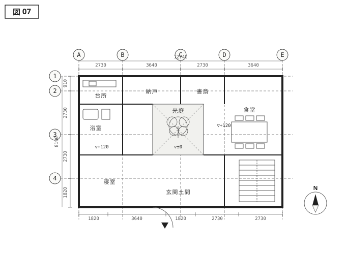
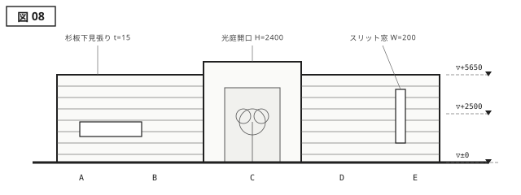
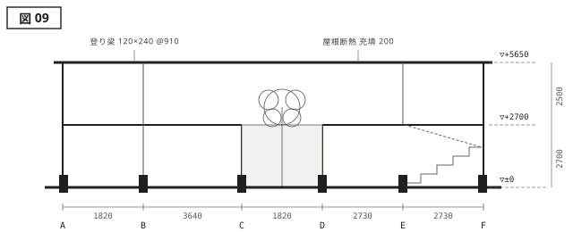

{.plan}

{.elevation}

{.section}

---

<aside class="spec">
<h2>建築概要</h2>

| 項目     | 内容               |
| -------- | ------------------ |
| 名称     | 汐那の家           |
| 所在地   | 碧海県 汐那町      |
| 設計     | 三雲建築設計室     |
| 施工     | 大和井建材工業     |
| 主要用途 | 専用住宅           |
| 敷地面積 | 412.85 m²          |
| 建築面積 | 94.20 m²           |
| 延床面積 | 132.64 m²          |
| 構造     | 木造軸組・一部RC造 |
| 階数     | 地上2階            |
| 最高高さ | 5.650 m            |
| 竣工     | 2025 / 03          |

</aside>

# 光庭と壁 {#work-shiona}

敷地の中央に据えた正方形の光庭は、《汐那の家》の構成を決定づける空白である。周囲を巡る壁は外に対して閉じ、内に向かってのみ開く。訪れる者はまず薄暗い玄関土間を抜け、光庭のかたわらで初めて空を見上げることになる。壁が視線を遮ることで、限られた開口から届く光はいっそう際立ち、時刻ごとに床へ落ちる陰影が室内の時間を刻む。

架構は木造軸組を基本とし、光庭を囲う四本の通り芯に沿って柱を落とした。水平に連続する杉板下見張りの外壁は、内部の複雑な間仕切りをあえて表さず、量塊としての静けさを保っている。仕上げは素地のまま残し、経年による色の変化を設計の一部として受け入れる。壁と余白、そのあいだに生まれる緊張こそが、設計者・三雲宗久がこの小さな家に与えた主題である。

光庭は建築面積のうち10平方メートル余りを占めるが、屋根も床も持たない。雨水は目地の粗い砂利に落ち、そのまま地中へ返る。設計中、建築主からはこの面積を室内に回せないかという問いが繰り返し出されたという。四周を壁に囲われた敷地で、空へ向く唯一の開口をどう扱うか。その答えとして、この空白は最後まで削られなかった。
