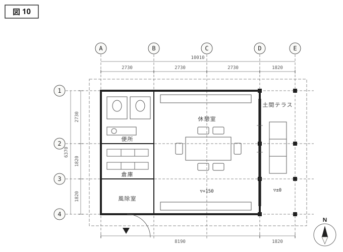
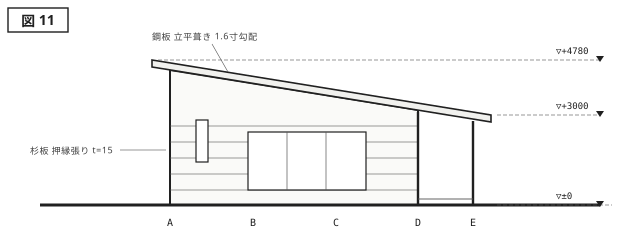
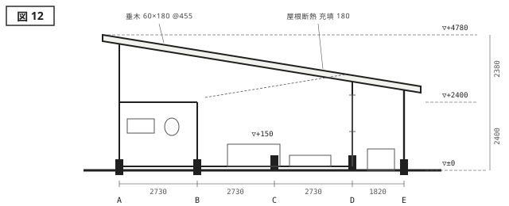

{.plan}

{.elevation}

{.section}

---

<aside class="spec">
<h2>建築概要</h2>

| 項目     | 内容               |
| -------- | ------------------ |
| 名称     | 比奈倉の休息舎     |
| 所在地   | 碧海県 比奈倉      |
| 設計     | 三雲建築設計室     |
| 施工     | 比奈倉建設         |
| 主要用途 | 休憩所（公園施設） |
| 敷地面積 | 3860.00 m²         |
| 建築面積 | 63.76 m²           |
| 延床面積 | 52.17 m²           |
| 構造     | 木造軸組・一部S造  |
| 階数     | 地上1階            |
| 最高高さ | 4.780 m            |
| 竣工     | 2026 / 05          |

</aside>

# 稜線に沿う屋根 {#work-hinakura}

比奈倉の丘陵公園は、麓の駐車場から尾根伝いに歩いて二十分の位置に展望地を持つ。休息舎はその手前、尾根が一度たわむ鞍部に置かれた。設計の与条件は、便所と倉庫を備えること、屋根のある休憩空間をつくること、そして遠望の妨げにならないことの三つだった。三つ目が実質的にすべてを決めた。

屋根は西から東へ1.6寸で下る一枚である。勾配は背後の尾根の傾きから写し取った。最高高さは西端の4780、東端の軒先で3000。歩いてきた人は屋根を見上げることなく、その下をくぐって東の土間テラスに出る。テラスは地面と同じ高さの土間コンクリートで、柱四本と屋根のほかに何もない。11.6平方メートル、囲いを持たないこの場所が、この建物でもっとも長く人のとどまる部屋になる。

閉じた部分は西の8190分だけにまとめた。便所と倉庫を厚い壁のかたまりに納め、そこへ背を預けるように休憩室を置いている。休憩室の床は土間から150上げ、靴のまま腰かけられる高さの縁を回した。屋根は垂木を60×180、455間隔であらわしとし、断熱は充填のみで納めている。冬季は閉鎖されるため、暖房設備は持たない。
