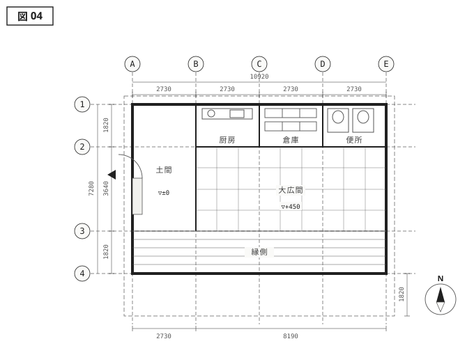
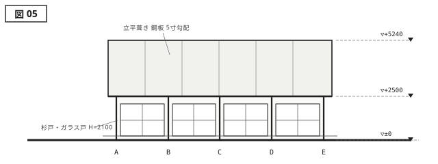
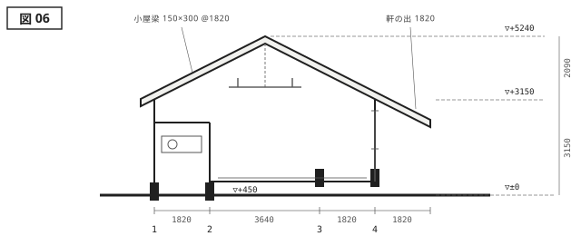

{.plan}

{.elevation}

{.section}

---

<aside class="spec">
<h2>建築概要</h2>

| 項目     | 内容           |
| -------- | -------------- |
| 名称     | 栗生野の集会所 |
| 所在地   | 碧海県 栗生野  |
| 設計     | 三雲建築設計室 |
| 施工     | 栗生野建設     |
| 主要用途 | 集会所         |
| 敷地面積 | 1024.60 m²     |
| 建築面積 | 88.45 m²       |
| 延床面積 | 79.50 m²       |
| 構造     | 木造軸組       |
| 階数     | 地上1階        |
| 最高高さ | 5.240 m        |
| 竣工     | 2021 / 09      |

</aside>

# 土間と庇 {#work-kuriuno}

栗生野は戸数四十ほどの集落で、それまでの集会所は昭和三十年代に建てられた木造の一棟だった。建て替えにあたって最初に出た要望は「葬式ができること」であり、次に出たのが「草刈りの休憩に使えること」だった。年に一度の儀式と、週に一度の雑談。この二つを同じ床に載せるために、床を二段階に分けた。

道に面した西端の2730通りは、土足のまま入れる土間である。長靴も一輪車もここで止まる。土間から450上がった先が3640奥行の大広間で、畳を敷き、儀式のときだけ全面を使う。さらに南へ1820、縁側が続く。三つの床は建具で仕切れるが、ふだんは開け放されていて、集落の人はたいてい縁側の端に腰かけて帰っていく。

南の軒は桁からさらに1820出している。軒先の高さは2500、大人が立って歩ける寸法に抑えた。この庇の下だけは、雨の日も、日差しの強い日も、屋内に入る決心をしないで済む場所になる。集会所という建物にとって、いちばん長い時間使われているのはおそらくこの一帯である。小屋梁は150×300を1820間隔で架け、下から見えるまま残した。
