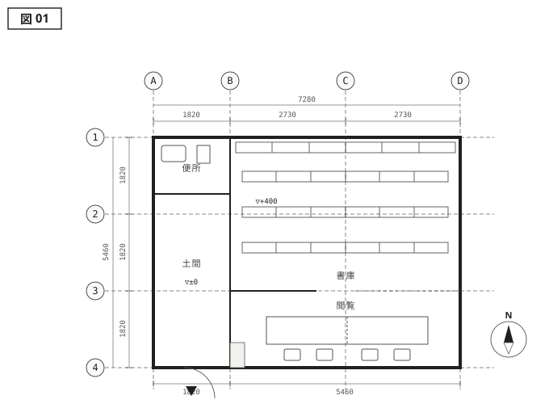
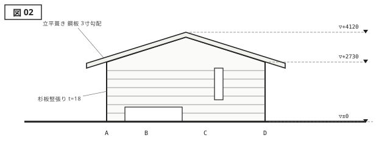
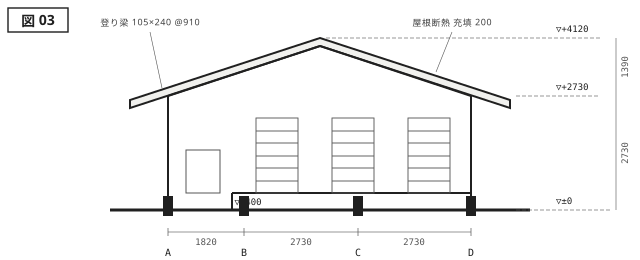

{.plan}

{.elevation}

{.section}

---

<aside class="spec">
<h2>建築概要</h2>

| 項目     | 内容           |
| -------- | -------------- |
| 名称     | 苫緒の書庫     |
| 所在地   | 碧海県 苫緒町  |
| 設計     | 三雲建築設計室 |
| 施工     | 苫緒木工舎     |
| 主要用途 | 書庫・書斎     |
| 敷地面積 | 268.40 m²      |
| 建築面積 | 39.75 m²       |
| 延床面積 | 39.75 m²       |
| 構造     | 木造軸組       |
| 階数     | 地上1階        |
| 最高高さ | 4.120 m        |
| 竣工     | 2018 / 11      |

</aside>

# 本を囲う厚み {#work-tomoo}

蔵書一万冊を収めるだけなら、建物は要らない。倉庫でも足りる。それでも建築主が小屋ではなく書庫を望んだのは、本を取りに行く動作そのものを一日の区切りにしたかったからだった。母屋から石畳を三十歩、下駄を脱がずに入れる土間を抜け、四百ミリの段を上がる。この段差が、居間の続きではないことを身体に知らせる。

平面は間口7280、奥行5460の単純な矩形である。西端の1820を土間と便所にあて、残る5460角の一室に書架を並べた。書架は北面の一列だけを壁に沿わせ、残りは自立させて背の高さを1800に抑えている。棚のあいだに立つと、視線は書の背表紙と、その上に広がる勾配天井の両方に届く。本に囲まれながら、囲われすぎない。厚みをどこまで与えるかが、この小さな建築のほとんどすべてだった。

開口は三か所しかない。南面の地窓は座って本を開いたときの目線より低く、床板を照らすだけである。その脇に穿った縦長窓は幅を400に絞って直射を細く切り、北面の高窓が一日を通した拡散光を天井に返す。紙を傷める光を避けながら、外の時刻だけは室内に入れておく。杉板の竪張りは素地のまま、五年を経て銀色に変わりつつある。
