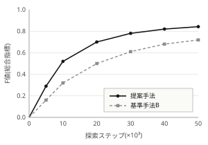
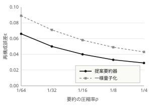

# 第3部知識基盤と協調システム {#p3-session}

座長　千賀 未央1　副座長　柏葉 直人2

1汐路総合研究所 知能基盤研究部　2稜北工科大学 システム創成学科

2027年3月10日(水) 13:30–15:10　C会場(知環市民会館3階・中会議室)

<strong>セッション趣旨</strong>　組織や領域を越えて分散する知識源を、版を重ねながら運用し続けるための基盤技術を扱う。本セッションでは、複数系統の知識グラフを版単位で統合する手法、分散した知識源を複数のエージェントで協調的に探索する枠組み、通信制約下で交換される要約情報の設計指針、そして実運用中の横断検索基盤から得られた利用実態の四件を収録する。前半二件が構成法、後半二件が運用と評価に対応し、いずれも共通の疑似分散知識グラフまたは実運用ログを評価対象としている。

<strong>共通キーワード</strong>　知識基盤, 版管理, 協調探索, 要約共有, 運用報告

## 収録概要 ##

第3部　収録概要

| 番号  | 題目・発表者                                                    | 頁                                  |
| ----- | --------------------------------------------------------------- | ----------------------------------- |
| P3-11 | 版管理を伴う異種知識グラフの差分統合 三瀬 彩乃ほか           |  |
| P3-12 | 分散知識基盤における協調探索手法 網代 千尋ほか               |  |
| P3-13 | 通信制約下の要約共有における圧縮率と再構成誤差 鵜殿 沙耶ほか |  |
| P3-14 | 知識基盤の横断検索ログにみる利用実態 逸見 郁ほか             |  |

注：発表番号の上二桁は部を、下二桁は部内の発表順を表す。

## 本冊子の見方 ##

各概要は1件1頁で構成し、冒頭に発表番号・題目・発表者・所属・連絡先を、続いて概要とキーワードを置く。本文は二段組で、節番号は各概要の内部で1から数える。図表および数式の番号も概要ごとに独立しており、他の概要の図表を参照する場合は発表番号を添えて示す。

参考文献は本文中の角括弧番号に対応し、末尾に一括して掲げる。最終行の索引用語は巻末索引の見出し語であり、キーワードとは別に編集委員会が付与している。連絡先の電子メールアドレスは、複数著者を代表する場合に括弧でまとめて記した。

## 図表と数式の表記 ##

図と表は概要ごとに1から番号を付け、本文からは図1、表1のように参照する。式は右端に括弧付きの番号を示し、番号は同じ概要の内部でのみ有効である。脚注は星印と番号で示し、当該頁の下部にまとめて置く。

数値は原則として有効数字3桁で示す。四捨五入の位置や試行回数など、値の読み方に前提がある場合は表の直下に注記した。単位を伴わない相対値は、比較の基準を注記または本文で明示している。

## 討論の進め方 ##

発表は1件あたり10分、質疑は5分とする。座長は残り時間を発表開始から8分および10分の時点で合図する。質疑で扱いきれなかった論点は、閉会後の交流時間に会場後方の掲示板を用いて継続する。

本部では同一の評価環境を用いる発表が複数含まれるため、質疑では評価条件の差異を明示したうえで議論することが望ましい。とくに疑似分散知識グラフを用いた三件は、ノード数と平均次数の設定が共通である一方、エージェント数と通信条件が異なる。

## 会場と設備 ##

C会場は知環市民会館3階の中会議室である。前方に有線接続の投影装置を備え、変換端子は受付で貸し出す。会場後方には掲示板を設け、発表者は補足資料を掲示できる。無線ネットワークは会期中のみ開放する。

## 関連する部 ##

第2部「探索と推薦の評価」および第5部「データ基盤の運用」にも、本部と評価環境を共有する発表が含まれる。とくに第5部のP5-08は、本部のP3-14と同一の横断検索基盤を対象としている。

## 引用の書式 ##

収録された概要を引用する際は、著者名、題目、知環学術フォーラム論文概要集2027、発表番号、頁の順に記す。本文中の参照は発表番号で行い、頁は補助的に添える。電子版では発表番号が恒久的な識別子として機能する。

## 編集について ##

本冊子は著者から提出された概要を、編集委員会が体裁のみ整えて収録したものである。内容および数値の責任は各著者に帰属する。誤りが判明した場合は正誤表を大会公式頁に掲示し、次年度の冊子の巻頭にも再掲する。

# P3-11版管理を伴う異種知識グラフの差分統合 {#p3-11}

三瀬 彩乃1・苅田 悠真1・津久井 賢一2

1碧洋大学 情報基盤学部　2稜北工科大学 システム創成学科

{a.mise, y.karita}@hekiyo-u.example.jp

<strong>概要</strong>　運用中の知識グラフは版を重ねるたびに構造と語彙が変化するため、複数系統を統合する際には版のずれに由来する競合が生じる。本研究では版管理された異種知識グラフを対象に、版間の差分を単位として統合を行う枠組みを構成した。差分を属性値衝突・参照先欠落・型不一致・重複実体の四種に分類し、各差分に信頼度と整合度への寄与を与えたうえで、統合後グラフの整合度を最大化する組合せ最適化として定式化する。三系統・計24版の疑似グラフを用いた評価では、競合解消の全体F値が0.876となり、ルールベース統合を0.134上回った()。統合の所要時間は24版で18.4分であり、日次運用に耐える水準である。

<strong>キーワード</strong>　知識グラフ, 版管理, 差分統合, 競合解消, 組合せ最適化, スキーマ整合

## はじめに

組織横断で運用される知識グラフは、語彙の追加や型定義の変更を伴いながら継続的に更新される[1]。複数系統を統合する際、各系統の最新版だけを突き合わせるスナップショット統合では、更新の順序や意図が失われ、同一実体に対する記述の食い違いを機械的に解消できない[2]。

本研究では、版と版の間に生じた差分そのものを統合の単位とすることで、更新の文脈を保ったまま競合を解消する枠組みを提案する。貢献は、差分を四種に分類した競合モデルの提示、整合度最大化としての定式化、および24版規模の疑似グラフによる定量評価の三点である。

## 差分統合の定式化

版 $v$ における知識グラフを $G_v$ と書き、隣接する版から抽出した差分の集合を $D$ とする。各差分 $e \in D$ には、抽出元の系統の信頼度 $w(e)$ と、採用したときの整合度への寄与 $s(e)$ を与える。統合結果は $D$ の部分集合を選ぶ問題となり、で表される。

$$
\hat{G} = \underset{G \subseteq D}{\operatorname{arg\,max}} \sum_{e \in G} w(e)\, s(e) - \mu\, r(G)
$$

ここで $r(G)$ は採用した差分の間に残る矛盾の数、$\mu$ は罰則係数である。$r(G)$ の評価には型定義と参照関係の閉包を用い、探索は貪欲法で初期解を得たのち局所改善を行う局所改善は矛盾に関与する差分の近傍のみを対象とするため、1版あたりの計算量は差分数に対しておおむね線形である。。

## 評価

三系統の疑似知識グラフ(ノード48,000、エッジ132,000、各系統24版)を対象に、競合種別ごとの解消精度を測定した。比較対象は、系統ごとの優先順位と型規則で解消するルールベース統合である。

競合種別ごとの解消F値

| 種別       | 件数  | 提案手法 | ルールベース |
| ---------- | ----- | -------- | ------------ |
| 属性値衝突 | 1,842 | 0.892    | 0.771        |
| 参照先欠落 | 964   | 0.885    | 0.746        |
| 型不一致   | 517   | 0.818    | 0.652        |
| 重複実体   | 1,203 | 0.869    | 0.734        |
| 全体       | 4,526 | 0.876    | 0.742        |

注：件数は24版分の合計。提案手法の全体の適合率は0.888、再現率は0.865である。

のとおり、提案手法はすべての競合種別でルールベース統合を上回った。とくに参照先欠落では差が0.139と大きく、版の順序を保持した差分表現が欠落の原因を特定しやすくしていることを示す。一方、型不一致は両手法とも精度が低く、型定義の変更意図が差分からは判別できない場合が残った。

統合の所要時間は24版で18.4分、1版あたり平均46秒であった。差分数に対する計算量の増加はおおむね線形であり、日次で版を取り込む運用に適用できる。

## まとめ

版管理された異種知識グラフを対象に、差分を単位とする統合の枠組みを示し、競合解消の全体F値0.876を得た。今後は型定義の変更意図を差分に付随させる記述方式を検討し、型不一致の解消精度を高める。

## 参考文献 ##

1. 稲生 志保ほか：知識グラフ運用における版管理の実態調査, 知環誌, 9(4), 301–314 (2024).
2. 塩飽 亮ほか：スナップショット統合の限界, 知環学術フォーラム予稿集2025, 118–121 (2025).
3. 楠瀬 直：差分表現に基づくスキーマ整合, 碧洋大学情報基盤学部紀要, 18, 45–58 (2025).
4. 是永 悠里ほか：組合せ最適化による競合解消, 知環誌, 10(1), 55–70 (2025).
5. 神門 遥ほか：異種語彙の対応付けと信頼度推定, 汐路総合研究所報告, 2026-3, 12–19 (2026).

<strong>索引用語</strong>　知識グラフ, 版管理, 差分, 競合解消

# P3-12分散知識基盤における協調探索手法 {#p3-12}

網代 千尋1・三瀬 彩乃1・柏葉 直人2・宗形 遼3

1碧洋大学 情報基盤学部　2稜北工科大学 システム創成学科　3汐路総合研究所 知能基盤研究部

{c.ajiro, a.mise}@hekiyo-u.example.jp

<strong>概要</strong>　分散する多様な知識源を横断的に探索する場面を想定し、協調的な探索を支援する枠組みを構成した。対象知識源の性質を特徴量として表現し、複数のエージェントが部分的な知識を交換しながら探索経路を協調的に生成するモデルを定義したうえで、価値推定関数と不確実性指標に基づく経路選択戦略を設計し、通信コストを考慮した効率的な協調を実現する。評価実験では疑似生成した分散知識グラフを対象に提案手法を検証し、基準手法と比較して探索効率および知識の多様性がいずれも向上することを確認した(、)。通信遅延やノード離脱を含むロバスト性評価でも、不完全な環境下で安定して機能することを示した。

<strong>キーワード</strong>　分散知識基盤, 協調探索, マルチエージェント, 価値推定, 不確実性, 通信制約

## はじめに

組織や領域を越えて分散する知識源を統合的に利用する需要が高まっている[1]。しかし知識源の分散性・異質性・部分可観測性により、単独の探索では十分な発見が難しい[2]。本研究では複数のエージェントが協調して探索する枠組みを提案する。

各エージェントは局所的な観測から探索行動を決定し、限られた通信帯域内で知識断片を交換することで、系全体として高い探索効率と多様性を同時に実現する[3][4]。本稿の貢献は、協調探索モデルの定式化、通信コストを考慮した経路選択戦略、大規模疑似環境における定量評価の三点である。

## 提案手法

本手法の概観をに示す。各エージェントは知識源ノードの局所特徴量 $x_i$ を観測し、価値関数 $V_i$ と不確実性 $U_i$ を推定する。エージェント $i$ の探索行動 $\pi_i$ は、価値と不確実性の重み付け和を最大化するで決まる。

$$
\pi_i = \underset{a}{\operatorname{arg\,max}} \{ V_i(a) + \lambda U_i(a) - \gamma C_i(a) \}
$$

ここで $C_i(a)$ は通信コスト、$\lambda$ と $\gamma$ は実数パラメータである。得られた知識断片は隣接エージェントと要約情報のみを交換し、共有モデルを更新する[5]。詳細は付録Aに示す付録Aでは要約情報の圧縮率と再構成誤差の関係、および近似最近傍探索による候補絞り込みの実装を述べる。。

<figure id="fig-p12-1">

<figcaption>探索ステップに対するF値の推移</figcaption>
</figure>

## 評価

評価環境には疑似生成した分散知識グラフ(ノード数1,000、平均次数8)を用い、エージェント数は16とした。指標は探索効率(F値)、知識多様性(シャノンエントロピー)、通信量である。

手法比較

| 手法      | F値 (↑) | 知識多様性 (↑) | 通信量 (相対) |
| --------- | ------- | -------------- | ------------- |
| 提案手法  | 0.842   | 2.731          | 1.00          |
| 基準手法A | 0.673   | 2.021          | 0.72          |
| 基準手法B | 0.719   | 2.354          | 1.35          |

注：表中の数値は5試行の平均値であり、小数第3位を四捨五入している。

より、提案手法は探索効率で基準手法Bを17.1%、多様性で16.0%上回りつつ、通信量は基準手法Bの0.74倍に収まる。通信遅延(平均200ms)やノード離脱(最大20%)を加えた評価でも性能低下は限定的であった。

高い探索効率を維持できた要因は、価値推定と不確実性指標の併用により既知領域への集中と未探索領域の開拓を適応的に切り替えられた点にある。一方、通信制約が極端に厳しい条件では要約情報の欠落により多様性の伸びが鈍化した。

## まとめ

分散知識基盤における協調探索の枠組みを提案し、価値推定と不確実性を統合した行動選択により、通信制約下でも高い探索効率と多様性を両立できることを確認した。今後は実環境データへの適用と学習型価値推定器の導入を検討する。

## 参考文献 ##

1. 稲生 志保ほか：分散知識基盤の統合に関する調査, 知環誌, 10(2), 123–138 (2025).
2. 塩飽 亮ほか：部分可観測環境の探索アルゴリズム比較, 知環学術フォーラム研究報告, 2025-KB-47(3), 45–52 (2025).
3. 楠瀬 直ほか：マルチエージェント協調の通信戦略, 湊北大学情報科学研究科技術報告, TR-2026-3, 1–12 (2026).
4. 是永 悠里ほか：不確実性指標を用いた意思決定手法, 知環誌, 11(1), 20–33 (2026).
5. 神門 遥ほか：要約情報共有の効果, 知環学術フォーラム予稿集2026, 33–36 (2026).

<strong>索引用語</strong>　協調探索, 分散システム, 価値関数, 不確実性指標

# P3-13通信制約下の要約共有における圧縮率と再構成誤差 {#p3-13}

鵜殿 沙耶1・網代 千尋2・宗形 遼3

1湊北大学 情報科学研究科　2碧洋大学 情報基盤学部　3汐路総合研究所 知能基盤研究部

{s.udono, m.munakata}@sohoku-u.example.jp

<strong>概要</strong>　協調探索では知識断片の要約を交換するが、通信路が細い環境では要約長を切り詰めざるを得ず、再構成の誤差が探索効率を損なう。本研究では要約の圧縮率と再構成誤差の関係を定量化し、維持すべき要約長の下限を導く。原次元512の知識断片を対象に要約長を8から128まで変化させて測定したところ、再構成誤差は圧縮率に対するべき乗則によく従い、決定係数0.994でに適合した()。協調探索の枠組み[3]に適用すると、圧縮率1/16の運用点では探索効率の低下が1.8%に留まる一方、これを下回る圧縮では誤差が急増し、多様性の伸びが鈍化することを確認した。

<strong>キーワード</strong>　要約共有, 圧縮率, 再構成誤差, べき乗則, 通信制約, 協調探索

## はじめに

分散した知識源を複数のエージェントで探索する枠組みでは、知識断片そのものではなく要約を交換することで通信量を抑える[1][2]。要約をどこまで短くできるかは通信路の帯域から決まるが、短くするほど再構成の誤差が増え、探索の判断が劣化する。

先行研究は要約器の構成法に関心が集中しており、圧縮率と誤差の関係を運用条件として扱った報告は少ない[4]。本研究では両者の関係を測定して定式化し、探索効率を損なわない運用点を示す。

## 圧縮率と再構成誤差

原次元を $d$、要約長を $m$ とし、圧縮率をで定義する。

$$
\rho = m / d
$$

再構成誤差 $\varepsilon$ は圧縮率に対して単調に減少し、測定値はのべき乗則によく従う。

$$
\varepsilon(\rho) = \varepsilon_0 + \kappa \rho^{-\theta}
$$

最小二乗法で推定した係数は $\varepsilon_0 = 0.021$、$\kappa = 3.4 \times 10^{-3}$、$\theta = 0.62$ であり、決定係数は0.994であった。$\varepsilon_0$ は要約器の構成に由来する下限であり、圧縮率を上げても取り除けない。

## 評価

原次元512の知識断片を対象に、要約長を8、16、32、64、128と変化させて再構成誤差を測定した。比較対象は同じ通信量を消費する一様量子化である。

<figure id="fig-p13-1">

<figcaption>圧縮率に対する再構成誤差</figcaption>
</figure>

のとおり、提案要約器の誤差は圧縮率1/64で0.066、1/16で0.040、1/4で0.029であり、いずれの圧縮率でも一様量子化を下回った。差は圧縮率が低いほど大きく、1/64では0.023の開きがある。

この誤差を協調探索[3]に与えた場合、圧縮率1/16では探索効率の低下が1.8%、1/32では4.1%、1/64では6.4%となった。通信量の削減と探索効率の維持を両立する運用点は1/16付近にあり、これを下回る圧縮では要約の欠落が知識多様性の伸びを直接に妨げる。

誤差の増加が探索効率の低下に直結しない点にも注意を要する。圧縮率1/16から1/8への変更では誤差が0.007減るのに対し、探索効率の改善は0.7ポイントに留まった。要約が保持すべき情報は近傍の順序関係であり、値そのものの精度は一定の水準を超えると寄与しないためと考えられる[5]。

## まとめ

要約共有における圧縮率と再構成誤差の関係をべき乗則として定式化し、協調探索に適用したときの運用点を示した。原次元512の条件では圧縮率1/16が下限であり、これは要約長32に相当する。

知識源の性質によって係数 $\kappa$ と $\theta$ は変わるため、運用点も一律ではない。今後は探索の途中で誤差を推定し、要約長を動的に切り替える方式を検討する。

## 参考文献 ##

1. 稲生 志保ほか：要約表現による通信量削減の枠組み, 知環誌, 10(3), 155–168 (2025).
2. 神門 遥ほか：要約情報共有の効果, 知環学術フォーラム予稿集2026, 33–36 (2026).
3. 網代 千尋ほか：分散知識基盤における協調探索手法, 知環学術フォーラム論文概要集2027, P3-12 (2027).
4. 是永 悠里：低帯域環境における近似表現の設計, 湊北大学情報科学研究科技術報告, TR-2026-9, 1–14 (2026).
5. 楠瀬 直ほか：量子化誤差が探索行動に与える影響, 汐路総合研究所報告, 2026-7, 25–33 (2026).

<strong>索引用語</strong>　要約共有, 圧縮率, 再構成誤差, 通信制約

# P3-14知識基盤の横断検索ログにみる利用実態 {#p3-14}

逸見 郁1・芦刈 智之2・千賀 未央3

1湊北大学 情報科学研究科　2碧洋大学附属図書館　3汐路総合研究所 知能基盤研究部

k.henmi@sohoku-u.example.jp

<strong>概要</strong>　四機関が共同運用する横断検索基盤について、2026年4月から2027年1月までの10か月分のログを分析した。総検索数は412,860件、利用者は8,214人であり、1人あたりの平均検索数は50.3件である。問合せを語数で分けると、2語から3語の問合せが全体の46.0%を占め、ゼロ件率が6.8%と最も低い一方、4語以上では21.6%に上ることが分かった()。この結果に基づき同義語辞書2,400語を導入したところ、全体のゼロ件率は11.0%から7.3%へ低下し、上位10件からの詳細閲覧率も改善した()。運用中の知識基盤における問合せ設計の指針として報告する。

<strong>キーワード</strong>　横断検索, 利用ログ, ゼロ件率, 同義語辞書, 運用報告, 知識基盤

## 背景

四機関が共同運用する横断検索基盤は、各機関の目録と研究データ登録簿を単一の問合せ窓口から検索する[1]。運用開始から3年が経過し、利用は定着した一方で、検索結果が得られない問合せへの対応が課題として残っていた[2]。

本報告では、10か月分の検索ログを問合せの語数という観点から整理し、ゼロ件率と詳細閲覧率の関係を示す。あわせて、分析結果に基づく同義語辞書の導入効果を報告する。

## 対象と方法

対象期間は2026年4月から2027年1月、総検索数は412,860件である。同一利用者による30分以内の連続検索を1セッションとして扱い、セッション内で最初に発行された問合せを分析対象とした利用ログは四機関の協定に基づき、利用者識別子を不可逆に変換したうえで集計している。。

指標は、検索結果が0件となった割合であるゼロ件率と、上位10件のいずれかを詳細表示した割合 $C@10$ の二つである。語数は形態素解析後の内容語の数で数えた。

## 結果

問合せ語数別の件数と指標

| 語数    | 件数    | ゼロ件率 | 詳細閲覧率 |
| ------- | ------- | -------- | ---------- |
| 1語     | 168,204 | 12.4%    | 31.2%      |
| 2–3語   | 189,918 | 6.8%     | 44.7%      |
| 4語以上 | 54,738  | 21.6%    | 28.3%      |

注：構成比は順に40.7%、46.0%、13.3%である。詳細閲覧率は上位10件からの閲覧割合を指す。

1語の問合せは語義が広く、結果は得られるが目的の資料に到達しにくい。4語以上ではゼロ件率が21.6%と高く、表記のゆれや機関ごとの語彙の違いが原因であった。両者を合わせた全体のゼロ件率は11.0%である。

ゼロ件となった問合せを抽出して内容を確認したところ、機関ごとに異なる分野名や、旧字体を含む固有名詞が上位を占めた。いずれも語そのものは登録簿に存在しており、表記の対応付けだけで解消できる見込みが立った。

同義語辞書の導入前後

| 指標             | 導入前 | 導入後 |
| ---------------- | ------ | ------ |
| ゼロ件率         | 11.0%  | 7.3%   |
| 平均クリック順位 | 4.8    | 3.6    |
| 再検索率         | 38.2%  | 31.5%  |

注：導入後は2026年12月から2027年1月の2か月分を集計している。

## 考察とまとめ

同義語辞書の導入により、ゼロ件率は3.7ポイント低下した。改善幅は4語以上の問合せで最も大きく、機関ごとの語彙差を吸収できたことが寄与している。一方、平均クリック順位の改善は限定的であり、順位付けの見直しが次の課題である。今後は問合せ語数に応じた辞書の適用範囲の切り替えを検討する。

## 参考文献 ##

1. 芦刈 智之ほか：四機関横断検索基盤の設計と構築, 碧洋大学情報基盤学部紀要, 16, 71–84 (2023).
2. 稲生 志保ほか：横断検索におけるゼロ件問合せの分析, 知環誌, 10(4), 210–221 (2025).
3. 塩飽 亮：利用ログに基づく語彙差の検出, 知環学術フォーラム予稿集2026, 205–208 (2026).
4. 千賀 未央ほか：同義語辞書の構築と保守の実際, 汐路総合研究所報告, 2026-11, 3–14 (2026).
5. 是永 悠里ほか：順位付けの評価指標に関する再検討, 湊北大学情報科学研究科技術報告, TR-2027-1, 1–9 (2027).

<strong>索引用語</strong>　横断検索, 利用ログ, ゼロ件率, 同義語辞書

