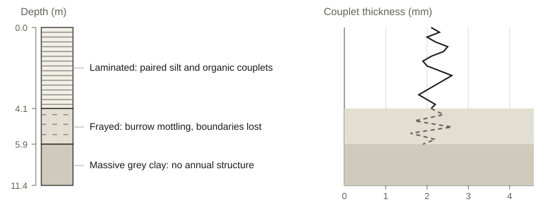
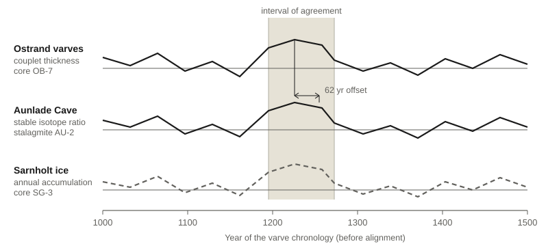

<header>

Research Frontiers

Earth Systems

<h1>Signals in Deep Time</h1>

Archives of stone, ice, and sediment preserve patterns that outlast our instruments. Interpreting their traces demands methods that are patient, plural, and precise.

L. Armitage &amp; M. Qasim

Department of Earth Systems, Ostrand Institute

</header>

## Reading the Record

Every proxy record is a translation: sediment, ice, and alpine larch each convert their surroundings into a physical trace, and each does so imperfectly.[^1]

The Ostrand Basin cores raised by the Ostrand Institute are crisp through four metres and ambiguous below, where bioturbation has smeared the seasonal boundary.

Resolution is not the only axis that matters. A speleothem tracks rainfall, but also the soil gas above the cave, and the two signals arrive superimposed.[^2]

Hence the retreat from single-archive reconstructions. Where three archives with unrelated failure modes agree, the shared signal is unlikely to be an artefact of one.

A modern reconstruction is less a curve than a defended argument, travelling with its uncertainty envelope and its calibration data.

## Models and Measures

Age-depth modelling carries the interpretive weight: between dated horizons, the analyst must say what they believe about accumulation.

Bayesian formulations make those beliefs auditable, returning a posterior over the whole chronology rather than a single best-fit line.[^3]

Measurement has kept pace; continuous-flow analysis now reads an ice core at sub-centimetre spacing.

Kelvale University's reanalysis of the Sarnholt Glacier series traces half its centennial variability to drilling fluid.

That result was not an indictment of the original team. The contaminant sat below the detection limit of the instruments available when the core was cut, and it entered the record as a smooth, slowly varying signal — which is to say, in the shape that a climate scientist is trained to find interesting.

It surfaced only because two laboratories agreed to measure the same eleven metres of ice by different chemistries and to publish the comparison whatever it showed.[^4]

Replication of that kind is slow, unglamorous, and nearly invisible in a literature that rewards novelty. It is also the only mechanism the field has for catching an artefact that behaves like a climate.

The Ostrand Concordance, begun at the Institute four years ago, was designed around that lesson. Rather than reconstruct one site to the finest achievable precision, it takes four archives within two hundred kilometres of each other and asks where their independently built chronologies can be brought into agreement.

Agreement is not the aim of the exercise. It is the diagnostic.

<aside class="card">

Later in this article

- [Varve counting and its error](#the-ostrand-sequence)
- [Four archives, four failure modes](#three-archives-one-winter)
- [A sixty-two year offset](#where-the-chronologies-disagree)
- [The instrumental overlap window](#the-instrumental-handshake)
- [What the archives owe](#what-the-archives-owe)

</aside>

## The Ostrand Sequence

Ostrand Basin is a narrow, steep-sided lake whose deepest water has not been stirred within the span of the record it holds. Its inflow delivers a spring flush of pale mineral silt; the productivity of late summer settles a darker organic drape on top of it. The two together make a varve, and the varves stack.

Cores raised over four winters reach 11.4 metres. The upper 4.1 are laminated cleanly enough that a practised counter can work at roughly a hundred years an hour, and the couplets are thick enough to be measured rather than merely tallied.

Below that depth the lamination frays. Burrow mottling cuts across the boundaries, faintly at first and then decisively, until by 5.9 metres the sediment is a massive grey clay with no annual structure at all.

<figure class="wide">

<figcaption>Core OB-7. Couplet thickness is measurable through the laminated interval and merely estimated across the frayed transition. Below 5.9 m the annual signal is gone; the chronology there rests entirely on the age model.</figcaption>
</figure>

"You can see the exact horizon where the lake became habitable again," says Ines Talmadge, the sedimentologist who has counted the sequence twice. "It is the most interesting thing in the core and the least useful."

The counting is done blind and in duplicate. Two analysts work from the same scanned thin sections without consulting one another, and their tallies are reconciled only after both are complete.

Over the laminated interval the two counts differed by thirty-one years in about three thousand — a little under one per cent, and almost all of it accumulated in four ambiguous stretches where a thin couplet may or may not be a couplet at all.[^5]

The Institute's protocol does not average the two counts. It carries both, together with the marked positions of every disputed couplet, into the age model as an explicit uncertainty on layer number.

This is more conservative than it sounds. A one per cent counting error over three millennia is not a one per cent error on any particular date; it is an error that accumulates monotonically downward, so the youngest part of the record is nearly exact and the oldest is not.

Tephra offers the one reliable check. Two ash layers of known composition sit at 2.3 and 3.8 metres, and both fall within the counted envelope — a result that constrains the count without independently confirming it, since the ages of the ash layers themselves were established elsewhere by the same family of methods.[^6]

## Three Archives, One Winter

The Concordance pairs the Ostrand varves with three neighbours: a stalagmite from Aunlade Cave in the Verrick Range, a short ice core from the Sarnholt Glacier, and a peat sequence from the Dunmarrow mire.

The four were chosen for their failure modes rather than their virtues. Nothing that would corrupt a varve count would also corrupt a stalagmite; nothing that biases isotope ratios in dripwater has any obvious route into an ice core's annual accumulation.

<figure class="wide">
<figcaption>The four archives of the Ostrand Concordance</figcaption>

| Archive     | Site          | Resolution | Dating control       | Principal confound          |
| ----------- | ------------- | ---------- | -------------------- | --------------------------- |
| Lake varves | Ostrand Basin | Annual     | Layer count, tephra  | Burrowing, slumped sediment |
| Speleothem  | Aunlade Cave  | Decadal    | Radiometric          | Soil gas, growth hiatus     |
| Ice         | Sarnholt      | Annual     | Layer count, horizon | Wind scour, meltwater       |
| Peat        | Dunmarrow     | Decadal    | Radiocarbon          | Water table, compaction     |

</figure>

That independence is the whole argument, and it is weaker than it looks. All four chronologies are anchored, at some depth, to a radiocarbon calibration that they share; all four were interpreted by people who knew what the others had found.

Marisol Venn, who works the Aunlade material, is blunt about the second problem. "I have never dated a stalagmite in ignorance of the varve count. Nobody has. The best you can do is write down what you expected before you measured, and then let somebody else check whether you got it."

The Concordance formalises exactly that. Each group registers its priors — expected growth rate, expected accumulation, the intervals it considers unreliable — before the analytical work begins, and the registration is timestamped in the Institute's open archive.[^7]

The four records were then aligned only on the interval where each had an internal chronology it was willing to defend without reference to the others: roughly 1180 to 1290 in the varve years.

## Where the Chronologies Disagree

They did not agree. Aligned on their own terms, the varve and speleothem series showed a coherent common signal displaced by sixty-two years, with the cave record consistently older.

<figure class="wide">

<figcaption>Three of the four series on the varve time axis before alignment. The shaded band marks the interval on which all three carry an independent chronology. The shared excursion is visible in each; its position is not.</figcaption>
</figure>

A sixty-two year offset is a small thing and a fatal one. It is small enough to be absorbed silently by any reconstruction that averages several records onto a common grid, and fatal to the claim that the event those records describe was synchronous.

<blockquote class="pull">

A prior is a promise about what you would have believed before you looked. Most of us write it down afterwards.

Rune Oyelaran

</blockquote>

Rune Oyelaran, the statistician who built the Concordance age models, spent eleven months on the discrepancy. "The temptation is to split the difference," he says. "You can always find a set of priors that makes two chronologies meet in the middle, and the posterior will look beautiful, and you will have learned nothing."

What the priors could not absorb, in the end, was the shape of the disagreement. The offset was not constant: it opened across roughly forty years of the speleothem record, held steady thereafter, and never reversed. That is not how a counting error behaves. It is exactly how a growth hiatus behaves.

Re-examination of the stalagmite at high magnification found the hiatus: a thin, dark, discontinuous surface at a depth the original scan had read as a single dense growth band.[^8]

The cave, it turned out, had gone dry. The stalagmite had stopped growing for a period the radiometric dates could bracket only loosely, and the age model — which had been asked to assume continuous deposition, because nothing in the data contradicted that assumption — had quietly distributed the missing decades through the surrounding growth.

Corrected, the two records agree to within the counting uncertainty. The correction was not a triumph of the model. It was a triumph of somebody looking again at a piece of rock because the arithmetic would not resolve.

Oyelaran is unsentimental about what this implies for the many reconstructions that have no second archive to argue with. "If you have one record, you have a hypothesis. We had four, and it took us the better part of a year to notice that one of them had a hole in it."

## The Instrumental Handshake

Every proxy reconstruction must eventually be calibrated against measurements — and the measurements are recent, short, and taken for other purposes.

The Ostrand gauge record begins in 1946 and is complete apart from two winters. Set against three thousand years of varves, it is a window of seventy-odd years through which the entire relationship between couplet thickness and spring temperature must be inferred.[^9]

Halvor Brekkan, who maintains the Sarnholt monitoring programme at Kelvale University, describes the overlap window as the field's least examined assumption. "We calibrate on the decades we can measure and then apply that relationship to centuries we cannot. The relationship is not guaranteed to hold, and the archive will not tell you when it stopped."

There are partial defences. Calibrating on one half of the instrumental period and validating on the other exposes the grosser failures. So does testing whether the proxy reproduces a documented extreme — a known flood year, a known failed harvest — that falls outside the calibration interval altogether.

<aside class="card">

In brief: what an age model does

An age–depth model converts a handful of dated points into a continuous chronology, by stating what the analyst believes about the rate of accumulation between them.

A Bayesian model states those beliefs as probability distributions and returns a distribution over chronologies. Its output is not a line but a bundle of lines, all of which are consistent with the dates and the assumptions.

The width of that bundle is an honest measure of ignorance only if the assumptions are honest. A model asked to assume continuous deposition will happily produce a narrow, confident, and entirely wrong chronology across a hiatus.

</aside>

Neither defence addresses the deeper worry, which is that the calibration period is itself unusual. The seventy years for which good instrumental data exist are precisely the seventy years in which the climate system has been forced hardest, and there is no principled reason to expect a proxy's sensitivity to be constant across that transition.[^10]

The Concordance response is to publish the calibration as a first-class object: the regression, its residuals, the years excluded and why, and the raw gauge series as received.[^11] A reader who disagrees with any of these can refit the relationship without repeating the fieldwork.

## What the Archives Owe

The Ostrand cores will be re-sampled next winter at a finer interval, and the Aunlade stalagmite has been returned to the cave laboratory for a full re-scan. Neither decision was forced by a reviewer.

What the Concordance has produced, after four years, is not a better curve. It is a curve of roughly the same shape as the one the Institute would have drawn from Ostrand alone, carrying an uncertainty envelope about forty per cent wider and a written account of every place where the envelope could not be narrowed honestly.

That is an awkward product. It is harder to plot, harder to summarise, and considerably harder to publish than a confident line.

But the archives were never obliged to be legible. Sediment, ice, and calcite record what happened to them, not what we would like to know, and the discipline of reading them consists largely in refusing to hear more than they said.

"The record is not a message," Talmadge says. "Nobody sent it. We are reading somebody else's mail, in a language we reconstructed from the mail itself, and we should be modest about the translation."

[^1]: On the general framing, see the Ostrand Institute methods handbook, third edition, chapter two; the reverse-translation figure is Armitage's.

[^2]: Confounding in speleothem records is reviewed in the Verrick Range synthesis (Kelvale University Press), which tabulates thirty-one published cases.

[^3]: The posterior chronologies discussed here, with the priors used to generate them, are deposited in the Ostrand open archive under accession OI-2024-118.

[^4]: The Sarnholt intercomparison and its two chemistries are documented in the joint Kelvale–Ostrand report of the same year; the drilling fluid was identified only in the second round.

[^5]: Counting sheets for both analysts, including the marked positions of all disputed couplets, are held under accession MI-2023-071.

[^6]: Neither ash layer is unique to Ostrand; both are dated, in part, from lake sequences of this same type.

[^7]: Registrations are public from the moment of deposit; they cannot be revised, only superseded.

[^8]: Imaging of the hiatus surface, at the original and revised magnifications, is included with the corrected chronology under accession MI-2025-014.

[^9]: Two winters are missing from the gauge series; the interpolation across them is flagged in the residuals.

[^10]: The point is not original to the Concordance: the methods handbook states it plainly, and few act on it.

[^11]: Calibration objects are versioned separately from the reconstructions that use them, so that a refitted relationship does not silently alter a published curve.
