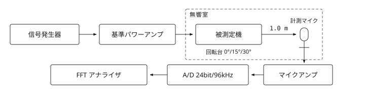
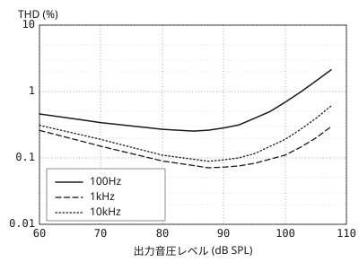
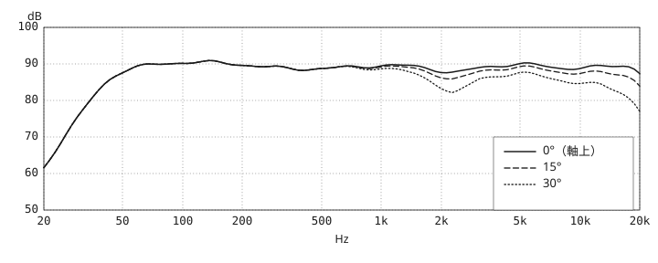
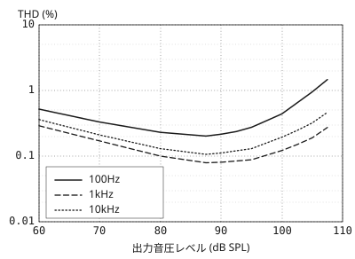
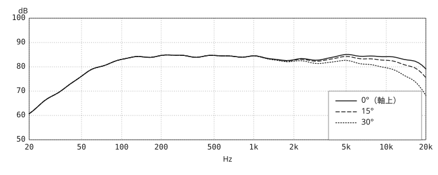
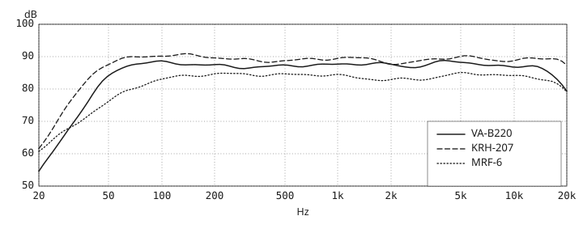

<p class="running-title">月刊　音響計測レビュー</p>

# ブックシェルフ型3機種の測定比較

<p class="meta"><b class="stamp-area">特集</b><span>2026年9月号&#8195;/&#8195;本誌音響計測室</span></p>

{#fig-setup .wide}

<div class="body">

小型のブックシェルフ型は置き場所を選ばず、価格も手が届く範囲に収まる。そのぶん設計者の判断が音の性格に直結し、同じ2ウェイでも聴こえ方は驚くほど分かれる。本特集では方式も口径も異なる3機種を本誌音響計測室に持ち込み、まったく同じ条件で測り、続けて同じ部屋で聴いた。

取り上げたのはVELLUTO ACUSTICAのVA-B220、KIRIHA AUDIOのKRH-207、MOORFELL ACOUSTICSのMRF-6である。前二者がバスレフ、MRF-6だけが密閉で、ウーファー口径は120mmから160mmまで開きがある。

## 測定方法

測定系は<a href="#fig-setup" data-ref="fig"></a>のとおりである。無響室の有効下限は80Hzで、それ以下は近接音場測定の結果を接続して合成した。信号は対数正弦波スイープ、入力は2.83V一定とし、軸上1.0mに立てた1/4インチ計測マイクで受けている。得られたインパルス応答には4.5msの時間窓をかけ、1/24オクターブ帯域で平滑化した。指向特性は回転台を用いて0°、15°、30°の3点を測り、1枚のグラフに重ねている。インピーダンスは定電流法で別途測ったが、誌面の都合でグラフは割愛し、最小値のみ各機の表に記した。

## グラフの読み方

軸上特性の平坦さは目を引くが、それだけで部屋に置いたときの印象は決まらない。3本の曲線が互いに平行に降りていれば、間接音の音色は軸上と大きく変わらない。逆に特定の帯域だけ角度による開きが大きい機種は、頭を少し動かしただけで音色が動く。

## 歪率の定義

本誌がグラフに掲げるのは全高調波歪率（THD）である。基本波の実効値を$V_1$、$n$次高調波の実効値を$V_n$とすると、百分率のTHDは次式で与えられる。

$$
\mathrm{THD} = \frac{\sqrt{V_2^2 + V_3^2 + \cdots + V_5^2}}{V_1} \times 100
$$

本誌では5次までを積算している。スピーカーの歪は入力レベルに強く依存するから、単一の数値で性能を語ることはできない。横軸に出力音圧レベルをとっているのはそのためで、読者が常用する音量域での値を読み取ってほしい。

低出力側で歪率が上がって見えるのは、暗騒音とマイクの自己雑音が相対的に大きくなるためで、機器の性能が落ちているわけではない。

## 試聴の条件

試聴は容積約28立方メートル、残響時間0.32秒のリスニングルームで行った。スピーカーは背面を壁から60cm離し、内振り15°で設置している。アンプは本誌基準機に固定し、スタンドとケーブルも3機種で共通とした。ソースは24bit/96kHzのファイル再生を主軸に、必要に応じてCDとDSDを併用している。試聴者は3名、機種名を伏せた状態で個別に聴取した。

</div>

<div class="bottom">

<aside class="conditions">
<h2>測定条件</h2>

```text
MIC: MC-4B 1/4in
FFT 65536pt
1/24oct smoothing
LEVEL 2.83V / 1m
```

</aside>

| 項目         | VA-B220    | KRH-207    | MRF-6      |
| ------------ | ---------- | ---------- | ---------- |
| ブランド     | VELLUTO    | KIRIHA     | MOORFELL   |
| 方式         | バスレフ   | バスレフ   | 密閉       |
| ウーファー   | 130mm      | 160mm      | 120mm      |
| ツイーター   | 28mmソフト | 25mmアルミ | 25mmシルク |
| 価格（ペア） | ¥128,000   | ¥98,000    | ¥156,000   |
| 質量（1台）  | 6.2kg      | 7.9kg      | 5.8kg      |
| 測定日       | 07-14      | 07-15      | 07-16      |

</div>

# VELLUTO ACUSTICA VA-B220

<p class="meta"><b class="stamp-area">測定レビュー</b><span>2ウェイ・バスレフ&#8195;/&#8195;<span class="price">&yen;128,000</span> (pair)</span></p>

{#fig-freq-va .wide}

<div class="body">

VELLUTO ACUSTICAはイタリア・ヴェネト州の小規模メーカーで、キャビネットの木工を自社で抱えていることを掲げている。VA-B220は同社で最も小さい2ウェイ機である。130mmのポリプロピレンコーンウーファーと28mmソフトドームツイーターを18mm厚MDFのバスレフ箱に収め、外形は190×320×270mm、質量は1台6.2kg。

## 周波数特性

<a href="#fig-freq-va" data-ref="fig"></a>は無響室で測った軸上1mの特性である。200Hzから10kHzの帯域内偏差は±1.5dBに収まり、平均レベルは2.83V入力で87.3dBだった。低域は63Hz付近から下降に転じ、−6dB点は44Hzである。100Hz付近に+1.4dBのわずかな持ち上がりがあるが、バスレフの同調点と箱の寸法に由来するもので、耳につく膨らみではない。高域は16kHzを境に急速に落ち、20kHzでは−8.0dBに達する。

## 歪率特性

<a href="#fig-thd-va" data-ref="fig"></a>が高調波歪率である。1kHzは88dB SPL付近で0.07%まで下がり、100dB SPLでも0.11%を保つ。10kHzもほぼ同じ形で、常用域では0.1%前後に収まる。100Hzだけは中域より一桁高く、常用域で0.25%前後、1%に達するのは103dB SPLだった。130mmという口径からすれば健闘した数値である。

## 指向性と試聴

15°と30°の曲線は5kHzまで軸上とほぼ平行に走り、開きは1dB強にとどまる。8kHzを超えると28mmドームの指向性が効きはじめ、30°では10kHzで−5.7dB、16kHzで−12.7dBまで落ちる。落ち方は単調で途中に段差がなく、クロスオーバー2.6kHz付近にも角度による乱れは見当たらない。

聴感もグラフの印象どおりだった。声の帯域に色がつかず、奏者の左右の位置が動かない。低域は量で押さないぶん、小音量でも輪郭が緩まなかった。

{#fig-thd-va}

</div>

<div class="bottom">

<aside class="conditions">
<h2>試聴条件</h2>

```text
AMP: ref. class-AB
SRC: 24bit/96kHz
ROOM: 28m3 RT0.32s
```

</aside>

| 項目           | 公称値 | 実測値    | 備考          |
| -------------- | ------ | --------- | ------------- |
| 再生下限       | 45Hz   | 44Hz      | −6dB点        |
| 再生上限       | 25kHz  | 18.8kHz   | −6dB点        |
| 出力音圧レベル | 87dB   | 87.3dB    | 2.83V・1m     |
| 帯域内偏差     | —      | ±1.5dB    | 200Hz–10kHz   |
| インピーダンス | 6Ω     | 5.4Ω      | 最小値・182Hz |
| クロスオーバー | 2.6kHz | 2.55kHz   | −6dB交点      |
| 最大出力       | —      | 103dB SPL | 100Hz・THD1%  |

</div>

# KIRIHA AUDIO KRH-207

<p class="meta"><b class="stamp-area">測定レビュー</b><span>2ウェイ・バスレフ&#8195;/&#8195;<span class="price">&yen;98,000</span> (pair)</span></p>

{#fig-freq-krh .wide}

<div class="body">

KIRIHA AUDIOは長野県の工房で組み立てを行う国内メーカーである。KRH-207は3機種で唯一160mmのウーファーを積み、ポリプロピレンコーンと25mmアルミドームツイーターを組み合わせる。バスレフ箱は200×355×300mmと今回いちばん大きく、質量は1台7.9kg。実売は3機種で最も安い。

## 周波数特性

<a href="#fig-freq-krh" data-ref="fig"></a>のとおり、平均レベルは2.83V入力で89.0dBと3機種で最も高い。−6dB点は38Hzまで伸び、箱の大きさと口径がそのまま効いている。100Hzから160Hzにかけて+1.1dBほどの持ち上がりがあり、量感を狙った同調と読める。いっぽう2kHz付近には−1.4dBのディップがある。高域は19kHz付近にアルミドームの分割振動によるピークが残るが、可聴帯域への影響は小さい。

## 歪率特性

<a href="#fig-thd-krh" data-ref="fig"></a>では100Hzの歪率が88dB SPLで0.20%と3機種で最も低い。1%に達するのは105dB SPLで、余裕は今回いちばん大きい。1kHzは0.08%前後、10kHzは0.11%前後で、いずれも常用域では問題にならない水準である。大きな箱と大口径が素直に効いた結果といえる。

## 指向性と試聴

角度をつけたときの変化は2kHz台に集中する。30°では2.3kHzで−7.0dBまで落ち込み、3.15kHz以上で−3dB程度まで戻る。160mmウーファーがクロスオーバー2.4kHzの手前で指向性を絞るためで、軸上では見えない谷が横に立つと現れる。10kHzでの30°減衰は−4.4dBと3機種で最も少ない。

試聴では低域の伸びと音圧の出やすさがすぐ分かった。ただし正面を外すと中高域がやや後退し、間隔を詰めて内振りを強めたほうがまとまった。

{#fig-thd-krh}

</div>

<div class="bottom">

<aside class="conditions">
<h2>試聴条件</h2>

```text
AMP: ref. class-AB
SRC: 24bit/96kHz
ROOM: 28m3 RT0.32s
```

</aside>

| 項目           | 公称値 | 実測値    | 備考         |
| -------------- | ------ | --------- | ------------ |
| 再生下限       | 40Hz   | 38Hz      | −6dB点       |
| 再生上限       | 30kHz  | 23.0kHz   | −6dB点       |
| 出力音圧レベル | 89dB   | 89.0dB    | 2.83V・1m    |
| 帯域内偏差     | —      | ±1.5dB    | 200Hz–10kHz  |
| インピーダンス | 6Ω     | 5.1Ω      | 最小値・96Hz |
| クロスオーバー | 2.4kHz | 2.35kHz   | −6dB交点     |
| 最大出力       | —      | 105dB SPL | 100Hz・THD1% |

</div>

# MOORFELL ACOUSTICS MRF-6

<p class="meta"><b class="stamp-area">測定レビュー</b><span>2ウェイ・密閉&#8195;/&#8195;<span class="price">&yen;156,000</span> (pair)</span></p>

{#fig-freq-mrf .wide}

<div class="body">

MOORFELL ACOUSTICSは英国の小規模ブランドで、3機種で唯一の密閉型を送り出した。120mmペーパーコーンウーファーと25mmシルクドームツイーターを178×300×255mmの箱に収め、質量は1台5.8kg。今回の3機種ではいちばん高価である。

## 周波数特性

<a href="#fig-freq-mrf" data-ref="fig"></a>の平均レベルは84.1dBで、密閉型らしく能率は低い。−6dB点は56Hzだが、そこから下の傾きが12dB/octと緩く、40Hzでも−11.5dBにとどまる。バスレフの2機種が同じ帯域で一気に落ちるのとは対照的である。1.5kHzから3kHzにかけて−1.2dB程度の浅い凹みがあり、いわゆるプレゼンスディップにあたる。高域は20kHzで−4.9dBと自然に減衰する。

## 歪率特性

<a href="#fig-thd-mrf" data-ref="fig"></a>では100Hzの歪率が78dB SPLで0.34%と3機種で最も高く、1%に達するのも96dB SPLと早い。120mmの振動板で密閉箱を駆動する以上、これは避けられない。いっぽう1kHzは0.07%、10kHzは0.08%と中高域は最も静かで、歪の内訳がはっきり分かれている。

## 指向性と試聴

オフアクシスの素直さは3機種で群を抜く。30°でも10kHzで−4.5dB、軸上曲線との差は全帯域でなだらかに開くだけで、途中に谷や段差がない。クロスオーバーを3.2kHzと高めに置き、25mmドームの受け持ちを絞ったことが効いている。壁からの反射が多い部屋でも音色が崩れにくいはずである。

聴感では低域が緩やかに減っていくため、量感は乏しいのに音階がよく見える。中高域の浅い凹みは声を後ろに下げるが、長時間聴いても疲れない。

{#fig-thd-mrf}

</div>

<div class="bottom">

<aside class="conditions">
<h2>試聴条件</h2>

```text
AMP: ref. class-AB
SRC: 24bit/96kHz
ROOM: 28m3 RT0.32s
```

</aside>

| 項目           | 公称値 | 実測値   | 備考          |
| -------------- | ------ | -------- | ------------- |
| 再生下限       | 55Hz   | 56Hz     | −6dB点        |
| 再生上限       | 28kHz  | 20.9kHz  | −6dB点        |
| 出力音圧レベル | 84dB   | 84.1dB   | 2.83V・1m     |
| 帯域内偏差     | —      | ±1.5dB   | 200Hz–10kHz   |
| インピーダンス | 8Ω     | 6.8Ω     | 最小値・210Hz |
| クロスオーバー | 3.2kHz | 3.15kHz  | −6dB交点      |
| 最大出力       | —      | 96dB SPL | 100Hz・THD1%  |

</div>

# 3機種の総括と選び方

<p class="meta"><b class="stamp-area">総括</b><span>MEASURED 2026-07&#8195;/&#8195;本誌音響計測室</span></p>

{#fig-overlay .wide}

<div class="body">

<a href="#fig-overlay" data-ref="fig"></a>に3機種の軸上特性を重ねた。縦軸は同じ2.83V入力での実測値だから、曲線の高さの差がそのまま能率の差である。KRH-207がいちばん上、VA-B220が中央、MRF-6が最も下で、上下の差は約5dBに達する。同じアンプで同じ音量を出すには、MRF-6には3倍以上の電力が要る計算になる。

## 低域の設計思想

低域の振る舞いは方式の違いがそのまま出た。バスレフのVA-B220とKRH-207は同調点まで平坦を保ち、その下で急速に落ちる。密閉のMRF-6は早くから下がり始めるかわり、傾きが緩く40Hzでも−11.5dBを保つ。数字の上ではKRH-207の38Hzが最も低いが、部屋の定在波と組み合わせたときに扱いやすいのは傾きの緩いMRF-6であることも多い。

## 歪率と最大出力

歪率は最大出力の目安として読むのがよい。100HzでTHD1%に達する出力はKRH-207が105dB SPL、VA-B220が103dB SPL、MRF-6が96dB SPLだった。10畳程度の部屋で常用する95dB SPL前後までなら3機種とも余裕があるが、それを超えるとMRF-6は急に苦しくなる。

## 指向性と部屋の相性

オフアクシスの素直さではMRF-6が最も良く、VA-B220がこれに続く。KRH-207は2kHz台に角度依存の谷を抱えるため、正面を外した席では中高域が薄くなる。ライブな部屋や、聴取位置を1点に絞れない環境では、この差は帯域内偏差の差より大きく効く。逆に机上のニアフィールドのように角度を固定できる使い方なら、KRH-207の谷はほとんど問題にならない。

## どれを選ぶか

測定値の総合点ではVA-B220が最もバランスがよい。突出した長所はないが、低域から高域まで欠点らしい欠点がなく、部屋も選ばない。KRH-207は能率と低域の伸びを最優先した設計で、この価格を考えれば得られるものは大きい。ただし設置の自由度は低い。MRF-6は能率と最大出力を割り切って、指向性と中高域の歪率を採った目的のはっきりした製品である。

価格順に良し悪しが並ばないのが、この価格帯の面白いところである。数字は選択の材料にはなるが、答えそのものではない。

</div>

<div class="bottom">

<aside class="conditions">
<h2>試聴盤</h2>

```text
DISC1 orch. 24/96
DISC2 jazz trio DSD
DISC3 vocal CD
```

</aside>

| 項目             | VA-B220  | KRH-207 | MRF-6    |
| ---------------- | -------- | ------- | -------- |
| 実測感度         | 87.3dB   | 89.0dB  | 84.1dB   |
| 低域限界         | 44Hz     | 38Hz    | 56Hz     |
| 高域限界         | 18.8kHz  | 23.0kHz | 20.9kHz  |
| 30°減衰（10kHz） | −5.7dB   | −4.4dB  | −4.5dB   |
| THD最小（1kHz）  | 0.07%    | 0.08%   | 0.07%    |
| 最大出力         | 103dB    | 105dB   | 96dB     |
| 価格（ペア）     | ¥128,000 | ¥98,000 | ¥156,000 |

</div>
