# NSR7420 Wideband RF Transceiver — Data Sheet

<p class="lead">Northstar Signal Labs · NSR7420 · Rev. C, April 2026</p>

## Functional Overview

The NSR7420 is a wideband, direct-conversion RF transceiver spanning 0.3 GHz to
6.0 GHz. It integrates dual receive and transmit I/Q chains, on-chip 12-bit
converters, a fractional-N PLL synthesizer and programmable baseband filters.
FDD and TDD operation are supported; the device is configured over a 4-wire SPI
port.

- Tuning 0.3–6.0 GHz, 100 MHz signal bandwidth
- 12-bit ADC/DAC pairs, on-chip I/Q and DC-offset calibration
- 2.8 dB noise figure, +20.5 dBm output at 1.0 GHz
- 48-lead QFN, 6 µA sleep, −40 °C to +85 °C

### Applications

- Software-defined radio and spectrum monitoring
- Private LTE and 5G NR sub-6 GHz small cells
- Point-to-point microwave backhaul modems
- Radar and instrumentation front ends

### RF Receive / Transmit Functional Block Diagram

<figure class="diagram" id="fig-block">
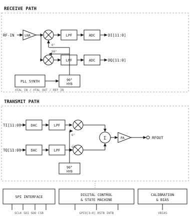
<figcaption>Receive and transmit signal chain.</figcaption>
</figure>

## Pin Configuration and Functions

<figure class="pinout">
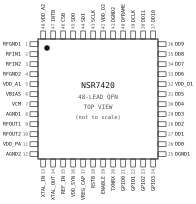
<figcaption>QFN-48 pin configuration, top view.</figcaption>
</figure>

### Pin Function Descriptions

<figure class="tbl">

| Pin | Name     | Type | Function                         |
| --- | -------- | ---- | -------------------------------- |
| 1   | RFGND1   | G    | RF ground, receive front end     |
| 2   | RFIN1    | AI   | RF input, low band 0.3–2.7 GHz   |
| 3   | RFIN2    | AI   | RF input, high band 2.4–6.0 GHz  |
| 4   | RFGND2   | G    | RF ground, receive front end     |
| 5   | VDD_A1   | P    | Analog supply, 3.3 V             |
| 6   | VBIAS    | AO   | Bias decoupling, 100 nF to AGND  |
| 7   | VCM      | AO   | Baseband common mode, 0.9 V      |
| 8   | AGND1    | G    | Analog ground                    |
| 9   | RFOUT1   | AO   | RF output, low band              |
| 10  | RFOUT2   | AO   | RF output, high band             |
| 11  | VDD_PA   | P    | Driver amplifier supply, 3.3 V   |
| 12  | AGND2    | G    | Analog ground                    |
| 13  | XTAL_IN  | AI   | Crystal or TCXO input            |
| 14  | XTAL_OUT | AO   | Crystal drive output             |
| 15  | REF_IN   | AI   | External reference clock input   |
| 16  | VDD_SYN  | P    | Synthesizer supply, 3.3 V        |
| 17  | VREG_CAP | AO   | Internal regulator, 1 µF to GND  |
| 18  | RSTB     | DI   | Hardware reset, active low       |
| 19  | ENABLE   | DI   | Device enable, active high       |
| 20  | TXNRX    | DI   | High = transmit, low = receive   |
| 21  | GPIO0    | DIO  | General-purpose I/O 0            |
| 22  | GPIO1    | DIO  | General-purpose I/O 1            |
| 23  | GPIO2    | DIO  | General-purpose I/O 2            |
| 24  | GPIO3    | DIO  | General-purpose I/O 3            |
| 25  | DGND1    | G    | Digital ground                   |
| 26  | DD0      | DIO  | Parallel data port, bit 0 (LSB)  |
| 27  | DD1      | DIO  | Parallel data port, bit 1        |
| 28  | DD2      | DIO  | Parallel data port, bit 2        |
| 29  | DD3      | DIO  | Parallel data port, bit 3        |
| 30  | DD4      | DIO  | Parallel data port, bit 4        |
| 31  | DD5      | DIO  | Parallel data port, bit 5        |
| 32  | VDD_D1   | P    | Digital supply, 1.8 V            |
| 33  | DD6      | DIO  | Parallel data port, bit 6        |
| 34  | DD7      | DIO  | Parallel data port, bit 7        |
| 35  | DD8      | DIO  | Parallel data port, bit 8        |
| 36  | DD9      | DIO  | Parallel data port, bit 9        |
| 37  | DD10     | DIO  | Parallel data port, bit 10       |
| 38  | DD11     | DIO  | Parallel data port, bit 11 (MSB) |
| 39  | DCLK     | DO   | Source-synchronous port clock    |
| 40  | DFRAME   | DO   | I/Q frame marker                 |
| 41  | DGND2    | G    | Digital ground                   |
| 42  | VDD_D2   | P    | Digital supply, 1.8 V            |
| 43  | SCLK     | DI   | SPI clock input                  |
| 44  | SDI      | DI   | SPI data input                   |
| 45  | SDO      | DO   | SPI data output                  |
| 46  | CSB      | DI   | SPI chip select, active low      |
| 47  | INTB     | DO   | Interrupt request, active low    |
| 48  | VDD_A2   | P    | Analog supply, 3.3 V             |
| EP  | EPAD     | G    | Exposed pad, solder to AGND      |

<figcaption>Pin function descriptions. P = power, G = ground, AI/AO = analog, DI/DO/DIO = digital.</figcaption>
</figure>

## Absolute Maximum Ratings

<figure class="tbl">

| Parameter               | Symbol   | Min  | Max       | Unit |
| ----------------------- | -------- | ---- | --------- | ---- |
| Digital supply voltage  | VDD_D    | -0.3 | 3.6       | V    |
| Analog supply voltage   | VDD_A    | -0.3 | 3.6       | V    |
| RF input level (50 Ω)   | VRF_IN   | -0.3 | +13       | dBm  |
| RF output level, RFOUT  | PRF_OUT  | —    | +20       | dBm  |
| Digital input voltage   | VIN_D    | -0.3 | VDD_D+0.3 | V    |
| Current per pin (cont.) | I_PIN    | -20  | +20       | mA   |
| Storage temperature     | TSTG     | -65  | +150      | °C   |
| Junction temperature    | TJ       | -40  | +125      | °C   |
| Humidity (non-cond.)    | —        | —    | 95        | %RH  |
| ESD, HBM (JS-001)       | VESD_HBM | —    | 2000      | V    |
| ESD, CDM (JS-002)       | VESD_CDM | —    | 750       | V    |

<figcaption>Absolute maximum ratings.</figcaption>
</figure>

<p class="note">Note: Stresses beyond the absolute maximum ratings may cause permanent damage to the device. Operation at these limits is not implied.</p>

## Recommended Operating Conditions

<figure class="tbl">

| Parameter             | Symbol  | Min  | Typ | Max  | Unit |
| --------------------- | ------- | ---- | --- | ---- | ---- |
| Analog supply         | VDD_A   | 3.00 | 3.3 | 3.60 | V    |
| Driver supply         | VDD_PA  | 3.00 | 3.3 | 3.60 | V    |
| Synthesizer supply    | VDD_SYN | 3.00 | 3.3 | 3.60 | V    |
| Digital supply        | VDD_D   | 1.62 | 1.8 | 1.98 | V    |
| Supply rise time      | tVDD    | 0.1  | —   | 20   | ms   |
| Reference frequency   | fREF    | 10   | 40  | 80   | MHz  |
| RF input level        | PIN_RF  | —    | —   | +10  | dBm  |
| SPI clock frequency   | fSCLK   | —    | —   | 40   | MHz  |
| Operating temperature | TA      | -40  | +25 | +85  | °C   |

<figcaption>Recommended operating conditions.</figcaption>
</figure>

## Thermal Characteristics

<figure class="tbl">

| Parameter               | Symbol  | Value | Unit |
| ----------------------- | ------- | ----- | ---- |
| Junction to ambient     | θJA     | 26.0  | °C/W |
| Junction to case, top   | θJC_top | 12.5  | °C/W |
| Junction to board       | θJB     | 6.8   | °C/W |
| Junction to pad, bottom | θJC_bot | 3.2   | °C/W |
| Peak reflow temperature | TPEAK   | 260   | °C   |
| Moisture sensitivity    | MSL     | 3     | —    |

<figcaption>Thermal characteristics, JEDEC 4-layer board with nine thermal vias.</figcaption>
</figure>

## Electrical Characteristics

<p class="lead">VDD_A = VDD_PA = VDD_SYN = 3.3 V, VDD_D = 1.8 V, fREF = 40 MHz, TA = 25 °C, 50 Ω system, unless otherwise noted.</p>

### Supply and Power Consumption

<figure class="tbl">

| Parameter         | Symbol  | Conditions     | Min | Typ  | Max  | Unit |
| ----------------- | ------- | -------------- | --- | ---- | ---- | ---- |
| Receive current   | I_RX    | BW = 100 MHz   | —   | 78   | 95   | mA   |
| Transmit current  | I_TX    | P_OUT = 20 dBm | —   | 210  | 260  | mA   |
| Digital current   | I_DD    | fDD = 100 MHz  | —   | 40   | 55   | mA   |
| Standby current   | I_STBY  | synth locked   | —   | 22   | 30   | mA   |
| Sleep current     | I_SLEEP | ENABLE low     | —   | 6    | 15   | µA   |
| Power dissipation | PD      | TDD, 50 % duty | —   | 0.55 | 0.75 | W    |

<figcaption>Supply and power consumption.</figcaption>
</figure>

### Receiver

<figure class="tbl">

| Parameter             | Symbol   | Conditions      | Min  | Typ  | Max  | Unit |
| --------------------- | -------- | --------------- | ---- | ---- | ---- | ---- |
| Operating frequency   | fRF      | —               | 0.30 | —    | 6.00 | GHz  |
| Receiver gain         | GRX      | max gain, 1 GHz | 40.0 | 45.0 | 50.0 | dB   |
| Receiver gain         | GRX      | max gain, 6 GHz | —    | 37.2 | —    | dB   |
| Gain control range    | GRNG     | 1 dB steps      | —    | 45   | —    | dB   |
| Gain step error       | GERR     | any step        | —    | 0.2  | 0.5  | dB   |
| Noise figure          | NF       | max gain, 1 GHz | —    | 2.8  | 4.5  | dB   |
| Noise figure          | NF       | max gain, 6 GHz | —    | 4.3  | 6.0  | dB   |
| Input IP3             | IIP3     | min gain, 1 GHz | —    | +2   | —    | dBm  |
| Input IP3             | IIP3     | max gain, 1 GHz | —    | -18  | —    | dBm  |
| Input P1dB            | IP1dB_RX | min gain, 1 GHz | —    | -10  | —    | dBm  |
| I/Q amplitude error   | AIMB     | calibrated      | —    | 0.01 | 0.05 | dB   |
| I/Q phase error       | PIMB     | calibrated      | —    | 0.08 | 0.30 | deg  |
| Image rejection       | IMR      | calibrated      | 50   | 60   | —    | dB   |
| LO leakage at RFIN    | PLO_RX   | max gain        | —    | -85  | -70  | dBm  |
| Baseband filter range | BW_LPF   | 3 dB corner     | 1.0  | —    | 50.0 | MHz  |
| Input return loss     | RL_IN    | 50 Ω, 1 GHz     | 10   | 15   | —    | dB   |

<figcaption>Receiver characteristics.</figcaption>
</figure>

### Transmitter

<figure class="tbl">

| Parameter            | Symbol | Conditions      | Min  | Typ  | Max  | Unit   |
| -------------------- | ------ | --------------- | ---- | ---- | ---- | ------ |
| Output power         | P_OUT  | max gain, 1 GHz | 18.0 | 20.5 | 22.0 | dBm    |
| Output power         | P_OUT  | max gain, 6 GHz | —    | 16.0 | —    | dBm    |
| Gain control range   | TRNG   | 0.25 dB steps   | —    | 40   | —    | dB     |
| Output IP3           | OIP3   | 1 GHz, 2 tones  | —    | +31  | —    | dBm    |
| ACPR                 | ACPR   | P_OUT = 15 dBm  | —    | -45  | -40  | dBc    |
| EVM                  | EVM    | P_OUT = 18 dBm  | —    | 1.8  | 3.5  | %rms   |
| Carrier leakage      | PLO_TX | calibrated      | —    | -42  | -35  | dBc    |
| Sideband suppression | PSSB   | calibrated      | —    | -55  | -45  | dBc    |
| Second harmonic      | HD2    | P_OUT = 15 dBm  | —    | -48  | -40  | dBc    |
| Broadband noise      | PN_TX  | Δf > 40 MHz     | —    | -155 | —    | dBm/Hz |
| Output return loss   | RL_OUT | 50 Ω, 1 GHz     | 10   | 14   | —    | dB     |

<figcaption>Transmitter characteristics. ACPR and EVM measured with a 10 MHz OFDM carrier at 1.0 GHz, 64-QAM.</figcaption>
</figure>

### Frequency Synthesizer

<figure class="tbl">

| Parameter              | Symbol | Conditions       | Min | Typ  | Max  | Unit   |
| ---------------------- | ------ | ---------------- | --- | ---- | ---- | ------ |
| Reference input level  | VREF   | sine, AC-coupled | 0.4 | 0.8  | 1.6  | Vpp    |
| Frequency resolution   | fSTEP  | fREF = 40 MHz    | —   | 2.4  | —    | Hz     |
| Loop bandwidth         | BW_PLL | programmable     | 20  | —    | 400  | kHz    |
| Lock time              | tLOCK  | 100 MHz step     | —   | 40   | 60   | µs     |
| Phase noise, 10 kHz    | L10k   | fLO = 1.0 GHz    | —   | -102 | -96  | dBc/Hz |
| Phase noise, 100 kHz   | L100k  | fLO = 1.0 GHz    | —   | -118 | -112 | dBc/Hz |
| Phase noise, 1 MHz     | L1M    | fLO = 1.0 GHz    | —   | -140 | -134 | dBc/Hz |
| Integrated phase error | PERR   | 1 kHz–100 MHz    | —   | 0.35 | 0.80 | deg    |
| Fractional spurs       | PSPUR  | worst case       | —   | -78  | -70  | dBc    |

<figcaption>Frequency synthesizer characteristics.</figcaption>
</figure>

### Data Converters and Data Port

<figure class="tbl">

| Parameter            | Symbol   | Conditions    | Min   | Typ  | Max    | Unit |
| -------------------- | -------- | ------------- | ----- | ---- | ------ | ---- |
| Converter resolution | N        | ADC and DAC   | —     | 12   | —      | bits |
| ADC sample rate      | fS_ADC   | —             | 15.36 | —    | 245.76 | MSPS |
| ADC dynamic range    | DR_ADC   | BW = 100 MHz  | —     | 70   | —      | dBFS |
| ADC ENOB             | ENOB_ADC | fIN = 10 MHz  | —     | 11.2 | —      | bits |
| ADC SFDR             | SFDR     | fIN = 10 MHz  | —     | 80   | —      | dBc  |
| DAC dynamic range    | DR_DAC   | BW = 100 MHz  | —     | 68   | —      | dBFS |
| DAC ENOB             | ENOB_DAC | fOUT = 10 MHz | —     | 11.0 | —      | bits |
| Data port rate       | fDD      | CMOS, DDR     | —     | —    | 122.88 | MHz  |
| Output high voltage  | VOH      | IOH = -2 mA   | 1.40  | —    | —      | V    |
| Output low voltage   | VOL      | IOL = 2 mA    | —     | —    | 0.40   | V    |

<figcaption>Data converter and data port characteristics.</figcaption>
</figure>

### SPI Timing Requirements

<figure class="timing">
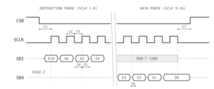
<figcaption>SPI read cycle timing.</figcaption>
</figure>

<figure class="tbl" id="tbl-spi-timing">

| Parameter          | Symbol | Conditions | Min  | Typ | Max  | Unit |
| ------------------ | ------ | ---------- | ---- | --- | ---- | ---- |
| SCLK frequency     | fSCLK  | —          | —    | —   | 40   | MHz  |
| CSB setup to SCLK  | t1     | —          | 10   | —   | —    | ns   |
| SCLK high time     | t2     | —          | 10   | —   | —    | ns   |
| SCLK low time      | t3     | —          | 10   | —   | —    | ns   |
| SDI setup          | t4     | —          | 4    | —   | —    | ns   |
| SDI hold           | t5     | —          | 4    | —   | —    | ns   |
| SDO access time    | t6     | CL = 15 pF | —    | 8   | 12   | ns   |
| SCLK to CSB high   | t7     | —          | 10   | —   | —    | ns   |
| Input high voltage | VIH    | —          | 1.26 | —   | —    | V    |
| Input low voltage  | VIL    | —          | —    | —   | 0.54 | V    |
| Input leakage      | IIN    | —          | —    | 0.1 | 1.0  | µA   |

<figcaption>SPI timing requirements, VDD_D = 1.8 V.</figcaption>
</figure>

### Data Port Timing

<figure class="timing" id="fig-dataport">
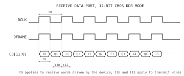
<figcaption>Receive data port timing, 12-bit CMOS DDR mode.</figcaption>
</figure>

<figure class="tbl">

| Parameter             | Symbol | Conditions | Min  | Typ | Max    | Unit |
| --------------------- | ------ | ---------- | ---- | --- | ------ | ---- |
| DCLK frequency        | fDCLK  | CMOS, DDR  | —    | —   | 122.88 | MHz  |
| DCLK period           | t8     | —          | 8.14 | —   | —      | ns   |
| DCLK duty cycle       | DCYC   | —          | 45   | 50  | 55     | %    |
| DCLK edge to DD valid | t9     | CL = 10 pF | 1.0  | —   | 3.2    | ns   |
| DD setup, transmit    | t10    | —          | 1.5  | —   | —      | ns   |
| DD hold, transmit     | t11    | —          | 1.2  | —   | —      | ns   |
| DFRAME to DCLK skew   | t12    | —          | -0.5 | —   | 0.5    | ns   |

<figcaption>Data port timing, VDD_D = 1.8 V, CL = 10 pF.</figcaption>
</figure>

## Typical Performance Characteristics

<p class="lead">VDD_A = 3.3 V, VDD_D = 1.8 V, TA = 25 °C, 50 Ω system, unless otherwise noted.</p>

<figure class="chart">
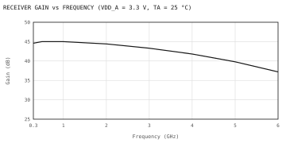
<figcaption>Receiver gain vs frequency, maximum gain setting.</figcaption>
</figure>

<figure class="chart">
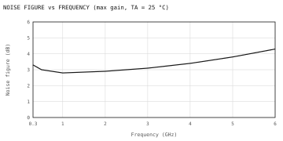
<figcaption>Receiver noise figure vs frequency.</figcaption>
</figure>

<figure class="chart">
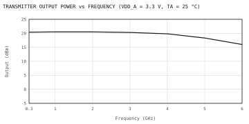
<figcaption>Transmitter output power vs frequency.</figcaption>
</figure>

<figure class="chart">
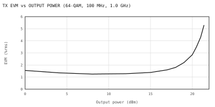
<figcaption>Transmit EVM vs output power.</figcaption>
</figure>

<figure class="chart">
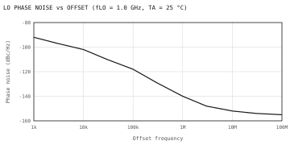
<figcaption>LO phase noise vs offset frequency.</figcaption>
</figure>

## Theory of Operation

### Receive Signal Path

The receiver is a zero-IF architecture. RFIN1 and RFIN2 are separate 50 Ω
single-ended inputs for the low band (0.3 GHz to 2.7 GHz) and the high band
(2.4 GHz to 6.0 GHz); the active input is selected by BAND[1:0] in register
0x07. The selected input drives a shunt-feedback LNA whose gain is set in 1 dB
steps over a 45 dB range, either directly through GAIN_IDX or by the internal
AGC loop.

Quadrature mixers driven by the LO hybrid down-convert the LNA output. The I
and Q signals pass through fifth-order Butterworth low-pass filters whose 3 dB
corner is programmable from 1.0 MHz to 50.0 MHz, and are digitized by the
12-bit ADCs. DC offset, gain imbalance and quadrature error are removed by the
calibration engine before the samples reach the data port.

### Transmit Signal Path

Baseband words written to the data port are interpolated, converted by the
12-bit DACs and reconstructed by matched low-pass filters. The quadrature
modulator up-converts to the LO frequency, and the summed signal drives a
two-stage driver amplifier with 40 dB of digital gain control in 0.25 dB steps.
RFOUT1 and RFOUT2 are open-drain outputs and require an external bias inductor
or a balun centre tap returned to VDD_PA.

### Frequency Synthesizer and LO Generation

A fractional-N PLL locked to the reference generates the LO. The reference may
be a 10 MHz to 80 MHz TCXO applied to REF_IN or a crystal across XTAL_IN and
XTAL_OUT. The 24-bit fractional modulus gives 2.4 Hz resolution at a 40 MHz
reference. The VCO covers 3.0 GHz to 6.0 GHz and is followed by a divide-by-1,
2, 4, 8 or 16 chain, so that the whole 0.3 GHz to 6.0 GHz tuning range is
reachable. Loop bandwidth is programmable from 20 kHz to 400 kHz to trade lock
time against close-in phase noise.

### Calibration Engine

The CALIB command measures and corrects transmit carrier leakage, transmit and
receive quadrature error and receiver DC offset using an internal loopback
detector. A full calibration takes 1.2 ms typical and is stored per band.
Repeat the calibration when the LO moves by more than 200 MHz or the die
temperature changes by more than 20 °C.

### Digital Data Port

The DI/DQ and TI/TQ words of <a href="#fig-block" data-ref="fig"></a>&nbsp;are time-multiplexed onto the 12-bit
CMOS port DD[11:0]. The source-synchronous clock DCLK carries the I word on
its rising edge and the Q word on its falling edge, and DFRAME is high while
the I word is on the bus (<a href="#fig-dataport" data-ref="fig"></a>). At the maximum clock rate of 122.88 MHz
the port therefore moves 122.88 M complex samples per second, which matches
the 100 MHz signal bandwidth. In TDD the direction follows TXNRX; in FDD
receive and transmit frames alternate under the same clock.

### Operating Modes

<figure class="tbl">

| Mode        | Entry         | Current | Exit time |
| ----------- | ------------- | ------- | --------- |
| Sleep       | ENABLE = 0    | 6 µA    | 2.0 ms    |
| Standby     | ENABLE = 1    | 22 mA   | 200 µs    |
| Synth on    | 0x02, bit 1   | 45 mA   | 60 µs     |
| Receive     | TXNRX = 0     | 78 mA   | 8 µs      |
| Transmit    | TXNRX = 1     | 210 mA  | 12 µs     |
| Calibrating | CALIB command | 95 mA   | 1.2 ms    |

<figcaption>Operating modes, typical current and exit time.</figcaption>
</figure>

### Interrupts and GPIO

INTB is held low while any unmasked source is active and is released when
register 0x03 is read. GPIO[3:0] power up as inputs and can be reassigned to
band-select outputs, the calibration strobe or a divided reference clock.

<figure class="tbl">

| Bit | Source   | Description                    |
| --- | -------- | ------------------------------ |
| 0   | PLL_LOCK | Synthesizer lock state changed |
| 1   | CAL_DONE | Calibration finished           |
| 2   | OVLD_RX  | Receiver overload detected     |
| 3   | UVLO     | Supply fell below 2.85 V       |
| 4   | THERM    | Die temperature above 115 °C   |
| 5   | PORT_ERR | Data port framing error        |

<figcaption>Interrupt sources and mask bits in register 0x0E.</figcaption>
</figure>

### Power-Up and Initialization

1. Apply VDD_D, then VDD_A, VDD_SYN and VDD_PA, holding RSTB low.
2. Start the reference clock and wait 1 ms for the internal regulator on
   VREG_CAP to settle.
3. Release RSTB and set ENABLE high; the device reaches standby in 200 µs.
4. Write the band, LO frequency and filter registers (0x04 to 0x0C).
5. Issue CALIB and poll register 0x03 for lock and calibration-done.
6. Set TXNRX and start the data port.

## Register Map

Registers are 16 bits wide and are addressed by a 7-bit field. Each SPI
transfer carries an 8-bit instruction (R/W plus address) followed by 8 bits of
data; 16-bit registers are accessed as two consecutive frames, low byte first.
Reserved bits must be written as 0.

```text title="Example register readback map (partial)."
0x00  0x7420  ; device identification / ID
0x01  0x01C3  ; silicon revision, class
0x02  0x0001  ; global control, soft reset
0x03  0x0000  ; PLL status, lock detect
0x04  0x0008  ; PLL divider N[15:0]
0x05  0x0027  ; PLL fractional P[7:0]
0x06  0x0001  ; PLL reference R[7:0]
0x07  0x0003  ; band select (0.3-6 GHz)
0x08  0x0137  ; RF LO frequency [23:8]
0x09  0xBA42  ; RF LO frequency [7:0]
0x0A  0x000F  ; TX maximum output level
0x0B  0x0012  ; RX front-end gain (LNA)
0x0C  0x0005  ; baseband filter bandwidth
0x0D  0x0001  ; duplex mode: TDD / FDD
0x0E  0x0000  ; interrupt mask
0x0F  0x00AA  ; CRC checksum, readback
```

<figure class="tbl">

| Bits   | Field | Access | Description                 |
| ------ | ----- | ------ | --------------------------- |
| [15:4] | RSVD  | R      | Reserved, returns 0x000     |
| [3:2]  | HYST  | R/W    | LO hysteresis, 0 to 3       |
| [1:0]  | BAND  | R/W    | 1 = low, 2 = high, 3 = auto |

<figcaption>Register 0x07 — band select.</figcaption>
</figure>

<figure class="tbl">

| Bits   | Field    | Access | Description                |
| ------ | -------- | ------ | -------------------------- |
| [15:8] | RSVD     | R      | Reserved, returns 0x00     |
| [7]    | AGC_EN   | R/W    | 1 = automatic gain control |
| [6]    | FAST_ATK | R/W    | 1 = fast AGC attack        |
| [5:0]  | GAIN_IDX | R/W    | Gain index, 0 to 45 (1 dB) |

<figcaption>Register 0x0B — receiver gain control.</figcaption>
</figure>

## Applications Information

### Typical Application Circuit

<figure class="circuit" id="fig-circuit">

<figcaption>Typical 1.0 GHz TDD application circuit.</figcaption>
</figure>

<figure class="tbl">

| Ref   | Value     | Description                      |
| ----- | --------- | -------------------------------- |
| U1    | NSR7420   | Wideband RF transceiver          |
| U2    | SPDT      | RF switch, 35 dB isolation       |
| FL1   | 1.0 GHz   | SAW band-pass filter, 100 MHz BW |
| FL2   | 2-section | Harmonic low-pass filter         |
| T1    | 1:1       | Balun, 0.3 GHz to 3 GHz          |
| T2    | 1:1       | Balun with centre tap to VDD_PA  |
| Y1    | 40 MHz    | TCXO, ±0.5 ppm, 0.8 Vpp          |
| C1-C8 | 100 nF    | Supply decoupling, 0402 X7R      |
| C9    | 4.7 µF    | Bulk decoupling per rail         |
| L1    | 22 nH     | RFOUT bias choke, Q > 40         |

<figcaption>External components for <a href="#fig-circuit" data-ref="fig"></a>.</figcaption>
</figure>

### Band Performance Summary

<figure class="tbl">

| Band    | NF (dB) | P_OUT (dBm) | EVM (%) | I_TX (mA) |
| ------- | ------- | ----------- | ------- | --------- |
| 0.9 GHz | 2.8     | 20.5        | 1.8     | 208       |
| 2.4 GHz | 2.9     | 20.4        | 1.9     | 212       |
| 3.5 GHz | 3.2     | 20.1        | 2.0     | 218       |
| 5.8 GHz | 4.1     | 16.5        | 2.4     | 232       |

<figcaption>Measured performance of the <a href="#fig-circuit" data-ref="fig"></a>&nbsp;circuit, 64-QAM at 18 dBm.</figcaption>
</figure>

### Impedance Matching and Filtering

Both RF inputs present a nominal 50 Ω impedance and are internally
AC-coupled; the input return loss is better than 10 dB over the whole tuning
range. A 1:1 balun (T1) is required only when a differential filter is used.
The transmit output is biased through the balun centre tap; the two-section
low-pass filter FL2 keeps the second harmonic below −48 dBc at 15 dBm.

### Frequency Planning

Keep the data port clock out of the receive band. At the maximum port rate of
122.88 MHz the eighth harmonic falls at 983.04 MHz, inside the low band: run
the port at 92.16 MHz, or offset the LO by half a channel, when a 0.9 GHz
carrier is used. Fractional spurs sit at multiples of fREF around the LO and
are typically 78 dBc below the carrier, so a single 40 MHz reference serves
the whole tuning range.

### Power Supply Recommendations

Decouple every supply pin with a 100 nF capacitor placed within 1.5 mm of the
pin, and add 4.7 µF of bulk capacitance per rail. VDD_PA draws 210 mA in
transmit, so the 3.3 V rail must hold droop below 50 mV during a TDD burst.
Supply VDD_SYN from a low-noise LDO: ripple above 100 kHz on this rail appears
directly as LO phase noise.

### Thermal Design

At the worst-case dissipation of 0.75 W and θJA = 26 °C/W, the junction
temperature at TA = +85 °C is `TJ = TA + θJA × PD = 85 + 19.5 = 104.5 °C`,
which is 20 °C below the +125 °C limit. The exposed pad carries most of this
heat, so its solder joint and via array determine the real θJA.

### Layout Recommendations

- Route RFIN and RFOUT as 50 Ω coplanar lines with continuous ground on the
  adjacent layer, and keep them shorter than 15 mm.
- Solder the exposed pad to a solid ground plane through a 3 × 3 array of
  0.30 mm vias.
- Group DD[11:0], DCLK and DFRAME and match their lengths to within 2.5 mm.
- Keep the TCXO and REF_IN trace away from RFOUT and from the digital port.
- Do not route digital signals under the baluns or the SAW filter.

## Evaluation and Documentation

The NSR7420-EVB carries the <a href="#fig-circuit" data-ref="fig"></a>&nbsp;circuit with SMA connectors on both RF
ports, a 40 MHz TCXO and a USB bridge to the SPI port. The board ships
calibrated for the 0.9 GHz and 2.4 GHz bands; register files for the other
bands are supplied with the control software.

<figure class="tbl">

| Document | Title                                    |
| -------- | ---------------------------------------- |
| AN-1140  | Calibrating the NSR7420 over temperature |
| AN-1152  | 5 GHz front-end design with the NSR7420  |
| AN-1163  | Data port interfacing with FPGA fabric   |
| UG-402   | NSR7420-EVB evaluation board user guide  |

<figcaption>Related documentation.</figcaption>
</figure>

## Package Information

<figure class="package">
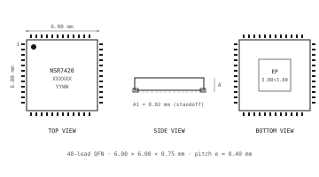
<figcaption>QFN-48 package outline.</figcaption>
</figure>

<figure class="tbl" id="tbl-package-dim">

| Symbol | Min  | Nom  | Max  |
| ------ | ---- | ---- | ---- |
| A      | 0.70 | 0.75 | 0.80 |
| A1     | 0.00 | 0.02 | 0.05 |
| A3     | 0.18 | 0.20 | 0.23 |
| b      | 0.18 | 0.25 | 0.30 |
| D / E  | 5.90 | 6.00 | 6.10 |
| e      | —    | 0.40 | —    |
| L      | 0.30 | 0.40 | 0.50 |

<figcaption>QFN-48 package dimensions (mm).</figcaption>
</figure>

<figure class="package">
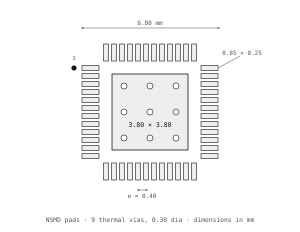
<figcaption>Recommended land pattern.</figcaption>
</figure>

<p class="note">Note: Use a 0.125 mm stencil and split the thermal land aperture into a 3 × 3 pattern at 60 % area, so that the standoff stays within the A1 limit of <a href="#tbl-package-dim" data-ref="tbl"></a>.</p>

### Tape and Reel

<figure class="tbl">

| Parameter             | Value              |
| --------------------- | ------------------ |
| Carrier tape width    | 12 mm              |
| Pocket pitch          | 8 mm               |
| Reel diameter         | 178 or 330 mm      |
| Units per 178 mm reel | 1500               |
| Units per 330 mm reel | 4000               |
| Dry pack              | MSL 3, 168 h floor |

<figcaption>Tape and reel information.</figcaption>
</figure>

## Ordering Information

<figure class="tbl">

| Model         | Temperature | Package     | Shipment   |
| ------------- | ----------- | ----------- | ---------- |
| NSR7420QFN    | -40/+85 °C  | QFN-48 6 mm | Tray, 260  |
| NSR7420QFNR7  | -40/+85 °C  | QFN-48 6 mm | Reel, 1500 |
| NSR7420QFNR13 | -40/+85 °C  | QFN-48 6 mm | Reel, 4000 |
| NSR7420-EVB   | -40/+85 °C  | Board       | Single     |

<figcaption>Ordering information. All parts are RoHS compliant and marked NSR7420 with a YYWW date code.</figcaption>
</figure>

## Revision History

<figure class="tbl">

| Rev | Date    | Description                                                                        |
| --- | ------- | ---------------------------------------------------------------------------------- |
| A   | 2025-02 | Initial release                                                                    |
| B   | 2025-09 | Added 6 GHz characterization; new θJA                                              |
| C   | 2026-04 | Corrected converter ENOB; added&nbsp;<a href="#tbl-spi-timing" data-ref="tbl"></a> |

<figcaption>Revision history.</figcaption>
</figure>

<p class="note">Northstar Signal Labs reserves the right to change the products and specifications described in this document without notice. Typical values are characterized on the NSR7420-EVB and are not production tested unless a minimum or maximum limit is given.</p>
