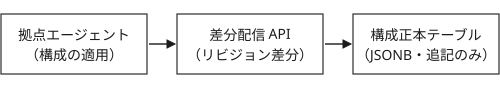

# 構成データ保存方式の選定 {#adr-storage}

---

ステータス：承認済　2025-11-04（決定記録09を置換）

## 背景

機器構成配信基盤Nagiwaは計測端末1,200拠点へ設定値を配信する。構成データは各拠点のローカルファイルにあり、更新は手作業だ。

直近半期に構成不一致の障害が4件発生し、監査要件では5年の履歴保全を求められる。

## 決定

構成データの正本をリレーショナルデータベースのJSONB列へ一元化し、拠点へは差分配信APIで配布する。過去版は追記のみで同一表に残す。

- 正本：`config_revision`表
- 配布：`GET /v1/config/diff`
- 履歴：追記のみ。物理削除はしない

```sql title="config_revision（抜粋）"
CREATE TABLE config_revision (
  revision BIGSERIAL PRIMARY KEY,
  site_id  TEXT      NOT NULL,
  payload  JSONB     NOT NULL
);
```

<div class="note">

分散KVS案は履歴保全に、オブジェクトストレージ案は部分取得に難があり見送った。

</div>

## 影響

拠点は起動時に自身のリビジョンを申告し、差分だけを取得する。

- 復旧は特定リビジョンの再適用に一本化される
- 書き込みが正本1系統に集中する
- 旧ファイルは移行完了から90日で削除する

```sh title="移行時の確認手順"
cfgctl migrate --site all --dry-run
cfgctl diff --revision 4213 --against live
```

{#fig-storage-arch}

<p class="xref">→決定記録09を参照</p>
