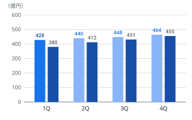
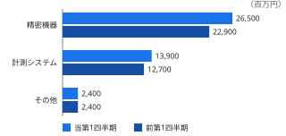

<header class="banner">

# 2026年3月期 第1四半期 決算短信〔速報〕

株式会社アオバ精機 （東証プライム・79XX）

</header>

2025年8月7日公表／対象期間2025年4月1日〜2025年6月30日／日本基準（連結）／記載金額は百万円未満を切捨て

<section class="kpi" aria-label="連結業績ハイライト">

売上高

428<small>億円</small>

前年同期比+12.6％

営業利益

52<small>億円</small>

前年同期比+18.2％

経常利益

53<small>億円</small>

前年同期比+17.0％

四半期純利益

37<small>億円</small>

前年同期比+17.5％

</section>

## 経営成績の概況

当第1四半期連結累計期間におけるわが国経済は、設備投資の持ち直しと個人消費の緩やかな回復を背景に、総じて底堅く推移いたしました。海外におきましても、一部地域で在庫調整の影響が残るものの、半導体および電子部品の生産は回復基調で推移いたしました。

このような環境のもと、当社グループの主力である精密位置決めステージおよび計測モジュール分野では、半導体製造装置向けと車載センサー向けの需要が想定を上回って推移いたしました。加えて、前期に量産を開始した新型ステージ「AX-70シリーズ」の立ち上がりが計画を上回り、期初想定を超える出荷となりました。

この結果、当第1四半期の連結売上高は428億円（前年同期比12.6％増）、営業利益は52億円（同18.2％増）となり、いずれも第1四半期としては過去最高を更新いたしました。営業利益率は12.1％と、前年同期の11.6％から0.5ポイント改善しております。連結経営成績の概要はのとおりであります。

<figure class="tbl tbl-pl sum-last" id="tbl-results">

<figcaption>連結経営成績（累計）　（単位：百万円）</figcaption>

| 科　目                           | 2026年3月期 1Q | 2025年3月期 1Q | 増減率 （％） |
| -------------------------------- | ------------------- | ------------------- | ------------------ |
| 売上高                           | 42,800              | 38,000              | 12.6               |
| 営業利益                         | 5,200               | 4,400               | 18.2               |
| 経常利益                         | 5,300               | 4,530               | 17.0               |
| 親会社株主に帰属する四半期純利益 | 3,700               | 3,150               | 17.5               |

</figure>

営業外損益では受取利息および持分法による投資利益が増加し、経常利益は53億円（前年同期比17.0％増）となりました。特別損益に重要なものはなく、親会社株主に帰属する四半期純利益は37億円（同17.5％増）、1株当たり四半期純利益は61円67銭（前年同期52円50銭）となりました。

部材価格および物流費の上昇は継続しておりますが、原価改善活動と価格改定の浸透により影響の一部を吸収しております。なお、研究開発費は2,940百万円、売上高研究開発費比率は6.9％と前年同期並みの水準を維持しております。

受注につきましては、当第1四半期の連結受注高は472億円（前年同期比14.2％増）、当第1四半期連結会計期間末の受注残高は612億円（前連結会計年度末比7.8％増）となり、下期以降の増産に向けた生産体制の整備を進めております。四半期別の売上高の推移はのとおりであります。

<figure class="chart" id="fig-quarterly">
<figcaption>四半期別 売上高（連結）</figcaption>

2026年3月期（実績）　2026年3月期（予想）　2025年3月期（実績）

</figure>

## セグメント別の状況

<figure class="tbl tbl-sg sum-last" id="tbl-segment">

<figcaption>セグメント別 売上高・利益　（単位：百万円）</figcaption>

| 区　分           | 売上高 | 前年同期比 （％） | セグメント 利益 | 前年同期比 （％） |
| ---------------- | ------ | ---------------------- | -------------------- | ---------------------- |
| 精密機器事業     | 26,500 | 15.7                   | 4,000                | 23.1                   |
| 計測システム事業 | 13,900 | 9.4                    | 1,600                | 16.8                   |
| その他           | 2,400  | 0.0                    | 130                  | 8.3                    |
| 調整額           | －     | －                     | △530                 | －                     |
| 合計（連結）     | 42,800 | 12.6                   | 5,200                | 18.2                   |

</figure>

<figure class="chart" id="fig-segment">
<figcaption>セグメント別 売上高（連結）</figcaption>

</figure>

### 精密機器事業

半導体製造装置向けの精密位置決めステージが、先端ロジックおよびメモリ向け投資の再開を背景に大きく伸長いたしました。車載センサー組立装置向けの搬送モジュールも、電動化に伴う新規ラインの立ち上げが続き、堅調に推移いたしました。

この結果、売上高は265億円（前年同期比15.7％増）、セグメント利益は40億円（同23.1％増）となりました。稼働率の上昇による固定費の吸収と機種構成の改善により、セグメント利益率は15.1％と前年同期の14.2％から改善しております。前第1四半期との対比はのとおりであります。

### 計測システム事業

環境計測装置は自治体および素材メーカー向けの更新需要が続き、品質検査システムは電池部材の検査ラインを中心に引き合いが増加いたしました。ソフトウェア保守を含むリカーリング収入も着実に積み上がっております。

この結果、売上高は139億円（前年同期比9.4％増）、セグメント利益は16億円（同16.8％増）となり、セグメント利益率は11.5％と前年同期の10.8％から改善しております。

### その他

計測機器の校正受託およびグループ会社向けの部品販売等を行っております。売上高は2,400百万円と前年同期並み、セグメント利益は130百万円（前年同期比8.3％増）となりました。

## 財政状態

当第1四半期連結会計期間末の総資産は328,490百万円となり、前連結会計年度末に比べ10,240百万円増加いたしました。これは、売上増加に伴う売上債権および棚卸資産の積み上がりに加え、新生産棟に係る設備投資の進捗により有形固定資産が増加したことによるものであります。

負債合計は151,700百万円となり、前連結会計年度末に比べ7,520百万円増加いたしました。仕入債務の増加に加え、設備投資資金として長期借入金を実行したことにより、有利子負債残高は48,920百万円（前連結会計年度末46,160百万円）となっております。

純資産合計は176,790百万円となり、前連結会計年度末に比べ2,720百万円増加いたしました。親会社株主に帰属する四半期純利益3,700百万円の計上および剰余金の配当2,160百万円の支払に加え、為替換算調整勘定を中心にその他の包括利益累計額が1,180百万円増加したことによるものであります。要約はのとおりであります。

<figure class="tbl tbl-std sum-last" id="tbl-balance">

<figcaption>連結財政状態の要約　（単位：百万円）</figcaption>

| 科　目         | 2026年3月期 1Q末 | 2025年3月期 期末 | 増減額 | 増減率 （％） |
| -------------- | --------------------- | --------------------- | ------ | ------------------ |
| 流動資産       | 124,850               | 119,230               | 5,620  | 4.7                |
| 固定資産       | 203,640               | 199,020               | 4,620  | 2.3                |
| 資産合計       | 328,490               | 318,250               | 10,240 | 3.2                |
| 流動負債       | 88,760                | 84,310                | 4,450  | 5.3                |
| 固定負債       | 62,940                | 59,870                | 3,070  | 5.1                |
| 負債合計       | 151,700               | 144,180               | 7,520  | 5.2                |
| 純資産合計     | 176,790               | 174,070               | 2,720  | 1.6                |
| 負債純資産合計 | 328,490               | 318,250               | 10,240 | 3.2                |

</figure>

自己資本比率は53.8％（前連結会計年度末54.7％）と高い水準を維持しており、1株当たり純資産は2,946円50銭（同2,901円17銭）となりました。有利子負債は営業キャッシュ・フローの範囲内で管理する方針としており、D/Eレシオは0.28倍（同0.27倍）であります。

## キャッシュ・フローの状況

当第1四半期連結累計期間における現金及び現金同等物は、前連結会計年度末に比べ1,590百万円減少し、31,470百万円となりました。

<figure class="tbl tbl-cf sum-last" id="tbl-cashflow">

<figcaption>連結キャッシュ・フローの状況　（単位：百万円）</figcaption>

| 区　分                           | 2026年3月期 1Q | 2025年3月期 1Q | 増減額 |
| -------------------------------- | ------------------- | ------------------- | ------ |
| 営業活動によるキャッシュ・フロー | 4,150               | 5,320               | △1,170 |
| 投資活動によるキャッシュ・フロー | △6,280              | △3,940              | △2,340 |
| 財務活動によるキャッシュ・フロー | 600                 | △2,880              | 3,480  |
| 現金及び現金同等物に係る換算差額 | △60                 | 90                  | △150   |
| 現金及び現金同等物の増減額       | △1,590              | △1,410              | △180   |
| 現金及び現金同等物の四半期末残高 | 31,470              | 28,470              | 3,000  |

</figure>

営業活動によるキャッシュ・フローは4,150百万円の収入となりました。税金等調整前四半期純利益は増加したものの、増産に対応した棚卸資産の積み増しと売上債権の増加により、前年同期に比べ1,170百万円の収入減となっております。

投資活動によるキャッシュ・フローは6,280百万円の支出となりました。第二新生産棟の建設および精密加工設備の増強を進めたことによるもので、当第1四半期連結累計期間の設備投資額は6,450百万円、減価償却費は3,280百万円であります。

財務活動によるキャッシュ・フローは600百万円の収入となりました。設備投資資金として長期借入金5,000百万円を実行した一方、長期借入金の返済1,860百万円、配当金の支払2,160百万円およびリース債務の返済380百万円を行っております。

この結果、フリー・キャッシュ・フローは2,130百万円の支出超過（前年同期は1,380百万円の収入超過）となりました。成長投資の実行局面にあることによるものであり、通期の見通しはに記載のとおり収入超過に転じる見込みであります。

## 通期業績予想 {#sec-forecast}

<figure class="tbl tbl-fc sum-last" id="tbl-forecast">

<figcaption>2026年3月期 通期連結業績予想　（単位：百万円）</figcaption>

| 科　目                         | 2026年3月期 通期予想 | 2025年3月期 実績 | 増減率 （％） | 進捗率 （％） |
| ------------------------------ | ------------------------- | --------------------- | ------------------ | ------------------ |
| 売上高                         | 178,000                   | 167,800               | 6.1                | 24.0               |
| 営業利益                       | 21,400                    | 19,650                | 8.9                | 24.3               |
| 経常利益                       | 22,000                    | 20,180                | 9.0                | 24.1               |
| 親会社株主に帰属する当期純利益 | 15,000                    | 13,820                | 8.5                | 24.7               |

</figure>

通期連結業績予想につきましては、2025年5月14日公表の数値を据え置いております。1株当たり当期純利益は250円00銭（前期実績230円33銭）を見込んでおります。

当第1四半期は期初計画を上回って推移いたしましたが、下期における半導体製造装置業界の設備投資動向および海外の在庫調整の推移には引き続き不透明感があること、ならびに為替相場の変動が見込まれることから、現時点では予想の修正は行っておりません。

通期予想の前提となる為替レートは1米ドル145円、1ユーロ158円としております（当第1四半期の平均レートは1米ドル147円、1ユーロ161円）。対米ドルで1円の変動が通期の営業利益に与える影響は約1億円と見込んでおります。また、通期の設備投資額は23,000百万円、減価償却費は13,800百万円、研究開発費は12,400百万円を計画しております。

<aside class="note">

<h3>（注）業績予想に関する留意事項</h3>

本資料の業績見通し等の将来に関する記述は、当社が現在入手可能な情報に基づく判断および仮定によるものであり、実際の業績は様々な要因により予想値と異なる可能性があります。

</aside>

## 配当の状況

<figure class="tbl tbl-dv" id="tbl-dividend">

<figcaption>1株当たり配当金　（単位：円）</figcaption>

| 区　分              | 第2四半期末 | 期　末 | 年間合計 |
| ------------------- | ----------- | ------ | -------- |
| 2025年3月期（実績） | 32.00       | 36.00  | 68.00    |
| 2026年3月期（予想） | 36.00       | 39.00  | 75.00    |

</figure>

当社は、株主に対する利益還元を経営の重要課題と位置づけ、連結配当性向30％を目安として安定的かつ継続的な配当を行うことを基本方針としております。

2026年3月期の配当につきましては、2025年5月14日公表のとおり、中間配当36円00銭、期末配当39円00銭、年間合計75円00銭を予定しております。前期の年間68円00銭に対し7円00銭の増配となり、予想連結配当性向は30.0％であります。

なお、当第1四半期連結累計期間においては、2025年6月に前期末配当として1株当たり36円00銭、総額2,160百万円の支払を行っております。

## 注記事項

### 重要な子会社の異動

当第1四半期連結会計期間より、新たに設立したアオバ計測サービス株式会社を連結の範囲に含めております。当該異動は特定子会社の異動には該当いたしません。

### 会計方針の変更・会計上の見積りの変更・修正再表示

該当事項はありません。

### 発行済株式数（普通株式）

<figure class="tbl tbl-sh" id="tbl-shares">

<figcaption>発行済株式数　（単位：株）</figcaption>

| 区　分                             | 2026年3月期 1Q | 2025年3月期 1Q |
| ---------------------------------- | ------------------- | ------------------- |
| 期末発行済株式数（自己株式を含む） | 62,400,000          | 62,400,000          |
| 期末自己株式数                     | 2,400,000           | 2,400,000           |
| 期中平均株式数（四半期累計）       | 60,000,000          | 60,000,000          |

</figure>

1株当たり四半期純利益および1株当たり当期純利益は、期中平均株式数60,000,000株に基づき算定しております。

### 四半期決算短信の監査手続

四半期決算短信は公認会計士または監査法人による監査およびレビューの対象外であり、本資料の開示時点において、四半期連結財務諸表に対する監査手続は実施しておりません。

## 参考情報

### 四半期業績の推移

<figure class="tbl tbl-qt" id="tbl-quarterly">

<figcaption>四半期別 売上高・営業利益　（単位：百万円）</figcaption>

| 期　別                    | 売上高  | 営業利益 | 営業利益率 （％） |
| ------------------------- | ------- | -------- | ---------------------- |
| 2025年3月期1Q             | 38,000  | 4,400    | 11.6                   |
| 2025年3月期2Q             | 41,200  | 4,780    | 11.6                   |
| 2025年3月期3Q             | 43,100  | 5,050    | 11.7                   |
| 2025年3月期4Q             | 45,500  | 5,420    | 11.9                   |
| 2026年3月期1Q             | 42,800  | 5,200    | 12.1                   |
| 2026年3月期2Q〜4Q（予想） | 135,200 | 16,200   | 12.0                   |

</figure>

のとおり、当第1四半期の売上高は、季節性により前第4四半期の45,500百万円を下回ったものの、前年同期に対しては4,800百万円の増収となりました。営業利益率は前連結会計年度の11％台後半から12.1％へ上昇しており、第2四半期以降も12.0％を前提としております。

### 受注の状況

<figure class="tbl tbl-od sum-last" id="tbl-orders">

<figcaption>セグメント別 受注高・受注残高　（単位：百万円）</figcaption>

| 区　分           | 受注高 | 前年同期比 （％） | 受注残高 | 前期末比 （％） |
| ---------------- | ------ | ---------------------- | -------- | -------------------- |
| 精密機器事業     | 30,100 | 16.6                   | 42,900   | 9.4                  |
| 計測システム事業 | 14,800 | 11.9                   | 16,150   | 4.7                  |
| その他           | 2,300  | 0.9                    | 2,150    | 0.0                  |
| 合計（連結）     | 47,200 | 14.2                   | 61,200   | 7.8                  |

</figure>

精密機器事業では、先端ロジック向け装置メーカーからの枠取り注文が加わり、受注残高が大きく積み上がりました。受注残高は当第1四半期の売上高の約1.4四半期分に相当し、下期の生産計画を支える水準にあります。

### 設備投資および従業員の状況

設備投資は第二新生産棟の建設が中心であり、通期計画23,000百万円に対する当第1四半期の進捗率は28.0％となりました。同棟は2026年3月期下期の稼働開始を予定しており、稼働後の年間生産能力は現行比で約2割の増加を見込んでおります。

当第1四半期連結会計期間末の連結従業員数は5,842名（前連結会計年度末5,760名）となり、増員は精密機器事業の生産部門および新設子会社への配置によるものであります。

<aside class="note colophon">

<h3>発行者情報・お問合せ先</h3>

上場取引所：東京証券取引所プライム市場／コード番号：79XX

URL：https://www.aobaseiki.example.jp/

代表者：代表取締役社長　立花遼一

問合せ先責任者：執行役員経営企画部長　峰岸沙織（TEL 0X-XXXX-XXXX）

決算補足説明資料作成の有無：有／決算説明会開催の有無：有（機関投資家・アナリスト向け）

</aside>

