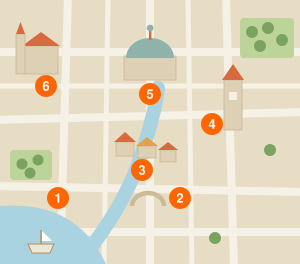
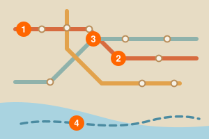
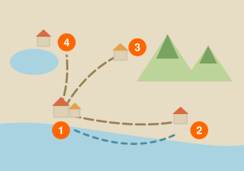

# ヴェルミリオ旧市街を歩くOld Town Walking Guide

{#fig-map}

アルネイア共和国の古都ヴェルミリオは、網の目のような運河と石畳の路地が中世そのままに残る「歩いてこそ楽しい街」だ。旧市街は東西わずか1.5キロ、丸一日あれば主要な見どころを無理なく巡れる。まずは中央駅を背に、大聖堂広場を目指して北へ歩き出そう（）。

路地はわざと迷路のように入り組んでいる。海風と外敵をさえぎるために造られた名残で、角を曲がるたびに小さな広場や井戸、看板のかすれた古い工房が現れる。地図を片手にあえて寄り道するのが、この街の正しい歩き方だ。

運河には等間隔に石橋が架かり、朝は市場へ向かう小舟が、夕方は荷を積んだ艀が行き交う。橋のたもとのベンチに腰かけ、水面に映る街並みを眺めるだけでも旅の疲れはほどけていく。

## 運河沿いのバザール {#bazaar}

運河の北岸に沿って400メートルほど続くバザールは、旧市街いちばんの賑わいだ。香辛料、乾物、手織りの敷物、銀細工——間口一間ほどの小さな店が軒を寄せ合い、呼び込みの声と量りの音が一日じゅう絶えない。

名物は琥珀色の蜂蜜と、運河でとれた小魚を揚げた串。どちらも1アルド前後で味わえる。値札のない店では軽い値段交渉も楽しみのうちで、笑顔で二、三度やり取りすれば、たいてい一割ほどはまけてくれる。

バザールの奥、水門のそばには小さな香辛料博物館がある。交易で栄えた往時の帳簿や天秤が並び、係員に請えば当時の香を焚いて見せてくれることもある。喧噪に疲れたら、ここでひと息つくとよい。

## スポットDATA {.data-box}

| 項目                      | 内容                                                          |
| ------------------------- | ------------------------------------------------------------- |
|    | 運河北岸、大聖堂広場より徒歩約5分。中央駅からは北へ徒歩15分。 |
|  | 通年9:00〜18:00（11〜3月は17:00まで、月曜休館）               |
|        | 大人7.50アルド／学生・65歳以上5.00アルド（共通券）            |
|      | 堂内はフラッシュ禁止。中庭と回廊は自由に撮影できる。          |

## モデルコース {.course}

1. 駅
2. 広場
3. バザール
4. 展望塔

中央駅から中央広場、バザールを抜けて時計塔まで、寄り道を含めておよそ半日。健脚なら午前中に、ゆっくり歩くなら昼食をはさんで回りたい。

## 料金表 {.fee}

| 券種            | 料金（アルド） |
| --------------- | -------------: |
| 大聖堂入場      |           2.50 |
| 時計塔展望台    |           4.00 |
| 共通券（3施設） |           7.50 |
| 1日周遊パス     |          12.00 |
| 博物館共通券    |          18.00 |

料金はいずれも旧市街観光案内所での当日窓口価格。共通券と1日周遊パスは同案内所とオンラインで前売りされ、繁忙期は事前購入がおすすめだ。

# 市内交通を使いこなすCity Transport Guide

{#fig-transit}

旧市街のなかは歩きが基本だが、坂の多い北の丘や、港のある南岸まで足を延ばすなら市内交通を使いたい。ヴェルミリオには路面電車が3系統、運河と湾を結ぶ水上バスが2航路、そして丘の上まで登る市バスが走っている（）。

ありがたいことに、どれも同じ乗車券で乗れる。1回券は刻印から60分間有効で、その間なら何度乗り換えてもよい。3日以上滞在するなら、乗り放題の周遊パスのほうが結局は安く上がる。

切符は停留所の券売機、桟橋の窓口、街角の売店で買える。売店では「トラムの1回券を1枚」と言えば通じる。夜間は券売機が現金を受け付けないことがあるので、日中に買い置きしておくと安心だ。

## トラムと水上バスの乗り方 {#transport-ride}

トラムは前後どちらの扉からでも乗れる。乗ったらまず車内の刻印機に切符を通すこと。刻印を忘れると無札とみなされ、検札で罰金を取られる。交通カードのヴェルカードなら、乗車時に読み取り機へ触れるだけでよい。

水上バスは桟橋ごとに乗り場が分かれている。同じ港桟橋でも、A乗り場は運河の内回り、B乗り場は湾口の灯台行きだ。桟橋の入口に掲げられた航路図と、行き先を示す色帯を確かめてから並ぼう。

降車停留所は車内の電光表示と自動放送で案内されるが、旧市街には似た名前の停留所が多い。地図の番号と見比べておくと乗り過ごしにくい。

## 交通DATA {.data-box}

| 項目                      | 内容                                                             |
| ------------------------- | ---------------------------------------------------------------- |
|  | 中央駅前の交通案内所。トラム全系統と水上バスの窓口を兼ねる。     |
|  | トラム5:30〜24:30／水上バス6:00〜22:00（11〜3月は21:00まで）     |
|        | 1回券1.20アルド。刻印から60分間有効で、乗り換えも自由。          |
|   | 乗車したらまず刻印。ヴェルカードは読み取り機に触れるだけでよい。 |

## 乗り継ぎの例 {.course}

1. 中央駅
2. トラム
3. 港桟橋
4. 灯台

中央駅からトラムで港桟橋へ出て、水上バスに乗り換えれば湾口の灯台まで30分ほど。夕暮れどきの便は混み合うので、ひとつ前の時間に乗るとよい。

## 乗車券の料金 {.fee}

| 券種              | 料金（アルド） |
| ----------------- | -------------: |
| 1回券（60分有効） |           1.20 |
| 回数券（10回分）  |          10.00 |
| 24時間券          |           4.50 |
| 3日乗車券         |           9.00 |
| 空港連絡列車      |           3.80 |

回数券は複数人で分け合って使える。空港連絡列車だけは市内交通と別建てで、駅の自動券売機か空港の窓口で買う。

# 旧市街の味を楽しむLocal Food Guide

ヴェルミリオの食は、海と香辛料の交易が育てたものだ。近海の小魚や貝に、内陸の羊肉、そしてバザールに積まれた香辛料が重なり、隣国のどこにも似ていない味になった。素材はどれも素朴で、驚くほど値段が安い。

食事どきは昼が13時前後、夜は20時を過ぎてから。観光客向けの店は通しで開けているが、地元の人が通う〈ソルナ〉と呼ばれる大衆食堂は、この時間を外すと閉まっていることが多い。

値段は店先の黒板に出ている。前菜と主菜を頼んで15アルドほど、屋台の軽食なら3アルドもあれば足りる。水は有料で、炭酸入りかどうかを必ず聞かれる。

## 運河沿いの名物料理 {#food-canal}

まず試したいのが〈カナルフリット〉。運河でとれた小魚を衣もつけずに揚げ、粗塩と柑橘を搾っただけの串だ。揚げたてを立ったまま食べるのが作法で、バザールの屋台なら一串1アルド前後で買える。

羊肉と白豆をゆっくり煮込んだ〈サルミータ〉は冬の看板料理。香辛料の配合は店ごとの秘伝で、同じ名前でもまるで味が違う。パンを浸して汁まで食べきるのが、この街での一皿の終わり方だ。

甘いものなら〈ミエロータ〉を。琥珀色の蜂蜜と胡桃を薄い生地で巻いて焼いた菓子で、蜂蜜商が店先で片手間に焼いているものがいちばんうまい。

## 食堂の選び方

大聖堂広場を囲む店は眺めがよいかわりに値段も相応だ。二本裏の路地に入るだけで、同じ料理が三割ほど安くなる。混み具合を見て、地元の客が多い店を選べばまず外れない。

〈ソルナ〉には品書きがないことも多い。壁の黒板を見るか、店主が口頭で今日の三品を教えてくれる。迷ったら「今日のおすすめを」と頼んでおけば間違いない。

席料とパン代が別に加算される店もある。伝票に席料の一行があっても不当な請求ではないので、驚かないでほしい。会計は席で頼み、釣り銭の端数を残すのがこの街の習慣だ。

## グルメDATA {.data-box}

| 項目                      | 内容                                                           |
| ------------------------- | -------------------------------------------------------------- |
|      | バザール中ほどの屋台通り。大聖堂広場から徒歩約7分。            |
|  | 屋台11:00〜21:00／食堂12:30〜15:00、19:30〜23:00（日曜休み）   |
|       | 小魚の串揚げカナルフリット、羊肉の煮込みサルミータ、蜂蜜菓子。 |
|        | 昼は8アルド前後、夜は15〜25アルド。屋台なら3アルドから。       |

## 食べ歩きコース {.course}

1. 屋台
2. 香辛料店
3. 食堂
4. 菓子店

昼前に屋台で軽くつまみ、香辛料店で土産を選んでから遅めの昼食に向かう。締めは菓子店の焼きたてを。半日でひと通り味わえる。

## 予算の目安 {.fee}

| 品目                    | 料金（アルド） |
| ----------------------- | -------------: |
| カナルフリット（1串）   |           1.00 |
| サルミータ（1皿）       |           9.50 |
| ミエロータ（2個）       |           2.80 |
| 地元産の白ワイン（1杯） |           3.20 |
| 昼の定食（前菜＋主菜）  |          12.00 |

いずれも旧市街の標準的な店での目安。広場に面したテラス席は1〜2割高く、席料が加わることもある。

# 職人街と市場で買うCrafts and Markets

ヴェルミリオの土産は、交易の街らしく手仕事のものが多い。銀細工、手織りの敷物、そして運河の粘土から焼く素朴な陶器。どれも旧市街のなかで作られ、そのまま売られている。

工房が集まるのは、時計塔の西へ伸びる三本の細い路地だ。石畳に金槌の音が響き、開け放した戸口からは作業台が見える。買わなくても覗いていくといい、というのがこの街の流儀である。

値札のある店は定価売り、ない店は交渉ありと考えてよい。ただし工房で職人から直接買う場合、値切りは歓迎されない。手間を値踏みする行いだと受け取られるからだ。

## 銀細工の路地 {#crafts-silver}

銀細工はこの街の看板だ。運河の水紋を写したという細かい打ち出し模様が特徴で、指輪や小皿、栞といった手ごろな品が並ぶ。同じ意匠でも、叩きの深さは工房ごとにまるで違う。

刻印を確かめよう。台座に打たれた三日月と数字が純度の証で、数字が大きいほど銀の含有率が高い。土産物屋に積まれた量産品には、この刻印がない。

注文して作ってもらうこともできる。簡単な指輪なら二日、細工物なら一週間ほど。滞在の初日に頼んでおき、発つ前に受け取るのが常道だ。

## 市場で買う土産

食品の土産はバザールで。琥珀色の蜂蜜、香辛料の詰め合わせ、乾した無花果が定番だ。真空包装を頼めば持ち帰りやすくなる。

敷物は端の始末を見る。手織りのものは裏返すと結び目が不揃いで、そこに作り手の癖が出る。機械織りは裏まで均一で、値段も三分の一ほどだ。

大きな買い物をしたら、免税の書類を頼もう。旧市街の店の多くは加盟店の札を掲げており、空港の窓口で払い戻しを受けられる。

## ショップDATA {.data-box}

| 項目                      | 内容                                                          |
| ------------------------- | ------------------------------------------------------------- |
|    | 時計塔の西、職人街の三本の路地。大聖堂広場から徒歩約6分。     |
|  | 工房10:00〜18:00（土曜は14:00まで、日曜休み）／バザールは無休 |
|        | 銀の指輪25アルド前後。手織りの敷物は小物で60アルドから。      |
|       | 工房での値切りは避ける。免税書類は購入時にその場で頼む。      |

## 買い物コース {.course}

1. 時計塔
2. 職人街
3. 銀細工
4. バザール

時計塔を起点に職人街を抜け、銀細工の路地で品を選んでから、バザールで食品の土産をまとめる。工房を覗きながらで半日ほどだ。

## 土産の相場 {.fee}

| 品目                 | 料金（アルド） |
| -------------------- | -------------: |
| 銀の指輪（刻印付き） |          25.00 |
| 銀の栞               |          12.00 |
| 手織りの敷物（小）   |          60.00 |
| 陶器の皿（1枚）      |          18.00 |
| 香辛料の詰め合わせ   |           9.00 |

いずれも工房の直売価格。バザールの土産物屋では二割ほど高いかわりに、包装や国外への発送を引き受けてくれる。

# 近郊へ日帰りで行くDay Trips from the City

{#fig-region}

ヴェルミリオを拠点にすれば、湾沿いの町や内陸の丘まで日帰りで足を延ばせる。中央駅からは各方面へ鉄道が伸び、港からは対岸や近隣の入江へ連絡船が出ている。

行き先の候補は三つ（）。漁港の町サルヴェナ、陶器で知られる丘の町カンドラ、そして湖と修道院のミオラだ。いずれも片道1時間半以内で、朝に出れば夕方には旧市街へ戻れる。

切符は当日でも買えるが、夏の週末だけは席が埋まる。前日までに駅の窓口で押さえておくと確実だ。連絡船は荒天で欠航することがあるので、朝のうちに運航掲示を確かめよう。

## 漁港の町サルヴェナ {#daytrip-salvena}

サルヴェナは中央駅から鉄道で50分。ヴェルミリオが交易で栄えたころ、大型船の荷を受けていた外港である。今は小さな漁港にすぎないが、朝の競りだけは昔と変わらない賑わいを見せる。

駅を出て坂を下ればすぐに港だ。競りは6時半に始まり8時には終わる。見学は自由だが、通路に引かれた黄色い線から先には入らないこと。競り人の合図の邪魔になる。

昼は港の食堂で。競りに出なかった雑魚を香辛料で煮た〈ゾルパ〉という汁物が名物で、一杯で腹がふくれる。午後は灯台まで歩き、連絡船でヴェルミリオへ戻るのが心地よい。

## エリアDATA {.data-box}

| 項目                      | 内容                                                     |
| ------------------------- | -------------------------------------------------------- |
|  | 中央駅から普通列車で約50分。1時間に1〜2本の運転。        |
|  | 競り6:30〜8:00／連絡船は7:00〜19:00に1日6便              |
|        | 鉄道は片道4.20アルド、連絡船は片道5.50アルド。           |
|      | 競り場は撮影できる。ただし競りの最中は音を立てないこと。 |

## 日帰りコース {.course}

1. 中央駅
2. サルヴェナ
3. 灯台
4. 連絡船

早朝の列車で競りを見て、昼は港の食堂、午後は灯台まで歩いて連絡船で戻る。船上から望む旧市街の遠景が、この日いちばんの眺めになる。

## 近郊への運賃 {.fee}

| 行き先                   | 片道（アルド） |
| ------------------------ | -------------: |
| サルヴェナ（鉄道50分）   |           4.20 |
| カンドラ（バス70分）     |           5.80 |
| ミオラ（鉄道85分）       |           7.40 |
| 連絡船（サルヴェナ航路） |           5.50 |
| 近郊1日フリー券          |          16.00 |

フリー券は鉄道・バス・連絡船が1日乗り放題。二つ以上の町を回るなら確実に得だ。中央駅の窓口で当日買える。

# 旅の準備と現地事情Travel Planning Basics

アルネイア共和国への旅は、思っているより手軽だ。観光目的で90日以内の滞在ならビザは要らず、入国審査も帰りの航空券を見せれば数分で終わる。旅券の残存有効期間だけは3か月以上を確保しておきたい。

玄関口はアルダ国際空港。ヴェルミリオ中央駅までは連絡列車で35分、深夜早朝は空港バスが走る。市内までのタクシーは地区ごとの定額制で、乗り場の掲示に行き先別の料金が出ている。

旅の季節は4〜6月と9〜10月がよい。夏は日中35度に達し、石畳の照り返しがこたえる。冬は雨が多いかわりに宿代が半値近くまで下がり、博物館もすいている。

言葉はアルネイア語だが、観光案内所と主要な博物館では英語が通じる。数字と地名の読み方だけでも覚えておくと、切符売り場や食堂でのやり取りがぐっと楽になる。

## 通貨と両替 {#money}

通貨はアルド。1アルドはおよそ165円で、紙幣は5・10・20・50・100アルドの5種類だ。硬貨は10分の1単位まであるが、市場では端数を切り捨てる店も多い。

両替は空港よりも市内のほうがよい。旧市街の両替所は手数料込みの実質レートを掲示する決まりで、掲示された額がそのまま受取額になる。

カードは博物館や大きな店なら使えるが、屋台と小さな食堂は現金のみだ。1日あたり50アルドほどを現金で持ち歩くと過不足がない。

現金自動預払機は街なかに多い。ただし旧市街の路地に置かれた小型機は手数料が高いので、銀行の店舗に併設された機械を選びたい。

## 通信・安全・マナー

空港と旧市街の案内所で旅行者向けのプリペイド回線が買える。15日間の通信券が9アルド前後、旧市街の主な広場には無料の公衆無線もある。

治安は良好だが、バザールと水上バスの桟橋だけはすりが多い。荷物は体の前で抱え、財布を上着の内側に入れておけばまず問題は起きない。

教会や修道院では肩と膝を隠す。堂内はフラッシュ禁止が原則で、祈りの時間には入口が閉じられる。チップは義務ではないものの、釣り銭の端数を残すと喜ばれる。

盗難に遭ったら、まず旧市街観光案内所へ向かおう。緊急通報の共通番号や、旅券の再発給に必要な手続きを一枚の紙にまとめて渡してくれる。

## 基本DATA {.data-box}

| 項目                      | 内容                                                         |
| ------------------------- | ------------------------------------------------------------ |
|    | 旧市街観光案内所は大聖堂広場の南角。中央駅にも出張所がある。 |
|  | 9:00〜19:00（11〜3月は18:00まで、年末年始を除き無休）        |
|        | 1アルド＝約165円。市内の両替所は手数料込みで表示する。       |
|       | バザールと桟橋ではすりに注意。教会では肩と膝を隠すこと。     |

## 準備の流れ {.course}

1. 旅券
2. 航空券
3. 保険
4. 両替

旅券の残存有効期間は入国時に3か月以上。航空券と保険を押さえたら、空港連絡列車の時刻だけ先に調べておくと到着当日が楽になる。

## 物価の目安 {.fee}

| 品目                 | 料金（アルド） |
| -------------------- | -------------: |
| コーヒー（立ち飲み） |           1.60 |
| 水（500ml）          |           0.70 |
| パン（1個）          |           0.90 |
| 空港連絡列車         |           3.80 |
| 中級ホテル（1泊）    |          78.00 |

旧市街での標準的な価格。宿は5〜9月が繁忙期で二割ほど上がり、1〜2月がもっとも安い。

