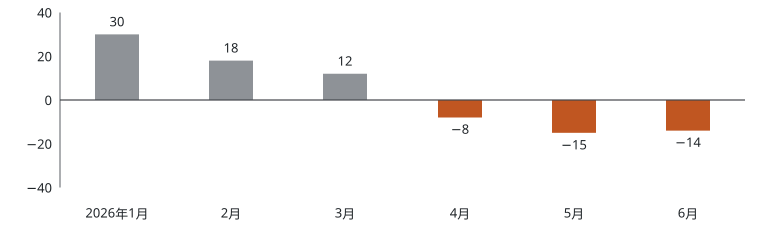
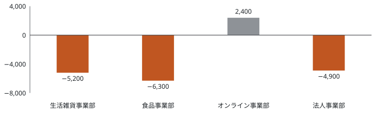
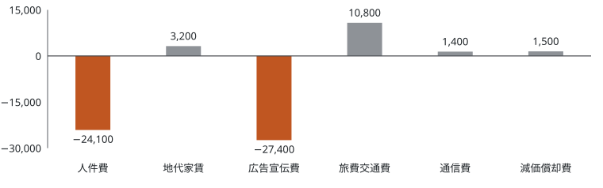

株式会社アオバホールディングス 経理部

## 損益予実対比

当月は増収を確保したものの、人件費と広告宣伝費の超過により営業利益は予算を下回りました。

| 勘定科目   | 予算      | 実績      | 差異                             | 差異率                           |                                              |
| ---------- | --------- | --------- | -------------------------------- | -------------------------------- | -------------------------------------------- |
| 売上高     | 1,250,000 | 1,284,500 | 34,500                           | 2.76%                            |    |
| 売上原価   | 720,000   | 737,800   | ▲17,800 | ▲2.47%  |     |
| 売上総利益 | 530,000   | 546,700   | 16,700                           | 3.15%                            |                                              |
| 人件費     | 250,000   | 266,400   | ▲16,400 | ▲6.56%  |  |
| 地代家賃   | 60,000    | 59,200    | 800                              | 1.33%                            |                                              |
| 広告宣伝費 | 45,000    | 61,800    | ▲16,800 | ▲37.33% |       |
| 旅費交通費 | 18,000    | 16,700    | 1,300                            | 7.22%                            |                                              |
| 通信費     | 8,500     | 8,100     | 400                              | 4.71%                            |                                              |
| 減価償却費 | 12,000    | 12,000    | 0                                | 0.00%                            |                                              |
| 販管費合計 | 393,500   | 424,200   | ▲30,700 | ▲7.80%  |                                              |
| 営業利益   | 136,500   | 122,500   | ▲14,000 | ▲10.26% |       |

（単位：千円。差異は有利差異をプラス、不利差異を▲で表示）

（単位：百万円）

## 主要差異の分析

<ul class="remarks">
<li id="rm-sales">売上高：オンライン事業部の夏季キャンペーン前倒しにより34,500千円の増収となりました。</li>
<li id="rm-cogs">売上原価：原価率は57.4%と予算の57.6%から0.2ポイント改善しましたが、増収に伴い金額では17,800千円の超過となりました。</li>
<li id="rm-payroll">人件費：採用活動の活発化および中途採用の増加により、採用関連費用が増加しました。今後も人員体制の強化を進めるため、費用の増加は一時的なものと見込んでいます。</li>
<li id="rm-ad">広告宣伝費：大型キャンペーンの前倒し実施により予算を上回りました。効果検証を進めます。</li>
<li id="rm-op">営業利益：人件費と広告宣伝費の増加により予算を14,000千円下回りました。</li>
</ul>

## 事業部別 売上高予実

全社の増収34,500千円はオンライン事業部の伸長によるもので、粗利増は広告宣伝費の超過に相殺されました。

| 事業部           | 予算      | 実績      | 差異                            | 差異率                          |                                                   |
| ---------------- | --------- | --------- | ------------------------------- | ------------------------------- | ------------------------------------------------- |
| 生活雑貨事業部   | 460,000   | 466,900   | 6,900                           | 1.50%                           |                                                   |
| 食品事業部       | 380,000   | 372,600   | ▲7,400 | ▲1.95% |    |
| オンライン事業部 | 265,000   | 306,400   | 41,400                          | 15.62%                          |  |
| 法人事業部       | 145,000   | 138,600   | ▲6,400 | ▲4.41% |                                                   |
| 合計             | 1,250,000 | 1,284,500 | 34,500                          | 2.76%                           |                                                   |

（単位：千円）

## 事業部別 営業利益予実

| 事業部           | 予算    | 実績    | 差異                             | 差異率                           |                                              |
| ---------------- | ------- | ------- | -------------------------------- | -------------------------------- | -------------------------------------------- |
| 生活雑貨事業部   | 54,000  | 48,800  | ▲5,200  | ▲9.63%  |                                              |
| 食品事業部       | 36,000  | 29,700  | ▲6,300  | ▲17.50% |  |
| オンライン事業部 | 28,500  | 30,900  | 2,400                            | 8.42%                            |                                              |
| 法人事業部       | 18,000  | 13,100  | ▲4,900  | ▲27.22% |  |
| 合計             | 136,500 | 122,500 | ▲14,000 | ▲10.26% |                                              |

（単位：千円）

（単位：千円）

## 事業部別の状況

<ul class="remarks">
<li id="rm-food-sales">食品事業部：主力の常温食品が想定を下回りました。7月から重点商品の販促を再設計します。</li>
<li id="rm-online-sales">オンライン事業部：会員向け先行販売と定期便の新規獲得が計画を大きく上回りました。</li>
<li id="rm-food-op">食品事業部：原材料価格の上昇分を販売価格へ転嫁しきれず、売上総利益率が低下しました。</li>
<li id="rm-corp-op">法人事業部：受注済み2案件の検収が7月へずれ込み、外注単価の上昇も重なりました。</li>
</ul>

## 上期累計 損益予実（2026年1月〜6月）

上期累計では営業利益が予算を23,000千円上回りました。第1四半期の貯金が第2四半期の下振れを吸収した形です。

| 勘定科目   | 予算      | 実績      | 差異                             | 差異率                          |     |
| ---------- | --------- | --------- | -------------------------------- | ------------------------------- | --- |
| 売上高     | 7,350,000 | 7,486,200 | 136,200                          | 1.85%                           |     |
| 売上原価   | 4,233,000 | 4,311,600 | ▲78,600 | ▲1.86% |     |
| 売上総利益 | 3,117,000 | 3,174,600 | 57,600                           | 1.85%                           |     |
| 販管費合計 | 2,335,500 | 2,370,100 | ▲34,600 | ▲1.48% |     |
| 営業利益   | 781,500   | 804,500   | 23,000                           | 2.94%                           |     |

（単位：千円）

## 月次営業利益の推移

| 月度      | 予算    | 実績    | 差異                             | 差異率                           |                                                   |
| --------- | ------- | ------- | -------------------------------- | -------------------------------- | ------------------------------------------------- |
| 2026年1月 | 118,000 | 148,000 | 30,000                           | 25.42%                           |                                                   |
| 2月       | 124,000 | 142,000 | 18,000                           | 14.52%                           |                                                   |
| 3月       | 141,000 | 153,000 | 12,000                           | 8.51%                            |                                                   |
| 4月       | 129,000 | 121,000 | ▲8,000  | ▲6.20%  |  |
| 5月       | 133,000 | 118,000 | ▲15,000 | ▲11.28% |                                                   |
| 6月       | 136,500 | 122,500 | ▲14,000 | ▲10.26% |                                                   |
| 上期累計  | 781,500 | 804,500 | 23,000                           | 2.94%                            |                                                   |

（単位：千円）

<ul class="remarks">
<li id="rm-q2-shortfall">4月以降の下振れ：第1四半期の有利差異60,000千円に対し、第2四半期は▲37,000千円です。4月の採用前倒しによる人件費増に、5月以降は広告宣伝費の超過が重なりました。</li>
</ul>

## 前年同期比較（上期累計）

| 勘定科目   | 前年同期  | 当期      | 増減                              | 増減率                          |                                          |
| ---------- | --------- | --------- | --------------------------------- | ------------------------------- | ---------------------------------------- |
| 売上高     | 6,982,400 | 7,486,200 | 503,800                           | 7.22%                           |  |
| 売上原価   | 4,047,800 | 4,311,600 | ▲263,800 | ▲6.52% |                                          |
| 売上総利益 | 2,934,600 | 3,174,600 | 240,000                           | 8.18%                           |                                          |
| 販管費合計 | 2,241,700 | 2,370,100 | ▲128,400 | ▲5.73% |                                          |
| 営業利益   | 692,900   | 804,500   | 111,600                           | 16.11%                          |                                          |

（単位：千円。増減は損益への影響を示し、費用の増加は▲で表示）

<ul class="remarks">
<li id="rm-yoy">前年同期比：増収率7.22%に対し販管費の増加率は5.73%にとどまり、営業利益は16.11%の増益となりました。予算未達ではあるものの、前年からの収益力は着実に改善しています。</li>
</ul>

## 販売費及び一般管理費の累計予実（2026年1月〜6月）

累計の販管費超過34,600千円は、人件費と広告宣伝費の2費目で51,500千円の不利差異が生じ、その他4費目の16,900千円の有利差異で一部を埋め合わせた結果です。

| 費目       | 予算      | 実績      | 差異                             | 差異率                           |                                                  |
| ---------- | --------- | --------- | -------------------------------- | -------------------------------- | ------------------------------------------------ |
| 人件費     | 1,485,000 | 1,509,100 | ▲24,100 | ▲1.62%  |  |
| 地代家賃   | 360,000   | 356,800   | 3,200                            | 0.89%                            |                                                  |
| 広告宣伝費 | 261,000   | 288,400   | ▲27,400 | ▲10.50% |       |
| 旅費交通費 | 108,000   | 97,200    | 10,800                           | 10.00%                           |       |
| 通信費     | 49,500    | 48,100    | 1,400                            | 2.83%                            |                                                  |
| 減価償却費 | 72,000    | 70,500    | 1,500                            | 2.08%                            |                                                  |
| 販管費合計 | 2,335,500 | 2,370,100 | ▲34,600 | ▲1.48%  |                                                  |

（単位：千円）

（単位：千円）

<ul class="remarks">
<li id="rm-payroll-cum">人件費：不利差異24,100千円のうち16,400千円は6月単月で発生しています。中途採用の入社が第2四半期に集中したことによるもので、7月以降の月次増加額は逓減する見通しです。</li>
<li id="rm-ad-cum">広告宣伝費：累計の超過27,400千円のうち16,800千円は6月の夏季キャンペーン前倒しによるものです。前倒し分は下期予算からの振替であり、通期では計画内に収まる見込みです。</li>
<li id="rm-travel">旅費交通費：オンライン商談の定着により出張件数が計画を下回り、10,800千円の有利差異となりました。下期も同水準で推移すると想定しています。</li>
</ul>

固定費性の強い地代家賃・減価償却費はほぼ計画どおりで、差異の大半は人件費と広告宣伝費という管理可能費に集中しています。7月度からは両費目を対象に、月次での執行残高のモニタリングを開始します。

## 通期見通し（2026年12月期）

上期実績と下期の再見積りを踏まえ、通期見通しを修正します。増収は維持する一方、費用水準の上振れにより営業利益は期初計画を40,000千円下回る見通しです。

| 勘定科目   | 期初計画   | 修正見通し | 差異                              | 差異率                          |                                               |
| ---------- | ---------- | ---------- | --------------------------------- | ------------------------------- | --------------------------------------------- |
| 売上高     | 15,200,000 | 15,480,000 | 280,000                           | 1.84%                           |  |
| 売上原価   | 8,755,000  | 8,930,000  | ▲175,000 | ▲2.00% |                                               |
| 売上総利益 | 6,445,000  | 6,550,000  | 105,000                           | 1.63%                           |                                               |
| 販管費合計 | 4,830,000  | 4,975,000  | ▲145,000 | ▲3.00% |    |
| 営業利益   | 1,615,000  | 1,575,000  | ▲40,000  | ▲2.48% |                                               |

（単位：千円）

<ul class="remarks">
<li id="rm-fy-sales">売上高：オンライン事業部の定期便会員の増加を下期見通しに反映し、通期で280,000千円の上振れを見込みます。食品事業部は重点商品の販促再設計により期初計画並みまで戻す前提です。</li>
<li id="rm-fy-sga">販管費合計：下期の販管費は、上期に前倒しした採用の平年度化により期初計画を110,400千円上回る見込みです。改善アクションプランによる下期効果額64,000千円は、この見通しに織り込み済みです。</li>
</ul>

## 半期別 営業利益の見通し

上期の修正見通し欄は6月までの実績です。下期は期初計画を63,000千円下回り、上期の有利差異23,000千円を打ち消す見込みです。

| 区分            | 期初計画  | 修正見通し | 差異                             | 差異率                          |     |
| --------------- | --------- | ---------- | -------------------------------- | ------------------------------- | --- |
| 上期（1〜6月）  | 781,500   | 804,500    | 23,000                           | 2.94%                           |     |
| 下期（7〜12月） | 833,500   | 770,500    | ▲63,000 | ▲7.56% |     |
| 通期            | 1,615,000 | 1,575,000  | ▲40,000 | ▲2.48% |     |

（単位：千円）

## 下期の月次営業利益計画

| 月度   | 期初計画 | 修正計画 | 差異                             | 差異率                          |     |
| ------ | -------- | -------- | -------------------------------- | ------------------------------- | --- |
| 7月    | 132,000  | 122,000  | ▲10,000 | ▲7.58% |     |
| 8月    | 128,000  | 118,500  | ▲9,500  | ▲7.42% |     |
| 9月    | 140,000  | 128,500  | ▲11,500 | ▲8.21% |     |
| 10月   | 145,000  | 135,000  | ▲10,000 | ▲6.90% |     |
| 11月   | 143,500  | 132,000  | ▲11,500 | ▲8.01% |     |
| 12月   | 145,000  | 134,500  | ▲10,500 | ▲7.24% |     |
| 下期計 | 833,500  | 770,500  | ▲63,000 | ▲7.56% |     |

（単位：千円）

## 改善アクションプラン

費用構造の是正に向けて、7つの施策を実行中です。年間効果額84,000千円のうち上期は20,000千円を実現し、進捗率は23.81%となりました。

| 施策               | 年間効果額 | 上期実績 | 下期見込 | 進捗率 |                                                  |
| ------------------ | ---------- | -------- | -------- | ------ | ------------------------------------------------ |
| 採用チャネル再編   | 18,000     | 4,200    | 13,800   | 23.33% |       |
| 広告投資の再配分   | 24,000     | 5,800    | 18,200   | 24.17% |                                                  |
| 物流コスト見直し   | 12,500     | 3,100    | 9,400    | 24.80% |                                                  |
| 法人案件の採算管理 | 9,600      | 1,800    | 7,800    | 18.75% |  |
| 間接材購買の集約   | 6,400      | 2,300    | 4,100    | 35.94% |                                                  |
| 在庫回転の改善     | 8,200      | 1,900    | 6,300    | 23.17% |                                                  |
| 業務システム統合   | 5,300      | 900      | 4,400    | 16.98% |       |
| 合計               | 84,000     | 20,000   | 64,000   | 23.81% |                                                  |

（単位：千円。進捗率は年間効果額に対する上期実績の割合）

<ul class="remarks">
<li id="rm-hiring">採用チャネル再編：人材紹介比率を下げ、社員紹介と直接応募の構成比を高めます。採用単価の低減効果は9月以降に本格化する見込みです。</li>
<li id="rm-corp-margin">法人案件の採算管理：見積段階での粗利率の下限を設定し、下回る案件は事業部長承認を必須とします。7月受注分から適用します。</li>
<li id="rm-system">業務システム統合：進捗率が16.98%と最も遅れています。移行対象の棚卸しが完了した10月以降に効果が集中する計画です。</li>
</ul>

<aside class="note">

**対策メモ**

- 採用計画の見直しと採用チャネルの最適化により、採用コストの抑制を図る。
- 広告宣伝費の効果測定を徹底し、費用対効果の高い施策へ予算配分を見直す。
- 各部門のコスト意識を向上させ、月次での予実管理を強化する。
- 前倒し実施したキャンペーンの下期予算からの振替を、7月の予算修正に反映する。
- 進捗率が20%を下回る施策は、8月の業績報告会で実行計画を再提出する。

</aside>

本レポートは経理部予算管理課が作成し、2026年7月10日開催の月次業績報告会に提出しました。数値は管理会計ベースの速報値であり、決算確定値とは一致しない場合があります。
