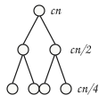
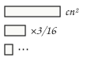
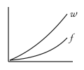
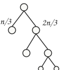
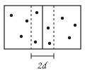

Divide-and-Conquer Recurrences

## The Substitution Method {#sec-substitution}

<aside class="sidenote">Method 1 Guess a closed form, then let induction do the bookkeeping. The guess is the art; the induction is only arithmetic.</aside>

Every divide-and-conquer procedure writes down its own running time. If it breaks an input of size <var>n</var> into <var>a</var> subproblems of size <var>n</var>/<var>b</var> and spends <var>f</var>(<var>n</var>) time on everything that is not a recursive call, then its running time obeys $T(n) = a\,T(n/b) + f(n).$ This chapter is about turning such an equation into a closed form, and about knowing when a shortcut is safe.

The oldest of the three methods we shall use is the _substitution method_: propose a bound, then prove it by induction, substituting the inductive hypothesis into the recurrence itself. The method never discovers a bound on its own — it certifies one — so it works best in company. Recursion trees, treated in Section , are good at producing candidates and poor at proving them; substitution is the reverse.

Consider the recurrence

$$
T(n) = 2\,T(\lfloor n/2 \rfloor) + n
$$

with $T(1) = 1,$ which describes any procedure that halves its input, recurses on both halves, and spends linear time joining the results. Suppose we guess that $T(n) = O(n \lg n),$ and try to establish the concrete bound $T(n) \le c\,n \lg n$ for some constant $c > 0$ and all sufficiently large $n.$ Assuming the bound for every argument smaller than $n$ and substituting it into the recurrence gives

$$
T(n) \le 2c \lfloor n/2 \rfloor \lg \lfloor n/2 \rfloor + n \le c\,n \lg (n/2) + n = c\,n \lg n - c\,n + n
$$

<em>which is at most</em>

$$
c\,n \lg n \quad \text{whenever } c \ge 1 .
$$

The induction still needs a foundation. We cannot start at $n = 1,$ because $\lg 1 = 0$ makes the claimed bound zero there, so we anchor the argument at $n = 2$ and $n = 3$ instead; the recurrence never reaches these values from below. Since $T(2) = 4$ and $T(3) = 5,$ the choice $c = 2$ works, and the bound holds for all $n \ge 2.$

<aside class="sidenote">Lem  The lemma is nothing but strong induction, written once so that we need not repeat it for every recurrence.</aside>

**(Certificate of a Guess).** Let $g$ be a positive nondecreasing function, and suppose that $T(n) \le a\,T(n/b) + f(n)$ for all $n \ge n_0.$ If $a\,g(n/b) + f(n) \le g(n)$ for every $n \ge n_0,$ and $T(n) \le g(n)$ for every $n < n_0$ on which $T$ is defined, then $T(n) \le g(n)$ for all $n.$

A guess that is very nearly right can still fail. Take $T(n) = 2\,T(\lfloor n/2 \rfloor) + 1$ and guess $T(n) = O(n),$ which is certainly true. Substituting $T(m) \le c\,m$ yields $T(n) \le 2c \lfloor n/2 \rfloor + 1 \le c\,n + 1,$ and $c\,n + 1$ is not $c\,n$: the induction fails by one, no matter how large $c$ is. The cure is to prove something stronger. With the hypothesis $T(m) \le c\,m - d$ we obtain $T(n) \le 2(c\,n/2 - d) + 1 = c\,n - 2d + 1,$ which is at most $c\,n - d$ as soon as $d \ge 1.$ Subtracting a lower-order term is the standard repair, and it is worth trying before abandoning a guess.

A second manoeuvre is to change variables. The recurrence $T(n) = 2\,T(\sqrt{n}\,) + \lg n$ is not of the divide-and-conquer form at all, but writing $m = \lg n$ and $S(m) = T(2^m)$ turns it into the recurrence $S(m) = 2\,S(m/2) + m$ that we have just solved. Hence $S(m) = O(m \lg m)$ and $T(n) = O(\lg n \lg \lg n).$ Substitution tolerates such rewriting because the induction is carried out on the transformed variable.

The simplest recurrences come from procedures with a single recursive call. Exponentiation by repeated squaring is the classic:

1. FAST-POWER(x, n)
2. &nbsp;&nbsp;**if** n = 0
3. &nbsp;&nbsp;&nbsp;&nbsp;**return** 1
4. &nbsp;&nbsp;y = FAST-POWER(x, &lfloor;n / 2&rfloor;)
5. &nbsp;&nbsp;**if** n **is even**
6. &nbsp;&nbsp;&nbsp;&nbsp;**return** y &middot; y
7. &nbsp;&nbsp;**return** x &middot; y &middot; y

<aside class="sidenote"> `FAST-POWER` is the smallest interesting divide-and-conquer procedure: one subproblem, half the size, constant glue.</aside>

Each call performs a constant number $e$ of multiplications and recurses once on an argument of half the size, so $T(n) = T(\lfloor n/2 \rfloor) + e.$ The guess $T(n) \le c \lg n + d$ substitutes into the recurrence as $c \lg n - c + d + e,$ which is at most $c \lg n + d$ whenever $c \ge e.$ Thus $T(n) = \Theta(\lg n)$: the procedure multiplies a logarithmic number of times rather than $n$ times.

## The Recursion-Tree Method {#sec-recursion-tree}

<aside class="sidenote">Thm  The recursion tree turns an algebraic recurrence into a picture: cost per level times number of levels.</aside>

Many of the recurrences that arise in the analysis of divide-and-conquer algorithms can be solved by drawing a _recursion tree_, in which each node stands for the cost of a single subproblem. Expanding the recurrence as a tree makes the structure of the repeated work visible, and often yields a tight bound with almost no calculation.

The basic observation is that the total cost is obtained by summing the costs across all levels of the tree. The root records the work done on the whole problem of size <var>n</var>; its children record the work on the smaller subproblems, and so on. If the per-level cost is easy to bound and the height of the tree is known, their product gives the total.

**(Master Recurrence).** Let <var>a</var>&nbsp;&ge;&nbsp;1 and <var>b</var>&nbsp;&gt;&nbsp;1 be constants, and let <var>f</var>(<var>n</var>) be a function with $f(n) = \Theta(n^{\log_b a}).$ Then the recurrence

<aside class="sidenote">

Case 2 This is Case 2 of the Master Theorem: the driving function matches the watershed $n^{\log_b a}.$

</aside>

$$
T(n) = a \cdot T(n / b) + f(n)
$$

<em>satisfies</em>

$$
T(n) = \Theta(n^{\log_b a} \cdot \log n)
$$

Consider, for example, the `MERGE-SORT` procedure:

1. MERGE-SORT(A, p, r)
2. &nbsp;&nbsp;**if** p &lt; r
3. &nbsp;&nbsp;&nbsp;&nbsp;q = &lfloor;(p + r) / 2&rfloor;
4. &nbsp;&nbsp;&nbsp;&nbsp;MERGE-SORT(A, p, q)
5. &nbsp;&nbsp;&nbsp;&nbsp;MERGE-SORT(A, q + 1, r)
6. &nbsp;&nbsp;&nbsp;&nbsp;MERGE(A, p, q, r)
7. &nbsp;&nbsp;**return**

Here a problem of size <var>n</var> is split into two halves, and the merge step runs in linear time. The tree has $\Theta(\log n)$ levels, each costing $\Theta(n),$ so the total cost is $\Theta(n \cdot \log n).$

<aside class="sidenote">Geometric When the level costs shrink by a constant factor, the whole tree costs no more than a constant times its root.</aside>

The merge-sort tree is the balanced case, and it is misleading in one respect: it suggests that every level matters. Consider instead

$$
T(n) = 3\,T(n/4) + c\,n^2 .
$$

A node at depth $i$ handles a subproblem of size $n/4^i$ and therefore costs $c(n/4^i)^2.$ There are $3^i$ such nodes, so the entire level costs $3^i c\,n^2 / 16^i = (3/16)^i c\,n^2.$ The level costs form a geometric series with ratio $3/16,$ and the sum of the whole series is bounded by

$$
\sum_{i=0}^{\infty} \left(\frac{3}{16}\right)^{i} c\,n^2 = \frac{16}{13}\,c\,n^2 = O(n^2).
$$

The leaves contribute nothing to this picture. The tree has depth $\log_4 n$ and hence $3^{\log_4 n} = n^{\log_4 3} \approx n^{0.793}$ leaves, and $n^{0.793}$ is dwarfed by $n^2.$ Since the root alone costs $c\,n^2,$ we also have $T(n) = \Omega(n^2),$ and therefore $T(n) = \Theta(n^2)$: the work at the top of the tree dominates, and everything below it is a constant-factor correction.

<aside class="sidenote">Discipline Draw the tree to get the answer; write the induction to get the proof. A tree is a picture of a sum, not a substitute for one.</aside>

A recursion tree drawn on the back of an envelope is an argument only in outline: it assumes that the subproblem sizes divide exactly, that the pattern of the first three levels continues, and that the sum of the level costs may be replaced by its limit. None of these assumptions is automatic. The disciplined use of the method is therefore to draw the tree, read off a candidate bound, and hand it to the substitution method for a proof. For the recurrence above, the hypothesis $T(m) \le c'm^2$ with $c' = 16c/13$ closes the induction in a single line, since $3c'(n/4)^2 + c\,n^2 = (3c'/16 + c)\,n^2 \le c'n^2.$

## The Master Method {#sec-master}

<aside class="sidenote">Method 3 One recursion tree, computed once and for all, covers every recurrence of the balanced form.</aside>

Drawing a tree for each new recurrence is soon tedious, because balanced recurrences all produce the same tree with different labels. The _master method_ performs the computation once. Everything turns on a comparison between the driving function $f(n)$ and the _watershed function_ $n^{\log_b a},$ which counts, up to constants, the leaves of the tree: with $a$ children per node and $\log_b n$ levels, the tree has $a^{\log_b n} = n^{\log_b a}$ leaves. If $f$ is smaller than the watershed the leaves pay for the algorithm; if $f$ is larger the root pays; if the two agree every level pays the same, and the answer picks up a logarithmic factor.

**(Master Theorem).** Let $a \ge 1$ and $b > 1$ be constants, let $f(n)$ be a nonnegative function, and let $T(n) = a\,T(n/b) + f(n),$ where $n/b$ stands for either $\lfloor n/b \rfloor$ or $\lceil n/b \rceil.$ Let $\varepsilon > 0$ be a constant, and assume in Case 3 the regularity condition $a\,f(n/b) \le c\,f(n)$ for some constant $c < 1$ and all sufficiently large $n.$ Then the three comparisons below give the solution.

<em>Case 1, the driving function polynomially smaller than the watershed:</em>

$$
f(n) = O(n^{\log_b a - \varepsilon}) \;\Longrightarrow\; T(n) = \Theta(n^{\log_b a}).
$$

<em>Case 2, the two of the same order:</em>

$$
f(n) = \Theta(n^{\log_b a}) \;\Longrightarrow\; T(n) = \Theta(n^{\log_b a} \lg n).
$$

<em>Case 3, the driving function polynomially larger and regular:</em>

$$
f(n) = \Omega(n^{\log_b a + \varepsilon}) \;\Longrightarrow\; T(n) = \Theta(f(n)).
$$

Case 2 is the statement we recorded as Theorem , and merge sort is its standard instance: $a = b = 2$ gives a watershed of $n^{\log_2 2} = n,$ the merge step costs $\Theta(n),$ and the solution is $\Theta(n \lg n).$

<aside class="sidenote">Read it as leaves win, tie, root wins — in that order.</aside>

The three cases are easiest to apply as a checklist. Compute $\log_b a;$ compare $f(n)$ with $n^{\log_b a};$ check, in Case 3 only, that $f$ shrinks by a constant factor when its argument is divided by $b.$ Three examples show the pattern.

The first example is a Case 1 recurrence. For $T(n) = 9\,T(n/3) + n$ the watershed is $n^{\log_3 9} = n^2,$ the driving function is $O(n^{2-1}),$ and the solution is $\Theta(n^2)$: all the work is in the leaves.

The second is a Case 2 recurrence with an unusual $b.$ For $T(n) = T(2n/3) + 1$ we have $a = 1$ and $b = 3/2,$ so the watershed is the constant function $n^0 = 1,$ the driving function matches it, and the solution is $\Theta(\lg n).$

The third is a Case 3 recurrence. For $T(n) = 3\,T(n/4) + n \lg n$ the watershed is $n^{\log_4 3} \approx n^{0.793},$ which the driving function exceeds polynomially. Regularity holds with $c = 3/4,$ since $3(n/4)\lg(n/4) \le (3/4)\,n \lg n,$ and the solution is $\Theta(n \lg n)$: the root pays for everything.

The theorem does not cover every balanced recurrence, and the gaps are not exotic. In $T(n) = 2\,T(n/2) + n \lg n$ the watershed is $n$ and the driving function is $n \lg n,$ which is larger — but only by a logarithmic factor, not by $n^{\varepsilon}$ for any positive $\varepsilon.$ No case applies. The recursion tree still works: level $i$ contains $2^i$ subproblems of size $n/2^i,$ each costing $(n/2^i)\lg(n/2^i),$ so the level costs $n(\lg n - i)$ and the total is $\sum_{i=0}^{\lg n - 1} n(\lg n - i) = \Theta(n \lg^2 n).$ A recurrence that falls into a gap is a recurrence to be solved by hand, not a recurrence without a solution.

Case 1 is the interesting one for algorithm design, because it says that the combining step is free. Blockwise matrix multiplication is the standard illustration:

1. BLOCK-MULTIPLY(A, B, n)
2. &nbsp;&nbsp;**if** n = 1
3. &nbsp;&nbsp;&nbsp;&nbsp;**return** A[1, 1] &middot; B[1, 1]
4. &nbsp;&nbsp;partition A, B, C **into** n/2 &times; n/2 blocks
5. &nbsp;&nbsp;**for** i = 1 **to** 2, j = 1 **to** 2
6. &nbsp;&nbsp;&nbsp;&nbsp;C[i, j] = BLOCK-MULTIPLY(A[i, 1], B[1, j], n / 2)
7. &nbsp;&nbsp;&nbsp;&nbsp;&nbsp;&nbsp;&nbsp;&nbsp;+ BLOCK-MULTIPLY(A[i, 2], B[2, j], n / 2)
8. &nbsp;&nbsp;**return** C

<aside class="sidenote"> Eight multiplications of half-sized blocks put the whole cost in the leaves; seven move the exponent from 3 to about 2.81.</aside>

The procedure performs eight multiplications of half-sized blocks and a quadratic amount of work in additions, so $T(n) = 8\,T(n/2) + \Theta(n^2).$ The watershed is $n^{\log_2 8} = n^3,$ the driving function is $O(n^{3 - 1}),$ and Case 1 gives $T(n) = \Theta(n^3)$ — no better than the triple loop. The observation behind Strassen's algorithm is that seven multiplications suffice if one is willing to compute fourteen sums; the recurrence becomes $T(n) = 7\,T(n/2) + \Theta(n^2),$ the watershed drops to $n^{\log_2 7},$ and Case 1 now yields $T(n) = \Theta(n^{\log_2 7}) = O(n^{2.81}).$ Nothing about the combining step changed; only the number of children of each node did.

## Unequal Splits {#sec-unequal}

<aside class="sidenote">Shape An unbalanced tree has a short path and a long one. Both are logarithmic, and that is usually all one needs.</aside>

Not every algorithm splits its input evenly. A pivot chosen by a rule of thumb, a partition driven by the data, or a deliberately lopsided design all lead to recurrences of the form $T(n) = T(\alpha n) + T((1 - \alpha) n) + \Theta(n)$ with $0 < \alpha < 1.$ The master method says nothing about these, because there is no single subproblem size, but the recursion tree is as informative as before.

Take $\alpha = 1/3,$ so that

$$
T(n) = T(n/3) + T(2n/3) + c\,n .
$$

Every node of the tree passes its entire input on to its two children, so the sizes at any complete level still sum to $n,$ and a complete level costs exactly $c\,n.$ The tree is not complete all the way down, however: following the $1/3$ branch at every step reaches a leaf after $\log_3 n$ steps, while following the $2/3$ branch takes $\log_{3/2} n$ steps. Below the shorter depth some branches have already terminated, so the level costs are at most $c\,n$ and at least nothing; above it they are exactly $c\,n.$ Hence

$$
c\,n \log_3 n \le T(n) \le c\,n \log_{3/2} n ,
$$

and since the two logarithms differ only by a constant factor, $T(n) = \Theta(n \lg n).$ The imbalance costs a constant, not an asymptotic factor — which is why an approximate median is as good as an exact one.

**(Balanced Enough).** Let $\alpha$ be a constant with $0 < \alpha < 1$ and let $T(n) = T(\alpha n) + T((1-\alpha)n) + \Theta(n).$ Then $T(n) = \Theta(n \lg n),$ with constants depending on $\alpha$ but not on $n.$

<aside class="sidenote">Test Add the fractions. Equal to one: an extra logarithm. Less than one: linear.</aside>

The situation changes completely when the subproblems do not consume the whole input. A procedure that throws away a constant fraction of its data before recursing leads to a recurrence such as

$$
T(n) = T(n/5) + T(7n/10) + c\,n ,
$$

whose two fractions sum to $9/10.$ The sizes at level $i$ therefore sum to at most $(9/10)^i n,$ the level costs decay geometrically, and the series sums to $T(n) \le 10\,c\,n.$ Substitution confirms it: assuming the bound below $n$ yields $T(n) \le 2c\,n + 7c\,n + c\,n,$ which is exactly $10\,c\,n.$ The recurrence is linear, and the extra logarithm of Theorem &nbsp;has vanished. The only quantity that mattered was the sum of the fractions.

## A Worked Case Study {#sec-case-study}

<aside class="sidenote">Case study Three methods on one algorithm: a tree for the guess, an induction for the proof, and the master theorem to explain why it does not apply.</aside>

We close the technical part of the chapter with an algorithm whose recurrence exercises all three methods. The problem is to find the closest pair among $n$ points in the plane, given in an array $P$ sorted by $x$-coordinate. The procedure splits the array at its median, solves both halves, and then repairs the split: any pair closer than the two recursive answers must straddle the dividing line, and both of its points must lie in a vertical strip of half-width $d$ around it.

1. SWEEP-PAIR(P, lo, hi)
2. &nbsp;&nbsp;**if** hi &minus; lo &lt; 3
3. &nbsp;&nbsp;&nbsp;&nbsp;**return** BRUTE-FORCE(P, lo, hi)
4. &nbsp;&nbsp;mid = &lfloor;(lo + hi) / 2&rfloor;
5. &nbsp;&nbsp;dL = SWEEP-PAIR(P, lo, mid)
6. &nbsp;&nbsp;dR = SWEEP-PAIR(P, mid + 1, hi)
7. &nbsp;&nbsp;d = min(dL, dR)
8. &nbsp;&nbsp;S = points of P[lo .. hi] within d of the split line
9. &nbsp;&nbsp;SORT-BY-Y(S)
10. &nbsp;&nbsp;**for** each s **in** S
11. &nbsp;&nbsp;&nbsp;&nbsp;d = min(d, dist(s, next 7 points of S))
12. &nbsp;&nbsp;**return** d

Lines &nbsp;and &nbsp;are correct because the strip is thin: a $d \times 2d$ rectangle cannot hold more than eight points that are pairwise at distance $d$ or more, so a constant number of comparisons per point of $S$ suffices. Everything outside the recursive calls therefore costs $\Theta(n)$ for building the strip and $\Theta(n \lg n)$ for sorting it, and the recurrence is

$$
T(n) = 2\,T(n/2) + \Theta(n \lg n).
$$

<aside class="sidenote">

Gap $n \lg n$ beats $n,$ but not by any fixed power of $n.$ Case 3 asks for a polynomial margin and does not get one.

</aside>

The master method does not apply: the watershed is $n^{\log_2 2} = n,$ and $n \lg n$ exceeds it by a logarithmic factor only, which is exactly the gap between Case 2 and Case 3 noted in Section . So we draw the tree. Level $i$ holds $2^i$ subproblems of size $n/2^i,$ each costing $c(n/2^i)\lg(n/2^i),$ and the level therefore costs $c\,n(\lg n - i).$ Summing over the $\lg n$ levels gives

$$
T(n) = \sum_{i=0}^{\lg n - 1} c\,n\,(\lg n - i) = c\,n \sum_{j=1}^{\lg n} j = \Theta(n \lg^2 n).
$$

<em>and substitution with a quadratic-logarithmic hypothesis confirms the bound.</em>

One logarithm too many is a hint about the algorithm rather than about the analysis. The strip is sorted from scratch at every node, although its points were already in $y$-order inside each half. Passing a $y$-sorted list up from the recursive calls and merging the two lists in linear time removes the sort, replaces $\Theta(n \lg n)$ by $\Theta(n),$ and puts the recurrence squarely into Case 2 of Theorem , whose solution is $\Theta(n \lg n).$ The recursion tree did not merely evaluate the algorithm; it pointed at the line to change.

## Floors, Ceilings, and Boundaries {#sec-boundaries}

<aside class="sidenote">Caution Dropping the floors is safe for these recurrences. It is not a general licence to round.</aside>

Throughout this chapter we have written $T(n/b)$ where an implementation would produce $T(\lfloor n/b \rfloor)$ or $T(\lceil n/b \rceil),$ and we have said nothing about the values of $T$ on small inputs. Both omissions are deliberate, and both are harmless for the recurrences considered here.

The rounding may be removed by a change of variable. Suppose $T(n) \le a\,T(\lceil n/b \rceil) + f(n),$ put $\delta = b/(b-1),$ and consider the shifted function $S(n) = T(n + \delta).$ A short calculation turns the inequality into $S(n) \le a\,S(n/b) + f(n + \delta),$ a recurrence with no rounding at all, because the additive constant survives division by $b.$ As long as $f$ grows polynomially, $f(n + O(1))$ and $f(n)$ are within a constant factor of each other, so the asymptotic solution is unchanged. Ceilings never make a subproblem larger than a fixed constant beyond $n/b,$ and floors never make one smaller than $n/b - 1.$

The boundary conditions are absorbed in the same way. For $n$ below some constant $n_0$ the running time $T(n)$ is itself bounded by a constant, and a constant may always be folded into the multiplicative constant hidden by the $\Theta$-notation — provided the claimed bound is positive and nondecreasing near $n_0,$ which is why the induction in Section &nbsp;was anchored at $n = 2$ rather than $n = 1.$ Asymptotic notation on the right-hand side of a recurrence is likewise a family of functions rather than one function, and a solution is a bound that holds for every member of the family.

<aside class="sidenote">

Not always A recurrence whose driving function oscillates can defeat the rounding argument even when it looks polynomial.

</aside>

The licence is not unlimited. It rests on $f$ being polynomially bounded and on the subproblem sizes being within a constant of $n/b.$ A driving function that oscillates, or a split whose size depends on the values in the input rather than on their number, can violate both, and such recurrences must be handled directly. Exercise &nbsp;gives a recurrence for which the regularity condition of Case 3 fails even though the driving function is polynomially larger than the watershed.

## Exercises {.exercises}

Use the master method to solve $T(n) = 4\,T(n/2) + n^3,$ $T(n) = 4\,T(n/2) + n^2,$ and $T(n) = 4\,T(n/2) + n.$ Identify the case that applies to each, and say in one sentence where the work is concentrated.

Draw a recursion tree for $T(n) = T(n/2) + T(n/4) + n$ and read off a bound. Then prove your answer by substitution. Why does the master method not apply?

Show that the guess $T(n) \le c\,n$ fails for $T(n) = 2\,T(\lfloor n/2 \rfloor) + n,$ no matter how large $c$ is, and explain what this failure does and does not tell you about the true growth of $T.$

Solve $T(n) = 2\,T(\sqrt{n}\,) + 1$ by changing variables, and compare the answer with that of $T(n) = 2\,T(\sqrt{n}\,) + \lg n$ obtained in Section .

A procedure splits an input of size $n$ into three parts of sizes $n/4,$ $n/4,$ and $n/2,$ recurses on all three, and spends $\Theta(n)$ time elsewhere. Write the recurrence and solve it. Does the answer change if the three fractions are $1/5,$ $1/5,$ and $1/2$?

Verify the identity $a\,(n/b)^{\log_b a} = n^{\log_b a},$ and explain why it says that every level of a Case 2 recursion tree costs the same.

★ Consider the recurrence $T(n) = 2\,T(n/2) + f(n)$ with the oscillating driving function $f(n) = n^2(2 + \sin n).$ Show that $f$ is polynomially larger than the watershed but that the regularity condition of Case 3 fails. Solve the recurrence anyway.

★ Solve $T(n) = 2\,T(n/2) + n/\lg n$ for $n \ge 2.$ The answer is not $\Theta(n);$ draw the tree and sum the level costs carefully.

Modify `SWEEP-PAIR` so that each call returns its points sorted by $y$-coordinate, and write the recurrence for the modified procedure. Confirm that Case 2 of Theorem &nbsp;applies.

★ Suppose the strip test in `SWEEP-PAIR` compared each point with the next $k$ points rather than the next seven, for a constant $k.$ For which values of $k$ is the procedure still correct, and how does the recurrence change?

## Chapter Notes ##

The three methods of this chapter are complementary rather than competing. Substitution proves; recursion trees suggest; the master theorem tabulates the answer for the one shape of recurrence that occurs most often. A fourth technique, useful when the subproblem sizes are unequal or vary with $n,$ replaces the sum over the tree by an integral: the Akra–Bazzi method covers recurrences of the form $T(n) = \sum_i a_i T(n/b_i) + f(n)$ and reduces to the master theorem when all the $b_i$ agree. Theorem &nbsp;is the special case that can be proved without it.

Two habits are worth carrying into the next chapter. The first is to write the recurrence directly from the code, one term per recursive call and one for everything else, before attempting to solve anything; most errors in the analysis of divide-and-conquer algorithms are errors in this transcription. The second is to look at a solution as a design document. An unexpected logarithm, as in Section , usually marks a step that is being repeated at every node of the tree when it could have been done once.
