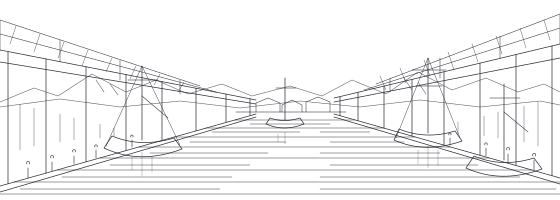

# 潮の匂いのする市場通り {#ichiba}

<aside class="sidebar">

干潮の二時間後がもっとも活気づく。朝九時ごろが目安。

</aside>

{霧津|きりつ}の港に近づくと、まず風が変わる。まだ町角も見えぬうちに、鼻の奥が海を知ってしまうのだ。

水路はやがて大きくうねり、左右に低い{桟|さん}がつづく。屋根の寄りあう家並みのあいだの細い道が、市場通りだ。

早い舟は夜のうちに戻っている。桟に横づけされた舟から箱が手渡しで陸に上がり、水をふくんだ{筵|むしろ}がその上にかぶせられる。日の出前のこの時間が、いちばん人の声が低い。

通りに屋根はない。かわりに、店ごとに{葭簀|よしず}や板が差しかけてあって、その影が地面でつながっている。雨の日には、その切れ目だけを選んで歩く人を見た。

桟には番号が書いてある。木札ではなく、板に直接、白い塗料で書いてあるだけのものだ。舟はいつも同じ番号の桟に着く。

その番号は、荷の種類でも持ち主でもなく、着く時刻の順だと聞いた。

店といっても、多くは箱と{秤|はかり}である。舟から上がったものが、そのまま並ぶ。

<aside class="sidebar">

市場の奥に公衆浴場あり。石鹸と手ぬぐいを持参したい。

</aside>

ここでは魚の名も産地の名も呼び声にまぜられ、干し{鱈|たら}の匂いが湯気にまじる。値は口で決まり、笑えば少しやすくなるという笑顔は値段のまけをうながす、霧津ことば。市場では落とし前という。まけた分を茶一杯で落とす。。

乾物の店では、名を知らぬ魚が板のように干してある。名を聞くと、店の人はまず産地を言い、それから、うちでは何と呼ぶかを言う。二つの名は、たいてい違っている。

箱に入れる氷は、朝のうちに舟で運ばれてくる。氷屋は町に一軒だけで、その一軒が市場ぜんたいの時間を決めているようなものだ。

呼び声は、こちらに向けられているようでいて、たぶん通りぜんたいに向けられている。返事をする者はいない。

桟のはしに立つと、通りの端から端までが一度に見える。舟が着くたび、人の流れがそちらへ寄って、また戻る。

<aside class="sidebar">

香辛料の店は昼過ぎに閉まる。朝のうちに寄るとよい。

</aside>

通りの中ほどで路地を入ると香辛料の店があり、その奥に湯煙のたつ浴場がある（）。

路地は人ひとりぶんの幅で、両側の壁がすこし内へ傾いている。すれちがうときは、どちらかが戸口に身を寄せる。それを断る人も、礼を言う人もいない。

浴場へ行くのは翌日にした。この日はまだ、市場の匂いが手についていた。石鹸で洗っても二日は落ちないと店の人が笑って言ったが、そのとおりになった。

夕方、潮のひくころ、通りの石はしっとりと冷たくなる。

店はあらかた仕舞われ、板と箱だけが残る。水の引いた桟の下から、杭に貼りついた貝が出てくる。市場の一日は、そこで終わる。

桟のうえには、洗われた木箱が伏せて干してある。数はいつも決まっているらしく、朝になると、その数だけの舟が戻ってくる。
