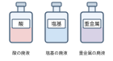
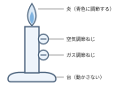
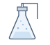
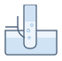
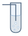
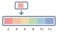
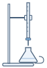
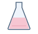
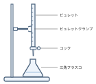
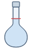

# もくじ {#contents data-badge="実験編"}

化学基礎　実験編

化学基礎の各章に対応する6つの実験を収めた。器具をはじめて手にする前に、次の2ページの安全の手引きを必ず読むこと。

<h2>収録した内容</h2>

| 内容 | ページ |
| ---- | ------ |
| [実験を始める前に](#safety-before) |  |
| [事故への対応と廃液の処理](#safety-accident) |  |
| [実験器具の基本操作](#exp-basic){data-ref=exp} |  |
| [混合物の分離](#exp-separation){data-ref=exp} |  |
| [気体の発生と捕集](#exp-gas){data-ref=exp} |  |
| [水溶液のpH](#exp-ph){data-ref=exp} |  |
| [中和滴定](#exp-titration){data-ref=exp} |  |
| [食酢中の酢酸の定量](#exp-acetic){data-ref=exp} |  |

<h3>対応する章</h3>

- 第1章　物質の探究……・
- 第3章　物質量と化学変化……
- 第4章　酸と塩基……〜

<h3>実験の進め方</h3>

どの実験も1回の授業で終わるように組んである。授業の前にそのページを読み、器具の名前と操作の順序を頭に入れておく。準備と後かたづけにかかる時間も、実験の一部として計画に入れておくこと。

<h3>班の編成と役割</h3>

2人から4人を1班とし、操作する人と記録する人を分ける。役割は実験ごとに交代し、全員がすべての操作を経験できるようにする。器具の受け取りと返却は班で1人が担当する。

<h3>記録の残し方</h3>

読み取った値は、その場でノートに書き写す。書き直すときは消さずに二重線を引き、新しい値を横に書く。うまくいかなかった操作も、気づいたことといっしょに残しておく。

<h2>このページの読み方</h2>

<h3>紙面の構成</h3>

各実験は1ページで完結する。左段に準備と安全上の注意、右段に操作の続きと図を置いた。実験室ではこのページを開いたまま作業してよい。ページの上には章の名前と実験の題を示してある。

<h3>操作の順序</h3>

赤いSTEPバッジの数字が操作の順序を示す。番号を飛ばさず、前の操作が終わってから次に進む。太字の見出しはその操作の目的である。図はその操作で何をどう持つかを示している。

<h3>器具と試薬の表</h3>

準備の表に書いた規格は、その実験に必要な最小限の精度を示す。数量は1班あたりの数である。試薬の濃度は、うすめた状態で示してあるものもあるので、ラベルの表示と見比べてから使う。

<h3>ピクトグラムの意味</h3>

-  保護めがねを着用する操作を含む。
-  皮膚や衣服を侵す薬品を扱う。
-  火気を用いる、または加熱する操作を含む。
-  廃液を指定の容器に回収する。

# 実験を始める前に {.safety #safety-before}

実験編　安全の手引き

実験室では、身じたくを整え、設備の位置を確かめてから作業を始める。ここに書いたことは、すべての実験に共通する約束である。

<h2>身じたくと実験室</h2>

<h3>服装</h3>

- 白衣、またはそでのしまった上着を着る。
- 長い髪はうしろでまとめ、顔にかからないようにする。
- かかとのある靴をはく。サンダルは使わない。
- かばんと上着は実験台に置かず、決められた場所にしまう。

<h3>保護具</h3>

| 保護具         | 着ける場面     |
| -------------- | -------------- |
| 保護めがね     | 実験中は常時   |
| 保護手袋       | 濃い薬品のとき |
| 実験用エプロン | 液がはねる操作 |

<h3>設備の位置</h3>

- 消火器と防火用の砂の置き場所。
- 洗眼器と、水を出しっぱなしにできる流し。
- 非常口までの経路と、扉の開く向き。
- ガスの元栓と、実験台の主電源の位置。

<h3>換気</h3>

気体が発生する実験では、始める前に窓を開けて換気扇を回す。においを調べるときは、手であおいで鼻に導き、容器に直接顔を近づけない。

<h3>実験台の上</h3>

その実験に使うもの以外は置かない。教科書とノートは液のかからない位置に置き、器具は台のふちから10 cm以上内側に並べる。

<h3>持ちこまないもの</h3>

- 飲み物と食べ物。実験室では飲食をしない。
- 実験に使わない私物。通路にも置かない。
- 手ぶくろ代わりの布や、ほつれた袖のある衣類。

<h2>器具と薬品のあつかい</h2>

<h3>ガラス器具</h3>

- 使う前に、ひびや欠けがないか光にすかして確かめる。
- ひびの入った器具は使わず、教員に申し出て交換する。
- 割れたガラスは手で拾わず、ほうきとちりとりで集める。

<h3>加熱器具</h3>

- 加熱した器具はしばらく高温のままである。金網や三脚も同じである。
- 試験管の口は人のいない方へ向け、上からのぞきこまない。
- 液体を加熱するときは、突沸を防ぐため軽く振りながら熱する。

<h3>薬品</h3>

- ラベルを2回読んでから取り出す。びんはラベル側を上にして持つ。
- 取りすぎた薬品は、もとのびんにもどさない。
- 濃い硫酸などをうすめるときは、水に薬品を少しずつ加える。

<h3>実験室の約束</h3>

-  実験中は保護めがねをはずさない。
-  濃い酸や塩基には保護手袋を着ける。
-  気体が出る操作では窓を開け、換気扇を回す。
-  ガラス器具は使う前に必ず点検する。

# 事故への対応と廃液の処理 {.safety #safety-accident}

実験編　安全の手引き

事故が起きたら、まず人の安全を確かめ、教員に知らせる。実験で出た液は流しに捨てず、区分ごとの容器に回収する。

<h2>事故への対応</h2>

<h3>まず知らせる</h3>

異常に気づいた人は、大きな声で周囲に知らせ、教員を呼ぶ。自分だけで片づけようとしない。けがの手当と、器具や薬品の後始末は別の人が分担する。

<h3>応急の手当</h3>

| 起きたこと       | ただちにすること     |
| ---------------- | -------------------- |
| 薬品が目に入った | 流水で15分以上洗う   |
| 皮膚についた     | 流水で洗い流す       |
| 衣服にかかった   | 脱いで流水で洗う     |
| 薬品を飲みこんだ | 口をすすぎ吐かせない |
| やけどをした     | 流水で冷やし続ける   |
| ガラスで切った   | 流水で洗い圧迫する   |

<h3>記録と報告</h3>

手当が終わったら、何をどれだけ扱っていたときに起きたかをノートに書く。薬品のラベルは捨てずに残しておく。小さなけがや器具の破損も、必ずその日のうちに報告する。

<h3>やってはいけないこと</h3>

-  目に入った薬品を、こすったり中和したりする。
-  燃えている容器を持ったまま運ぶ。
-  こぼれた薬品を、ぬれた雑巾でふき広げる。

<h2>廃液とかたづけ</h2>

<h3>廃液の分別</h3>

| 区分       | おもなもの       |
| ---------- | ---------------- |
| 酸の廃液   | 塩酸・硫酸・食酢 |
| 塩基の廃液 | 水酸化ナトリウム |
| 重金属     | 銅・鉛・銀の塩   |
| 有機物     | エタノール・油   |

<h3>流しに流してよいもの</h3>

- 器具をすすいだあとの水。
- 純水と、食塩水などの中性の水溶液。
- 指示薬を加えていない、うすい砂糖水。

<h3>かたづけの順序</h3>

- 廃液を区分ごとの容器に移し、こぼした分もふき取って回収する。
- 器具は洗剤で洗い、純水ですすいでから、伏せて水を切る。
- ガスの元栓と水道を閉め、実験台をふいてから手を洗う。

# 実験器具の基本操作 {.experiment #exp-basic}

第1章　物質の探究

実験でくり返し使う器具の基本操作を確かめ、体積と質量を正しくはかり、安全に加熱できるようにする。

<h2>準備</h2>

<h3>器具</h3>

| 器具                 | 規格・数量      |
| -------------------- | --------------- |
| メスシリンダー       | 100 mL・1個     |
| ビーカー             | 200 mL・2個     |
| 電子てんびん         | 0.01 gまで・1台 |
| 薬包紙・薬さじ       | 各1             |
| ガスバーナー         | 1台             |
| 試験管・試験管ばさみ | 各3             |
| 試験管立て           | 1個             |
| マッチ・燃えがら入れ | 各1             |

<h3>試薬</h3>

- 純水
- 塩化ナトリウム
- 中性洗剤

<h3>安全上の注意</h3>

-  保護めがねを着用する。加熱した液が飛ぶことがある。
-  点火の前に、まわりに紙やアルコールがないか確かめる。
-  器具にひびや欠けがないか、使う前に確かめる。

1. 

   **体積をはかる**

   メスシリンダーを水平な台に置き、純水を50 mL入れる。目の高さを液面に合わせ、へこんだ面の最も低いところを読む。

2. 

   **質量をはかる**

   電子てんびんを水平に置き、薬包紙をのせて表示を0にする。薬さじで塩化ナトリウムを少しずつのせ、2.00 gになったところで止める。

3. 

   **バーナーに点火する**

   2つの調節ねじが閉じていることを確かめ、元栓、コックの順に開く。マッチに火をつけてから、ガス調節ねじをゆるめて点火する。

4. 

   **試験管を加熱する**

   試験管に純水を3分の1ほど入れ、試験管ばさみではさむ。口を人のいない方へ向け、液面の上下を軽く振りながら熱する。

# 混合物の分離 {.experiment #exp-separation}

第1章　物質の探究

塩化ナトリウムと二酸化ケイ素の混合物を、水への溶けやすさの違いを利用して分ける。

<h2>準備</h2>

<h3>器具</h3>

| 器具         | 規格・数量  |
| ------------ | ----------- |
| ビーカー     | 200 mL・2個 |
| ろうと・ろ紙 | 各1組       |
| ろうと台     | 1台         |
| ガラス棒     | 1本         |
| 蒸発皿       | 1個         |
| 三脚・金網   | 各1         |
| ガスバーナー | 1台         |
| 洗浄びん     | 1本         |

<h3>試薬</h3>

- 塩化ナトリウムと二酸化ケイ素の混合物
- 純水
- 中性洗剤

<h3>安全上の注意</h3>

-  保護めがねを着用する。加熱の途中で固体がはねる。
-  蒸発皿と金網は、火を消したあとも高温のままである。
-  熱い蒸発皿を、ぬれた台の上に直接置かない。

1. 

   **水に溶かす**

   混合物5 gをビーカーにとり、純水を100 mL加える。ガラス棒で2分ほどかき混ぜ、溶けるものと溶けないものに分ける。

2. 

   **ろ過する**

   ろ紙を四つ折りにして開き、ろうとに密着させる。ガラス棒を伝わらせて液を注ぎ、ろうとの先はビーカーの内壁につけておく。

3. 

   **水を蒸発させる**

   ろ液を蒸発皿に半分ほどとり、金網の上で弱く加熱する。液が残り少なくなったら火を止め、余熱で乾かして結晶を観察する。

<h3>発展　ろ液から水をとり出す</h3>

蒸発では水は空気中に逃げてしまう。枝付きフラスコと冷却器を使うと、いったん気体にした水を冷やして液体にもどし、取り出すことができる。この操作を蒸留という。

# 気体の発生と捕集 {.experiment #exp-gas}

第3章　物質量と化学変化

石灰石に希塩酸を加えて二酸化炭素を発生させ、水上置換で集めて、その性質を確かめる。

<h2>準備</h2>

<h3>器具</h3>

| 器具               | 規格・数量      |
| ------------------ | --------------- |
| 三角フラスコ       | 100 mL・1個     |
| ゴム栓・ガラス管   | 1組             |
| ゴム管             | 1本             |
| 水槽               | 1個             |
| 試験管・試験管立て | 各1組           |
| 電子てんびん       | 0.01 gまで・1台 |
| 薬さじ・薬包紙     | 各1             |
| メスシリンダー     | 50 mL・1個      |

<h3>試薬</h3>

- 石灰石（炭酸カルシウム）
- 希塩酸（約2 mol/L）
- 石灰水
- 純水

<h3>安全上の注意</h3>

-  保護めがねを着用する。栓が飛ぶことがある。
-  窓を開け、換気扇を回してから始める。
-  残った塩酸と石灰石は、酸の廃液の容器に回収する。

1. 

   **石灰石をはかりとる**

   薬包紙を電子てんびんにのせて表示を0にし、石灰石を3.0 gはかりとる。粒の大きさをそろえておくと、気体が一定の速さで発生する。

2. 

   **装置を組み立てる**

   三角フラスコに石灰石を入れ、希塩酸を20 mL加えてすぐにゴム栓をする。ガラス管とゴム管のつなぎ目に、すき間がないことを確かめる。

3. 

   **水上置換で集める**

   水を満たした試験管を水槽の中で逆さにし、ゴム管の先を口に入れる。はじめに出てくる気体は捨て、2本目からを集める。

4. 

   **石灰水で確かめる**

   集めた気体を石灰水に通す。白くにごれば二酸化炭素である。にごりが消えるまで通し続けないよう、10秒ほどで止める。

<h3>気体の集め方</h3>

| 集め方   | 適する気体     |
| -------- | -------------- |
| 水上置換 | 水に溶けにくい |
| 上方置換 | 空気より軽い   |
| 下方置換 | 空気より重い   |

<h3>二酸化炭素の性質</h3>

- 無色・無臭で、空気よりも重い。
- 水に少し溶け、その水溶液は弱い酸性を示す。
- 石灰水に通すと、炭酸カルシウムができて白くにごる。

<h3>あとしまつ</h3>

- 反応が止まってから、ゴム管を水槽から先に抜く。
- 三角フラスコの中身は、固体と液体に分けて回収する。

# 水溶液のpH {.experiment #exp-ph}

第4章　酸と塩基

身のまわりの水溶液のpHを試験紙と指示薬で調べ、酸性・中性・塩基性を区別する。

<h2>準備</h2>

<h3>器具</h3>

| 器具             | 規格・数量 |
| ---------------- | ---------- |
| 試験管           | 6本        |
| 試験管立て       | 1個        |
| メスシリンダー   | 10 mL・1個 |
| ガラス棒         | 1本        |
| 時計皿           | 1枚        |
| こまごめピペット | 3本        |
| 白色のタイル     | 1枚        |
| 洗浄びん         | 1本        |

<h3>試薬</h3>

- 食酢、レモンのしぼり汁、水道水
- 石けん水、重そう水
- pH試験紙（標準変色表つき）
- 指示薬：BTB溶液

<h3>安全上の注意</h3>

-  保護めがねを着用する。指示薬は衣服につくと落ちにくい。
-  石けん水と重そう水は塩基性である。手についたら洗う。
-  調べ終わった液は、区分ごとの廃液容器に回収する。

1. 

   **試料をとる**

   5種類の水溶液を、それぞれ5 mLずつメスシリンダーではかりとり、別々の試験管に入れる。試験管には番号を書いておく。

2. 

   **pH試験紙につける**

   ガラス棒の先を試料につけ、時計皿にのせたpH試験紙にふれさせる。1回ごとにガラス棒を純水で洗い、水を切ってから次に進む。

3. 

   **標準変色表と比べる**

   試験紙の色が変わったら、すぐに標準変色表の上に置いて見比べる。時間がたつと色が変わるので、30秒以内に読み取る。

4. 

   **指示薬で確かめる**

   別の試験管に試料を3 mLとり、BTB溶液を2滴加える。白いタイルの上に並べると、色の違いが見分けやすい。

<h3>指示薬の色の変化</h3>

| 指示薬               | 酸性 → 塩基性 |
| -------------------- | ------------- |
| BTB溶液              | 黄色 → 青色   |
| メチルオレンジ       | 赤色 → 黄色   |
| フェノールフタレイン | 無色 → 赤色   |
| リトマス紙           | 赤色 → 青色   |

<h3>pHの決まり方</h3>

pHは、水素イオンのモル濃度$c$ mol/Lを用いて次のように定められている。

$$
\mathrm{pH} = -\log_{10} c
$$

25℃の純水では$c$が$1.0 \times 10^{-7}$となり、pHは7で中性である。これより小さければ酸性、大きければ塩基性である。

<h3>まとめ方</h3>

- 試料ごとに、pHの読みと指示薬の色を並べて書く。
- 同じ試料を2回調べ、読みがちがったらやり直す。

# 中和滴定 {.experiment #exp-titration}

第4章　酸と塩基

未知濃度の塩酸水溶液を、水酸化ナトリウム標準液を用いて中和滴定し、その濃度を決定する。

<h2>準備</h2>

<h3>器具</h3>

| 器具                   | 規格・数量    |
| ---------------------- | ------------- |
| ビュレット             | 50 mL・1本    |
| ビュレット台・クランプ | 1組           |
| 三角フラスコ           | 250 mL・3個   |
| ホールピペット         | 10.00 mL・1本 |
| メスピペット           | 1 mL・1本     |
| ピペットフィラー       | 1個           |
| メスシリンダー         | 100 mL・1個   |
| 洗浄びん・漏斗・薬さじ | 各1           |

<h3>試薬</h3>

- 塩酸水溶液（未知濃度）
- 水酸化ナトリウム標準液（約0.100 mol/L）
- 中性洗剤、純水
- 指示薬：フェノールフタレイン溶液

<h3>安全上の注意</h3>

-  保護めがねを着用する。薬品や溶液の飛散から目を守る。
-  塩酸や水酸化ナトリウムは強い酸・強い塩基であり、皮膚や衣服に付着すると危険である。
-  廃液は、指定された容器に回収し、決められた方法で処理する。

1. 

   **試料を量り取る**

   ホールピペット（10.00 mL）で、塩酸水溶液を正確に10.00 mL量り取り、三角フラスコ（250 mL）に入れる。

2. 

   **指示薬を加える**

   フェノールフタレイン溶液を2〜3滴加え、軽く振り混ぜる。溶液は無色のままであることを確認する。

3. 

   **滴定する**

   ビュレットに水酸化ナトリウム標準液を入れ、初期目盛りを読み取る。塩酸を入れた三角フラスコに、ビュレットの溶液を少しずつ加え、振り混ぜながら滴定する。

4. 

   **終点を確認する**

   溶液の色がうすい赤色（淡紅色）になり、30秒ほどその色が消えないところを終点とする。

# 食酢中の酢酸の定量 {.experiment #exp-acetic}

第4章　酸と塩基

市販の食酢を正確に10倍にうすめ、水酸化ナトリウム標準液で滴定して、もとの食酢に含まれる酢酸の濃度を求める。

<h2>準備</h2>

<h3>器具</h3>

| 器具                   | 規格・数量    |
| ---------------------- | ------------- |
| メスフラスコ           | 100 mL・1個   |
| ホールピペット         | 10.00 mL・2本 |
| ビュレット             | 50 mL・1本    |
| ビュレット台・クランプ | 1組           |
| 三角フラスコ           | 250 mL・3個   |
| ピペットフィラー       | 1個           |
| 洗浄びん・漏斗         | 各1           |

<h3>試薬</h3>

- 食酢（市販のもの）
- 水酸化ナトリウム標準液（0.100 mol/L）
- 指示薬：フェノールフタレイン溶液
- 純水

<h3>安全上の注意</h3>

-  保護めがねを着用する。ピペットの口で液を吸い上げない。
-  水酸化ナトリウム標準液は強い塩基である。皮膚についたら洗う。
-  滴定の終わった液は、酸の廃液の容器に回収する。

1. 

   **食酢をうすめる**

   ホールピペットで食酢を10.00 mLとり、100 mLのメスフラスコに入れる。純水を標線まで加え、栓をして上下を返しながらよく混ぜる。

2. 

   **うすめた食酢をとる**

   うすめた食酢を別のホールピペットで10.00 mLとり、三角フラスコに入れる。フェノールフタレイン溶液を2滴加える。

3. 

   **滴定する**

   ビュレットの初期目盛りを読み取ってから、標準液を少しずつ加える。終点が近づいたら、1滴ずつ加えて振り混ぜる。

4. 

   **終点を読み取る**

   うすい赤色が30秒消えなくなったところで止め、目盛りを読む。同じ操作を3回くり返し、値のそろった2回の平均をとる。

<h3>結果の整理</h3>

うすめた食酢の濃度を$c$ mol/L、滴下量の平均を$V$ mLとすると、酢酸と水酸化ナトリウムはどちらも1価なので、次の関係が成り立つ。

$$
c \times \frac{10.00}{1000} = 0.100 \times \frac{V}{1000}
$$

もとの食酢は10倍にうすめてあるので、その酢酸の濃度は$10c$ mol/Lとなる。

