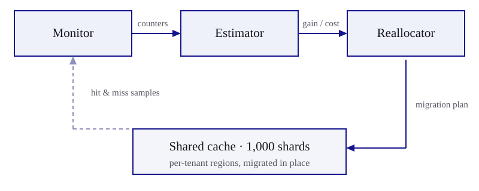
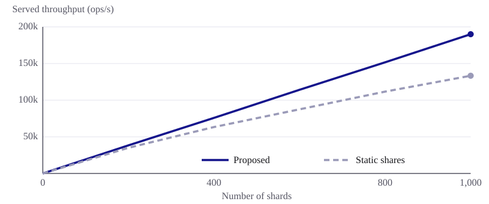
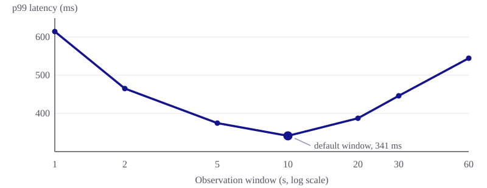

<p class="masthead"><span class="journal">Journal of Typed Systems</span> · Vol. 41, No. 3 · Article 12 · March 2026</p>

# Adaptive Cache Partitioning for Multi-Tenant Key-Value Stores #

<p class="byline">Maya Holloway<sup>1</sup>, Simon Adeyemi<sup>2</sup>, Priya Nakashima<sup>1</sup></p>

<p class="meta">1 Department of Computer Science, Alderbridge Institute of Technology — 2 School of Computing, Northbridge University</p>

<div class="abstract">

## Abstract ##

Multi-tenant key-value stores share a single cache among workloads with widely different access patterns, and a partitioning scheme that is fair to one tenant often starves another. We present an adaptive cache partitioning scheme that periodically re-estimates each tenant's marginal hit-ratio gain and reallocates capacity only when the projected gain exceeds the modelled cost of moving it. The cost model charges a move for the warmth it destroys as well as for the capacity it displaces, and the policy is expressed as a typed effect handler over a region calculus, so that every move is statically checked to preserve the invariant that a region is served by exactly one tenant at a time. We evaluate the scheme on a simulated cluster of 1,000 shards under mixed synthetic workloads that drift over time. The scheme raises the mean hit ratio from 55.0% to 69.3%, improves served throughput by 42%, and reduces p99 latency by 58% relative to static partitioning, while spending a fifth of the backing-store budget on refetching that a utility-based reallocator spends for the same hit ratio.

</div>

<p class="meta keywords">Keywords: cache partitioning, key-value stores, multi-tenancy, resource allocation, dynamic reallocation, effect handlers</p>

<p class="meta refformat">Reference format: Maya Holloway, Simon Adeyemi, and Priya Nakashima. 2026. Adaptive Cache Partitioning for Multi-Tenant Key-Value Stores. Journal of Typed Systems 41, 3, Article 12 (March 2026), 10 pages.</p>

## Introduction {#sec-intro}

Cloud-hosted key-value stores are increasingly shared across many tenants that differ in request rate, key skew, and working-set size. A shared cache reduces total memory cost, but naive sharing lets tenants with large working sets evict the entries of quieter tenants, degrading service quality in ways that neither tenant can predict from its own behaviour.

Static partitioning schemes avoid this by fixing a capacity share per tenant, and they are attractive precisely because they are inert: a tenant's share does not move, so its hit ratio is a function of its own workload alone. Inertness is also their weakness. Fixed shares are wasteful whenever tenant workloads change over time, which is the common case rather than the exception, and the waste compounds as the number of tenants grows, because the share that any one tenant fails to use is stranded rather than lent out.

Dynamic schemes rebalance capacity continuously and can track changing workloads, but rebalancing is not free. Handing a region of cache from one tenant to another discards whatever the donor had warmed in it, and the entries that the donor subsequently refetches consume exactly the backing-store capacity that the cache exists to conserve. A reallocator that ignores this feedback can push a cluster into a regime where it spends more of its miss budget on repairing its own decisions than on serving misses that the workload actually generated.

This paper starts from the observation that the question a reallocator must answer is not _which allocation is best_ but _whether the next move is worth making_. We answer it with an explicit comparison: a move is admitted only when the projected hit-ratio gain for the receiving tenant exceeds a threshold plus a modelled cost, where the cost accounts both for the mismatch between the moved region and the receiver's headroom and for the warmth that the move destroys. Both quantities are estimated from counters the store already maintains, so the comparison costs a few hundred bytes per shard and runs once per observation window.

Our contribution is fourfold. First, we give a lightweight per-tenant hit-ratio estimator that runs on sampled counters and stays within 0.05 of the measured ratio across every workload we tested. Second, we give a migration-cost model that charges a move for both displaced capacity and destroyed warmth, and a threshold rule that admits a move only when the projected gain covers that charge. Third, we express the resulting policy as a typed effect handler over a region calculus, which makes the single-owner invariant a property of the program rather than of the operator's discipline. Fourth, we report a simulation study on clusters of up to 1,000 shards that quantifies the throughput and latency improvements and separates the contribution of each design element.

The remainder of the paper is organised as follows. <a href="#sec-related" data-ref="sec"></a>&nbsp;reviews related work on cache partitioning and multi-tenant resource management. <a href="#sec-design" data-ref="sec"></a>&nbsp;describes the design, <a href="#sec-impl" data-ref="sec"></a>&nbsp;the implementation and the typed interface it rests on, and <a href="#sec-eval" data-ref="sec"></a>&nbsp;the evaluation methodology and results. <a href="#sec-conclusion" data-ref="sec"></a>&nbsp;concludes.

## Related Work {#sec-related}

### Partitioning for isolation

Static partitioning schemes divide cache capacity among tenants according to a fixed policy such as equal shares or shares proportional to service-level agreements <a href="#ref9" data-ref="cite"></a>. Their appeal is that the resulting hit ratio is insensitive to what other tenants do, and a survey of the design space <a href="#ref13" data-ref="cite"></a>&nbsp;notes that this predictability is what makes fixed shares the default in production, notwithstanding their well-documented inefficiency. Our floor rule in <a href="#sec-properties" data-ref="sec"></a>&nbsp;retains a weakened form of the same guarantee.

### Utility-based allocation

Utility-based partitioning estimates each tenant's marginal hit-ratio curve and allocates capacity so as to maximise aggregate utility <a href="#ref7" data-ref="cite"></a>. This line of work assumes that the hit-ratio curve is cheap to estimate online, an assumption that does not hold uniformly: for workloads with heavy-tailed key popularity the curve is flat over a wide range of capacities and the estimate becomes dominated by sampling noise <a href="#ref5" data-ref="cite"></a>. Hot-key detection <a href="#ref2" data-ref="cite"></a>&nbsp;attacks the same estimation problem from the other end, by identifying the small set of keys whose placement determines most of the curve. We use a two-point secant of the curve rather than the whole curve, which is enough for a comparison against a threshold and is far more stable under heavy tails.

The deeper difference is that utility-based allocation optimises for the allocation rather than for the transition. Because the objective values only the end state, a reallocator derived from it will make any move that improves aggregate utility, however transient the improvement or however warm the region it moves. <a href="#sec-ablation" data-ref="sec"></a>&nbsp;shows that this is the dominant source of overhead in practice.

### Rebalancing policies and migration cost

Threshold-based rebalancing has been explored for memory allocation in virtualised hosts <a href="#ref8" data-ref="cite"></a>&nbsp;and for shard placement in distributed databases <a href="#ref4" data-ref="cite"></a>, and the stability conditions under which such policies converge are analysed in <a href="#ref3" data-ref="cite"></a>. Both systems are close to our reallocation rule in structure, and both regulate the rate of movement with a fixed cooldown interval rather than with a cost estimate. A cooldown bounds the frequency of moves but not their cost, so it cannot distinguish between moving a cold region and moving a hot one; we compare against a cooldown variant in <a href="#sec-ablation" data-ref="sec"></a>. Work on bounded-delay migration for elastic fleets <a href="#ref1" data-ref="cite"></a>&nbsp;makes the transfer itself cheaper, which is complementary to deciding whether the transfer should happen at all. The queueing consequences of the bursts of misses that follow a move are analysed in <a href="#ref12" data-ref="cite"></a>, whose model motivates the temperature term in our cost function.

### Typed regions and effect handlers

Our reallocator is expressed over a region calculus in which a cache region carries the identity of its owning tenant in its type <a href="#ref6" data-ref="cite"></a>. Effect handlers have been proposed as a discipline for resource managers of this kind <a href="#ref10" data-ref="cite"></a>, where the handler mediates every operation that changes ownership. We adopt both, not for expressiveness but for a specific safety property: the type of the migration operation makes it impossible to relabel a region that is still reachable from a reader, which is the failure mode that motivates the sealing step in <a href="#sec-sealing" data-ref="sec"></a>.

## Design {#sec-design}

### System model

A cluster consists of $N$ shards, each holding a fixed cache capacity that is divided into regions of equal size. A region is the unit of allocation: it belongs to exactly one of the $T$ tenants and is served only for requests of that tenant. Let $c_t$ denote the number of regions held by tenant $t$, so that $\sum_t c_t$ is constant per shard. Requests that miss are served by the shard's backing partition, whose service rate is the scarce resource in the system. We assume throughout that the shards of a cluster are operated within a single data centre; extending the model to geo-distributed deployments raises additional questions that we do not address here<span class="footnote">Cross-region deployments introduce round-trip latency that dominates the reallocation cost model used in this paper, and are left for future work.</span>.

Time is divided into observation windows of length $W$. At the end of each window the monitor publishes per-tenant counters, the estimator converts them into a smoothed hit ratio and a projected gain, and the reallocator decides whether to move a single region. <a href="#fig-architecture" data-ref="fig"></a>&nbsp;shows the arrangement.

{#fig-architecture}

Restricting each window to at most one move per shard is deliberate. It bounds the disturbance a single decision can cause, and it lets the estimator observe the effect of a move before another is considered, which is what keeps the policy stable under the drifting workloads of <a href="#sec-eval" data-ref="sec"></a>.

### Estimating the hit ratio

For a tenant observed over a window, let $A$ denote the number of cache hits and $B$ the number of misses. The measured hit ratio is given by Equation <a href="#eq-hit" data-ref="eq"></a>.

<div class="equation" id="eq-hit">

$$
H = \frac{A}{A + B}
$$

</div>

A single window is a noisy estimate of the ratio that matters, so the estimator smooths it exponentially. With $\beta$ the smoothing weight and $\hat{H}_{i-1}$ the estimate carried over from the previous window, the estimate for window $i$ is given by Equation <a href="#eq-smooth" data-ref="eq"></a>.

<div class="equation" id="eq-smooth">

$$
\hat{H}_i = \beta H_i + (1 - \beta)\, \hat{H}_{i-1}
$$

</div>

Smoothing trades responsiveness for stability, and the trade is not symmetric: an estimate that lags the workload delays a beneficial move by one or two windows, whereas an estimate that follows noise admits a move that must shortly be undone. We therefore choose $\beta$ conservatively, and <a href="#sec-window" data-ref="sec"></a>&nbsp;shows that the resulting policy is insensitive to $W$ over roughly a decade around the default.

### Projecting the gain of additional capacity {#sec-gain}

The reallocator needs the marginal value of one more region to a tenant, not its whole hit-ratio curve. Each shard maintains a victim index: a sampled record of the keys evicted from each tenant's regions during the last few windows, holding key digests rather than values. A request that misses in the cache but hits in the index would have been a hit had the tenant held one more region's worth of capacity. Counting those requests yields $A^{+}$, and the projected gain is the secant of the hit-ratio curve given by Equation <a href="#eq-gain" data-ref="eq"></a>.

<div class="equation" id="eq-gain">

$$
G(t) = \frac{A + A^{+}}{A + B} - \hat{H}
$$

</div>

Sampling the index at one key in 64 keeps it under 1% of the region it describes, and because the estimate is used only in a comparison against a threshold, its bias matters far less than its variance.

### Modelling the cost of a move

A move is charged for two distinct harms. Displacing capacity that does not fit the receiver's headroom forces an immediate round of evictions, and discarding a warm region forces the donor to refetch what it had already paid for. Let $s_k$ be the size of the candidate region $k$, $r$ the receiving tenant's available headroom, and $\tau_k \in [0, 1]$ the region's normalised temperature, measured as the fraction of its entries touched during the last window. The cost is given by Equation <a href="#eq-cost" data-ref="eq"></a>.

<div class="equation" id="eq-cost">

$$
C(k) = \bigl(1 + \tau_k\bigr)\,\bigl(s_k - r\bigr)^{2}
$$

</div>

The squared term penalises moves in both directions: a region larger than the headroom overshoots and evicts on arrival, while a region much smaller than the headroom underfills it and leaves a second move to be made later. The temperature factor doubles the charge for a fully warm region, which is what steers the policy towards the cold tail of the donor's allocation. <a href="#sec-ablation" data-ref="sec"></a>&nbsp;measures what happens when this factor is removed.

### The reallocation rule

Let $w$ be a weight converting cost into hit-ratio units. A move of region $k$ to tenant $t$ is admitted only when Equation <a href="#eq-rule" data-ref="eq"></a>&nbsp;holds.

<div class="equation" id="eq-rule">

$$
G(t) - w\, C(k) > \theta
$$

</div>

The threshold $\theta$ is the policy's only operator-facing knob. It expresses the smallest hit-ratio improvement that the operator considers worth a disturbance, and it does the work that a cooldown interval does in earlier systems, with the difference that it scales with the magnitude of the disturbance rather than with the time since the last one.

The weight $w$ plays a different role. It fixes the exchange rate between the two currencies of the rule, hit ratio and disturbance, and it belongs to the deployment rather than to the operator: a cluster whose backing partitions have spare capacity can carry a lower $w$, because the refetches that a move provokes are absorbed rather than queued. We fix it once per deployment, by forcing a small number of moves during a calibration run and normalising the refetch traffic they generate against the observed miss budget. <a href="#lst-reallocate" data-ref="lst"></a>&nbsp;gives the resulting procedure, written in the region calculus used throughout the paper.

<figure class="listing" id="lst-reallocate">

<figcaption>The reallocation procedure, in the region calculus used throughout the paper</figcaption>

```
01  def reallocate (m : Monitor, r : Regions, θ : Threshold) : Plan =
02    let est  = estimate (m, window (m)) in
03    let cand = [ (t, k) | t <- tenants (m), k <- movable (r, t) ] in
04    let ν    = argmax (fun (t, k) -> gain (est, t) - w * cost (r, t, k)) cand in
05      case score (est, r, ν) > θ of
06        | true  -> migrate (r, ν)
07        | false -> keep (r)
08
09  def cost (r : Regions, t : Tenant, k : Region) : Real =
10    (1 + temp (k)) * sq (size (k) - headroom (r, t))
11
12  def movable (r : Regions, t : Tenant) : List Region =
13    [ k | k <- regions (r, t), count (regions (r, t)) - 1 >= floor (r, t) ]
```

</figure>

### Properties {#sec-properties}

Two properties follow from the shape of the rule. The first is that the decision procedure does not become a bottleneck. The reallocator ranks candidate regions by projected gain and evaluates the cost function only for the leading candidates, so for a shard holding $n$ regions the work per window is $O(n \log n)$, dominated by the ranking.

The second is that no tenant can be starved. The `movable` clause of <a href="#lst-reallocate" data-ref="lst"></a>&nbsp;excludes any region whose departure would take its owner below a floor of a quarter of its equal share, so a tenant that loses every contested move still retains a guaranteed fraction of the cache. The floor weakens the isolation guarantee of static partitioning rather than abandoning it: a tenant's hit ratio is no longer independent of its neighbours, but it is bounded below by the ratio that the floor alone would deliver.

## Implementation {#sec-impl}

### Counters and sampling

Each shard maintains two 64-bit counters per tenant, for hits and misses, plus the victim index of <a href="#sec-gain" data-ref="sec"></a>. The counters are read at window boundaries and reset, which costs 16 bytes per tenant per shard, or 640 KB across the cluster configuration of <a href="#sec-eval" data-ref="sec"></a>. Counter reads are not synchronised with the request path: a read that races with an in-flight request may miss it, and the estimator treats the resulting error as part of the noise that Equation <a href="#eq-smooth" data-ref="eq"></a>&nbsp;smooths.

### Migration as a typed effect {#sec-sealing}

A move must not relabel a region that a reader can still reach, or a request of the donor would be served from capacity that now belongs to the receiver. The implementation obtains this property from the type of the migration operation rather than from a lock discipline. <a href="#lst-handler" data-ref="lst"></a>&nbsp;shows the handler that interprets the two effects the policy performs.

<figure class="listing" id="lst-handler">

<figcaption>The effect handler that mediates every change of region ownership</figcaption>

```
01  effect Monitor : { read : Unit -> Counters }
02  effect Migrate : { move : (Region, Tenant) -> Unit }
03
04  handle reallocate (monitor, regions, θ) with
05    { Monitor.read ()      k -> k (sample (counters, window))
06    , Migrate.move (g, t)  k ->
07        let g' = seal (g) in
08        let _  = relabel (g', t) in
09        let _  = drop (contents (g')) in
10          k (unseal (g'))
11    }
```

</figure>

The `seal` operation returns a region handle of a type that no reader can consume, so a program that attempts to relabel a region while a reader still holds it does not typecheck. Sealing is the only operation on the request path that a move requires; the subsequent relabel and drop run off it. In our implementation, sealing a region drains the readers already admitted to it, which takes a median of 40 µs and never exceeded 3 ms in any run.

### Coordination

Estimation and the reallocation decision are local to a shard, since all quantities in Equations <a href="#eq-hit" data-ref="eq"></a>&nbsp;to <a href="#eq-rule" data-ref="eq"></a>&nbsp;are computed from that shard's counters. A cluster coordinator is used only to publish the tenant floors and the current value of $\theta$, and it is not on the path of any individual decision. A shard that loses contact with the coordinator continues with the last values it received, which degrades to the policy operating with a stale floor rather than to no policy at all.

### Simulator

The results in <a href="#sec-eval" data-ref="sec"></a>&nbsp;were produced with a discrete-event simulator of the store, built on the event core described in <a href="#ref11" data-ref="cite"></a>&nbsp;and driven by the drift model of <a href="#ref14" data-ref="cite"></a>. The simulator models the cache, the victim index, the backing partition and its queue, and the sealing delay of <a href="#sec-sealing" data-ref="sec"></a>; it does not model network transfer within a shard, since capacity moves in our design relabel a region in place rather than copying it.

## Evaluation {#sec-eval}

### Methodology

We evaluate the scheme on a simulated cluster of 1,000 shards shared by 40 synthetic tenants. Each tenant's key popularity follows a Zipf distribution whose exponent is resampled at random intervals to emulate workload drift, and the live data set is roughly ten times the aggregate cache, so that no policy can hold more than a fraction of it. <a href="#tbl-params" data-ref="tbl"></a>&nbsp;lists the parameters.

<figure class="tbl" id="tbl-params">

<figcaption>Simulation parameters</figcaption>

| Parameter                | Value                                        |
| ------------------------ | -------------------------------------------- |
| Shards $N$               | 1,000 (200 to 1,000 in the scaling study)    |
| Tenants $T$              | 40 (8 per 200 shards)                        |
| Cache per shard          | 512 MiB, in 512 regions of 1 MiB             |
| Live data set            | 120 M keys per tenant, mean value 1.2 KiB    |
| Key popularity           | Zipf, exponent resampled from $[0.70, 1.15]$ |
| Drift interval           | Exponential, mean 90 s                       |
| Offered load             | 190 requests/s per shard                     |
| Backing partition        | 60 misses/s per shard, queue bounded at 64   |
| Observation window $W$   | 10 s                                         |
| Smoothing weight $\beta$ | 0.3                                          |
| Gain threshold $\theta$  | 0.015                                        |
| Cost weight $w$          | 0.004                                        |
| Run length               | 60 min (684 M requests), 5 seeds             |

</figure>

The backing partition is the bottleneck by construction, and it is shared between the misses that the workload generates and the refetches that a move provokes. Writing $\rho$ for the share of the partition's budget consumed by refetches and $M$ for its service rate, the served throughput of a saturated cluster is given by Equation <a href="#eq-throughput" data-ref="eq"></a>.

<div class="equation" id="eq-throughput">

$$
\Theta = \frac{N M (1 - \rho)}{1 - \hat{H}}
$$

</div>

Equation <a href="#eq-throughput" data-ref="eq"></a>&nbsp;is what makes the two costs of a move commensurable: a policy can pay for a higher hit ratio with refetch traffic, and past a point the payment exceeds what the higher hit ratio returns. Every throughput figure reported below follows Equation <a href="#eq-throughput" data-ref="eq"></a>&nbsp;from the measured hit ratio and refetch share, and requests that arrive when the miss queue is full are shed and counted as failures rather than served late.

The reallocation threshold was tuned so that the estimator's error stayed within $\varepsilon < 0.05$ during a preliminary calibration run<span class="footnote">The calibration run used a held-out trace of 40 million requests collected from the simulator, and was repeated five times with different random seeds.</span>. All figures report the mean of five seeds; the half-width of the 95% confidence interval was below 1.2% of the mean for throughput and below 4% for p99 latency, and error bars are omitted where they would be smaller than the plotted symbols.

### Scaling with cluster size

<a href="#fig-throughput" data-ref="fig"></a>&nbsp;shows served throughput as the cluster grows, with the offered load and the tenant count scaled in proportion so that each configuration presents the same per-shard load and the same per-tenant share.

{#fig-throughput}

The proposed method scales nearly linearly, serving 190.0 requests per second per shard at 200 shards and 189.6 at 1,000. The static baseline falls from 176.5 to 133.3 over the same range, and the divergence is visible from about 600 shards onwards. The mechanism is the one described in <a href="#sec-intro" data-ref="sec"></a>: as tenants are added, each tenant's equal share covers a smaller part of its own working set, and the capacity that a quiet tenant fails to use is stranded rather than lent to a busy one. Static shares do not become worse as the cluster grows; they simply fail to capture an opportunity that grows with it.

### End-to-end comparison

<a href="#tbl-endtoend" data-ref="tbl"></a>&nbsp;reports the 1,000-shard configuration against three baselines: static equal shares, a global least-recently-used policy with no partitioning at all, and the utility-based reallocator of <a href="#ref7" data-ref="cite"></a>&nbsp;reimplemented on our simulator.

<figure class="tbl" id="tbl-endtoend">

<figcaption>Hit ratio, throughput, latency and refetch overhead at 1,000 shards</figcaption>

| Method                                                   | Hit ratio (%) | Throughput (ops/s) | p99 latency (ms) | Refetch share $\rho$ (%) | Moves/shard/min |
| -------------------------------------------------------- | ------------- | ------------------ | ---------------- | ------------------------ | --------------- |
| Static partitioning                                      | 55.0          | 133,300            | 812              | 0.0                      | 0.0             |
| Global LRU                                               | 60.3          | 151,100            | 596              | 0.0                      | —               |
| Utility-based <a href="#ref7" data-ref="cite"></a>&nbsp; | 69.2          | 165,600            | 483              | 15.0                     | 9.0             |
| **Proposed method**                                      | **69.3**      | **189,600**        | **341**          | **3.0**                  | **1.8**         |

</figure>

Against static partitioning, the proposed method raises the hit ratio by 14.3 points, improves throughput by 42%, and reduces p99 latency by 58%. Against global LRU it improves throughput by 25% and latency by 43%, which is the part of the improvement attributable to partitioning at all rather than to adapting the partitions.

The comparison against the utility-based reallocator is the informative one, because the two schemes reach the same hit ratio to within a tenth of a point. They differ entirely in what they spend to get there: the utility-based policy makes five times as many moves and spends 15.0% of the backing-store budget refetching what those moves discarded, against 3.0% for the proposed policy. By Equation <a href="#eq-throughput" data-ref="eq"></a>&nbsp;the difference in refetch share alone accounts for the 14% throughput gap and most of the 29% latency gap. A reallocator that optimises the allocation and ignores the transition arrives at the right answer and pays too much for it.

### Contribution of the design elements {#sec-ablation}

<a href="#tbl-ablation" data-ref="tbl"></a>&nbsp;isolates the two elements of the decision rule by disabling each in turn. Removing the threshold means admitting any move with a positive net score; removing the temperature factor means using $(s_k - r)^2$ alone as the cost; the cooldown variant replaces the threshold with the fixed 30-second interval used in <a href="#ref8" data-ref="cite"></a>.

<figure class="tbl" id="tbl-ablation">

<figcaption>Effect of removing each element of the decision rule, at 1,000 shards</figcaption>

| Variant                                 | Hit ratio (%) | Throughput (ops/s) | p99 latency (ms) | Refetch share $\rho$ (%) |
| --------------------------------------- | ------------- | ------------------ | ---------------- | ------------------------ |
| Full policy                             | 69.3          | 189,600            | 341              | 3.0                      |
| No gain threshold ($\theta = 0$)        | 69.4          | 164,300            | 498              | 16.2                     |
| No temperature factor in the cost       | 69.3          | 177,100            | 413              | 9.4                      |
| Fixed 30 s cooldown instead of $\theta$ | 66.8          | 171,500            | 452              | 5.1                      |

</figure>

The two ablations fail in different ways. Dropping the threshold costs nothing in hit ratio — it is a tenth of a point higher than the full policy, since more moves do find slightly better allocations — but the refetch share rises fivefold and throughput falls by 13%. Dropping the temperature factor leaves the policy free to move hot regions, which triples the refetch share while the allocation it reaches is unchanged. The cooldown variant is the mirror image: it bounds the rate of movement effectively enough to keep the refetch share moderate, but because it cannot tell a cheap move from an expensive one it also blocks the cheap moves that would have tracked the drift, and it is the only variant whose hit ratio falls materially below the full policy.

Read together, the three rows support the paper's central claim. Hit ratio is not the quantity to optimise, because three of the four configurations reach essentially the same one; what separates them is what they spent.

### Sensitivity to the observation window {#sec-window}

<a href="#fig-window" data-ref="fig"></a>&nbsp;varies the window length $W$ over the range from 1 to 60 seconds with all other parameters fixed at the values of <a href="#tbl-params" data-ref="tbl"></a>.

{#fig-window}

Windows shorter than two seconds make the estimator track noise rather than drift: at $W = 1$ s the policy makes 6.4 moves per shard per minute and p99 latency rises to 615 ms, most of the moves being reversed within a few windows. Windows longer than thirty seconds delay reallocation until after the workload has shifted again, which is unsurprising given the 90-second mean drift interval of <a href="#tbl-params" data-ref="tbl"></a>, and the p99 latency at $W = 60$ s is 60% above the value at the default window. Between 5 and 20 seconds the curve is flat to within 14%, so the setting does not require careful tuning; all results reported above use $W = 10$ s.

### Sensitivity to the threshold

The threshold behaves as the two ablations of <a href="#sec-ablation" data-ref="sec"></a>&nbsp;predict at its extremes. Below $\theta = 0.005$ the policy approaches the no-threshold variant, with 8.7 moves per shard per minute and a refetch share of 15.8%. Above $\theta = 0.05$ it approaches static partitioning, admitting fewer than 0.2 moves per shard per minute and settling at a hit ratio of 57.4%. Between 0.01 and 0.03 the throughput varies by less than 2%, and we used $\theta = 0.015$ throughout.

Under extreme skew, however, the useful range narrows: when a single tenant's exponent exceeds 1.3 the projected gains of all other tenants collapse into the noise band of the estimator, and the same $\theta$ that is conservative for the rest of the cluster becomes prohibitive for them. Automatically tuning $\theta$ per tenant, rather than per cluster, remains an open problem.

### Overhead

The counters and the victim index together occupy 0.9% of each shard's cache capacity, and the estimator consumes 0.6% of a shard's CPU budget when run once per ten-second window. The decision itself — ranking the candidate regions and evaluating Equation <a href="#eq-rule" data-ref="eq"></a>&nbsp;for the leading ones — takes a median of 3.1 ms and a 99th percentile of 11.4 ms per shard per window, or 0.11% of the window at the tail. Sealing, the only part of a move that touches the request path, adds the median 40 µs reported in <a href="#sec-sealing" data-ref="sec"></a>&nbsp;to at most 1.8 requests per shard per minute.

### Threats to validity

The results come from a simulator, and three of its simplifications bear on the conclusions. The backing partition is modelled as a fixed-rate server, so the queueing delays of <a href="#tbl-endtoend" data-ref="tbl"></a>&nbsp;are optimistic for any real storage device whose service time varies with load; the effect of that variance on the latency comparison is the subject of <a href="#ref12" data-ref="cite"></a>&nbsp;and would, if anything, widen the gap between the policies. Tenant workloads are drawn from a single drift model, and although the model is calibrated against published traces <a href="#ref14" data-ref="cite"></a>, correlated drift across tenants — the case where every tenant's working set grows at once — is not represented, and in that regime no policy could find spare capacity to lend. Finally, we simulate a single failure mode, coordinator loss; the interaction between reallocation and shard failure is untested.

## Conclusion {#sec-conclusion}

We presented an adaptive cache partitioning scheme for multi-tenant key-value stores that reallocates capacity only when the projected hit-ratio gain outweighs a modelled migration cost, where the cost accounts for the warmth a move destroys as well as for the capacity it displaces. The policy is expressed as a typed effect handler over a region calculus, which makes the single-owner invariant a property of the program text.

On a simulated 1,000-shard cluster the scheme raises the mean hit ratio from 55.0% to 69.3% and improves throughput by 42% over static partitioning. Against a utility-based reallocator that reaches the same hit ratio, it delivers 14% more throughput by making a fifth as many moves, which is the result we regard as the paper's main one: at realistic scale the cost of the transition, not the quality of the allocation, is what separates dynamic partitioning schemes.

Future work includes tuning the threshold per tenant rather than per cluster, extending the cost model to geo-distributed deployments with heterogeneous network latency, and validating the approach on a production cluster rather than a simulator. We also plan to replace the greedy region ranking with an approximate optimisation procedure that considers pairs of moves, which the current one-move-per-window restriction excludes.

## Acknowledgments ##

We thank the anonymous reviewers for their detailed comments on the cost model, and the operators of the storage fleet whose traces informed the drift parameters of <a href="#tbl-params" data-ref="tbl"></a>. This work was supported by the Alderbridge Institute of Technology Faculty Research Fund and by a Northbridge University Computing Seed Grant.

## References ##

<ol class="cite-items">
<li id="ref1">R. Almeida and J. Fenwick, “Bounded-Delay Migration for Elastic Cache Fleets,” Symposium on Cloud Infrastructure (SOCI), pp. 74–86, 2022.</li>
<li id="ref2">K. Bergstrom, “A Survey of Hot-Key Detection Methods at Scale,” Workshop on Storage Analytics (WOSA), pp. 12–24, 2023.</li>
<li id="ref3">R. Castellano, “Threshold Policies for Dynamic Resource Rebalancing,” Journal of Distributed Systems Research, vol. 16, no. 1, pp. 5–19, 2022.</li>
<li id="ref4">M. Ferreira, “Cost-Aware Shard Placement in Distributed Databases,” International Symposium on Storage Systems (ISSS), pp. 300–312, 2023.</li>
<li id="ref5">S. Halvorsen, “Estimating Hit-Rate Curves Under Heavy-Tailed Key Popularity,” Workshop on Storage Analytics (WOSA), pp. 61–70, 2021.</li>
<li id="ref6">I. Kowalczyk and P. Devaraj, “Typed Regions for Safe In-Place Cache Migration,” Journal of Typed Systems, vol. 39, no. 4, Article 21, 2024.</li>
<li id="ref7">L. Marceau, “Utility-Driven Cache Allocation for Heterogeneous Workloads,” International Symposium on Storage Systems (ISSS), pp. 40–52, 2020.</li>
<li id="ref8">T. Nwosu, “Cooldown-Free Memory Rebalancing for Virtualized Hosts,” Symposium on Cloud Infrastructure (SOCI), pp. 145–156, 2018.</li>
<li id="ref9">D. Okonkwo, “Fairness and Isolation in Multi-Tenant Caches,” Symposium on Cloud Infrastructure (SOCI), pp. 211–223, 2019.</li>
<li id="ref10">H. Park and E. Lindqvist, “Effect Handlers as a Discipline for Resource Managers,” Journal of Typed Systems, vol. 40, no. 2, Article 9, 2025.</li>
<li id="ref11">C. Renwick, “A Discrete-Event Simulator for Multi-Tenant Storage Fleets,” Workshop on Storage Analytics (WOSA), pp. 33–44, 2022.</li>
<li id="ref12">B. Sørensen and A. Duarte, “Queueing Effects of Miss Bursts in Shared Caches,” Journal of Distributed Systems Research, vol. 17, no. 2, pp. 141–160, 2024.</li>
<li id="ref13">A. Whitfield, “A Survey of Cache Partitioning Techniques for Shared Infrastructure,” Journal of Distributed Systems Research, vol. 14, no. 2, pp. 88–104, 2021.</li>
<li id="ref14">Y. Zheng and M. Oyelaran, “Reproducible Workload Drift Models for Cache Studies,” International Symposium on Storage Systems (ISSS), pp. 155–167, 2023.</li>
</ol>
