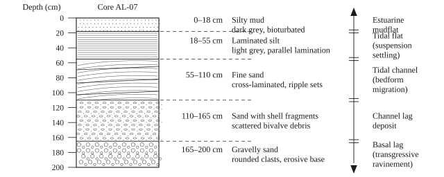

# Methodology {#ch-methodology}

This chapter describes the methodology of the present enquiry and justifies the choice of
techniques. Meteorological records and hydrographic observations were gathered over a period of
eighteen months in the Alderford Estuary, where amplified macrotidal characteristics are observed.
Water level was logged without interruption by pressure sensors accurate to ±1 mm, while currents
were measured by acoustic Doppler current profilers (ADCPs) at three stations (see ).
Sediment sampling was carried out on cores recovered by gravity, combined with integrated dating
methods. The protocol followed the recommendations of the Marlbrook Sedimentology Panel and the
best practice of the Estuarine Coring Initiative.E. Halvorsen and R. Pike, _Handbook of Estuarine Field Methods_, 3rd edn (Wrenfield: Ashgrove Press, 2019), pp. 114–21.

Beyond this, grain-size analyses, geochemical measurements and stable-isotope analyses were
performed in the laboratory, in order to investigate the provenance of the material and to
reconstruct the environmental conditions of deposition. The integration of multiple and independent
approaches permitted the cross-checking of the data and strengthened the interpretative force of
the conclusions drawn in Chapters 5 and 6.

## Field Site and Instrumentation {#sec-field-site-and}

Three monitoring stations were established along the axis of the estuary: AL-A at the head of the
tidal reach, AL-B immediately seaward of the sill at Alderford Narrows, and AL-C in the outer bay.
Each carried a bottom-mounted acoustic Doppler current profiler sampling in 0.25 m bins at 2 Hz,
and a vented pressure sensor logging at one-minute intervals. The instruments were recovered and
redeployed at six-week intervals; data return exceeded 96 per cent at AL-A and AL-B, and 88 per cent
at AL-C, where a mooring was lost in the gale of 14 February.

Suspended sediment concentration was estimated from the acoustic backscatter of the profilers,
calibrated against 214 water samples drawn at slack water and at maximum flood and ebb over eleven
tidal cycles. The calibration was performed separately for each station, since the backscatter
response is sensitive to the particle-size distribution of the suspension and the three stations
differ appreciably in that respect. Residual sediment flux was then computed by integrating the
product of concentration and velocity over complete tidal cycles, a procedure which follows the
recommendation of the Estuarine Coring Initiative that fluxes be reported over whole cycles rather
than over calendar days.

## Sediment Core Sampling Protocol {#sec-sediment-core-sampling}

Sediment cores were collected at high water from predetermined transects across the estuary. A
gravity corer of 90 mm diameter and 1.5 m length was employed, fitted with a transparent acrylic
liner for the preservation of the undisturbed stratigraphy. Penetration was slow and steady, and
the cores were sealed at head and foot within five minutes of recovery. Recovery rates exceeded
ninety per cent at every station save AL-03, where a cobble horizon halted penetration at 74 cm.

In the field the cores were labelled, photographed and chilled in portable cool boxes. In the
laboratory they were sectioned at intervals of 1 cm, and the subsamples were stored in darkness and
under refrigeration until analysis.

<figure id="fig-core-al07">

<figcaption>Stratigraphic profile of core sample AL-07, Alderford Estuary.</figcaption>
</figure>

## Grain-Size Analysis {#sec-grain-size-analysis}

Grain size was determined by laser diffraction on the disaggregated fine fraction and by dry sieving
on the fraction coarser than 1 mm. Organic matter was removed with hydrogen peroxide and carbonate
with dilute hydrochloric acid; samples were dispersed ultrasonically immediately before measurement.
Each subsample was measured three times and the mean distribution retained.

Distributions are reported on the logarithmic $\phi$ scale, in which a diameter $d$ is expressed
relative to a reference diameter $d_0$ of one millimetre:

$$
\phi = -\log_2\!\left(\frac{d}{d_0}\right)
$$

Summary statistics were computed by the method of moments rather than by graphical interpolation,
since the distributions of the laminated units are strongly bimodal and the graphical measures are
unreliable in that case. The mean $M_\phi$ and the sorting $\sigma_\phi$ were obtained from the
frequency $f_i$ of the $i$th size class as

$$
M_\phi = \frac{1}{100}\sum_{i} f_i \phi_i, \qquad
\sigma_\phi = \sqrt{\frac{1}{100}\sum_{i} f_i \left(\phi_i - M_\phi\right)^{2}}
$$

A sample is described below as well sorted where $\sigma_\phi < 0.5$, moderately sorted where
$0.5 \leq \sigma_\phi < 1.0$, and poorly sorted where $\sigma_\phi \geq 1.0$.

## Radiometric Chronology {#sec-radiometric-chronology}

Unsupported 210Pb was determined by alpha spectrometry on its granddaughter
210Po, with 209Po added as a yield tracer; supported activity was taken as the
mean of the five deepest horizons, in each of which the total activity had fallen to within counting
error of a constant value. Where the profile of unsupported activity $A$ against depth $z$ was
adequately described by a single exponential, the linear accumulation rate $r$ was obtained from the
decay constant $\lambda = 0.03114$ a−1 by

$$
r = \frac{\lambda z}{\ln\!\left(A_0 / A(z)\right)}
$$

where $A_0$ is the unsupported activity at the sediment–water interface. The corresponding mass
accumulation rate follows as $R_m = r\,\rho_d$, with $\rho_d$ the dry bulk density measured on the
same interval. Where the profile departed from a single exponential — as it does in the upper 30 cm
of cores AL-04 and AL-07 — a constant-rate-of-supply formulation was substituted, and the inventory
test recommended by Quennell was applied before the resulting ages were accepted.Quennell, 'Inventory completeness', p. 321. The test compares the measured inventory against that predicted from the regional atmospheric flux; a shortfall of more than fifteen per cent was taken here as disqualifying.

Two independent markers were used to check the radiometric chronology. The first is the
137Cs fallout maximum, resolved in every core at a depth consistent with 1963 to within
2 cm. The second is the reclamation horizon of the upper marshes, which appears as an abrupt
coarsening accompanied by a fall of some 40 per cent in organic carbon, and which the estate papers
of the Alderford Commissioners date to the winter of 1888–9.

## Analytical Uncertainty {#sec-analytical-uncertainty}

Uncertainties are reported throughout at one standard deviation unless otherwise stated. For the
grain-size statistics the dominant term is the reproducibility of the dispersion step, estimated
from thirty replicate preparations at $\pm 0.14\,\phi$ on the mean and $\pm 0.09\,\phi$ on the
sorting. For the radiometric ages the dominant term is counting statistics in the lowest-activity
horizons, which propagates to between four and eleven years at 150 cm depth depending upon the core.
The uncertainty attaching to the 137Cs and reclamation markers is stratigraphic rather
than analytical, and is taken as half the sampling interval, that is $\pm 0.5$ cm.

No attempt has been made to combine these three chronologies into a single age–depth model. They are
reported separately in , and the extent of their agreement is itself treated as a result.
