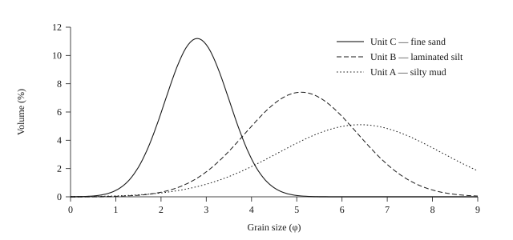

# Results {#ch-results}

## The Modern Hydrodynamic Regime {#sec-the-modern-hydrodynamic}

The tidal wave entering the Alderford Estuary is markedly distorted by the sill at Alderford
Narrows. At AL-C, in the outer bay, the flood and the ebb are of nearly equal duration, the mean
difference over the deployment being eleven minutes. At AL-B, immediately landward of the sill, the
flood is shorter than the ebb by fifty-four minutes at springs, and the peak flood velocity exceeds
the peak ebb velocity by 0.31 m s−1. At AL-A, at the head of the tidal reach, the
asymmetry is greater still.

The residual sediment flux computed from these records is directed landward at AL-A and AL-B and
seaward at AL-C, and the reversal occurs within a distance of 1.8 km. The magnitude of the residual
at AL-B, 0.42 t m−1 per spring–neap cycle, is an order of magnitude greater than the
fluvial supply estimated from the gauged discharge of the Alderford Water over the same interval.
The estuary is, on this evidence, importing sediment from the outer bay and redistributing sediment
already resident within it, and is doing so at rates that make the catchment contribution
negligible.

## Stratigraphy and Grain Size {#sec-stratigraphy-and-grain}

The twelve cores resolve five lithological units, which are laterally persistent across all four
transects and which are illustrated for core AL-07 in . Their grain-size statistics are
summarised in .

<figure id="tbl-grainsize">

| Unit | Depth (cm) | Lithology      | $M_\phi$ | $\sigma_\phi$ | Sorting  |
| ---- | ---------- | -------------- | -------- | ------------- | -------- |
| A    | 0–18       | Silty mud      | 6.42     | 1.82          | Poor     |
| B    | 18–55      | Laminated silt | 5.11     | 1.24          | Moderate |
| C    | 55–110     | Fine sand      | 2.79     | 0.71          | Good     |
| D    | 110–165    | Shelly sand    | 2.14     | 1.08          | Moderate |
| E    | 165–200    | Gravelly sand  | 0.86     | 1.94          | Poor     |

<figcaption>Grain-size statistics by lithological unit, core AL-07. Values are means of three determinations; uncertainties are ±0.14 φ on the mean and ±0.09 φ on the sorting.</figcaption>
</figure>

The frequency distributions of the three uppermost units are given in . Unit C is
unimodal and well sorted, as would be expected of material deposited from traction under a
consistent flow regime. Unit B is moderately sorted and weakly bimodal, the subordinate mode lying
at approximately 3 φ; this is the signature of the alternation of silt and fine-sand laminae
described below. Unit A is poorly sorted and strongly bimodal, and is interpreted as a bioturbated
mixture of the two.

<figure id="fig-grainsize">

<figcaption>Grain-size frequency distributions for units A, B and C of core AL-07.</figcaption>
</figure>

Within Unit B the laminae are of centimetre scale and occur in couplets of graded silt and fine
sand. Counting the couplets across the eleven best-preserved intervals of core AL-07 gives a mean of
27.4 couplets per 10 cm, with a standard deviation of 2.1. If each couplet is taken to record a
single spring–neap cycle, the implied accumulation rate over Unit B is 3.9 mm a−1, which
is within uncertainty of the radiometric estimate reported in the following section.

## Accumulation Rates {#sec-accumulation-rates}

The radiometric results are set out in . In every core the unsupported 210Pb
profile is adequately described by a single exponential below 30 cm, and the inventory test is
satisfied in all but AL-03, where the truncation of the section at 74 cm is presumed to have
removed part of the record.

<figure id="tbl-rates">

| Core  | Interval (cm) | Rate (mm a−1) | Method | Marker check    |
| ----- | ------------- | ------------------------ | ------ | --------------- |
| AL-04 | 0–30          | 4.16 ± 0.21              | CRS    | 1963 at 24 cm   |
| AL-04 | 30–150        | 1.42 ± 0.09              | CIC    | 1888–9 at 61 cm |
| AL-07 | 0–30          | 4.08 ± 0.18              | CRS    | 1963 at 25 cm   |
| AL-07 | 30–150        | 1.38 ± 0.07              | CIC    | 1888–9 at 59 cm |
| AL-11 | 0–30          | 3.94 ± 0.24              | CRS    | 1963 at 23 cm   |

<figcaption>Accumulation rates from unsupported 210Pb, with independent marker horizons. Uncertainties are one standard deviation and derive principally from counting statistics.</figcaption>
</figure>

Two features of the table deserve emphasis. The first is the consistency between cores: the three
outer cores agree upon a post-1880 rate of approximately 4 mm a−1 and a pre-1880 rate of
approximately 1.4 mm a−1, and the difference between the two is far larger than the
uncertainty attaching to either. The second is the agreement between the radiometric ages and the
reclamation horizon. In both AL-04 and AL-07 the coarsening horizon that the estate papers date to
1888–9 falls within 3 cm of the depth predicted by extrapolating the pre-1880 rate, which is a
stringent test given that the two chronologies share no assumptions whatever.The comparison is stringent precisely because the estate papers were consulted only after the radiometric chronology had been finalised. I am grateful to Dr Bramfitt for insisting upon this order of work.

The threefold increase in accumulation rate is therefore securely dated to the closing decades of
the nineteenth century, and coincides with the completion of the reclamation of the upper marshes.
Its interpretation is the subject of .

## Geochemical Provenance {#sec-geochemical-provenance}

The ratio of titanium to aluminium, taken here as an index of the terrigenous fraction, falls by
23 per cent across the reclamation horizon in AL-04 and by 19 per cent in AL-07, while the
carbonate content rises correspondingly. Both changes are in the direction expected of an increased
marine contribution. The stable-isotope record is consistent: δ13C of the bulk organic
fraction shifts from −26.4 ‰ below the horizon to −23.1 ‰ above it, and δ15N shifts in
the same sense, though by a smaller margin.

These signals are, however, individually weak, and each admits of an alternative reading. A fall in
the terrigenous index would also follow from the diversion of the Alderford Water into its present
cut, which the estate papers place in the same decade; and the isotopic shift is of a magnitude that
the reclamation of the marshes could produce directly, simply by removing a source of terrestrial
organic matter. The geochemistry is therefore reported here as corroborative rather than as
diagnostic, and the weight it can bear is considered further in .
