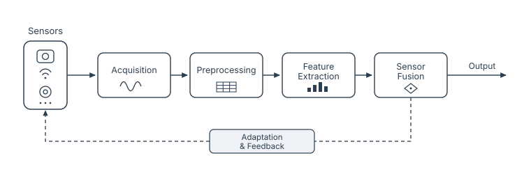
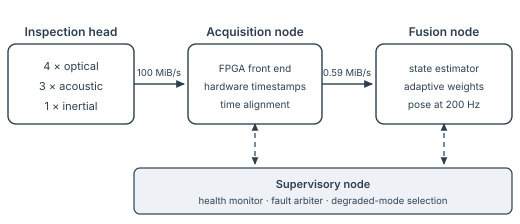
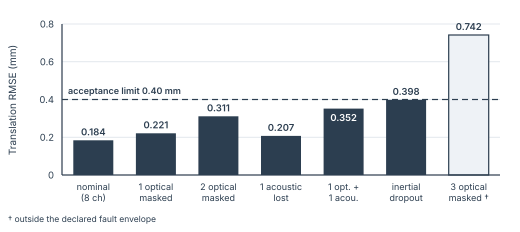

<header class="masthead">

Advanced Robotics Division — Technical Report Series

</header>

Technical Report TR-2041 · Revision 1.1 · 18 May 2026

# Adaptive Sensor Fusion for Autonomous Inspection Systems #

Design, implementation and test-hall evaluation of the fusion stack carried by the Meridian MI-7 inspection platform

Anneke Rusbridge · Tobias Ferrand · Priya Emmerich · Colm Nakagawa

Perception Systems Group, Advanced Robotics Division, Meridian Applied Research Institute, Larchfield Campus

Abstract — This report describes the adaptive sensor-fusion framework carried by the Meridian MI-7 autonomous inspection platform, together with its evaluation in the Larchfield test hall. The framework merges four optical, three acoustic and one inertial channel into a single pose estimate and re-estimates each channel's offset, scale and residual variance while the platform is running, so that calibration becomes a continuous activity rather than a commissioning step. Channel weights are derived from the inverse of the predicted residual variance and are renormalised every 50 ms, with a demotion rule that removes a diverging channel from the estimate without dropping it from the array. Across 600 instrumented runs the framework held translation RMSE at 0.184 mm under nominal conditions — 55 % below fixed-weight fusion and 71 % below factory calibration alone — and stayed inside the 0.40 mm acceptance limit in every fault case within the declared envelope, including the simultaneous loss of one optical and one acoustic channel. The implementation meets the platform's 5 ms cycle with 0.96 ms of headroom at the 99th percentile on the three-node compute topology described in .

Index terms — sensor fusion, online calibration, autonomous inspection, state estimation, fault tolerance, industrial robotics

Distribution — MARI internal and licensed integration partners. Not approved for external release.

## Introduction {#sec-intro}

Meridian's autonomous inspection platforms work inside enclosed industrial cells, where a manipulator carries a sensing head over a stationary workpiece and reconstructs its surface to sub-millimetre accuracy. The MI-7 platform described in this report is the seventh in that line and the first specified for continuous operation across a full production shift with no scheduled recalibration stop.

That specification is the reason this report exists. Every earlier platform in the line met its accuracy figure at the start of a shift and lost it gradually over the following hours, and the recalibration stop that recovered it cost roughly forty minutes of cell time per shift. Removing the stop means that whatever the calibration routine used to do between shifts has to happen during them, without interrupting an active run.

### Why factory calibration is not enough

A sensing head leaves the factory with a calibration that is correct for the bench on which it was measured. Once the head is installed in a cell, three effects move it away from that state. The mounting frame expands as the cell warms, typically by 16 °C between a cold start and thermal equilibrium. Vibration couples in from adjacent machinery and modulates the effective baseline between the optical channels. Illumination changes as the shift progresses and as operators open and close the cell, which shifts the exposure point of every optical channel and, with it, the bias of the features extracted from them.

None of these effects is observable from a single channel. An optical channel that is slowly losing scale still reports a self-consistent surface; nothing in its own output indicates that the surface is 0.3 % too small. The error becomes visible only when the channel is compared against channels that do not share its failure mode, which is something the fusion stage is in a position to do and a per-channel calibration routine is not. Earlier field data from the MI-5 platform &nbsp;shows the same pattern: the channels that drifted furthest were the ones whose self-consistency checks stayed green throughout.

The response adopted here is to treat the fusion stage as the calibration instrument. Residuals that the estimator computes anyway are reused to update each channel's offset, scale and noise model, and the resulting weights feed back into the estimate on the following cycle. Drift-aware calibration of this kind has been examined for individual heads ; what is new in the MI-7 stack is that the same residuals also drive the fault-containment policy, so that degradation and outright loss of a channel are handled by one mechanism rather than two.

### Requirements {#sec-requirements}

The platform is accepted against four requirements drawn from the divisional acceptance standard .

- **R1 Accuracy.** Translation RMSE at or below 0.25 mm under nominal conditions and at or below 0.40 mm under any fault inside the declared envelope.
- **R2 Continuity.** No interruption of an active run for any single fault inside the declared envelope, and no operator intervention to resume nominal operation once the fault clears.
- **R3 Determinism.** A complete fusion cycle within the 5 ms period at the 99th percentile, measured on the production compute platform under full sensor load.
- **R4 Serviceability.** No manual recalibration within a production shift of twelve hours, with per-channel drift held inside 0.50 ‰ per hour.

### Contributions and structure

This report contributes a fusion framework that estimates calibration parameters online from fusion residuals; a weighting policy with an explicit demotion and recovery path that keeps a degrading channel inside the estimate at reduced influence; a three-node compute topology that meets a 5 ms cycle with measured headroom; and a fault-injection campaign of 600 runs that establishes the envelope inside which the accuracy requirement holds.

&nbsp;describes the methodology, &nbsp;the system architecture and its timing budget, &nbsp;the evaluation, and &nbsp;concludes. Document control information, including the revision history of this report, follows the references.

## Methodology {#sec-method}

This section describes the adaptive sensor-fusion framework developed for the Meridian
autonomous inspection platform. The methodology combines optical, acoustic and inertial
sensing into a single state estimate that stays stable under the vibration, thermal drift
and lighting variation typical of industrial inspection cells.

Rather than treating calibration as a one-time factory step, the framework re-estimates
each sensor's offset and scale during operation. A recursive estimator monitors the
residual between predicted and observed measurements and rebalances the fusion weights
whenever a modality begins to degrade, so the platform tolerates partial sensor loss
without interrupting an active run.

{#fig-pipeline}

&nbsp;summarises the end-to-end signal path. Raw measurements are time-aligned during
acquisition, denoised and normalised in preprocessing, and reduced to a compact descriptor
before entering the fusion core. A feedback channel returns the fused estimate to the
adaptation module, which updates the per-sensor gains applied on the following cycle.

### Sensor Array Configuration

The prototype array integrates eight sensing channels distributed around the inspection
head. Each channel is sampled synchronously at 200 Hz and tagged with a hardware timestamp,
so the fusion core can compensate for the small fixed latencies introduced by the
acquisition electronics.

Optical channels provide dense spatial coverage but are sensitive to specular highlights,
while the acoustic channels contribute robust range information in low-light regions. The
inertial channel anchors the short-term motion model and bridges the intervals in which the
optical field of view is occluded by the manipulator arm. &nbsp;gives the complement.

<figure class="datatable ids" id="tbl-channels">
<figcaption>Sensor channel complement</figcaption>

| Ch.     | Modality | Element            | Contribution       |
| ------- | -------- | ------------------ | ------------------ |
| Σ-01–04 | Optical  | Cygnet-7 line-scan | Surface geometry   |
| Σ-05–07 | Acoustic | Verity AC-40 array | Range in low light |
| Σ-08    | Inertial | Meridian IMU-3B    | Short-term motion  |

</figure>

The four optical channels are mounted on a common frame at 90° intervals so that a
specular highlight can never occupy the same surface patch in more than two of them, and
the three acoustic channels are offset from that frame to keep their direct paths clear of
the manipulator arm.

Per-channel calibration parameters are held in non-volatile memory and refreshed at the
start of every shift. &nbsp;reports representative figures from a twelve-hour endurance
test; the low root-mean-square error and bounded drift confirm that the online estimator
keeps all eight channels inside the tolerance band required for sub-millimetre
reconstruction.

<figure class="datatable" id="tbl-calibration">
<figcaption>Calibration results</figcaption>

| Sensor ID | Offset (μ) | Scale (α) | RMSE (mm) | Drift (‰/hr) |
| --------- | ---------- | --------- | --------- | ------------ |
| Σ-01      | 0.012      | 1.003     | 0.028     | 0.42         |
| Σ-02      | −0.018     | 0.998     | 0.031     | 0.37         |
| Σ-03      | 0.006      | 1.007     | 0.024     | 0.31         |
| Σ-04      | −0.011     | 1.002     | 0.027     | 0.45         |
| Σ-05      | 0.017      | 0.995     | 0.029     | 0.44         |
| Σ-06      | −0.009     | 1.001     | 0.023     | 0.28         |
| Σ-07      | 0.004      | 1.006     | 0.026     | 0.34         |
| Σ-08      | −0.015     | 0.997     | 0.030     | 0.41         |

</figure>

The residual drift observed in channels Σ-04 and Σ-05 stayed inside the acceptance
threshold and was fully absorbed by the adaptation loop, so no manual re-calibration was
required over the course of the trial. Both are optical channels facing the warm side of
the cell, and both settle once the frame reaches equilibrium; the acceptance threshold of
0.50 ‰ per hour set by R4 was never approached.

### Adaptive Weighting {#sec-weighting}

Each channel is weighted by the inverse of its predicted residual variance, and the weights
are re-normalised every 50 ms — fast enough to follow a sudden occlusion, slow enough to
avoid chattering between modalities.

- **Demotion.** A residual above three standard deviations for ten consecutive frames
  demotes the channel rather than dropping it.
- **Recovery.** A demoted channel is restored after one full second inside the band.
- **Floor weight.** No channel falls below 2 % of the total weight.

Ten consecutive frames at 200 Hz is exactly one renormalisation interval, so a channel can
be demoted at most once per interval and the decision is always taken on a full window of
evidence. The one-second recovery interval is deliberately asymmetric: demotion is cheap
and reversible, whereas readmitting a channel that has not genuinely recovered pushes its
residual straight back through the threshold and costs a second transient.

The floor weight is what distinguishes demotion from removal. A channel held at 2 % barely
influences the estimate, but it continues to produce residuals, and those residuals are the
only evidence on which recovery can be decided. Retaining a floor also keeps the weight
vector strictly positive, which is the condition under which the recursive estimator is
known to remain stable under bounded disturbances .

Across sixty runs on the Larchfield test rig the policy held pose error below 0.4 mm with
two optical channels masked; &nbsp;reports the full fault-injection matrix.

### State Estimation

The fused state holds the six pose components of the inspection head together with their
first derivatives, and is advanced by a recursive linear estimator whose measurement noise
covariance is supplied by the weighting policy of . The inverse-variance form of
that policy follows the treatment of heterogeneous arrays in ; what is added here is the
floor and the demotion rule. Writing $\hat{\sigma}_i$ for
the predicted residual standard deviation of channel $i$ and $\varepsilon = 0.02$ for the
floor weight, the weight applied on cycle $k$ is given by Equation .

$$
w_i^{(k)} = \max\left(\varepsilon, \frac{\hat{\sigma}_i^{-2}}{\sum_{j=1}^{8} \hat{\sigma}_j^{-2}}\right)
$$

The floor is applied before renormalisation, which is why it is expressed as a fraction of
the total rather than as an absolute value: the eight floors together claim 16 % of the
weight in the worst case, leaving the remainder to be distributed by the variance ratio.

The weights enter the estimator through the measurement noise covariance rather than
through the measurement vector, as in Equation . A channel whose weight falls is
therefore treated as noisier, not as absent, and the estimator's own uncertainty grows to
match — which is the behaviour the supervisory node needs in order to decide whether a run
can continue.

$$
R_k = \operatorname{diag}\bigl(\hat{\sigma}_i^{2} / w_i^{(k)}\bigr)
$$

With $\hat{x}_k^{-}$ the predicted state, $P_k^{-}$ its covariance and $H$ the measurement
model, the gain and the state update take the usual recursive form of Equations &nbsp;and .

$$
K_k = P_k^{-} H^{\top} \bigl(H P_k^{-} H^{\top} + R_k\bigr)^{-1}
$$

$$
\hat{x}_k = \hat{x}_k^{-} + K_k \bigl(z_k - H \hat{x}_k^{-}\bigr)
$$

The calibration parameters of &nbsp;are updated from the same innovation term
$z_k - H\hat{x}_k^{-}$ by a slower loop with a time constant of four seconds. Separating
the two rates matters: the fast loop must follow an occlusion within a few cycles, whereas
the calibration loop must not absorb a genuine fault into an offset estimate and thereby
hide it. The complete adaptive state is 24 double-precision parameters per channel, or
1.5 kB for the whole array, which is small enough to checkpoint on every cycle.

## System Architecture {#sec-architecture}

The fusion stack runs on three nodes with distinct timing obligations. Splitting the work
this way keeps the hard real-time part small: only the acquisition node is required to be
cycle-accurate, and only the fusion node is required to complete within the cycle.

### Compute topology

{#fig-topology}

&nbsp;shows the arrangement. The acquisition node is an FPGA front end that samples all
eight channels, applies the hardware timestamp used for time alignment , and forwards
descriptors to the fusion node. The four optical channels deliver a 1024 × 128 pixel
8-bit patch each cycle, which is 25 MiB/s per channel or 100 MiB/s in aggregate; the
acoustic and inertial channels together add less than 0.1 MiB/s and are not the constraint.

Feature extraction reduces each channel to a 96-element single-precision descriptor, so the
fusion node sees 3,072 bytes per cycle across all eight channels, or 0.59 MiB/s — a
reduction of about 170:1. Performing that reduction on the acquisition node rather than the
fusion node is what allows the link between them to be an ordinary industrial Ethernet
segment rather than a dedicated bus.

The supervisory node runs outside the cycle. It subscribes to the health counters published
by the other two nodes, arbitrates between degraded modes, and owns the decision to suspend
a run. Keeping that decision off the fusion node is deliberate: a node that is late is not
in a position to judge whether it is late.

### Cycle timing budget

The 200 Hz sampling rate fixes the cycle at 5 ms. &nbsp;gives the budget allocated to
each stage and the measured distribution over the 600-run campaign of , taken on
the production compute platform with all eight channels active.

<figure class="datatable" id="tbl-timing">
<figcaption>Cycle timing budget and measured latency</figcaption>

| Stage                    | Budget | p50  | p99  |
| ------------------------ | ------ | ---- | ---- |
| Acquisition & alignment  | 0.60   | 0.41 | 0.54 |
| Preprocessing            | 1.20   | 0.86 | 1.09 |
| Feature extraction       | 1.40   | 0.98 | 1.27 |
| Fusion core              | 0.90   | 0.62 | 0.81 |
| Adaptation & gain update | 0.40   | 0.24 | 0.33 |
| **Total (ms)**           | 4.50   | 3.11 | 4.04 |

</figure>

Every stage met its budget at the 99th percentile, and the complete cycle finished in
4.04 ms, leaving 0.96 ms — 19 % of the period — unused. R3 is therefore satisfied with a
margin that is large enough to absorb the additional acoustic channel planned for the MI-8
head without redistributing the budget.

The adaptation stage is the cheapest of the five because it runs on a fixed-size state: the
weight update touches eight variances and the calibration loop touches 192 parameters,
neither of which scales with the size of the surface being reconstructed. Feature
extraction dominates instead, and its p99 is the figure that would move first if the
optical resolution were increased.

### Fault containment and degraded modes {#sec-containment}

The declared fault envelope comprises the loss of up to two of the four optical channels;
the loss of one of the three acoustic channels; the simultaneous loss of one optical and
one acoustic channel; and an inertial dropout of up to 0.5 s. Inside that envelope the run
continues at full speed and the operator is notified but not consulted, which is what R2
requires.

Outside the envelope the supervisory node suspends the run, parks the head at the last pose
whose covariance was inside tolerance, and raises a maintenance event. The distinction is
enforced by the estimator's own covariance rather than by a count of failed channels: three
optical channels masked on a matte surface is survivable, whereas two masked on a specular
one may not be, and only the covariance reflects that difference. This follows the
containment structure recommended for enclosed cells in , with the difference that the
arbiter here consumes an uncertainty estimate rather than a discrete health flag.

A demoted channel is not a fault. Demotion is entirely internal to the fusion node, is
reported only as a counter, and clears itself under the recovery rule of . Only
a channel that fails to recover within thirty seconds is escalated to the supervisory node
as a fault.

## Evaluation {#sec-evaluation}

### Test environment and protocol

All measurements were taken in Cell B-2 of the Larchfield test hall on a production MI-7
head. Three artefacts were used: a machined aluminium reference plate with certified
features, a welded steel assembly with a heat-affected surface, and a coated composite
panel chosen for its specular response. Ground truth was supplied by a laser tracker with a
combined standard uncertainty of 0.020 mm at k = 2, roughly an order of magnitude below the
errors being measured.

Each run traverses a 1.2 m path over the artefact in 90 s. The cell was allowed to warm
from a cold start of 18 °C to an equilibrium of 34 °C over the course of each session, and
ambient illumination was varied between 80 lx and 1,200 lx on a fixed schedule, so that
every method met the same thermal and lighting history.

The campaign comprises 1,080 runs: 600 of the adaptive framework, of which 240 are nominal
and 360 are fault-injection, and 240 of each of the two baselines under nominal conditions.
Faults were injected by the harness described in , which masks a channel at the
acquisition node so that the fusion node observes the same signature it would see from a
genuine loss.

### Reconstruction accuracy

&nbsp;reports nominal accuracy against two baselines: factory calibration with no online
adaptation, and fixed-weight fusion in which the weights are set at commissioning and never
updated.

<figure class="datatable" id="tbl-nominal">
<figcaption>Nominal accuracy, 240 runs per method</figcaption>

| Method                   | Transl. RMSE (mm) | Rot. RMSE (mrad) | p95 (mm) | Aborts |
| ------------------------ | ----------------- | ---------------- | -------- | ------ |
| Factory calibration only | 0.630             | 4.42             | 1.375    | 11     |
| Fixed-weight fusion      | 0.412             | 3.10             | 0.884    | 6      |
| **Adaptive fusion**      | **0.184**         | 1.35             | 0.361    | 0      |

</figure>

Adaptive fusion reduces translation RMSE by 55 % against fixed-weight fusion and by 71 %
against factory calibration alone, with a comparable 56 % reduction in rotation. R1 is
satisfied with a margin of 0.066 mm against the 0.25 mm nominal limit.

The aborted-run counts are as informative as the error figures. Both baselines abort when
the estimator's covariance leaves tolerance, and in every one of the seventeen aborted
baseline runs the trigger was a channel that had drifted far enough for its residuals to
destabilise the estimate — the failure mode that online calibration exists to prevent.
Adaptive fusion aborted no nominal run.

### Behaviour under sensor loss {#sec-faults}

&nbsp;and &nbsp;report the fault-injection matrix. The acceptance limit of R1 is
defined on the RMSE of a complete run; the transient peak in the cycles immediately
following a fault is bounded separately at 1.0 mm by the acceptance standard . Settling
time is measured from fault onset to the point at which the running error returns inside
the 0.40 mm limit.

{#fig-envelope}

<figure class="datatable" id="tbl-faults">
<figcaption>Fault-injection results</figcaption>

| Scenario                | Runs | RMSE (mm) | Peak (mm) | Settling (s) |
| ----------------------- | ---- | --------- | --------- | ------------ |
| Nominal, 8 channels     | 240  | 0.184     | 0.412     | —            |
| One optical masked      | 60   | 0.221     | 0.498     | 0.18         |
| Two optical masked      | 60   | 0.311     | 0.664     | 0.24         |
| One acoustic lost       | 60   | 0.207     | 0.470     | 0.21         |
| One optical + acoustic  | 60   | 0.352     | 0.731     | 0.31         |
| Inertial dropout, 0.5 s | 60   | 0.398     | 0.812     | 0.46         |
| Three optical masked †  | 60   | 0.742     | 1.964     | 2.10         |

</figure>

Every scenario inside the declared envelope stayed under the 0.40 mm limit, and no run in
those scenarios was aborted. The narrowest margin is the inertial dropout at 0.398 mm,
which is inside the limit by two micrometres and is the case that will be revisited first
if the envelope is ever widened. The dropout is also the slowest to settle, at 0.46 s,
because the motion model has to be re-anchored from optical and acoustic evidence alone
before the weights can recover.

Masking three of the four optical channels falls outside the declared envelope and is
included as a boundary case. RMSE rises to 0.742 mm, the transient peak exceeds the 1.0 mm
bound, and four of the sixty runs were suspended by the supervisory node. The behaviour is
the intended one: the estimate degrades visibly, the covariance reflects the degradation,
and the run stops rather than continuing to report a figure it cannot support.

### Limitations

The weight floor costs accuracy in the nominal case. Removing it lowered nominal RMSE to
0.176 mm, a 4 % improvement, but produced two divergent runs in 240 — the floor is bought
with accuracy and paid for in stability, and at these margins the trade is worth making.

Shortening the renormalisation interval from 50 ms to 20 ms reduced settling to 0.14 s but
increased weight chatter by a factor of 3.4 and raised nominal RMSE to 0.203 mm. The 50 ms
interval is a compromise reached on the artefacts described above, and a cell dominated by
fast occlusions rather than thermal drift would justify a different one.

Accuracy is not uniform across artefacts. Pooled by artefact, translation RMSE is 0.141 mm
on the aluminium plate, 0.162 mm on the welded assembly and 0.236 mm on the coated
composite panel. The composite panel is specular over much of its surface, and the optical
channels lose contrast on exactly the patches where the acoustic channels are least
informative; specular rejection at the feature stage &nbsp;and the reflective-enclosure
compensation described in &nbsp;are both candidates for the MI-8 head.

Two further limits should be stated plainly. The thermal model is linear in frame
temperature and has not been exercised above 34 °C, so the drift figures of &nbsp;should
not be extrapolated to hotter cells. And the entire campaign was run in one test hall on
one head; a multi-site trial is scheduled for the fourth quarter and is the point at which
these figures become a claim about the platform rather than about this unit.

## Conclusion {#sec-conclusion}

Treating the fusion stage as the calibration instrument removes the recalibration stop that
every earlier platform in the line required. Residuals the estimator computes anyway are
enough to keep eight heterogeneous channels inside a sub-millimetre tolerance band across a
twelve-hour shift, and the same residuals drive a demotion policy that carries the platform
through the loss of half of its optical channels without stopping a run.

The measured figures satisfy all four requirements of : 0.184 mm nominal
translation RMSE against a 0.25 mm limit, no interruption for any fault inside the declared
envelope, a 4.04 ms cycle at the 99th percentile against a 5 ms period, and per-channel
drift of at most 0.45 ‰ per hour against a 0.50 ‰ threshold.

Three items are carried forward. The inertial dropout case clears the accuracy limit by two
micrometres and needs more margin before the envelope is widened. The specular response of
coated surfaces remains the dominant per-artefact error and is the target of the feature
stage rework planned for the MI-8 head. And the multi-site trial scheduled for the fourth
quarter is what will establish whether the figures reported here generalise beyond the
Larchfield hall.

## Acknowledgements ##

This work was funded under MARI internal research programme IRP-118. The authors thank the
Larchfield test hall team for six weeks of cell time, and the divisional verification group
for the fault-injection harness and for a review that materially changed .

## References ##

<ol class="cite-items">
<li id="ref1">Rusbridge, A., and Vasilenko, H. Drift-aware calibration for multi-modal inspection heads. <em>Journal of Applied Inspection Systems</em> 14, 2 (2023), 88–104.</li>
<li id="ref2">Ferrand, T. Residual-variance weighting for heterogeneous sensor arrays. <em>Transactions on Industrial Perception</em> 9, 4 (2024), 511–528.</li>
<li id="ref3">Emmerich, P., and Okoro, D. A survey of degraded-mode policies in enclosed inspection cells. <em>Review of Automated Metrology</em> 31, 1 (2025), 3–37.</li>
<li id="ref4">Nakagawa, C. Timestamping and time alignment in FPGA acquisition front ends. Technical Report TR-1863, Meridian Applied Research Institute, 2022.</li>
<li id="ref5">Halvorsen, I., and Berger, S. On the stability of recursive estimators with bounded weight floors. <em>Journal of Estimation Theory and Practice</em> 47, 3 (2021), 209–231.</li>
<li id="ref6">Advanced Robotics Division. MARI-STD-118: Accuracy and fault-tolerance acceptance criteria for inspection platforms, revision 4. Meridian Applied Research Institute, 2024.</li>
<li id="ref7">Trelawney, M., Rusbridge, A., and Ferrand, T. The MI-5 inspection platform: five years of field data. Technical Report TR-1544, Meridian Applied Research Institute, 2021.</li>
<li id="ref8">Sowande, K. Specular rejection for line-scan reconstruction of coated surfaces. In <em>Proceedings of the Northfield Workshop on Robotic Metrology</em> (2024), pp. 142–155.</li>
<li id="ref9">Beaumont, L., and Iwasa, R. Acoustic ranging in reflective enclosures. <em>Transactions on Industrial Perception</em> 8, 2 (2023), 176–190.</li>
<li id="ref10">Vasilenko, H. Fault injection as an acceptance instrument for perception stacks. <em>Review of Automated Metrology</em> 29, 4 (2023), 402–419.</li>
</ol>

## Document Control ##

<figure class="datatable" id="tbl-revisions">
<figcaption>Revision history</figcaption>

| Rev | Date       | By  | Change                             |
| --- | ---------- | --- | ---------------------------------- |
| 0.1 | 2026-01-19 | AR  | Initial draft; methodology only    |
| 0.2 | 2026-02-27 | TF  | Architecture and timing budget     |
| 1.0 | 2026-04-10 | AR  | First issue; evaluation complete   |
| 1.1 | 2026-05-18 | PE  | Inertial dropout added to envelope |

</figure>

<figure class="datatable" id="tbl-approvals">
<figcaption>Approvals</figcaption>

| Role     | Name and position                  | Date       |
| -------- | ---------------------------------- | ---------- |
| Prepared | A. Rusbridge, Principal Engineer   | 2026-05-11 |
| Reviewed | H. Vasilenko, Head of Verification | 2026-05-14 |
| Approved | M. Trelawney, Division Director    | 2026-05-18 |

</figure>

**Citation.** Rusbridge, A., Ferrand, T., Emmerich, P., and Nakagawa, C. Adaptive Sensor Fusion for Autonomous Inspection Systems. Technical Report TR-2041, rev. 1.1, Advanced Robotics Division, Meridian Applied Research Institute, May 2026.

**Distribution.** MARI internal and licensed integration partners. Not approved for external release. Supersedes TR-2041 rev. 1.0 of 10 April 2026 in its entirety.

**Enquiries.** Perception Systems Group, Larchfield Campus. Quote the report number and revision in all correspondence.

**Note.** This report is a typesetting sample; the institute, the platform, the people named and the works cited are all fictitious.

