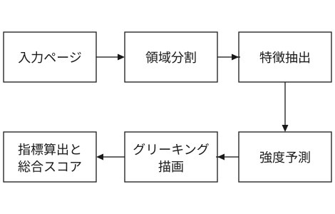
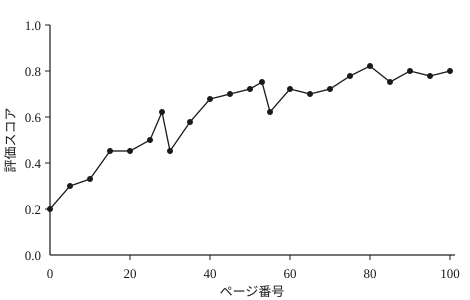
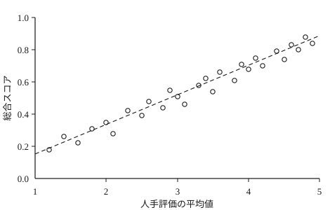

# 適応的グリーキングによる紙面レイアウト自動評価手法

<div class="frontmatter">
<div class="running-journal">日本計算メディア学会論文誌　Vol.19 No.4 (2026)</div>
<p class="subhead">An Automatic Evaluation Method for Page Layout Using Adaptive Greeking</p>
<p class="byline">駒形 遼<span class="footnote">東雲工科大学　情報理工学院</span>　　宇津木 詩織<span class="footnote">湊南義塾大学　理工学部</span></p>
<p class="lead">本研究では，紙面レイアウトの質を自動的に評価する新しい手法を提案する．提案手法は，文字組版のグリーキング量をページの文脈に応じて適応的に制御し，視覚的調和や可読性を定量的に評価する．まず，レイアウト構造と内容特徴を特徴量として抽出し，機械学習モデルにより最適なグリーキングパラメータを予測する．次に，予測されたパラメータを用いて紙面を再構成し，複数の評価指標を統合して総合スコアを算出する．4種類の紙面10,000ページを用いた実験により，提案手法の総合スコアは人手評価と順位相関0.874で一致し，最良の従来法を0.09ポイント上回ることを確認した．さらに，評価結果の解釈性や調整容易性にも優れており，実運用への適用可能性を示す．</p>
<p class="meta">キーワード：紙面レイアウト評価，​自動評価，​グリーキング，​適応的制御，​機械学習</p>
<p class="meta">2026年1月19日受付，2026年4月8日採録</p>
</div>

## はじめに {#sec-intro}

紙面レイアウトの質は，出版物の可読性や印象を大きく左右する重要な要素である．近年，デザイン作業の効率化や客観的評価の必要性から，レイアウトを自動的に評価する技術への関心が高まっている．従来の評価手法は，主に余白や文字サイズなどの幾何学的特徴に基づくルールベースの方法が中心であったが，視覚的な調和や読みやすさを十分に反映できないという課題があった．

評価が難しい理由の一つは，人が紙面を見るとき，組版の見えと文章の内容とを同時に受け取ってしまう点にある．内容が平易であれば窮屈な組版も許容され，内容が難解であれば読みにくさが組版の責に帰せられる．紙面そのものの質を測ろうとする限り，この二つの寄与は分離されねばならない．

一方，文字の字形を捨象して灰色の帯や矩形に置き換えるグリーキングは，内容を伏せたまま紙面の濃度分布とリズムだけを提示する操作であり，組版の質を左右する要因を取り出す手掛かりとなる．デザインの現場でも，レイアウトの検討段階でダミーテキストを用いる慣行が経験的に定着している．しかし，どの程度まで字形を捨象すべきかはページの構造や領域の役割によって異なるため，一律の捨象度では見出しの階層が失われたり，逆に本文の可読性が残りすぎて注意が内容へ向いたりする．固定的な設定では十分な評価が困難である．

そこで本研究では，ページの文脈を考慮してグリーキング量を適応的に制御し，得られた濃度表現の上で紙面レイアウトの質を自動的に評価する手法を提案する．提案手法は，領域分割によって得た各ブロックの役割と近傍の構造から捨象の強度を予測し，その強度で再構成した紙面に対して視覚的調和・可読性・情報密度の3指標を算出したうえで，重み付き和として総合スコアを与える．

本研究の貢献は次の3点である．第一に，グリーキング強度をブロック単位の連続量として定式化し，学習によって決定する枠組みを与えた．第二に，濃度表現の上で定義した3指標により，スコアの内訳を人が読み解ける形で提示できることを示した．第三に，4種類の紙面からなる評価データを構築し，提案手法が既存手法を上回る順位相関を達成することを実験的に確認した．

以下，<a href="#sec-related" data-ref="sec"></a>で関連研究を整理し，<a href="#sec-method" data-ref="sec"></a>で提案手法を述べる．<a href="#sec-experiment" data-ref="sec"></a>で実験設定と結果を示し，<a href="#sec-discussion" data-ref="sec"></a>で考察を加え，<a href="#sec-conclusion" data-ref="sec"></a>でまとめる．

## 関連研究 {#sec-related}

### 紙面レイアウトの自動評価

紙面レイアウトの自動評価に関する研究は，主に視覚的特徴量の抽出と機械学習による予測に大別される．例えば，余白比や情報密度を用いた評価<a href="#cite-1" data-ref="cite"></a>や，視線計測データを用いた可読性予測<a href="#cite-2" data-ref="cite"></a>などが報告されている．前者は計算が軽く解釈もしやすい反面，同じ余白比を持つ整然とした紙面と乱雑な紙面とを区別できない．後者は人の挙動を直接扱う点で説得力があるが，計測の負荷が大きく，大規模な紙面集合には適用しにくい．

近年は，深層学習の発展により，レイアウト画像から高次の視覚特徴を抽出する研究も進んでいる<a href="#cite-3" data-ref="cite"></a>．これらは人手評価との相関を大きく改善したが，スコアの根拠が内部表現に埋もれるため，どこをどう直せばよいかという制作者の問いには答えにくい．また，学習に用いる紙面と評価対象の紙面とで版面設計が異なると性能が低下することも指摘されている<a href="#cite-4" data-ref="cite"></a>．

### グリーキングと視覚的近似

グリーキングは本来，字形の判読を抑えて紙面の構造だけを見せるための表示技法である．ダミーテキストを用いた版面検討が評価者の判断に与える影響については，内容への注意が減ることで構造への注意が相対的に高まるとの報告がある<a href="#cite-5" data-ref="cite"></a>．また，グリーキングを知覚的なフィルタとして定式化し，可読な文字列と灰色の帯との中間状態を連続的に扱う試みも行われている<a href="#cite-6" data-ref="cite"></a>．

タイポグラフィの側からは，文字間隔の最適化に関する知覚モデル<a href="#cite-7" data-ref="cite"></a>や，組版規則に基づく評価方法<a href="#cite-8" data-ref="cite"></a>が提案されてきた．しかし，これらの研究は固定的なパラメータ設定を前提としており，ページ内容に応じた適応的制御については十分に検討されていない．とくに，見出しと本文のように役割の異なる領域を同じ強度で捨象してよいかという点は，これまで正面から扱われていない．

### 本研究の位置づけ

文字を読ませずに紙面の質を推定する試みとしては，文書画像から文字認識を経ずに品質を学習する手法<a href="#cite-9" data-ref="cite"></a>や，多重解像度の濃度記述子を用いる手法<a href="#cite-10" data-ref="cite"></a>がある．これらは本研究と動機を共有するが，捨象の度合いを前処理として固定している点が異なる．また，主観評価の学習には対比較に基づく順位学習が有効であることが知られている<a href="#cite-11" data-ref="cite"></a>．

本研究は，これらの知見を踏まえ，グリーキング強度そのものを学習対象の変数として扱い，適応的制御と多面的評価を単一の枠組みへ統合する点で新規性を有する．

## 提案手法 {#sec-method}

### 全体構成

提案手法の処理の流れを<a href="#fig-pipeline" data-ref="fig"></a>に示す．入力ページはまず領域分割によってブロック集合へ分解され，各ブロックについて特徴量が抽出される．次に，特徴量からブロックごとのグリーキング強度が予測され，その強度に従って紙面が濃度表現へ再構成される．最後に，再構成された紙面から3つの部分指標が算出され，重み付き和として総合スコアが与えられる．

{#fig-pipeline}

処理はページ単位で完結し，前後のページや文書全体の情報を必要としない．これは，制作途上の紙面を1ページずつ検討する実務の流れに合わせた設計である．

### レイアウト特徴量

ブロック$b$に対して，19次元の特徴ベクトル$\boldsymbol{\phi}_b$を定義する．内訳は，ブロックの相対面積・縦横比・版面内での正規化座標といった幾何量が7次元，推定された文字サイズと行送り，および周囲の空き量が5次元，罫線や図版との隣接関係を表す指示量が4次元，見出し・本文・キャプション・表の別を表す役割の符号が3次元である．役割の判定には既存の文書構造解析器を用い，判定誤りはそのまま入力の雑音として扱う．

特徴量はいずれもページの物理寸法で正規化されるため，判型の異なる紙面を同一のモデルで扱える．一方，色やスクリーン線数といった印刷条件は本研究の範囲外とし，すべての紙面を墨一色として扱う．

### 適応的グリーキング

ブロック$b$のグリーキング強度$\gamma_b\in[0,1]$を，特徴ベクトルの線形結合にロジスティック関数$\sigma$を適用して定める．

$$
\gamma_b = \sigma\!\left(\mathbf{w}^{\top}\boldsymbol{\phi}_b + w_0\right)
$$

<a id="eq-1"></a>

$\gamma_b=0$は原画像をそのまま残すことを，$\gamma_b=1$はブロックを平均濃度の矩形へ完全に置き換えることを意味する．中間の値に対しては，原画像$I$とブロック平均濃度$\bar{I}_b$との内挿によって濃度場$\tilde{I}$を構成する．

$$
\tilde{I}(x) = (1-\gamma_b)\,I(x) + \gamma_b\,\bar{I}_b
$$

<a id="eq-2"></a>

ここで$x$はブロック$b$に属する画素である．内挿の前に画素値へ低域通過フィルタを掛けることで，強度が小さい領域でも字形の輪郭が階段状に残らないようにした．

### 部分指標

再構成された紙面$\tilde{I}$に対し，3つの部分指標を定義する．第一の視覚的調和$s_1$は，版面を$N$個の領域に区切ったときの面積比$p_i$の正規化エントロピーとして与える．

$$
s_1 = -\frac{1}{\log N}\sum_{i=1}^{N} p_i \log p_i
$$

<a id="eq-3"></a>

領域の大小が極端に偏った紙面では$s_1$が小さくなり，均質に分割された紙面では1に近づく．

第二の可読性$s_2$は，本文ブロックの平均行長$\ell$が和文組版において好ましいとされる行長$\ell^{*}$からどれだけ離れているかで測る<a href="#cite-12" data-ref="cite"></a>．

$$
s_2 = \exp\!\left(-\frac{(\ell-\ell^{*})^{2}}{2\tau^{2}}\right)
$$

<a id="eq-4"></a>

$\tau$は許容幅を定める定数であり，本研究では既報の視線移動コスト<a href="#cite-13" data-ref="cite"></a>を参照して$\tau=6$字とした．

第三の情報密度$s_3$は，版面を$M$個の帯に分割したときの濃度$d_j$の平均絶対偏差から定める．

$$
s_3 = 1 - \frac{1}{M}\sum_{j=1}^{M}\left|d_j-\bar{d}\right|
$$

<a id="eq-5"></a>

濃い帯と白い帯が交互に現れる紙面では$s_3$が下がり，紙面全体で濃度が揃っているほど1に近づく．

### 総合スコアと学習

総合スコア$S$は，$K=3$個の部分指標の重み付き和として与える．

$$
S = \sum_{k=1}^{K} v_k s_k
$$

<a id="eq-6"></a>

重み$v_k$は非負かつ総和1に制約し，スコアの値域を$[0,1]$に保つ．パラメータ$\theta=\{\mathbf{w},w_0,\mathbf{v}\}$は，人手評価$y$を教師信号とする二乗誤差に$L_2$正則化を加えた損失を最小化して求める．

$$
\mathcal{L} = \frac{1}{|D|}\sum_{i \in D}\left(S_i-y_i\right)^{2} + \lambda\lVert\theta\rVert_{2}^{2}
$$

<a id="eq-7"></a>

$\lambda$は検証集合上の順位相関が最大となる値を対数格子探索で選び，$\lambda=3\times10^{-3}$とした．最適化には確率的勾配降下法を用い，ミニバッチ長32，初期学習率$1\times10^{-2}$，30エポックで打ち切った．なお，<a href="#eq-2" data-ref="eq"></a>の内挿は$\gamma_b$について微分可能であるため，強度の予測器と重みとを一括して学習できる．

### アルゴリズムと計算量

提案手法の主要処理を擬似コードで示す．

```
 1  def evaluate(page, theta):
 2    blocks = segment(page)
 3    for b in blocks:
 4      phi[b] = features(b, page)
 5      gamma[b] = sigmoid(w * phi[b] + w0)
 6    greeked = greek(page, gamma)
 7    s1 = harmony(greeked)
 8    s2 = readability(greeked, gamma)
 9    s3 = density(greeked)
10    score = v1*s1 + v2*s2 + v3*s3
11    return score, gamma
```

ブロック数を$B$，版面の画素数を$P$とすると，2行目から5行目までの計算量は$O(B)$，6行目の再構成は$O(P)$である．部分指標の算出はいずれも版面の走査1回で済むため，全体の計算量は$O(B+P)$に収まる．

## 実験 {#sec-experiment}

### データセット

評価用として，判型と版面設計の異なる4種類の紙面を収集し，計10,000ページのデータセットを構築した．内訳を<a href="#tbl-dataset" data-ref="tbl"></a>に示す．いずれも組版済みのPDFから300dpiで画像化し，本文言語は和文に限定した．

<figure class="tbl" id="tbl-dataset">
<figcaption>データセットの内訳</figcaption>

| 記号 | 収録内容         | ページ数 |
| :--: | :--------------- | -------: |
|  D1  | 学術論文誌の本文 |    4,200 |
|  D2  | 一般雑誌の特集   |    2,600 |
|  D3  | 技術書の解説     |    1,800 |
|  D4  | 広報誌・会報     |    1,400 |

</figure>

各ページには，組版実務の経験を3年以上有する評価者7名が5段階で質を判定し，その平均値を人手評価$y$とした．評価者間の一致度は級内相関係数で0.79であり，主観評価としては十分な水準にある．データセットはページ単位で学習6割・検証2割・評価2割に分割し，同一の出版物が分割をまたがないようにした．

### 実験条件

比較のため，同一の特徴量を用いる4つの回帰モデルを従来法として実装した．実験条件を<a href="#tbl-condition" data-ref="tbl"></a>に示す．C1からC4まではグリーキングを行わず原画像から直接スコアを回帰する構成であり，C5が提案手法である．

<figure class="tbl" id="tbl-condition">
<figcaption>実験条件の一覧</figcaption>

| 条件ID | モデル                         | 学習データ数 |
| :----: | :----------------------------- | -----------: |
|   C1   | 線形回帰                       |        1,000 |
|   C2   | ランダムフォレスト             |        5,000 |
|   C3   | 勾配ブースティング             |       10,000 |
|   C4   | ニューラルネットワーク         |       10,000 |
|   C5   | 提案手法（適応的グリーキング） |       10,000 |

</figure>

### 評価尺度

主たる評価尺度には，予測スコアと人手評価との順位相関$\rho$を用いる．レイアウト評価では絶対値の一致より順序の再現が重要であり，主観評価の学習では対比較に基づく尺度が安定するという報告<a href="#cite-11" data-ref="cite"></a>に従った．補助的に，評価集合内の全ページ対に対する順位一致率も併せて示す．

### 結果

各条件の順位相関を<a href="#tbl-score" data-ref="tbl"></a>に示す．提案手法C5は$\rho=0.874$を達成し，従来法で最良のC4を0.090ポイント上回った．順位一致率でも同様の傾向が見られ，C5は0.812，C4は0.771であった．

<figure class="tbl" id="tbl-score">
<figcaption>各手法の評価性能</figcaption>

| 条件ID | 手法                   | 順位相関ρ |
| :----: | :--------------------- | --------: |
|   C1   | 線形回帰               |     0.612 |
|   C2   | ランダムフォレスト     |     0.703 |
|   C3   | 勾配ブースティング     |     0.759 |
|   C4   | ニューラルネットワーク |     0.784 |
|   C5   | 提案手法               |     0.874 |

</figure>

続いて，同一の出版物に属する連続したページに対して総合スコアを算出した推移を<a href="#fig-score" data-ref="fig"></a>に示す．冒頭の扉と目次では総合スコアが低く，本文が始まる20ページ目以降で安定して上昇する．60ページ目付近の落ち込みは，図版が集中して配置された折に対応しており，情報密度$s_3$の低下がそのまま総合スコアへ現れている．

{#fig-score}

評価集合の全ページについて人手評価と総合スコアの関係を<a href="#fig-scatter" data-ref="fig"></a>に示す．両者はおおむね直線上に分布し，人手評価が3点前後の中間帯でばらつきが最大となった．この帯は評価者間の一致度も低く，主観そのものが割れている領域と解釈できる．

{#fig-scatter}

### アブレーション

提案手法の各要素の寄与を確認するため，構成要素を取り除いた場合の順位相関の変化を<a href="#tbl-ablation" data-ref="tbl"></a>に示す．グリーキングを行わない設定A1で最も大きな低下が生じ，本手法の中核が濃度表現への変換にあることが確認された．強度を全ブロック一律とする設定A2でも0.068ポイントの低下が見られ，適応的制御の寄与が確かめられた．

<figure class="tbl" id="tbl-ablation">
<figcaption>構成要素を除いた場合の性能変化</figcaption>

| 設定 | 変更内容                   |     Δρ |
| :--: | :------------------------- | -----: |
|  A1  | グリーキングを行わない     | −0.121 |
|  A2  | 強度を全ブロック一律とする | −0.068 |
|  A3  | 役割の符号を特徴から除く   | −0.043 |
|  A4  | 可読性項を除く             | −0.052 |
|  A5  | 情報密度項を除く           | −0.019 |

</figure>

## 考察 {#sec-discussion}

### 適応的制御が有効に働く理由

学習された強度$\gamma_b$を役割別に集計すると，本文ブロックの平均は0.81と高く，見出しは0.36，キャプションは0.44であった．すなわちモデルは，本文を灰色の帯へ大きく還元しつつ，見出しの階層を示す濃淡は残すという配分を自ら獲得している．これは，紙面の印象が本文の字面よりも見出しの配置と大きさに支配されるという実務上の経験と一致する．

強度を一律とした設定A2では，本文に合わせて強く捨象すると見出しの階層が失われ，見出しに合わせて弱く捨象すると本文の字面が評価へ混入した．両者の折り合いをブロック単位で付けられる点が，適応的制御の利得の源泉であると考えられる．

### 評価の解釈性

提案手法の総合スコアは3つの部分指標の重み付き和であるため，低いスコアの原因を$s_1$から$s_3$のいずれかに帰着させることができる．学習された重みは$v_1=0.42$，$v_2=0.35$，$v_3=0.23$であり，いずれの項も無視できない寄与を持つ．実際に評価集合の下位100ページを調べたところ，62ページは$s_1$の低下，24ページは$s_2$の低下が主因であった．前者は図版と本文の面積配分が極端な紙面，後者は行長が過大な多段組の紙面に対応する．

さらに，強度$\gamma_b$の分布そのものが紙面の診断情報となる．本文であるにもかかわらず強度が低く予測されたブロックは，文字サイズや行送りが本文らしくないことを示唆しており，制作者に対する具体的な指摘となりうる．密度感の言語化を試みた研究<a href="#cite-14" data-ref="cite"></a>とは異なり，本手法は指摘の根拠を数値として提示できる．

### 限界

本研究にはいくつかの限界がある．第一に，扱う紙面を墨一色に限定しており，色数の多い商業誌には適用できない．色相の調和は視覚的調和の重要な成分であり，指標の拡張が必要である．第二に，評価は和文の横組み紙面に限られる．縦組みでは行の進行方向が変わるため，<a href="#eq-4" data-ref="eq"></a>の行長と可読性の関係を測り直さなければならない．

第三に，人手評価そのものの偏りが残る．評価者7名はいずれも組版実務の経験者であり，一般の読者とは異なる観点を持つ可能性がある．読者層を広げた評価の再取得は今後の課題である．

## おわりに {#sec-conclusion}

本稿では，グリーキング強度をブロック単位で適応的に制御し，得られた濃度表現の上で紙面レイアウトの質を評価する手法を提案した．4種類の紙面10,000ページを用いた実験により，提案手法は人手評価と順位相関0.874で一致し，従来法を上回ることを確認した．また，総合スコアの内訳と強度の分布とを併せて提示することで，評価結果を制作者が読み解ける形にできることを示した．

今後は，多色紙面および縦組み紙面への拡張，ならびに見開き単位での評価に取り組む．とくに，隣り合うページの濃度の釣り合いは紙面設計の要点であり，ページ単位の評価を見開きへ拡張する自然な方向であると考えている．

## 謝辞

本研究の一部は，日本計算メディア学会研究助成（課題番号CM-2025-14）の支援を受けた．データセットの評価に協力いただいた匿名の評価者各位に謝意を表する．

## 参考文献

<ol class="cite-items">
<li id="cite-1">藤堂 廉, 白鳥 佳純: 余白比と情報密度に基づく紙面レイアウトの定量評価, 日本計算メディア学会論文誌, Vol.14, No.2, pp.88–99 (2021).</li>
<li id="cite-2">甲斐 千尋, 仁科 亨: 視線計測に基づく雑誌ページの可読性予測, 日本計算メディア学会論文誌, Vol.16, No.1, pp.12–24 (2023).</li>
<li id="cite-3">熊坂 篤, 三国 泰葉: 深層特徴を用いたレイアウト画像の美的評価, 電子組版技術研究会論文誌, Vol.12, No.1, pp.31–46 (2024).</li>
<li id="cite-4">芹沢 岳人, 泉 未散: レイアウト評価データセットの構築と公開, 日本計算メディア学会研究報告, Vol.2025-CM-48, No.3, pp.1–9 (2025).</li>
<li id="cite-5">沖田 るり, 蓑輪 敬三: ダミーテキストが版面評価に与える影響, 日本計算メディア学会研究報告, Vol.2019-CM-31, No.7, pp.1–8 (2019).</li>
<li id="cite-6">Novacek, J.: Greeking as a perceptual filter, Perceptual Design Letters, Vol.3, No.1, pp.9–27 (2018).</li>
<li id="cite-7">Halloran, P. and Ives, M.: Optical spacing revisited: a perceptual model of letterfit, Journal of Computational Typography, Vol.7, No.3, pp.201–218 (2022).</li>
<li id="cite-8">更級 秀一: 組版規則の形式化と自動検定, 電子組版技術研究会論文誌, Vol.9, No.4, pp.55–70 (2020).</li>
<li id="cite-9">Marchetti, L., Osei, K. and Brandvold, T.: Learning visual quality of document images without text, Proc. Int. Workshop on Adaptive Document Layout, pp.44–53 (2024).</li>
<li id="cite-10">Aberdeen, S. and Kuroki, N.: Scale-space descriptors for page grayness, Proc. Int. Conf. on Visual Document Aesthetics, pp.310–319 (2023).</li>
<li id="cite-11">Ferreira, D. and Lindqvist, Å.: Pairwise ranking for subjective design quality, Journal of Computational Typography, Vol.9, No.2, pp.77–95 (2024).</li>
<li id="cite-12">相良 千代, 布施 敦志: 和文組版における行長と可読性の関係, 日本読書工学会論文誌, Vol.25, No.2, pp.188–199 (2019).</li>
<li id="cite-13">兎沢 恭平, 立花 都, 大河内 志乃: 段組文書における視線移動コストのモデル化, 日本読書工学会論文誌, Vol.28, No.6, pp.733–745 (2022).</li>
<li id="cite-14">鴇田 望: 版面設計における密度感の言語化, 日本計算メディア学会誌, Vol.15, No.3, pp.140–147 (2022).</li>
</ol>
