# 樹葉観察図譜第四章　凡例

<nav class="sidebar" aria-label="五十音索引">
<ol>
<li>ア</li>
<li>カ</li>
<li>サ</li>
<li>タ</li>
<li>ナ</li>
<li>ハ</li>
<li>マ</li>
<li>ヤ</li>
<li>ラ</li>
<li>ワ</li>
</ol>
</nav>

## この章について<small><b>凡例</b></small>

第四章は、葉のかたちから樹木の名をたどるための章である。ひとつの見出し語に、和名、学名、模式図、短い解説、保存状況をそろえ、どのページから開いても読み始められるようにした。

取り上げたのは、平地から低山の林縁、社寺の境内、街路や公園でふつうに目にする落葉樹と常緑樹である。花や果実の見られない季節にも手がかりが残るよう、記述の重心は葉に置いた。

収録：<strong>樹種18</strong>・用語9[→ 用語図解](#t-yoji)

## 見出し語の並び<small><b>凡例</b></small>

見出し語は和名の五十音順に並べた。濁音と半濁音は清音と同じ位置に置き、長音符は直前の母音に読み替えて配列している。小口の索引タブは、そのページの最初の見出し語が属する行を示す。

行の見当がつかないときは、巻末の和名索引から引くとよい。ひとつの和名が複数の種に使われている場合は、より広く通用する側を見出し語に採った。地方名は採録していない。

配列：五十音順[→ 和名索引](#ix-wamei)

## 学名の表記<small><b>凡例</b></small>

学名は見出し語のすぐ下に、欧文の斜体で示した。属名と種小名の二語を基本とし、亜種や変種を含むものは、階級を示す略号を立体で挟んで続けている。命名者名は紙面の都合で省いた。

分類の見直しで属が移された種では、現在ひろく用いられている組み合わせを採り、以前の名は必要に応じて解説でふれる。種小名には葉の形に由来するものが少なくない。

表記：属名＋種小名

## 在来と外来の区分<small><b>凡例</b></small>

見出し語の頭に置いた丸印は、その種が国内に自生するものか、人の手で持ち込まれたものかを示す。塗りつぶした丸は在来、白抜きの丸は外来である。見出し語の右には、同じ区分を文字でもそえた。

渡来の時期が古く、いまは野生化している種については、より確からしい側に寄せたうえで、その事情を解説にしるした。区分は分布のいまを写したものにすぎない。

記号：●在来／○外来

## 図版の約束<small><b>凡例</b></small>

図版はいずれも写生ではなく模式図である。輪郭、主脈と側脈、葉柄、そして種を特徴づける付属物だけを残し、色や質感は省いた。葉は表を上にして平らに広げた形で描き、葉柄はかならず下に向けている。

複葉の種では、小葉ではなく葉軸ごと一枚として描いた。図中の細い引き出し線は、とくに見てほしい部位を指す。付属物は、季節が合えば必ず目に入るものを選んでいる。

図版：模式図[→ 葉形](#t-yokei)

## 縮尺のこと<small><b>凡例</b></small>

各図の下に置いた横棒は縮尺で、その長さが実物の二センチメートルにあたる。図ごとに縮尺は異なるので、種どうしの大小を図の見かけから比べることはできない。葉の実寸のおよその幅は解説にしるした。

用語図解の図には縮尺を入れていない。かたちの型を示すための図であって、寸法をもたないためである。実物を測るときは、葉柄を除いた葉身をいちばん長いところで測る。

縮尺：<strong>2cm</strong>の横棒

## 保存状況の略号<small><b>凡例</b></small>

保存状況の欄には、絶滅のおそれの度合いを略号で置いた。LCは低懸念、NTは準絶滅危惧、VUは絶滅危惧を表す。評価の枠組みから外れる外来種については、国内評価としてNEを示した。

同じ種でも、全国の評価と都道府県の評価では結果が異なることがある。この章の表示は全国の評価にもとづくもので、地域の実情は各地の資料にあたってほしい。

略号：LC／NT／VU／NE

## 用語と相互参照<small><b>凡例</b></small>

解説に用いた葉の用語は、次のページに図解としてまとめた。見出し語の末尾にある矢印つきの語は、その種を見るうえで手がかりになる用語への案内である。

逆に用語の側からも、その形がよく表れている種へ戻れるようにしてある。図譜は前から順に読むものではない。どこから入っても行き来できることを、この章では何より大切にした。

相互参照：矢印つきの語[→ 葉縁](#t-yoen)

## 葉を見る順序<small><b>凡例</b></small>

はじめに枝を見て、葉のつき方をたしかめる。つぎに一枚を手にとり、単葉か複葉かを見分ける。それから輪郭、葉先、葉脚の順に形を追い、最後にふちの刻みと脈の走り方を確かめるとよい。

この順で見ていくと、似た葉が並ぶ属のなかでも迷いが少ない。解説の記述もおおむねこの順に並べてある。迷ったら葉の裏を見る。毛や腺の有無が決め手になることが多い。

順序：枝・葉身・ふち・脈[→ 葉序](#t-yoji)

## 季節による見え方<small><b>凡例</b></small>

同じ木でも、春に出たばかりの葉と盛夏の葉では大きさが倍ほども違う。日なたの葉は厚く小さく、日陰の葉は薄く大きい。若い枝や萌芽枝につく葉は、ふちの刻みが深くなったり、切れ込みが現れたりする。

この図譜の図版は、いずれも枝の中ほどについた成葉をもとにしている。見慣れない形に出会ったら、まず葉の位置を疑ってみたい。

基準：枝の中ほどの成葉

## 観察と採取の心得<small><b>凡例</b></small>

葉のつき方は落ちてしまえば分からなくなる。まず枝についたままの姿を確かめたい。落葉を拾って調べる場合も、同じ木の下で数枚を集め、形の幅を見ておくとよい。

生きた枝を折る必要はほとんどない。社寺や公園、保護区では採取が禁じられていることが多い。この章の図版も、落葉と写真からおこしたものである。持ち帰らずに見る工夫が、次に来る人の観察を守る。

採取：無用の折り取りを避ける

## 記録の残し方<small><b>凡例</b></small>

日付、場所、木の高さ、葉のついていた位置。この四つを書きとめておけば、あとで図譜と照らし合わせるときに迷わない。写真は葉の表と裏の両方を、定規をそえて撮っておきたい。

押し葉にするなら、葉柄を残し、表を上にして挟む。名が分からないままでも記録は残る。後日、同じ木を訪ねて答え合わせをするのも楽しい。

記録：日付・場所・位置[→ 用語索引](#ix-yogo)

# 樹葉観察図譜第四章　用語図解

<nav class="sidebar" aria-label="五十音索引">
<ol>
<li>ア</li>
<li>カ</li>
<li>サ</li>
<li>タ</li>
<li>ナ</li>
<li>ハ</li>
<li>マ</li>
<li>ヤ</li>
<li>ラ</li>
<li>ワ</li>
</ol>
</nav>

## 葉序<small><b>用語</b></small>

_Phyllotaxis_

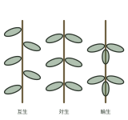

葉が枝につく並び方をいう。一枚ずつ交互に出るものを互生、二枚が向かい合うものを対生、三枚以上が輪になるものを輪生と呼ぶ。落ちた葉では分からない。

型：<strong>互生</strong>・対生・輪生[→ ホオノキ](#s-hoonoki)

## 単葉と複葉<small><b>用語</b></small>

_Simple and compound leaves_

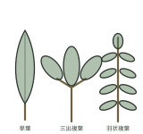

葉身が一枚のものを単葉、複数の小葉に分かれるものを複葉という。複葉には葉軸の左右に小葉が並ぶ羽状、一点から放射状に出る掌状、小葉三枚の三出がある。

型：単葉・<strong>羽状</strong>・掌状・三出[→ ヌルデ](#s-nurude)

## 葉形<small><b>用語</b></small>

_Leaf shape_

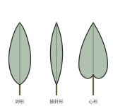

葉身の輪郭の型をいう。幅が最も広い位置で見分け、下が広いものを卵形、上が広いものを倒卵形、細長いものを披針形、つけ根のくびれるものを心形と呼ぶ。

型：卵形・倒卵形・披針形・<strong>心形</strong>[→ ボダイジュ](#s-bodaiju)

## 葉先<small><b>用語</b></small>

_Leaf apex_

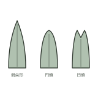

葉身の先端の形をいう。細く長く伸びるものを鋭尖形、丸みを帯びるものを円頭、先の中央がへこむものを凹頭と呼ぶ。同じ木でも枝の勢いで差が出る。

型：鋭尖形・円頭・<strong>凹頭</strong>[→ ユリノキ](#s-yurinoki)

## 葉脚<small><b>用語</b></small>

_Leaf base_

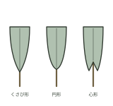

葉身のつけ根の形をいう。くさび形に細まるもの、丸く収まるもの、心形にくぼむものがある。左右が同じ形にならない種もあり、その不相称が手がかりになる。

型：<strong>くさび形</strong>・円形・心形[→ ミズナラ](#s-mizunara)

## 葉縁<small><b>用語</b></small>

_Leaf margin_

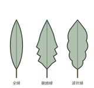

葉身のふちの状態をいう。刻みのないものを全縁、細かい刻みが並ぶものを鋸歯縁、大きくゆるやかに波打つものを波状縁と呼ぶ。指でなぞると見分けやすい。

型：全縁・鋸歯縁・<strong>波状縁</strong>[→ カシワ](#s-kashiwa)

## 鋸歯<small><b>用語</b></small>

_Serration_

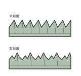

葉縁に並ぶのこぎり状の刻みをいう。刻みが一段のものを単鋸歯、大きな刻みの上にさらに小さな刻みが乗るものを重鋸歯と呼ぶ。先が糸状に伸びるものもある。

型：<strong>単鋸歯</strong>・重鋸歯[→ ケヤキ](#s-keyaki)

## 葉脈<small><b>用語</b></small>

_Venation_

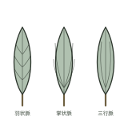

葉身を走る筋をいう。中央の一本が主脈、分かれるものが側脈。羽状に出るものを羽状脈、放射状に出るものを掌状脈、三本が長く伸びるものを三行脈と呼ぶ。

型：羽状脈・掌状脈・<strong>三行脈</strong>[→ クスノキ](#s-kusunoki)

## 葉柄と托葉<small><b>用語</b></small>

_Petiole and stipules_

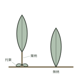

葉身を枝につなぐ柄を葉柄、そのつけ根に対で生じる小さな付属物を托葉という。葉柄をもたないものは無柄。托葉は早く落ちる種が多く、棘に変わるものもある。

部位：葉柄・<strong>托葉</strong>・無柄[→ ニセアカシア](#s-nisecacia)

# 樹葉観察図譜第四章　見出し語　ア行—サ行

<nav class="sidebar" aria-label="五十音索引">
<ol>
<li aria-current="true">ア</li>
<li>カ</li>
<li>サ</li>
<li>タ</li>
<li>ナ</li>
<li>ハ</li>
<li>マ</li>
<li>ヤ</li>
<li>ラ</li>
<li>ワ</li>
</ol>
</nav>

## アカメガシワ<small><b>在来</b></small>

_Mallotus japonicus_

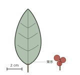

伐採跡や荒地にいち早く現れる落葉高木。若葉は赤みを帯び、長い葉柄の先に広い葉を互生する。夏に小花を穂状に立て、秋に蒴果が裂けて黒い種子を見せる。

保存状況：**LC**（低懸念）[→ 葉序](#t-yoji)

## イタヤカエデ<small><b>在来</b></small>

_Acer pictum_ subsp. _mono_

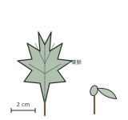

山地に広く分布する落葉高木。掌状に五〜七裂した葉を対生し、裂片の縁は鋸歯がなく波打つ。秋に黄色く色づき、翼を広げた翼果が旋回しながら落ちる。

保存状況：**LC**（低懸念）[→ 葉脈](#t-yomyaku)

## ウワミズザクラ<small><b>在来</b></small>

_Padus grayana_

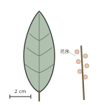

谷沿いの林に多い落葉高木。葉は長楕円形で先が細く尖り、縁に細かな鋸歯が並ぶ。春、葉を開いたのちに総状花序を立て、夏に黒く熟す果実を垂らす。

保存状況：**LC**（低懸念）[→ 鋸歯](#t-kyoshi)

## カシワ<small><b>在来</b></small>

_Quercus dentata_

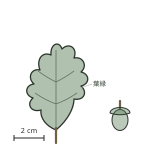

日当たりのよい丘陵や海岸に育つ落葉高木。葉は倒卵形で、縁に波状の大きな鋸歯を連ねる。枯れ葉が春まで枝に残り、堅果は椀状の殻斗に浅く包まれる。

保存状況：**LC**（低懸念）[→ 葉縁](#t-yoen)

## キョウチクトウ<small><b>外来</b></small>

_Nerium oleander_

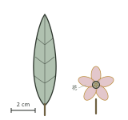

街路や公園に植えられる常緑低木。細い葉は硬く光沢があり、多くは三枚ずつ輪生する。夏から秋にかけ淡紅色や白の花を次々に開く。全体に強い毒をもつ。

国内評価：<b class="alt">NE</b>（対象外）[→ 葉序](#t-yoji)

## クスノキ<small><b>在来</b></small>

_Cinnamomum camphora_

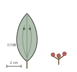

暖地の社寺や公園に巨木となる常緑高木。葉は卵形で革質、表に光沢がある。つけ根近くから三本の脈が伸び、分かれ目にふくらみができる。枝葉をもむと香りが立つ。

保存状況：**LC**（低懸念）[→ 葉脈](#t-yomyaku)

## ケヤキ<small><b>在来</b></small>

_Zelkova serrata_

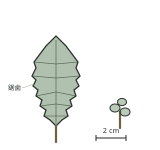

屋敷林や社寺、街路に大きく育つ落葉高木。幹は根元から扇を開くように分かれる。葉は卵状披針形で先が細く尖り、縁の鋭い単鋸歯へ側脈がまっすぐ届く。

保存状況：**LC**（低懸念）[→ 鋸歯](#t-kyoshi)

## サルナシ<small><b>在来</b></small>

_Actinidia arguta_

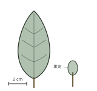

林縁の樹上へ這い上がる落葉のつる性木本。葉は広卵形でやや厚く、縁に細かな鋸歯をもつ。雌雄異株で、秋に緑褐色の小さな液果を実らせる。

保存状況：**LC**（低懸念）[→ 葉形](#t-yokei)

## シラカシ<small><b>在来</b></small>

_Quercus myrsinifolia_

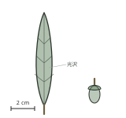

暖地の丘陵に多い常緑高木。葉は披針形で革質、表面に光沢があり、上半部に浅い鋸歯をもつ。冬も葉を落とさず、細長い堅果を浅い殻斗が抱く。

保存状況：**LC**（低懸念）[→ 葉縁](#t-yoen)

# 樹葉観察図譜第四章　見出し語　タ行—ヤ行

<nav class="sidebar" aria-label="五十音索引">
<ol>
<li>ア</li>
<li>カ</li>
<li>サ</li>
<li aria-current="true">タ</li>
<li>ナ</li>
<li>ハ</li>
<li>マ</li>
<li>ヤ</li>
<li>ラ</li>
<li>ワ</li>
</ol>
</nav>

## トウカエデ<small><b>外来</b></small>

_Acer buergerianum_

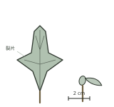

中国原産の落葉高木で、街路樹や庭木として広く植えられる。葉は浅く三裂して対生し、裂片の先は短く尖る。秋の色づきは黄から紅まで幅がある。

国内評価：<b class="alt">NE</b>（対象外）[→ 葉形](#t-yokei)

## トチノキ<small><b>在来</b></small>

_Aesculus turbinata_

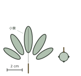

谷沿いの肥えた土地に育つ落葉高木。長い葉柄の先に五〜七枚の小葉を放射状に広げる掌状複葉で、小葉は倒卵形。葉は枝先に対生する。秋に厚い皮の実を落とす。

保存状況：**LC**（低懸念）[→ 複葉](#t-fukuyo)

## ニセアカシア<small><b>外来</b></small>

_Robinia pseudoacacia_

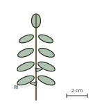

北米原産の落葉高木。河原や荒地に広がり、奇数羽状複葉を互生する。托葉は鋭い棘に変わり、初夏に白い蝶形花を房状に垂らす。根から盛んに萌芽する。

国内評価：<b class="alt">NE</b>（対象外）[→ 托葉](#t-yohei)

## ヌルデ<small><b>在来</b></small>

_Rhus javanica_

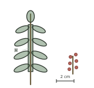

伐採跡や崩れ地に早く現れる落葉小高木。奇数羽状複葉を互生し、小葉のあいだの葉軸には翼が張り出す。秋の紅葉が早く、虫こぶが枝先につくことがある。

保存状況：**LC**（低懸念）[→ 複葉](#t-fukuyo)

## ホオノキ<small><b>在来</b></small>

_Magnolia obovata_

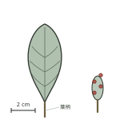

山地の谷筋に育つ落葉高木。枝先に集まってつく葉は大きな倒卵形で、国内の樹木では最大級。裏面は白みを帯びる。初夏に大きな白い花を上向きに開く。

保存状況：**LC**（低懸念）[→ 葉柄](#t-yohei)

## ボダイジュ<small><b>外来</b></small>

_Tilia miqueliana_

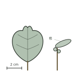

中国原産の落葉高木で、寺院や公園に植えられる。葉は左右不相称の心形で、裏面に白い毛が密生する。細長い苞の中ほどから花序を垂らし、果実を苞ごと散らす。

国内評価：<b class="alt">NE</b>（対象外）[→ 葉脚](#t-yokyaku)

## ミズナラ<small><b>在来</b></small>

_Quercus crispula_

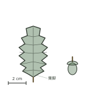

冷涼な山地に多い落葉高木。葉は倒卵形で葉柄がごく短く、縁に大きな鋸歯を連ねる。葉脚はくさび形にすぼまる。堅果は浅い殻斗に抱かれ、秋に落ちる。

保存状況：**LC**（低懸念）[→ 葉脚](#t-yokyaku)

## ヤマグワ<small><b>在来</b></small>

_Morus australis_

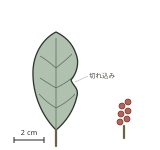

林縁や河原に生える落葉小高木。葉は卵形で、若い枝ではしばしば不規則に切れ込む。縁に粗い鋸歯があり、初夏に赤から黒へ熟す果実を垂らす。雌雄異株。

保存状況：**LC**（低懸念）[→ 葉形](#t-yokei)

## ユリノキ<small><b>外来</b></small>

_Liriodendron tulipifera_

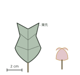

北米原産の落葉高木で、公園や街路に植えられる。葉は先が浅く切れ込む半纏形で、他に見ない輪郭をもつ。初夏、枝先に黄緑と橙の杯状の花を上向きに開く。

国内評価：<b class="alt">NE</b>（対象外）[→ 葉先](#t-yosaki)

# 樹葉観察図譜第四章　索引と付記

<nav class="sidebar" aria-label="五十音索引">
<ol>
<li>ア</li>
<li>カ</li>
<li>サ</li>
<li>タ</li>
<li>ナ</li>
<li>ハ</li>
<li>マ</li>
<li>ヤ</li>
<li>ラ</li>
<li>ワ</li>
</ol>
</nav>

## 和名索引<small>ア行</small>

アカメガシワ…… 
イタヤカエデ…… 
ウワミズザクラ……

## 和名索引<small>カ行</small>

カシワ…… 
キョウチクトウ…… 
クスノキ…… 
ケヤキ……

## 和名索引<small>サ行・タ行</small>

サルナシ…… 
シラカシ…… 
トウカエデ…… 
トチノキ……

## 和名索引<small>ナ行・ハ行</small>

ニセアカシア…… 
ヌルデ…… 
ホオノキ…… 
ボダイジュ……

## 和名索引<small>マ行・ヤ行</small>

ミズナラ…… 
ヤマグワ…… 
ユリノキ……

## 用語索引<small>五十音順</small>

鋸歯…… 
単葉と複葉…… 
葉形…… 
葉脚…… 
葉序…… 
葉先…… 
葉柄と托葉…… 
葉脈…… 
葉縁……

## 索引の使い方<small><b>付記</b></small>

この索引は、第四章に収めた見出し語と用語を五十音順に並べ、それぞれの図版番号を示したものである。ページ番号ではなく図版番号で引くのは、図をたどるほうが目的の一枚に早く届くからである。

和名索引には樹種を、用語索引には葉のかたちを表す語をまとめた。学名から引きたいときは、巻末の総索引を用いてほしい。同じ種が別の章にも現れる場合は、総索引にすべての図版番号を並べてある。

引き方：五十音順・図版番号

## 図版一覧<small><b>付記</b></small>

第四章に収めた図版は二十七点である。うち九点は葉のかたちを説明するための用語図解で、残る十八点が樹種ごとの模式図にあたる。用語図解には縮尺を入れず、樹種の図にはすべて二センチメートルの横棒をそえた。

番号は章のなかで通し、他章の図版とは重ならない。原図はいずれも同じ方眼の上でおこし、印刷の段階で大きさをそろえている。

点数：<strong>27</strong>（用語9・樹種18）

## 保存状況の出典<small><b>付記</b></small>

保存状況の欄に置いた略号は、全国を対象とした絶滅危惧の評価にもとづく。評価は数年ごとに見直され、区分が変わることも珍しくない。刷りの時点でもっとも新しい版を参照したが、実際の判断にあたっては最新の一覧を確かめてほしい。

外来種は評価の対象外にあたるため、国内評価としてNEを示した。地域ごとの評価では、全国では低懸念とされる種が絶滅危惧に挙げられていることもある。

基準：全国評価

## 用語の選び方<small><b>付記</b></small>

用語図解に立てた九項は、この章の解説で実際に用いた語にかぎった。葉のかたちを表す語はほかにも多いが、まず覚えるべきものを絞るほうが、はじめて図譜を開く人には役に立つと考えたからである。

より細かな区分は、巻末の用語解説にゆずった。呼び方が複数ある語については、観察会や図鑑でひろく通じるほうを見出しに採り、もう一方は解説のなかにそえている。

項目：<strong>9</strong>（章内で用いた語）

## 第四章を終えて<small><b>付記</b></small>

葉のかたちだけで樹木の名にたどり着けることは、実のところそう多くない。それでも、輪郭とふちと脈を順に追う習慣がつくと、名の分からない木の前に立ったときの見え方が変わってくる。

一枚の葉を手にして、どこから見ればよいかが分かる。それだけで、林の中の時間はずいぶん長くなる。この章がその手がかりになれば幸いである。花や樹皮からの引き方は、続く章にゆずる。

収録：樹種18・用語9

## 次章の予告<small><b>付記</b></small>

第五章では、樹皮と冬芽をあつかう。葉の落ちた季節に木を見分けるための章で、幹の割れ方、皮目の並び、冬芽の鱗片の数といった、葉とはまったく別の手がかりを図解する。

第四章と同じ十八種を、別の角度から見直せるように組んである。葉で覚えた種を冬にもう一度たしかめると、一年を通じてその木が見えるようになる。

次章：樹皮と冬芽

