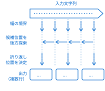
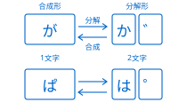
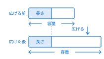

<aside class="chapter-tab">文字列操作</aside>

## moji.oru(haba, kigou) → Ito {#api-moji-oru}

| 引数    | 説明                              |
| ------- | --------------------------------- |
| `haba`  | 1行あたりの最大表示幅（正の整数） |
| `kigou` | 折り返しに使用する記号（文字列）  |

このItoを、指定した幅で折り返して新しいItoを返します。表示幅は全角文字を2、半角文字を1として数えます。折り返しは、空白・記号・連続する助詞（「、」「。」など）の直前で行います。

適切な位置が見つからない場合は、幅で強制的に折り返します。折り返すたびにkigouを挿入します。

```
text = "糸を紡ぐ音がする。名前はまだ" +
       "決まっていない。"

// 幅12で折り返す
out = text.moji.oru(12, "\n")
print(out)   // 各行末に改行が入る
```

## moji.sagasu(hari, hajime) → Int {#api-moji-sagasu}

| 引数     | 説明                                |
| -------- | ----------------------------------- |
| `hari`   | 検索する文字列                      |
| `hajime` | 検索を開始する位置（0以上、省略可） |

このItoの中からhariを検索し、最初に見つかった位置を返します。位置は0から始まる文字インデックスです。見つからない場合は −1 を返します。

hajimeが省略された場合は先頭から検索します。hajimeが負の場合は0として扱います。

```
s = "Tsumugi言語は楽しい言語です"
i = s.moji.sagasu("言語")        // 7
j = s.moji.sagasu("言語", i + 1) // 13
k = s.moji.sagasu("方言")        // -1
```

## moji.kirisaku(hajime, owari) → Ito {#api-moji-kirisaku}

| 引数     | 説明                              |
| -------- | --------------------------------- |
| `hajime` | 開始位置（0以上、負値可、省略可） |
| `owari`  | 終了位置（0以上、負値可、省略可） |

このItoの、hajime以上owari未満の部分文字列を返します。位置は0から始まる文字インデックスです。owariは含まれません。

負値は末尾からの相対位置を表します。省略時のhajimeは0、owariは末尾です。範囲が不正な場合は空文字列を返します。

```
s = "abcdefghij"
print(s.moji.kirisaku(2, 5))    // "cde"
print(s.moji.kirisaku(-3, -1))  // "hi"
print(s.moji.kirisaku(3))       // "defghij"
```

## moji.makunaru(haba, kigou) → Ito {#api-moji-makunaru}

| 引数    | 説明                              |
| ------- | --------------------------------- |
| `haba`  | 1行あたりの最大表示幅（正の整数） |
| `kigou` | 折り返しに使用する記号（文字列）  |

このItoを、指定した幅できれいに折り返して複数行のItoを返します。moji.oruと同様に幅を数え、空白・記号・助詞の直前を優先して折り返します。

折り返し位置の選択アルゴリズムは<a href="#fig-orikaeshi" data-ref="fig"></a>のとおりです。kigouには改行（`"\n"`）を指定するのが一般的です。

{#fig-orikaeshi}

```
para = "Tsumugi言語は日本語のテキストを" +
       "得意とするプログラミング言語です。"

out = para.moji.makunaru(16, "\n")
print(out)    // 幅16で美しく折り返す
```

## moji.nagasa() → Int {#api-moji-nagasa}

このItoの文字数（コードポイント数）を返します。改行文字も1文字として数えます。

```
s = "こんにちは世界"
print(s.moji.nagasa())    // 7

t = "a\nB\nC"
print(t.moji.nagasa())    // 5
```

## moji.haba() → Int {#api-moji-haba}

このItoの表示幅を返します。全角文字を2、半角文字と記号および改行を1として数えます。

```
s = "abcあいう"          // 3 + 3*2 = 9
print(s.moji.haba())     // 9

t = "a\nあ"              // 1 + 1 + 2 = 4
print(t.moji.haba())     // 4
```

## ito.tsunagu(retsu, nori) → Ito {#api-ito-tsunagu}

| 引数    | 説明                     |
| ------- | ------------------------ |
| `retsu` | Itoの並び（配列）        |
| `nori`  | 要素の間に挿入する文字列 |

retsuの各要素をnoriで連結した1つのItoを返します。retsuが空の場合は空文字列を返します。

要素が文字列以外の場合は、文字列表現に変換してから連結します。[→ moji.makunaru](#api-moji-makunaru){data-ref=api}参照

```
arr = ["りんご", "みかん", "バナナ"]
s = ito.tsunagu(arr, ", ")
print(s)   // "りんご, みかん, バナナ"
n = ito.tsunagu([1, 2, 3], ":")
print(n)   // "1:2:3"
```

## ito.kakusu(kigou, n) → Ito {#api-ito-kakusu}

| 引数    | 説明                               |
| ------- | ---------------------------------- |
| `kigou` | 隠す文字に置き換える記号（文字列） |
| `n`     | 置き換える文字数（0以上、省略可）  |

このItoの末尾からn文字（省略時はすべて）をkigouで置き換えた新しいItoを返します。

nが元の文字数より大きい場合はすべて置き換えます。[→ moji.kirisaku](#api-moji-kirisaku){data-ref=api}参照

```
s = "090-1234-5678"
print(s.ito.kakusu("*", 4))
   // 090-1234-****
print(s.ito.kakusu("*"))
   // *************
```

## ito.kakutei() → Ito {#api-ito-kakutei}

このItoを不変（読み取り専用）にして返します。

不変化すると、内容の変更を伴う操作は例外を送出します。すでに不変のItoなら同じItoを返します。

不変Itoは安全に共有でき、辞書のキーにも使えます。

```
s = "Tsumugi"
r = s.ito.kakutei()
r.ito.kakikaeru(0, "t")  // 例外: 不変Ito
cho = { r: 10 }
print(cho[r])  // 10
```

## kata.utsusu(moto) → Kata {#api-kata-utsusu}

| 引数   | 説明     |
| ------ | -------- |
| `moto` | 元のKata |

motoと同じ内容の新しいKataを返します。コピーは独立した領域に確保され、片方の変更は他方に影響しません。

[→ kata.henkou](#api-kata-henkou){data-ref=api}参照

```
k1 = kata.aratame("data")
k2 = kata.utsusu(k1)
k2.kata.henkou(0, "D")
print(k1, k2)  // "data" "Data"
```

## moji.atosagasu(hari, owari) → Int {#api-moji-atosagasu}

| 引数    | 説明                                |
| ------- | ----------------------------------- |
| `hari`  | 検索する文字列                      |
| `owari` | 検索を打ち切る位置（0以上、省略可） |

このItoの末尾側からhariを検索し、最後に見つかった位置を返します。位置の数え方はmoji.sagasuと共通で、返る値は一致した部分の先頭を指します。

owariを指定すると、一致の先頭がowari未満のものだけを探します。見つからない場合は −1 を返します。

前方からの検索と組み合わせると、同じ目印で挟まれた範囲を取り出せます。[→ moji.aida](#api-moji-aida){data-ref=api}参照

```
s = "糸へん、糸口、糸巻き"
print(s.moji.atosagasu("糸"))     // 7
print(s.moji.atosagasu("糸", 5))  // 4
print(s.moji.atosagasu("布"))     // -1
```

## moji.subete(hari) → Retsu {#api-moji-subete}

| 引数   | 説明           |
| ------ | -------------- |
| `hari` | 検索する文字列 |

このItoの中でhariが現れる位置をすべて集め、Intの並びにして返します。重なり合う一致は数えず、見つかるたびに一致した長さだけ先へ進みます。

一致が1つもない場合は空の並びを返します。個数だけが必要な場合は、moji.kazoeruのほうが手短に書けます。

同じ相手を何度も探すときは、moji.sagasuを位置をずらしながら呼ぶよりも、いちどで並びを受け取るほうが速く済みます。

```
s = "糸車と糸巻きと糸口"
print(s.moji.subete("糸"))
   // [0, 3, 7]
print(s.moji.subete("綿"))
   // []
```

## moji.kazoeru(hari) → Int {#api-moji-kazoeru}

| 引数   | 説明             |
| ------ | ---------------- |
| `hari` | 数え上げる文字列 |

このItoの中でhariが重ならずに現れる回数を返します。左から順に探し、見つかるたびに一致した長さだけ先へ進みます。

そのため「あああ」の中の「ああ」は2回ではなく1回と数えます。hariが空文字列の場合は0を返します。

```
s = "あいあいあ"
print(s.moji.kazoeru("あい"))  // 2
print(s.moji.kazoeru("あ"))    // 3
print("あああ".moji.kazoeru("ああ"))
   // 1
```

## moji.fukumu(hari) → Ronri {#api-moji-fukumu}

| 引数   | 説明       |
| ------ | ---------- |
| `hari` | 探す文字列 |

このItoがhariを含むならば真を返します。位置を必要としない判定では、moji.sagasuの結果を −1 と比べるより読みやすく書けます。

hariが空文字列の場合は常に真です。大小や全半角を無視して判定したい場合は、あらかじめito.totonoeru<a href="#api-ito-totonoeru" data-ref="api-page"></a>で表記を揃えてください。

```
s = "紡ぎ車"
print(s.moji.fukumu("ぎ車"))  // 真
print(s.moji.fukumu("糸車"))  // 偽
print(s.moji.fukumu(""))      // 真
```

## moji.hajimaru(hari) → Ronri {#api-moji-hajimaru}

| 引数   | 説明                 |
| ------ | -------------------- |
| `hari` | 先頭に置かれる文字列 |

このItoがhariで始まるならば真を返します。比較は文字単位で行い、大小や全半角の同一視は行いません。

hariがこのItoより長い場合は必ず偽になります。接頭辞を取り除くときは、判定のあとにmoji.kirisaku<a href="#api-moji-kirisaku" data-ref="api-page"></a>を続けて呼びます。

```
s = "tsumugi.ito"
print(s.moji.hajimaru("tsu"))  // 真
print(s.moji.hajimaru("Tsu"))  // 偽
```

## moji.owaru(hari) → Ronri {#api-moji-owaru}

| 引数   | 説明                 |
| ------ | -------------------- |
| `hari` | 末尾に置かれる文字列 |

このItoがhariで終わるならば真を返します。拡張子や語尾の判定に使います。

候補が多いときは、並びに対して繰り返し呼ぶより、moji.atosagasuで区切りの位置を1度だけ求めるほうが速く済みます。

```
n = "hyoshi.tsumugi"
print(n.moji.owaru(".tsumugi"))
   // 真
print(n.moji.owaru(".ito"))
   // 偽
```

## moji.karappo() → Ronri {#api-moji-karappo}

このItoが1文字も持たないならば真を返します。空白だけからなるItoは空ではないので偽になります。

空白を含めて中身がないことを調べるには、moji.kezuru<a href="#api-moji-kezuru" data-ref="api-page"></a>で端を落としてから呼びます。

```
print("".moji.karappo())    // 真
print(" ".moji.karappo())   // 偽
print(" ".moji.kezuru().moji.karappo())
   // 真
```

## moji.toru(ichi) → Ito {#api-moji-toru}

| 引数   | 説明                   |
| ------ | ---------------------- |
| `ichi` | 取り出す位置（負値可） |

ichiの位置にある1文字をItoとして返します。負値は末尾からの相対位置です。範囲外を指すと空文字列を返します。

1文字ずつ順に見ていく場合は、moji.narabi<a href="#api-moji-narabi" data-ref="api-page"></a>で並びに変えてから繰り返すほうが速く済みます。

```
s = "紡ぎ糸"
print(s.moji.toru(1))   // "ぎ"
print(s.moji.toru(-1))  // "糸"
print(s.moji.toru(9))   // ""
```

## moji.fugo(ichi) → Int {#api-moji-fugo}

| 引数   | 説明                  |
| ------ | --------------------- |
| `ichi` | 位置（0以上、省略可） |

ichiの位置にある文字の符号位置を整数で返します。省略時は先頭の文字を対象にします。範囲外を指すと −1 を返します。

符号位置どうしの大小は、そのまま文字の並び順になります。文字の種類を調べる判定を自分で書くときの土台になります。

```
s = "あA"
print(s.moji.fugo())    // 12354
print(s.moji.fugo(1))   // 65
```

## moji.kuraberu(aite) → Int {#api-moji-kuraberu}

| 引数   | 説明           |
| ------ | -------------- |
| `aite` | 比較する文字列 |

このItoとaiteを符号位置の並びで先頭から比べ、小さければ −1、等しければ0、大きければ1を返します。

並べ替えの比較関数にそのまま渡せます。前方が一致したまま一方が尽きた場合は、短いほうが小さいと判定されます。

```
print("ito".moji.kuraberu("kata"))
   // -1
print("ito".moji.kuraberu("ito"))
   // 0
print("itoya".moji.kuraberu("ito"))
   // 1
```

## moji.hitoshii(aite, hou) → Ronri {#api-moji-hitoshii}

| 引数   | 説明                   |
| ------ | ---------------------- |
| `aite` | 比較する文字列         |
| `hou`  | 同一視の指定（省略可） |

このItoとaiteが等しいならば真を返します。houに「大小」「全半」「かな」を並べて渡すと、その違いを無視して比べます。

houを省略すると完全一致で比べます。指定できる語はito.totonoeru<a href="#api-ito-totonoeru" data-ref="api-page"></a>と共通で、半角空白で区切って並べます。

```
a = "ｱｲｳ"
b = "アイウ"
print(a.moji.hitoshii(b))
   // 偽
print(a.moji.hitoshii(b, "全半"))
   // 真
```

## moji.wakeru(kugiri, kazu) → Retsu {#api-moji-wakeru}

| 引数     | 説明                     |
| -------- | ------------------------ |
| `kugiri` | 区切りに使う文字列       |
| `kazu`   | 分割の上限個数（省略可） |

このItoをkugiriで区切り、Itoの並び（Retsu）にして返します。kugiriそのものは結果に含まれません。

kazuを指定すると、その個数に達した時点で分割をやめ、残りをまとめて最後の要素にします。区切りが連続する場合は空文字列の要素が入ります。

kugiriに空文字列を渡した場合は1文字ずつに分かれ、moji.narabi<a href="#api-moji-narabi" data-ref="api-page"></a>と同じ結果になります。

```
s = "赤,青,緑,黒"
print(s.moji.wakeru(","))
   // ["赤", "青", "緑", "黒"]
print(s.moji.wakeru(",", 2))
   // ["赤", "青,緑,黒"]
```

## moji.gyou(nokosu) → Retsu {#api-moji-gyou}

| 引数     | 説明                         |
| -------- | ---------------------------- |
| `nokosu` | 改行を残すかどうか（省略可） |

このItoを改行で区切り、行の並びにして返します。改行の種類は自動で見分け、末尾の改行に対して空の行は作りません。

nokosuに真を渡すと、各行の末尾に改行を付けたまま返します。読み込んだ内容をそのまま書き戻す処理で使います。

行の中身だけを扱う場合は、続けてmoji.kezuruを呼んで端の空白を落としておくと安全です。

```
s = "一行目\n二行目\n"
print(s.moji.gyou())
   // ["一行目", "二行目"]
print(s.moji.gyou(真))
   // ["一行目\n", "二行目\n"]
```

## moji.kezuru(kigou, hou) → Ito {#api-moji-kezuru}

| 引数    | 説明                         |
| ------- | ---------------------------- |
| `kigou` | 削る文字の集合（省略可）     |
| `hou`   | 「前」「後」「両」（省略可） |

このItoの端から、kigouに含まれる文字を削った新しいItoを返します。kigouを省略すると空白・タブ・改行を削ります。

houを省略すると両端を削ります。入力の整形では、端を落としてからmoji.wakeruにかけると扱いやすくなります。

kigouは文字の集合として扱われ、並び順は結果に影響しません。

```
t = "  紡ぎ糸  "
print(t.moji.kezuru())
   // "紡ぎ糸"
print(t.moji.kezuru(" ", "前"))
   // "紡ぎ糸  "
```

## moji.tsumeru(kigou) → Ito {#api-moji-tsumeru}

| 引数    | 説明                 |
| ------- | -------------------- |
| `kigou` | 詰める文字（省略可） |

連続するkigouを1文字にまとめた新しいItoを返します。省略時は空白・タブ・改行をまとめて、半角空白1つにします。

端の空白は残るため、moji.kezuruと組み合わせて使うのが一般的です。表記の揺れを吸収してから比較や分割にかけると扱いやすくなります。

```
s = "紡ぎ　　糸\t車"
print(s.moji.tsumeru())
   // "紡ぎ 糸 車"
print("--".moji.tsumeru("-"))
   // "-"
```

## moji.sorou(haba, kigou, hou) → Ito {#api-moji-sorou}

| 引数    | 説明                         |
| ------- | ---------------------------- |
| `haba`  | 揃える表示幅                 |
| `kigou` | 補う文字（省略可）           |
| `hou`   | 「前」「後」「中」（省略可） |

このItoの表示幅がhaba未満のとき、kigouを補って幅を揃えた新しいItoを返します。幅の数え方はmoji.habaと同じです。

すでにhaba以上ある場合は、そのまま返します。kigouに2文字以上を渡すと例外を送出します。

```
print("7".moji.sorou(4, "0", "前"))
   // "0007"
print("名".moji.sorou(6))
   // "名    "
```

## moji.kurikaesu(kaisu) → Ito {#api-moji-kurikaesu}

| 引数    | 説明                  |
| ------- | --------------------- |
| `kaisu` | 繰り返す回数（0以上） |

このItoをkaisu回つないだ新しいItoを返します。kaisuが0なら空文字列を返します。

罫線の生成や字下げの組み立てに使います。kaisuが負の場合は例外を送出します。

```
print("─".moji.kurikaesu(8))
   // "────────"
print("ab".moji.kurikaesu(3))
   // "ababab"
```

## moji.hasamu(ichi, soe) → Ito {#api-moji-hasamu}

| 引数   | 説明                   |
| ------ | ---------------------- |
| `ichi` | 挿入する位置（負値可） |
| `soe`  | 挿入する文字列         |

このItoのichiの位置にsoeを挟んだ新しいItoを返します。ichiが文字数と等しいときは末尾に付け足します。

```
s = "あう"
print(s.moji.hasamu(1, "い"))
   // "あいう"
```

## moji.kaeru(moto, saki, n) → Ito {#api-moji-kaeru}

| 引数   | 説明                     |
| ------ | ------------------------ |
| `moto` | 置き換える対象の文字列   |
| `saki` | 置き換えた後の文字列     |
| `n`    | 置き換える個数（省略可） |

このItoに現れるmotoをsakiに置き換えた新しいItoを返します。先頭から順に、重ならないように置き換えます。

nを省略するとすべて置き換えます。置き換えた結果に再びmotoが現れても、その部分は対象になりません。

motoが空文字列の場合は、元のItoをそのまま返します。置き換えの回数が多い場合は、Kata<a href="#api-kata-aratame" data-ref="api-page"></a>に組み立てるほうが速く済みます。

```
s = "糸,糸,糸"
print(s.moji.kaeru("糸", "布"))
   // "布,布,布"
print(s.moji.kaeru("糸", "布", 1))
   // "布,糸,糸"
```

## moji.aida(hidari, migi) → Ito {#api-moji-aida}

| 引数     | 説明       |
| -------- | ---------- |
| `hidari` | 左側の目印 |
| `migi`   | 右側の目印 |

最初に現れるhidariと、その後ろに現れるmigiとに挟まれた部分を返します。目印そのものは結果に含まれません。

どちらかが見つからない場合は空文字列を返します。入れ子になった目印は扱わないため、深さのある構造ではmoji.sagasuを組み合わせてください。

hidariとmigiに同じ文字列を渡すと、最初と2番目の出現に挟まれた部分を取り出せます。

```
s = "名前【紡ぎ糸】と説明"
print(s.moji.aida("【", "】"))
   // "紡ぎ糸"
print(s.moji.aida("と", "と"))
   // ""
```

## moji.nozoku(hajime, owari) → Ito {#api-moji-nozoku}

| 引数     | 説明                       |
| -------- | -------------------------- |
| `hajime` | 取り除く開始位置           |
| `owari`  | 取り除く終了位置（省略可） |

このItoから、hajime以上owari未満の範囲を取り除いた新しいItoを返します。owariを省略すると末尾までを取り除きます。

範囲の数え方はmoji.kirisaku<a href="#api-moji-kirisaku" data-ref="api-page"></a>と共通で、負値は末尾からの相対位置を表します。範囲が不正な場合は、元のItoをそのまま返します。

```
s = "abcdefg"
print(s.moji.nozoku(2, 5))  // "abfg"
print(s.moji.nozoku(4))     // "abcd"
print(s.moji.nozoku(-2))    // "abcde"
```

## moji.sakasa() → Ito {#api-moji-sakasa}

このItoの文字を逆順に並べ替えた新しいItoを返します。並べ替えは文字単位で行うため、濁点を分けて持つItoでは意図しない結果になることがあります。

先にito.totonoeruで合成しておくと安全です。行の並びを逆にしたい場合は、moji.gyou<a href="#api-moji-gyou" data-ref="api-page"></a>で分けてから並べ替えてください。

```
print("たけやぶやけた".moji.sakasa())
   // "たけやぶやけた"
print("紡ぎ糸".moji.sakasa())
   // "糸ぎ紡"
```

## moji.narabi() → Retsu {#api-moji-narabi}

このItoを1文字ずつに分けたItoの並びを返します。moji.wakeru<a href="#api-moji-wakeru" data-ref="api-page"></a>に空文字列を渡した場合と同じ結果になります。

1文字ずつ数えたり並べ替えたりする処理では、位置を指定して取り出すより、いちど並びに変えてから扱うほうが速く済みます。

```
r = "紡ぎ糸".moji.narabi()
print(r)
   // ["紡", "ぎ", "糸"]
print(r.nagasa())  // 3
```

## ito.totonoeru(hou) → Ito {#api-ito-totonoeru}

| 引数  | 説明                     |
| ----- | ------------------------ |
| `hou` | 行う正規化を並べた文字列 |

このItoの表記を揃えた新しいItoを返します。houには「合成」「分解」「全半」「かな」「大小」を、半角空白で区切って並べます。

「合成」は濁点・半濁点を前の文字にまとめ、「分解」は逆にそれらを分けます。<a href="#fig-seikika" data-ref="fig"></a>のように、両者は互いに逆の変換です。

{#fig-seikika}

「全半」は全角と半角の揺れを半角側へ、「かな」はひらがなとカタカナの揺れをカタカナ側へ寄せます。houを省略した場合は「合成」だけを行います。

```
s = "か" + "゛"
print(s.moji.nagasa())    // 2
t = s.ito.totonoeru("合成")
print(t)                  // "が"
print(t.moji.nagasa())    // 1
u = "ア".ito.totonoeru("全半")
print(u)                  // "ｱ"
```

## moji.zenkaku(rui) → Ito {#api-moji-zenkaku}

| 引数  | 説明                         |
| ----- | ---------------------------- |
| `rui` | 「英数」「記号」「カナ」など |

このItoに含まれる半角文字を全角に置き換えた新しいItoを返します。ruiで対象の種類を絞れます。省略時はすべてを対象にします。

ruiには「英数」「記号」「カナ」「空白」を、半角空白で区切って並べます。指定した種類に当てはまらない文字は、そのまま残ります。

半角カナの濁点は、全角にする際に前の文字と合成されます。そのため変換の前後でmoji.nagasaの値が変わることがあります。

```
s = "ﾂﾑｷﾞ 21"
print(s.moji.zenkaku())
   // "ツムギ　２１"
print(s.moji.zenkaku("英数"))
   // "ﾂﾑｷﾞ ２１"
```

## moji.hankaku(rui) → Ito {#api-moji-hankaku}

| 引数  | 説明                         |
| ----- | ---------------------------- |
| `rui` | 「英数」「記号」「カナ」など |

このItoに含まれる全角文字を半角に置き換えた新しいItoを返します。moji.zenkakuと対になり、ruiの指定も共通です。

半角に置き換える相手がない文字は、そのまま残ります。全角の句読点や括弧は「記号」に含まれます。

濁点付きのカナを半角にすると2文字に分かれるため、表示幅を数え直す必要があります。

```
s = "ツムギ　２１"
print(s.moji.hankaku("英数"))
   // "ツムギ 21"
print(s.moji.hankaku())
   // "ﾂﾑｷﾞ 21"
```

## moji.oomoji(hou) → Ito {#api-moji-oomoji}

| 引数  | 説明                   |
| ----- | ---------------------- |
| `hou` | 「頭」を渡すと語頭のみ |

このItoのラテン文字を大文字にした新しいItoを返します。houに「頭」を渡すと、語の先頭だけを大文字にします。

語の切れ目は空白と記号で判断します。ラテン文字以外は変換の対象にならず、そのまま残ります。

見出しの体裁を整える用途では、moji.kezuru<a href="#api-moji-kezuru" data-ref="api-page"></a>で端を落としてから呼ぶと結果が安定します。

```
s = "ito to kata"
print(s.moji.oomoji())
   // "ITO TO KATA"
print(s.moji.oomoji("頭"))
   // "Ito To Kata"
```

## moji.komoji(hou) → Ito {#api-moji-komoji}

| 引数  | 説明                   |
| ----- | ---------------------- |
| `hou` | 「頭」を渡すと語頭のみ |

このItoのラテン文字を小文字にした新しいItoを返します。moji.oomojiと対になります。

大小を無視して比べたいだけの場合は、moji.hitoshii<a href="#api-moji-hitoshii" data-ref="api-page"></a>に「大小」を渡すほうが手短です。

```
s = "ITO To Kata"
print(s.moji.komoji())
   // "ito to kata"
```

## moji.kanaeru(hou) → Ito {#api-moji-kanaeru}

| 引数  | 説明                   |
| ----- | ---------------------- |
| `hou` | 「かな」または「カナ」 |

このItoのひらがなとカタカナを、houで指定した側に寄せた新しいItoを返します。長音記号や小書き文字もあわせて変換します。

漢字と記号はそのまま残ります。読みの揺れを吸収したいだけなら、ito.totonoeruに「かな」を渡すほうが手短です。

```
s = "つむぎイト"
print(s.moji.kanaeru("カナ"))
   // "ツムギイト"
print(s.moji.kanaeru("かな"))
   // "つむぎいと"
```

## ito.tsutsumu(fugo) → Tsutsumi {#api-ito-tsutsumu}

| 引数   | 説明         |
| ------ | ------------ |
| `fugo` | 符号化の名前 |

このItoをfugoで指定した符号化で包み、バイトの並び（Tsutsumi）にして返します。ファイルや通信路への書き出しは、この型を経由して行います。

fugoには「八単位」「十六単位」などを指定します。符号化できない文字があるときは例外を送出します。

```
t = "紡ぎ".ito.tsutsumu("八単位")
print(t.nagasa())  // 6
```

## ito.hodoku(tsutsumi, fugo) → Ito {#api-ito-hodoku}

| 引数       | 説明         |
| ---------- | ------------ |
| `tsutsumi` | バイトの並び |
| `fugo`     | 符号化の名前 |

tsutsumiをfugoで指定した符号化として解き、Itoにして返します。ito.tsutsumuと対になります。

途中で壊れた並びに出会うと例外を送出します。読み込んだ内容の符号化が分からない場合は、第9章（p.312）の見分けを先に呼んでください。

```
i = ito.hodoku(t, "八単位")
print(i)  // "紡ぎ"
```

## ito.yomu(moji, kihon) → Int {#api-ito-yomu}

| 引数    | 説明                  |
| ------- | --------------------- |
| `moji`  | 数を表す文字列        |
| `kihon` | 基数（2〜36、省略可） |

mojiを整数として読み取ります。前後の空白は無視し、先頭の符号は受け付けます。読み取れない場合は例外を送出します。

kihonを省略すると10進として読みます。全角の数字は読み取れないため、先にmoji.hankaku<a href="#api-moji-hankaku" data-ref="api-page"></a>を呼んでください。

```
print(ito.yomu("  120 "))  // 120
print(ito.yomu("ff", 16))  // 255
```

## ito.kaku(atai, kihon, keta) → Ito {#api-ito-kaku}

| 引数    | 説明                  |
| ------- | --------------------- |
| `atai`  | 書き出す整数          |
| `kihon` | 基数（2〜36、省略可） |
| `keta`  | 最小の桁数（省略可）  |

ataiをkihon進の文字列にして返します。ketaに満たない場合は、先頭を0で埋めて桁を揃えます。ito.yomuと対になります。

```
print(ito.kaku(255, 16))   // "ff"
print(ito.kaku(9, 10, 3))  // "009"
```

## ito.kumu(hinagata, soe) → Ito {#api-ito-kumu}

| 引数       | 説明                 |
| ---------- | -------------------- |
| `hinagata` | 差し込み口を含む雛型 |
| `soe`      | 差し込む値の並び     |

hinagataの中の`{}`を、soeの要素で順に置き換えたItoを返します。`{名}`のように名前を書いた場合は、soeを帳（Cho）として受け取ります。

`{}`の中に`:`を挟むと、続けて幅と揃えを書けます。`{:4前}`なら幅4で前を埋めます。揃えの指定はmoji.sorou<a href="#api-moji-sorou" data-ref="api-page"></a>と共通です。

```
print(ito.kumu("{}は{}本", ["糸", 3]))
   // "糸は3本"
print(ito.kumu("{数:4前}", { 数: 7 }))
   // "   7"
```

## ito.kakikaeru(ichi, moji) → Ito {#api-ito-kakikaeru}

| 引数   | 説明           |
| ------ | -------------- |
| `ichi` | 書き換える位置 |
| `moji` | 置く1文字      |

このItoのichiの位置の文字をmojiに書き換え、同じItoを返します。新しいItoは作りません。

ito.kakutei<a href="#api-ito-kakutei" data-ref="api-page"></a>で不変にしたItoに対しては例外を送出します。

```
s = "糸巻き"
s.ito.kakikaeru(0, "毛")
print(s)  // "毛巻き"
```

## kata.aratame(moto) → Kata {#api-kata-aratame}

| 引数   | 説明                  |
| ------ | --------------------- |
| `moto` | 元にするItoまたはKata |

motoの内容を写した新しいKataを起こします。Kataは文字を直接書き換えられる器で、継ぎ足しを繰り返すときにItoより速く働きます。

motoを省略すると、空のKataを起こします。元がKataの場合はkata.utsusu<a href="#api-kata-utsusu" data-ref="api-page"></a>と同じ結果になります。

```
k = kata.aratame("紡")
k.kata.tsugu("ぎ糸")
print(k.kata.katameru())
   // "紡ぎ糸"
```

## kata.tsugu(soe) → Kata {#api-kata-tsugu}

| 引数  | 説明           |
| ----- | -------------- |
| `soe` | 継ぎ足す文字列 |

このKataの末尾にsoeを継ぎ足し、同じKataを返します。容量が足りない場合は自動で広げます。

返り値が同じKataなので、続けて書き並べられます。継ぎ足す量があらかじめ分かっている場合は、先にkata.hirogeruを呼んでください。

```
k = kata.aratame()
k.kata.tsugu("糸").kata.tsugu("車")
print(k.kata.katameru())  // "糸車"
```

## kata.hirogeru(yoryo) → Kata {#api-kata-hirogeru}

| 引数    | 説明                   |
| ------- | ---------------------- |
| `yoryo` | 確保する容量（文字数） |

このKataの容量をyoryo文字ぶんまで広げ、同じKataを返します。すでに足りている場合は何もしません。

継ぎ足す量が分かっているときに先に広げておくと、途中での作り直しを避けられます。<a href="#fig-kata-yoryo" data-ref="fig"></a>のように、長さは変わらず容量だけが伸びます。

{#fig-kata-yoryo}

```
k = kata.aratame("糸")
k.kata.hirogeru(64)
print(k.kata.nagasa())  // 1
print(k.kata.yoryo())   // 64
```

## kata.henkou(ichi, moji) → Kata {#api-kata-henkou}

| 引数   | 説明           |
| ------ | -------------- |
| `ichi` | 書き換える位置 |
| `moji` | 置く1文字      |

このKataのichiの位置の文字をmojiに書き換え、同じKataを返します。範囲外の位置を指すと例外を送出します。

```
k = kata.aratame("data")
k.kata.henkou(0, "D")
print(k.kata.katameru())  // "Data"
```

## kata.harau() → Kata {#api-kata-harau}

このKataの中身をすべて捨てて空にし、同じKataを返します。確保済みの容量はそのまま残るため、同じ器を繰り返し使えます。

```
k = kata.aratame("糸車")
k.kata.harau()
print(k.kata.nagasa())  // 0
print(k.kata.yoryo())   // 16
```

## kata.yoryo() → Int {#api-kata-yoryo}

このKataが作り直しなしに保持できる文字数を返します。kata.tsuguで長さが容量を超えると、容量はおよそ2倍に広げられます。

実際に入っている文字数はkata.nagasaで得られます。

```
k = kata.aratame("糸車")
print(k.kata.nagasa())  // 2
print(k.kata.yoryo())   // 16
```

## kata.katameru() → Ito {#api-kata-katameru}

このKataの内容を固めてItoにして返します。固めたあともKataは使えますが、返ったItoは以後の変更の影響を受けません。

```
k = kata.aratame("糸")
i = k.kata.katameru()
k.kata.tsugu("車")
print(i)  // "糸"
```

## 文字列操作の計算量 {#api-complexity}

nはこのItoの文字数、mは相手の文字数です。

| 計算量   | 主な操作                 |
| -------- | ------------------------ |
| `O(1)`   | moji.nagasa、moji.toru   |
| `O(n)`   | moji.sakasa、ito.tsunagu |
| `O(n+m)` | moji.sagasu、moji.kaeru  |

Itoは不変であるため、連結を繰り返すとそのたびに写しが起こります。回数が多い場合はKataを使ってください。

照合による検索と置換は第5章（p.183）で、入出力での符号化は第9章（p.312）で扱います。
