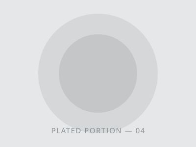
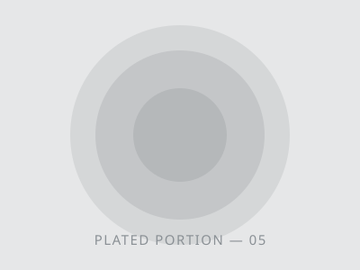
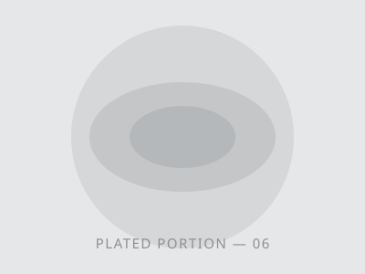

<header>
Clear Plate Manual
Controlled Recipes
</header>

# Roasted Root Bowl

| Parameter      | Value     |
| -------------- | --------- |
| Total time     | 00:45     |
| Prep time      | 00:15     |
| Cook time      | 00:30     |
| Serves         | 04        |
| Difficulty     | ★★☆☆☆     |
| Cost / serving | 2.40      |
| Oven temp      | 200°C     |
| Batch size     | 1×        |
| Recipe ID      | CPM-01-17 |

<aside class="warning">

Safety First

- Wash hands and all contact surfaces before starting; keep a dedicated allergen-free board.
- Hold hot components above 63 °C until plating; discard anything held past two hours.
- Keep dairy and dressings on the cold chain below 5 °C until service.
- Complete every step within the 45-minute window shown; do not batch-hold.
- Re-read the ingredient check and confirm each marker before combining.
- Bin any component that has touched an uncontrolled surface. Do not reuse.

</aside>

## Ingredient Check {.hd-ingredient}

| Ingredient                | Allergen             |
| ------------------------- | -------------------- |
| Roasted sweet potato      | <mark>None</mark>    |
| Yukon gold potato         | <mark>None</mark>    |
| Rainbow carrot            | <mark>None</mark>    |
| Chickpeas, cooked         | <mark>None</mark>    |
| Baby kale                 | <mark>None</mark>    |
| Extra-virgin olive oil    | <mark>None</mark>    |
| Cold-pressed rapeseed oil | <mark>None</mark>    |
| Tahini paste              | <mark>Sesame</mark>  |
| Toasted almond flakes     | <mark>Tree</mark>    |
| Lemon juice               | <mark>None</mark>    |
| Roasted peanut crumble    | <mark>Peanut</mark>  |
| Ground cumin              | <mark>None</mark>    |
| Cultured butter           | <mark>Milk</mark>    |
| Miso glaze                | <mark>Soy</mark>     |
| Flaky sea salt            | <mark>None</mark>    |
| Dried apricot, treated    | <mark>Sulfite</mark> |
| Chopped chives            | <mark>None</mark>    |
| Sourdough croutons        | <mark>Gluten</mark>  |
| Anchovy dressing          | <mark>Fish</mark>    |
| Cracked black pepper      | <mark>None</mark>    |

<aside class="warning">

Caution

- Shared fryers and toasters are a frequent source of hidden gluten transfer.
- Verify every supplier lot code against the Quillmarsh allergen register,&nbsp;.
- Utensils used for tahini or nut components must not return to the main bowl.
- When a guest declares an allergy, prepare the portion at an isolated station.

</aside>

## Method {.hd-method}

1. Heat the oven to 200 °C. Line a clean tray reserved for allergen-free service.
2. Dice sweet potato, potato and carrot to a uniform 20 mm; toss with olive oil and salt.
3. Roast 25 minutes, turning once, until the edges are caramelised and tender.
4. Warm the chickpeas separately with cumin; keep them off the nut and sesame board.
5. Whisk the tahini and lemon dressing in an isolated bowl; label it before it leaves the bench.
6. Bed the baby kale, then plate the roots and chickpeas while still above 63 °C.
7. Add optional components last, one guest at a time, checking each allergen marker.
8. Finish with chives and cracked pepper. Serve immediately or discard after two hours.

<aside class="warning">

Cross-Contact Alert

Optional components carry sesame, tree nut, peanut, milk, soy, sulfite, gluten and fish. Plate every allergen-free portion first, on cleaned equipment, before any flagged component enters the station. Reset the bench to&nbsp;&nbsp;between orders.

</aside>

## Nutrition per Serving {.hd-nutrition}

| Nutrient          | Amount | % DV | Nutrient          | Amount | % DV |
| ----------------- | ------ | ---- | ----------------- | ------ | ---- |
| Energy (kcal)     | 481    | 24%  | Linoleic acid (g) | 6.9    | –    |
| Protein (g)       | 12.4   | 25%  | Omega-3 (g)       | 1.4    | –    |
| Carbohydrate (g)  | 58.2   | 21%  | Added sugars (g)  | 2.4    | 5%   |
| Total fat (g)     | 22.4   | 29%  | Potassium (mg)    | 412    | 9%   |
| Saturated fat (g) | 3.1    | 16%  | Iron (mg)         | 3.8    | 21%  |
| Fibre (g)         | 10.6   | 38%  | Folate (µg)       | 92     | 23%  |
| Sodium (mg)       | 712    | 31%  | Magnesium (mg)    | 78     | 19%  |
| Sugars (g)        | 12.8   | –    | Zinc (mg)         | 1.2    | 11%  |

\* Percent Daily Values are based on a 2,000 kcal reference diet. Figures cover the allergen-free base only; optional components are counted separately.

# Charred Corn Chowder

| Parameter      | Value     |
| -------------- | --------- |
| Total time     | 01:05     |
| Prep time      | 00:20     |
| Cook time      | 00:45     |
| Serves         | 04        |
| Difficulty     | ★★★☆☆     |
| Cost / serving | 2.85      |
| Hold temp      | 65°C      |
| Batch size     | 1×        |
| Recipe ID      | CPM-02-17 |

<aside class="warning">

Safety First

- Wash hands and all contact surfaces before starting; keep a dedicated allergen-free pan.
- Hold the finished base above 63 °C until service; discard anything held past two hours.
- Chill anything not served below 5 °C within 90 minutes, or bin it.
- Ladle every unflagged portion before a garnish reaches the pass.
- Re-read the ingredient check and confirm each marker before garnishing.
- Bin any component that has touched an uncontrolled surface. Do not reuse.

</aside>

## Ingredient Check {.hd-ingredient}

| Ingredient                   | Allergen             |
| ---------------------------- | -------------------- |
| Sweet corn kernels           | <mark>None</mark>    |
| Floury potato                | <mark>None</mark>    |
| Leek, white part             | <mark>None</mark>    |
| Yellow onion                 | <mark>None</mark>    |
| Vegetable stock, lot-checked | <mark>None</mark>    |
| Cold-pressed rapeseed oil    | <mark>None</mark>    |
| Smoked paprika               | <mark>None</mark>    |
| Flaky sea salt               | <mark>None</mark>    |
| Cracked white pepper         | <mark>None</mark>    |
| Chopped parsley              | <mark>None</mark>    |
| Single cream                 | <mark>Milk</mark>    |
| Cultured butter              | <mark>Milk</mark>    |
| Smoked cod flake             | <mark>Fish</mark>    |
| Wheat cracker crumb          | <mark>Gluten</mark>  |
| Peanut chilli oil            | <mark>Peanut</mark>  |
| Cashew cream                 | <mark>Tree</mark>    |
| Toasted sesame oil           | <mark>Sesame</mark>  |
| Tamari glaze                 | <mark>Soy</mark>     |
| Poached hen egg              | <mark>Egg</mark>     |
| White wine reduction         | <mark>Sulfite</mark> |

<aside class="warning">

Caution

- The base pot carries no declared allergen; every marker above sits in a garnish.
- Cream and butter share one ladle rack. A ladle that leaves it does not go back.
- Check each tamari lot code against the Quillmarsh allergen register; lots differ.
- Cracker crumb is milled on a shared line and is marked for gluten at all times.

</aside>

## Method {.hd-method}

1. Sweat the leek and onion in rapeseed oil over a low flame until translucent, 8 minutes.
2. Add potato, corn and stock; simmer 25 minutes until the potato collapses.
3. Blend half the pot smooth, return it, then season with paprika, salt and pepper.
4. Hold the base above 63 °C on a pass reserved for allergen-free service.
5. Ladle every unflagged bowl first, using a ladle that has met the base pot only.
6. Warm each garnish in its own labelled pan; do not share the rack between them.
7. Add garnishes bowl by bowl, checking the marker before the component leaves the bench.
8. Finish with parsley. Serve immediately or discard after two hours.

<aside class="warning">

Cross-Contact Alert

Every garnish on this sheet carries a declared allergen: milk, fish, gluten, peanut, tree nut, sesame, soy, egg or sulfite. Ladle the plain base first, on cleaned equipment, before any flagged component reaches the pass. Reset the bench to&nbsp;&nbsp;between orders.

</aside>

## Nutrition per Serving {.hd-nutrition}

| Nutrient          | Amount | % DV | Nutrient          | Amount | % DV |
| ----------------- | ------ | ---- | ----------------- | ------ | ---- |
| Energy (kcal)     | 386    | 19%  | Linoleic acid (g) | 5.4    | –    |
| Protein (g)       | 8.2    | 16%  | Omega-3 (g)       | 0.9    | –    |
| Carbohydrate (g)  | 52.4   | 19%  | Added sugars (g)  | 0.0    | 0%   |
| Total fat (g)     | 15.6   | 20%  | Potassium (mg)    | 738    | 16%  |
| Saturated fat (g) | 2.4    | 12%  | Iron (mg)         | 1.6    | 9%   |
| Fibre (g)         | 6.8    | 24%  | Folate (µg)       | 74     | 19%  |
| Sodium (mg)       | 640    | 28%  | Magnesium (mg)    | 62     | 15%  |
| Sugars (g)        | 11.2   | –    | Zinc (mg)         | 0.9    | 8%   |

\* Percent Daily Values are based on a 2,000 kcal reference diet. Figures cover the base pot only; garnishes are counted separately.

# Citrus Lentil Salad

| Parameter      | Value     |
| -------------- | --------- |
| Total time     | 00:35     |
| Prep time      | 00:20     |
| Cook time      | 00:15     |
| Serves         | 04        |
| Difficulty     | ★★☆☆☆     |
| Cost / serving | 1.95      |
| Serve temp     | 4°C       |
| Batch size     | 2×        |
| Recipe ID      | CPM-03-17 |

<aside class="warning">

Safety First

- Wash hands and all contact surfaces before starting; keep a dedicated cold board.
- Hold the dressed base below 5 °C; discard anything held past two hours.
- Cook and cool the lentils on equipment that has not met a flagged component.
- Dress to order. A dressed bowl cannot be split, re-portioned or returned.
- Re-read the ingredient check and confirm each marker before adding a topping.
- Bin any component that has touched an uncontrolled surface. Do not reuse.

</aside>

## Ingredient Check {.hd-ingredient}

| Ingredient             | Allergen             |
| ---------------------- | -------------------- |
| Green lentils, dry     | <mark>None</mark>    |
| Navel orange segments  | <mark>None</mark>    |
| Fennel bulb, shaved    | <mark>None</mark>    |
| Red onion, sliced      | <mark>None</mark>    |
| Baby spinach           | <mark>None</mark>    |
| Flat-leaf parsley      | <mark>None</mark>    |
| Extra-virgin olive oil | <mark>None</mark>    |
| Lemon juice            | <mark>None</mark>    |
| Ground coriander       | <mark>None</mark>    |
| Flaky sea salt         | <mark>None</mark>    |
| Cracked black pepper   | <mark>None</mark>    |
| Feta, brined           | <mark>Milk</mark>    |
| Chopped walnut         | <mark>Tree</mark>    |
| Roasted peanut crumble | <mark>Peanut</mark>  |
| Smoked mackerel flake  | <mark>Fish</mark>    |
| Sourdough crumb        | <mark>Gluten</mark>  |
| Tamari dressing        | <mark>Soy</mark>     |
| Tahini drizzle         | <mark>Sesame</mark>  |
| Soft-boiled hen egg    | <mark>Egg</mark>     |
| Red wine vinegar       | <mark>Sulfite</mark> |

<aside class="warning">

Caution

- The dressed base carries no declared allergen; every marker above sits in a topping.
- Cold work hides transfer. Wipe the board between the base and any topping.
- Crumble and tahini share a bench at goods-in; keep both off the base board.
- Vinegar leaves this station in its own labelled jar and never joins the base dressing.

</aside>

## Method {.hd-method}

1. Rinse the lentils, then simmer in unsalted water 15 minutes until just tender.
2. Drain and spread on a clean tray reserved for allergen-free service; cool below 5 °C.
3. Segment the oranges over a bowl and hold the caught juice for the dressing.
4. Whisk olive oil, lemon juice, coriander and the caught juice in a labelled jar.
5. Shave the fennel and slice the onion on the cold board; keep both dry until service.
6. Toss lentils, fennel, onion, spinach and orange through half the dressing.
7. Plate every unflagged bowl first, then add toppings one guest at a time.
8. Finish with parsley and pepper. Serve immediately or discard after two hours.

<aside class="warning">

Cross-Contact Alert

Toppings on this sheet carry milk, tree nut, peanut, fish, gluten, soy, sesame, egg or sulfite. Dress and plate every unflagged bowl first, on cleaned equipment, before a flagged topping reaches the bench. Reset to&nbsp;&nbsp;between orders.

</aside>

## Nutrition per Serving {.hd-nutrition}

| Nutrient          | Amount | % DV | Nutrient          | Amount | % DV |
| ----------------- | ------ | ---- | ----------------- | ------ | ---- |
| Energy (kcal)     | 312    | 16%  | Linoleic acid (g) | 1.4    | –    |
| Protein (g)       | 13.6   | 27%  | Omega-3 (g)       | 0.2    | –    |
| Carbohydrate (g)  | 38.4   | 14%  | Added sugars (g)  | 0.0    | 0%   |
| Total fat (g)     | 11.2   | 14%  | Potassium (mg)    | 612    | 13%  |
| Saturated fat (g) | 1.6    | 8%   | Iron (mg)         | 4.2    | 23%  |
| Fibre (g)         | 9.4    | 34%  | Folate (µg)       | 186    | 47%  |
| Sodium (mg)       | 268    | 12%  | Magnesium (mg)    | 58     | 14%  |
| Sugars (g)        | 8.6    | –    | Zinc (mg)         | 1.8    | 16%  |

\* Percent Daily Values are based on a 2,000 kcal reference diet. Figures cover the dressed base only; toppings are counted separately.
