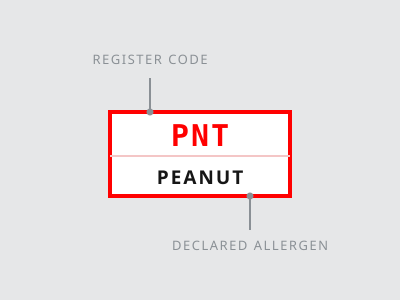
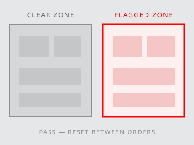
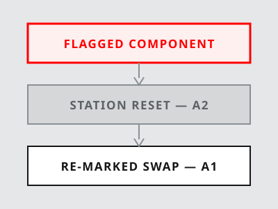

<header>
Clear Plate Manual
Station Controls
</header>

# Allergen Marker Key {#sheet-marker-key}

| Parameter      | Value     |
| -------------- | --------- |
| Register       | CPM-A1-17 |
| Glyph set      | CPM-G9    |
| Markers in use | 10        |
| Review cycle   | 90 d      |
| Last review    | 17-04     |
| Station audits | 4× / wk   |
| Boards in use  | 05        |
| Chips per day  | 240       |
| Sheet revision | 17.2      |

<aside class="warning">

Read First

- A marker states a declared allergen. It is not a verdict on who may eat the dish.
- An unmarked row means no declared allergen in that component as supplied.
- Markers travel with the component. Re-mark every decant before it leaves the bench.
- A missing or unreadable chip holds the component. Bin it; never guess the lot.
- Trace wording is not a marker. Log it and keep the component on the flagged side.
- A chip stays on the container until it is emptied, and goes to the bin with it.

</aside>

## Marker Legend {.hd-ingredient}

| Component group          | Marker               |
| ------------------------ | -------------------- |
| Finned fish, roe, sauce  | <mark>Fish</mark>    |
| Prawn, crab, krill       | <mark>Crust</mark>   |
| Butter, cream, cheese    | <mark>Milk</mark>    |
| Yolk, white, albumen     | <mark>Egg</mark>     |
| Wheat, barley, rye, malt | <mark>Gluten</mark>  |
| Tofu, miso, tamari       | <mark>Soy</mark>     |
| Peanut, oil, flour       | <mark>Peanut</mark>  |
| Almond, cashew, walnut   | <mark>Tree</mark>    |
| Seed, paste, oil         | <mark>Sesame</mark>  |
| Treated fruit, wine      | <mark>Sulfite</mark> |
| No declared allergen     | <mark>None</mark>    |

<aside class="warning">

Register Notes

- The legend lists what a marker covers in this kitchen, not what a supplier prints.
- Two markers on one component are stacked, never merged into a single chip.
- A component that leaves the register loses its marker only after a fresh lot check.

</aside>

## Marking Procedure {.hd-method}

1. Pull the lot code from the delivery note and match it to the Quillmarsh register.
2. Print the chip from the CPM-G9 set; hand-written markers are not accepted here.
3. Fix the chip to the container before the component leaves goods-in.
4. Re-mark every decant, single portions included, at the moment it is filled.
5. Enter the marker, the lot and the station in the day sheet as you go.
6. Re-check the chip at the pass. An unreadable chip holds the whole container.
7. Strip and bin every chip when the station is reset to&nbsp;.
8. File the day sheet at close; the register is rebuilt from it each review cycle.

<aside class="warning">

Chip Stock

- Chips are printed on the shift they are used. Yesterday's roll is not stock.
- A roll that leaves the print station returns to it, or it is binned unused.
- Count the roll in and out against the day sheet; a gap closes the station.
- Blank chips live in the sealed drawer and never sit on an open bench.

</aside>

## Declared Allergen Glyphs {.hd-nutrition}

| Allergen   | Code | Glyph                                                                   | Allergen | Code | Glyph                                                              |
| ---------- | ---- | ----------------------------------------------------------------------- | -------- | ---- | ------------------------------------------------------------------ |
| Fish       | FSH  |              | Soy      | SOY  |           |
| Crustacean | CRU  |  | Peanut   | PNT  |     |
| Milk       | MLK  |              | Tree nut | TRN  |  |
| Egg        | EGG  |                | Sesame   | SES  |     |
| Gluten     | GLU  |          | Sulfite  | SUL  |   |

\* Glyphs are printed at 8 mm minimum on station cards. A glyph supports the written marker; it never replaces it.

# Station Reset Procedure {#sheet-station-reset}

| Parameter         | Value     |
| ----------------- | --------- |
| Reset time        | 00:12     |
| Wipe passes       | 03        |
| Sanitiser contact | 00:30     |
| Boards per set    | 05        |
| Ladles per set    | 04        |
| Cloths per reset  | 03        |
| Audit interval    | 4× / wk   |
| Log retention     | 90 d      |
| Sheet ID          | CPM-A2-17 |

<aside class="warning">

Stop Conditions

- A flagged component on the clear bench stops the station. Reset before the next order.
- A dropped utensil is a flagged utensil. Send it to the wash, never to the rinse tap.
- Cloths are single-pass. A cloth that has met a flagged surface goes to the bin.
- A reset that missed the log did not happen. Run it again and sign the sheet.
- A chip that cannot be read stops the container, and the container stops the bench.

</aside>

## Verification Points {.hd-ingredient}

| Checkpoint                                                          | Result            |
| ------------------------------------------------------------------- | ----------------- |
| Bench cleared to bare surface                                       | <mark>Pass</mark> |
| Open components binned                                              | <mark>Pass</mark> |
| Detergent wash completed                                            | <mark>Pass</mark> |
| Sanitiser held 30 s                                                 | <mark>Pass</mark> |
| Single-pass cloth used                                              | <mark>Pass</mark> |
| Boards drawn from sealed rack                                       | <mark>Pass</mark> |
| Ladle set re-counted to 04                                          | <mark>Pass</mark> |
| Markers re-applied to&nbsp; | <mark>Pass</mark> |
| Extractor filter checked                                            | <mark>Hold</mark> |
| Shared toaster isolated                                             | <mark>Hold</mark> |
| Day sheet signed                                                    | <mark>Pass</mark> |

<aside class="warning">

Held Points

- A held point keeps the station closed for allergen-free service until it clears.
- Two held points on one shift escalate to the head of section before the next order.
- Record the clearing time against the held point; a blank field reads as unresolved.

</aside>

## Reset Sequence {.hd-method}

1. Clear the bench: every container, board, cloth and utensil leaves the surface.
2. Bin all open components on the flagged side; nothing open survives a reset.
3. Wash the surface with detergent, rinse it, then apply sanitiser for 30 seconds.
4. Dry with a fresh single-pass cloth and air-dry the final pass where you can.
5. Rebuild with clean boards and ladles drawn from the sealed rack, counted in.
6. Re-mark every decant against&nbsp;&nbsp;before it returns to the bench.
7. Walk the verification points below and mark each one pass or hold.
8. Sign the day sheet with the time, the station and your initials.

<aside class="warning">

After the Reset

- The bench is clear only for the order it was reset for. The next order resets again.
- A reset does not carry between shifts. The incoming section runs its own.
- Boards leave the sealed rack one set at a time; an open rack is a flagged rack.
- Log the reset before the first component lands, not after service.

</aside>

## Hold and Discard Limits {.hd-nutrition}

| Control point        | Limit  | Action  | Control point         | Limit | Action  |
| -------------------- | ------ | ------- | --------------------- | ----- | ------- |
| Hot hold above 63 °C | 2 h    | Discard | Opened cream at 5 °C  | 24 h  | Discard |
| Cold hold below 5 °C | 4 h    | Discard | Dressed base at 5 °C  | 2 h   | Discard |
| Bench at ambient     | 20 min | Reset   | Decant without a chip | 0 min | Bin     |
| Sanitiser contact    | 30 s   | Re-wipe | Cloth, single pass    | 1 use | Bin     |
| Log entry after work | 15 min | Sign    | Board rotation        | 4 h   | Swap    |
| Chip legible at pass | 0 min  | Hold    | Sealed rack, opened   | 1 set | Reseal  |

\* Limits are this manual's own service window. Where the house policy is shorter, the shorter figure stands.

# Substitution Reference {#sheet-substitution}

| Parameter          | Value     |
| ------------------ | --------- |
| Approved swaps     | 14        |
| Withdrawn swaps    | 00        |
| Validation batches | 03        |
| Sensory panel      | 06        |
| Yield tolerance    | ±5%       |
| Re-test cycle      | 180 d     |
| Register           | CPM-A3-17 |
| Sheet revision     | 17.2      |

<aside class="warning">

Swap Limits

- A swap is approved for the recipe it is listed against, not for the kitchen at large.
- A swap removes one declared allergen. It does not make a dish fit for every guest.
- Re-run the ingredient check after any swap. The old chip does not carry over.
- A swap outside this sheet is a new recipe and needs its own validation batches.
- A replacement carries its own marker. Read it before you print the chip.

</aside>

## Swap Register {.hd-ingredient}

| Flagged component      | Marker               |
| ---------------------- | -------------------- |
| Cultured butter        | <mark>Milk</mark>    |
| Single cream           | <mark>Milk</mark>    |
| Feta, brined           | <mark>Milk</mark>    |
| Sourdough crouton      | <mark>Gluten</mark>  |
| Wheat cracker crumb    | <mark>Gluten</mark>  |
| Tahini drizzle         | <mark>Sesame</mark>  |
| Roasted peanut crumble | <mark>Peanut</mark>  |
| Chopped walnut         | <mark>Tree</mark>    |
| Anchovy dressing       | <mark>Fish</mark>    |
| Tamari dressing        | <mark>Soy</mark>     |
| Soft-boiled hen egg    | <mark>Egg</mark>     |
| Peanut chilli oil      | <mark>Peanut</mark>  |
| Smoked mackerel flake  | <mark>Fish</mark>    |
| Dried apricot, treated | <mark>Sulfite</mark> |

<aside class="warning">

Register Scope

- The register covers the controlled recipes of this manual only. Later numbers carry their own sheet.
- A component listed twice keeps one marker per lot; split lots are logged apart.
- Withdrawn swaps stay on the sheet, struck through, until the next revision.

</aside>

## Swap Procedure {.hd-method}

1. Confirm the swap is listed against this recipe number before anything is opened.
2. Reset the station to&nbsp;&nbsp;before the replacement reaches the bench.
3. Draw the replacement from a sealed pack; opened stock is not eligible.
4. Weigh to the ratio below, then check the yield against the ±5% tolerance.
5. Print a fresh chip from&nbsp;&nbsp;and fix it before the container is filled.
6. Record the swap, the lot and the batch number in the day sheet.
7. Read the ingredient check back to the guest before the plate leaves the pass.

<aside class="warning">

Validation

- A swap enters the register after three batches and one sensory panel, not before.
- Yield outside ±5% sends the swap back to validation, whatever the panel scored.
- Re-test every swap on the 180-day cycle; a lapsed swap leaves the sheet.
- A withdrawn swap stays struck through so the day sheets still read true.

</aside>

## Approved Substitutions {.hd-nutrition}

| Flagged component   | Replacement     | Ratio | Flagged component      | Replacement    | Ratio |
| ------------------- | --------------- | ----- | ---------------------- | -------------- | ----- |
| Cultured butter     | Olive oil       | 0.80  | Roasted peanut crumble | Toasted corn   | 0.90  |
| Single cream        | Potato cream    | 1.00  | Chopped walnut         | Pumpkin seed   | 1.00  |
| Feta, brined        | Brined olive    | 0.90  | Anchovy dressing       | Caper brine    | 0.75  |
| Sourdough crouton   | Polenta crisp   | 0.85  | Tamari dressing        | Mushroom glaze | 1.05  |
| Wheat cracker crumb | Corn crisp      | 1.00  | Soft-boiled hen egg    | Roast chickpea | 1.20  |
| Tahini drizzle      | Sunflower paste | 1.00  | Dried apricot, treated | Untreated fig  | 0.95  |
| Peanut chilli oil   | Chilli oil      | 1.00  | Smoked mackerel flake  | Roast tomato   | 0.80  |

\* Ratios are by weight against the flagged component. Every replacement above sits in the register as <mark>None</mark> — anything outside this list does not.
