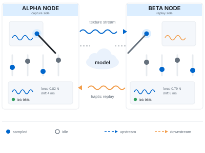
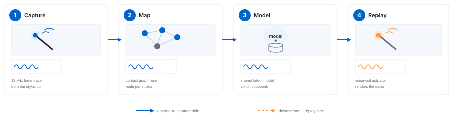
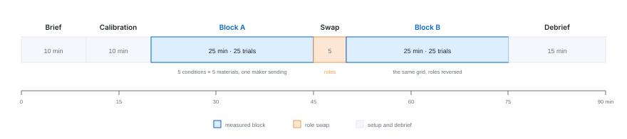
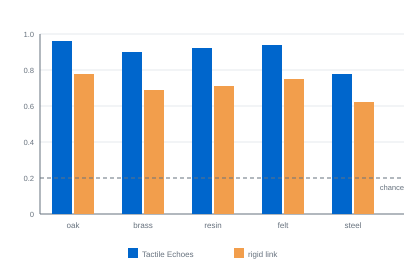

<p class="meta eyebrow">Nexus Interaction Forum 2026</p>

# Tactile Echoes<span class="subhead">Shared Haptics for Remote Making</span>

<p class="byline">Amara Veldt<sup>1</sup>, Idris Kolev<sup>1</sup>, Ravenna Sund<sup>2</sup>, Tomás Ibarra<sup>3</sup>, Wen Halloway<sup>1</sup></p>

<p class="meta">
<sup>1</sup> Draymoor Institute of Interaction &nbsp;·&nbsp; <sup>2</sup> Kestrel Applied Labs, Aventine &nbsp;·&nbsp; <sup>3</sup> University of Nordholm
</p>

---

<p class="abstract"><b>Abstract</b> Remote making already moves video, speech and the occasional photograph between workshops; it almost never moves touch. We present Tactile Echoes, a system that treats contact as a signal to be captured, encoded and resynthesised rather than streamed. An instrumented stylus samples tangential force at 12 kHz, an encoder folds each 256-sample frame into a six-bit code, and a codebook shared by every node in a session turns that code back into a texture at the far end, so that 281 bit/s crosses the link in place of the 192 kbit/s a raw trace would need. In a study with fourteen pairs of remote collaborators and 700 trials, makers named the material under the far stylus from touch alone in 90% of trials under the echo condition, against 71% under a rigid waveform link, at half the latency and a third of the force error.</p>

<p class="concepts"><b>Forum Concepts</b> Bodily interaction → Haptic reproduction; Shared physical presence. Making practice → Distributed workshops; Tool-mediated skill. Signal handling → Perceptual coding; Low-rate transport. <i>(Nexus Concept Scheme 2026)</i></p>

<p class="keywords"><b>Keywords</b> remote making; haptic rendering; texture resynthesis; latent coding; shared codebook; craft practice</p>

## Introduction {#sec-intro}

<aside class="sidenote">
<p>Eleven makers at the Draymoor workshop took part in the pilot that set the sampling rate and the wrist-mounted actuator.</p>
</aside>

Remote making has become ordinary. A maker steers a tool in one workshop while a
collaborator follows from another city, and what travels between them is video, speech and
the occasional still photograph <a href="#ref17" data-ref="cite"></a>. Touch almost never makes the trip. Tactile
Echoes treats contact itself as a signal that can be captured, compressed and re-rendered at
the far end of an ordinary network link.

Our starting point is that most craft feedback is high in frequency and small in amplitude.
A blade catching a grain boundary, a bead of solder wetting a pad, a router bit chattering
in a fixture: each leaves a vibration signature that a trained hand reads instantly
<a href="#ref5" data-ref="cite"></a>, <a href="#ref16" data-ref="cite"></a>. Sampled at 12 kHz and replayed through a voice-coil
actuator, those signatures stay recognisable even after aggressive quantisation.

<aside class="sidenote">
<p>Traces were recorded with consent and stripped of workshop audio before they were uploaded to the shared model.</p>
</aside>

The difficulty is that raw vibration does not survive the trip. Jitter smears the transients
that carry the most information, and packet loss turns a continuous surface into a stutter
<a href="#ref3" data-ref="cite"></a>. Rather than stream waveforms, we stream a small latent description of the
contact and let the receiving node resynthesise a plausible texture from it. The echo is not
identical to the original, but it is stable, cheap and, in our study, more legible than the
waveform it replaces.

This extended abstract makes four contributions. First, a capture-and-resynthesis pipeline
that carries surface contact at 281 bit/s. Second, a codebook shared across a session rather
than mirrored per node, so that a maker who joins late inherits a texture instead of
relearning one. Third, a five-condition study with fourteen pairs of remote collaborators
that reports recognition, latency, force agreement and task time. Fourth, a reading of those
results that puts repeatability ahead of fidelity as the property remote touch should be
designed for.

<a href="#sec-related" data-ref="sec"></a>&nbsp;places the work among earlier attempts to move contact across a link.
<a href="#sec-system" data-ref="sec"></a>&nbsp;describes the system, <a href="#sec-study" data-ref="sec"></a>&nbsp;the study and <a href="#sec-findings" data-ref="sec"></a>&nbsp;what we found.
<a href="#sec-discussion" data-ref="sec"></a>&nbsp;and <a href="#sec-conclusion" data-ref="sec"></a>&nbsp;discuss the consequences and close with the limits we hit: rigid materials, sustained
contact and anything that depends on absolute force rather than surface change.

## Related Work {#sec-related}

### Streaming the waveform {#sec-streaming}

The direct approach to remote touch is to move the contact waveform itself. Contact
signatures are stable enough to identify a material from a few hundred milliseconds of
tangential force <a href="#ref16" data-ref="cite"></a>, and voice-coil actuators reproduce surface transients
faithfully enough for that identification to survive rendering <a href="#ref7" data-ref="cite"></a>. What does not
survive is the network. Measurements of jitter and loss on ordinary links show that the
transients doing the identifying are the first thing to go <a href="#ref3" data-ref="cite"></a>, and an analysis of
what remains after a lossy hop finds that perceived grain collapses long before mean energy
does <a href="#ref11" data-ref="cite"></a>. Our rigid and damped conditions in <a href="#sec-conditions" data-ref="sec"></a>&nbsp;are our reading of this
line of work, and they behave in the study much as that literature predicts.

### Learned texture models

A second line replaces the waveform with a learned description. Latent codes for
low-bandwidth texture transfer reduce a spectral frame to a handful of bits and resynthesise
at the far end <a href="#ref9" data-ref="cite"></a>, and compact codebooks of the order of sixty-four entries have
been shown to cover the textures of a single workshop <a href="#ref15" data-ref="cite"></a>. Two problems recur.
Codebooks drift over a long session as the encoder adapts to whatever is currently under the
tool <a href="#ref2" data-ref="cite"></a>, and quantisation interacts badly with the dynamic range of small
wrist-mounted actuators <a href="#ref4" data-ref="cite"></a>. A grammar of tool contact that treats a stroke rather
than a frame as the unit of description <a href="#ref6" data-ref="cite"></a>&nbsp;addresses the first problem by
enlarging the unit; we address it instead by moving the codebook off the node.

### Presence rather than fidelity

A third line argues that remote collaboration is served better by a signal that is
consistent than by one that is accurate. Repeatability has been reported to matter more than
realism in remote touch <a href="#ref14" data-ref="cite"></a>, and shared workspaces have been shown to sustain a
sense of presence on signals that no participant would call faithful <a href="#ref8" data-ref="cite"></a>. The
five-way discrimination task we use as our recognition measure comes from this literature
<a href="#ref10" data-ref="cite"></a>, as does the finding that coarse displays are read faster than continuous
ones during time-critical manual work <a href="#ref1" data-ref="cite"></a>. Practical accounts of what remote makers
actually ask for <a href="#ref17" data-ref="cite"></a>, of what breaks when a collaborator joins a session already
in progress <a href="#ref13" data-ref="cite"></a>, and of two-handed assembly at a distance <a href="#ref12" data-ref="cite"></a>&nbsp;frame
the design requirements we work to.

## System Design {#sec-system}

Each workstation runs an identical node. An instrumented stylus samples tangential force, a
lightweight encoder folds the spectrum into a six-bit code, and a shared model held on the
forum server reconciles the two streams so that either side can act as sender or receiver
without reconfiguration.

{#fig-nodes}

Because the model is shared rather than mirrored, a node that joins late inherits the session
texture instead of rebuilding it from scratch.

### Capture

The stylus carries a strain gauge at the tip and a three-axis accelerometer in the shaft.
Only the tangential component is transmitted; normal force is logged for the analysis in
<a href="#sec-agreement" data-ref="sec"></a>&nbsp;but is never sent. The signal is sampled at 12 kHz and cut into frames of 256
samples, so each frame covers 21.3 ms of contact. Frames overlap by half, which costs
nothing at this rate and keeps a transient from falling into the seam between two frames.

Calibration takes about a minute. The maker draws the stylus across a reference plate at
three speeds while the node fits a gain curve to the tip gauge, which removes most of the
variation between individual instruments. The accelerometer is used only to decide when the
stylus is in contact at all: contact is declared once tangential force exceeds 0.05 N for
three consecutive frames and released after ten frames below it.

### Encoding

<aside class="sidenote">
<p>The codebook holds sixty-four entries, one for each six-bit code, and the server rewrites it after every thirty seconds of contact.</p>
</aside>

Each frame is reduced to twenty-four log-spaced bands between 40 Hz and 5 kHz, embedded in
twelve dimensions, and quantised against the shared codebook. With sampling rate $f_s$, frame
length $L$ and $b$ bits per frame, the rate on the link is

$$
R = \frac{f_s\,b}{L} = \frac{12000 \times 6}{256} = 281\ \mathrm{bit/s}
$$

which is roughly 680 times less than the 192 kbit/s that the unfiltered 16-bit trace would
require. The encoder proposes a codebook revision only when the quantisation residual exceeds
a threshold $\tau$, fixed at 0.18 on the pilot traces.

Twenty-four bands and twelve dimensions were the smallest pair that survived the pilot
without audible banding. Fewer bands blurred the boundary between oak and cast resin, and
fewer dimensions collapsed brass and polished steel onto the same entry; larger values cost
rate without changing what the pilot makers could name.

<div class="wide-code">

```text
capture(t):
    frame    ← window(force[t], 256)              # 21.3 ms of tangential force at 12 kHz
    spectrum ← mel(frame, bands = 24)             # 24 log-spaced bands, 40 Hz to 5 kHz
    latent   ← encode(spectrum) ⊕ session_ctx     # 12-dim embedding, biased by the session
    code     ← quantise(latent, bits = 6)         # nearest of 64 shared codebook entries
    if residual(latent, code) > τ:                # τ = 0.18, fixed on the pilot traces
        propose(code, latent)                     # the server may fold it into the codebook
    return code                                   # 6 bits per frame, 281 bit/s on the link
```

</div>

### A codebook the session shares

The entry that matters is not the one a single node finds useful but the one both nodes agree
on. The server therefore accepts proposals from either side and blends them into the shared
codebook only when an entry is being used far more often than its neighbours, which keeps a
single unusual stroke from rewriting a texture that the other maker is relying on.

```text
on_propose(code, node):
  hits[code] += 1
  if hits[code] > 3 · median(hits):
    old ← codebook[code]
    new ← latent(node)
    codebook[code] ← blend(old, new, α)
```

The blend weight $\alpha$ is 0.2, which is slow enough that an entry takes several proposals
to move and fast enough to follow a change of material within a stroke or two. One
consequence is that codebook drift, which is the failure mode reported for per-node
schemes <a href="#ref2" data-ref="cite"></a>, becomes a property of the session rather than of a participant. A
maker who joins twenty minutes in receives the current sixty-four entries and is immediately
working in the same texture space as everyone else <a href="#ref13" data-ref="cite"></a>.

### Replay

The receiving node looks the code up, resynthesises a frame and drives a wrist-mounted
voice-coil actuator. Because resynthesis is local, a dropped packet costs one frame rather
than a stutter: the node repeats the previous code until a new one arrives, and at 21.3 ms
per frame a single repetition is below the threshold at which our pilot makers noticed
anything. Quantisation is set conservatively against the actuator's dynamic range, following
the limits reported for wrist-mounted hardware <a href="#ref4" data-ref="cite"></a>.

{#fig-pipeline .full-width}

## Study {#sec-study}

Fourteen pairs of collaborators completed a matched pair of assembly tasks under five link
conditions. Each pair worked from separate rooms with audio and video always available, so
the only variable was what the receiving stylus did with the contact signal.

### Participants

Twenty-eight makers took part, recruited in pairs from two community workshops and a
university studio. Ages ranged from 21 to 58 (median 34), and self-reported workshop
experience from 1 to 31 years (median 6). Thirteen participants described themselves as
women, fourteen as men, and one declined to state. None had used a haptic display before.
The eleven makers of the pilot were not eligible.

### Task and materials

Both tasks were drawn from ordinary workshop practice: seating a brass hinge in a routed
recess, and soldering a connector onto a small board held in a fixture. Five materials were
presented under the sending stylus in each trial — oak, brass sheet, cast resin, dense felt
and polished steel — and the receiving maker named the one they believed they were feeling.
With five alternatives, chance performance is 0.20.

### Link conditions {#sec-conditions}

<figure class="tbl" id="tbl-conditions">

<figcaption>The five link conditions. Only the last shares a codebook across the session.</figcaption>

| Condition          | Carried over the link  | Codebook    |
| ------------------ | ---------------------- | ----------- |
| Rigid link         | 12 kHz force trace     | none        |
| Damped link        | 1 kHz damped trace     | none        |
| Latent model       | six-bit code           | per node    |
| Hybrid relay       | six-bit code, envelope | per node    |
| **Tactile Echoes** | **six-bit code**       | **session** |

</figure>

The rigid and damped conditions stand for the streaming approach of <a href="#sec-streaming" data-ref="sec"></a>, unfiltered
and low-passed respectively. The latent condition isolates resynthesis from sharing: it runs
the same encoder but keeps the codebook on the node. The hybrid relay adds a 1 kHz amplitude
envelope alongside the code, which is the obvious compromise and, as <a href="#sec-findings" data-ref="sec"></a>&nbsp;shows, the
least interesting one.

### Procedure and measures

<aside class="sidenote">
<p>Sessions ran ninety minutes. Pairs swapped roles once, so every maker both sent and received.</p>
</aside>

Each pair completed twenty-five recognition trials in each role, one for every combination of
condition and material, for 50 trials per pair and 700 in total. Condition order was
counterbalanced with a 5 × 5 Latin square; the four pairs beyond the two full squares were
assigned rows at random. We recorded recognition, round-trip latency, force error and task
time, and logged every stroke the sending stylus made.

{#fig-timeline .full-width}

## Findings {#sec-findings}

Resynthesis beat transmission on every measure we recorded. Pairs on the echo condition
settled into a rhythm of short probing strokes, whereas pairs on the rigid link pressed
harder and longer, apparently compensating for a signal they did not trust.

### Recognition

Recognition under the echo condition reached 0.90, nineteen points above the rigid link and
seven above the latent model that differs from it only in where the codebook lives. That
seven-point gap is the clearest evidence we have that sharing the codebook, rather than
resynthesis alone, is doing the work. The damped link was the weakest condition of the five,
below even the rigid one: low-passing removes exactly the transients that identify a
material.

<figure class="tbl wide-table" id="tbl-measures">

<figcaption>Mean latency, recognition, force error and median task time across the five link conditions. Recognition is the proportion of the 700 trials in which the receiving maker named the material correctly from touch alone; chance is 0.20.</figcaption>

| Condition          | Link rate     | Latency (ms) | Recognition | Force error | Task time (s) |
| ------------------ | ------------- | ------------ | ----------- | ----------- | ------------- |
| Rigid link         | 192 kbit/s    | 142          | 0.71        | 0.09        | 214           |
| Damped link        | 16 kbit/s     | 128          | 0.68        | 0.11        | 226           |
| Latent model       | 281 bit/s     | 96           | 0.83        | 0.05        | 181           |
| Hybrid relay       | 8.3 kbit/s    | 118          | 0.77        | 0.08        | 197           |
| **Tactile Echoes** | **281 bit/s** | **74**       | **0.90**    | **0.03**    | **163**       |

</figure>

{#fig-recognition}

The per-material breakdown in <a href="#fig-recognition" data-ref="fig"></a>&nbsp;shows where the mean comes from. Oak, felt and cast
resin were recognised in 0.96, 0.94 and 0.92 of echo trials respectively; brass sheet reached
0.90 and polished steel only 0.78. The ordering under the rigid link is the same but
compressed downward, from 0.78 on oak to 0.62 on steel, which suggests that both conditions
are limited by the same property of the material rather than by the link.

### Latency and force agreement {#sec-agreement}

Round-trip latency under the echo condition was 74 ms, 48% below the rigid link. Most of the
difference is payload: 281 bit/s clears a congested link in one packet where 192 kbit/s
queues. The remainder comes from the shared codebook, which removes the per-session
negotiation that the latent condition still pays for.

<aside class="sidenote">
<p>Two pairs worked polished steel throughout the second block. Both fall outside the ±0.04 band.</p>
</aside>

We summarise agreement between the two sides with a single normalised index, where $\xi$ is
the energy the sender measured and $\varphi$ the energy the receiver rendered:

$$
\theta = \frac{\xi - \varphi}{\xi + \varphi}
$$

Values near zero indicate that both sides are working with comparable contact energy. Under
the echo condition the mean of $|\theta|$ was 0.021 (SD 0.014), and $\theta$ stayed inside
±0.04 for twelve of the fourteen pairs. Both exceptions were working on polished steel, the
material on which recognition was also weakest.

### How pairs worked

The behavioural difference was larger than the numbers alone suggest. Under the echo
condition the median trial contained eleven strokes against six under the rigid link, and
median stroke length fell from 47 mm to 18 mm. Median peak force fell from 1.9 N to 0.8 N.
Makers on the echo condition were, in short, sampling the surface rather than pushing into
it, and several said so unprompted in the debrief.

### Reading the interface

The interface followed the same logic. Rather than show a waveform, the receiving node
displays four coarse states, and makers reported that the coarse display was easier to read
mid-task than the continuous trace we started with — a result consistent with earlier work on
time-critical manual displays <a href="#ref1" data-ref="cite"></a>. Glances at the panel fell from a median of nine
per trial with the continuous trace in the pilot to three with the four-state display.

{#fig-states}

## Discussion {#sec-discussion}

### Repeatability before fidelity

Makers did not describe the echo as realistic, and they did not need to. What mattered was
that the same gesture produced the same sensation every time, so that a difference in the
signal could be read as a difference in the work rather than as noise in the link. Fidelity
turned out to be worth less than repeatability, which is what the presence literature has
argued on other grounds <a href="#ref14" data-ref="cite"></a>.

### Design implications

Three consequences follow for anyone building in this space. Share the codebook rather than
the waveform: the seven-point gap between the latent and echo conditions is the price of
keeping a texture private to a node. Quantise coarsely and consistently, because a stable
approximation is read faster than an unstable accurate one. And display states, not signals;
the four-state panel was glanced at a third as often as the trace it replaced, and that
attention went back into the work.

### Limitations

The limits are clear enough. Rigid materials with little surface change give the encoder
almost nothing to work with, which is why polished steel is the worst material in every
condition we ran <a href="#ref11" data-ref="cite"></a>. Sustained contact drifts as the codebook adapts, so a
minute-long cut is described less well at its end than at its beginning. Any task that
depends on absolute force rather than on change over time falls outside what a resynthesised
echo can carry, since we deliberately transmit no normal force at all. The study is also
small: fourteen pairs, two tasks, five materials, one workshop tradition.

## Conclusion {#sec-conclusion}

Tactile Echoes carries workshop contact between two remote makers at 281 bit/s by encoding it
rather than streaming it, and by holding the codebook that decodes it in the session rather
than on the node. Across 700 trials with fourteen pairs, this raised material recognition
from 0.71 to 0.90, cut round-trip latency by 48% and reduced force error to a third of the
rigid-link baseline, while makers moved from pressing to probing. We read the result as an
argument for designing remote touch around what stays the same rather than around what is
accurate. We are extending the codebook to two-handed work next <a href="#ref12" data-ref="cite"></a>, where two
styli on the same surface must share a description without either one dominating it.

## References ##

<ol class="cite-items">
<li id="ref1">P. Aldenmere. Coarse displays for time-critical manual work. <em>Proc. Nexus Interaction Forum</em>, 118–130, 2023.</li>
<li id="ref2">P. Ashgrove. Codebook drift in long collaborative sessions. <em>Journal of Tangible Systems</em>, 17(3):300–312, 2023.</li>
<li id="ref3">M. Brandeis. Jitter, loss and the perception of continuity. <em>Kestrel Technical Notes</em>, 145–156, 2019.</li>
<li id="ref4">K. Duvenoy and L. Halverne. Quantisation limits for wrist-mounted actuators. <em>Proc. Symposium on Embodied Fabrication</em>, 88–99, 2022.</li>
<li id="ref5">W. Halloway. Reading the workshop by hand. <em>Proc. Nexus Interaction Forum</em>, 61–70, 2021.</li>
<li id="ref6">L. Halverne. A grammar of tool contact. <em>Transactions on Craft Computing</em>, 74–91, 2021.</li>
<li id="ref7">T. Ibarra. Voice-coil rendering of surface transients. <em>Nordholm Reports on Interaction</em>, 16(1):5–19, 2023.</li>
<li id="ref8">F. Kelmscour. Presence without fidelity in shared workspaces. <em>Journal of Haptic Practice</em>, 5(2):33–47, 2024.</li>
<li id="ref9">I. Kolev. Latent codes for low-bandwidth texture transfer. <em>Proc. Aventine Symposium</em>, 211–223, 2022.</li>
<li id="ref10">J. Marrenholt and D. Tarrowby. Naming materials by touch: a five-way discrimination task. <em>Journal of Haptic Practice</em>, 4(1):12–29, 2023.</li>
<li id="ref11">C. Osterhalt. What survives a lossy link: transients and the perception of grain. <em>Journal of Tangible Systems</em>, 15(4):210–226, 2022.</li>
<li id="ref12">S. Ruhle. Two-handed assembly at a distance. <em>Proc. Draymoor Workshop Series</em>, 12–24, 2024.</li>
<li id="ref13">H. Sableau. Late joining in continuous collaborative sessions. <em>Kestrel Technical Notes</em>, 202–214, 2023.</li>
<li id="ref14">R. Sund. Repeatability over realism in remote touch. <em>Transactions on Craft Computing</em>, 40–52, 2020.</li>
<li id="ref15">D. Tarrowby. Sixty-four textures: compact codebooks for contact audio. <em>Proc. Symposium on Embodied Fabrication</em>, 140–152, 2024.</li>
<li id="ref16">A. Veldt. Contact signatures in shared workshop practice. <em>Journal of Tangible Systems</em>, 14(2):88–104, 2021.</li>
<li id="ref17">A. Veldt and I. Kolev. Video is not enough: what remote makers ask for. <em>Proc. Draymoor Workshop Series</em>, 55–68, 2021.</li>
</ol>
