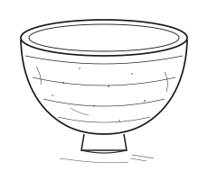
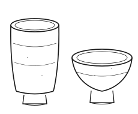

## 茶碗と茶の湯

茶碗が茶の湯の世界で特別な意味をもつようになったのは、室町時代の中頃、{村瀬宗珪|むらせそうけい}（一四三一〜一五〇六）の時代にさかのぼる。宗珪は、唐物の大振りな茶碗を用いる風潮に対し、国焼の素朴な茶碗を重んじ、「器の美を悦ばず、茶の味を貴ぶ」と語ったと伝えられる「宗珪語録」巻上（雲間書店、二一頁）。。器の優劣よりも、茶を点てる心のあり方こそが大切であるというこの考え方は、のちの茶の湯の精神的支柱となっていく。

{#fig-ido}

<aside class="column">
<h3>茶碗の銘の付け方</h3>

茶碗には銘を付けることで、独自の由緒が与えられる。銘は姿や景色、由来、茶席での出来事などから茶人が命名する。宗珪が苫緒で得た小振りの井戸形は、口辺の欠けを直した跡から「片時雨」と呼ばれた。名付け親が誰であるかによって、同じ器の評価が変わることさえあった。

</aside>

宗珪の影響を受けた{梶浦紹閑|かじうらじょうかん}（一五一〇〜六八）は、茶碗の取り合わせに独自の美意識を打ち立てた。名物の価値は、産地や作行きだけでなく、茶人の手に渡ってからの「見立て」によって決まるとされた棚倉惟史「茶の湯名物記」（三日月坂出版、五七頁）。。紹閑は井戸形や筒茶碗など日常の器を茶席の中心に据え、侘びの美を体現した。

こうして茶碗は、単なる道具ではなく、茶の湯の美学を体現する存在へと高められていった。以下では、その過程を器の側から、すなわち焼物としての茶碗の側からたどってみたい。

<aside class="column">
<h3>唐物と国焼</h3>

唐物とは大陸から渡ってきた器を、国焼とは国内の窯で焼かれた器を指す。室町の茶席では唐物が上位に置かれたが、宗珪以後は国焼のなかにも見どころを見いだす目が育ち、両者の序列はしだいに緩んでいった。高麗の井戸形が珍重されたのも、この目の変化と無縁ではない。

</aside>

{塩屋宗晏|しおやそうあん}（一五三三〜一六〇一）は、茶碗の選び方をさらに一歩進めた。姿かたちよりも、手にしたときの重みや肌合い、茶を点てたときに見込みへ生まれる景色を重んじたのである。宗晏が弟子に語ったという「碗は目で見るにあらず、掌で聴くものなり」という言葉塩屋宗晏の語として「苫緒茶会記」（雲間書店、八八頁）に引く。は、いささか謎めいて響くが、要するに茶碗の良し{悪|あ}しは手が先に知る、という意味であろう。

手取りとは、茶碗を掌に載せたときの総合的な感覚を指す言葉である。重さそのものではなく、重心の位置、高台の当たり、釉の肌が指に返してくる冷たさや温もりまでを含む。に示した井戸形は、口が開いて腰が深く、掌に収まると器のほうから重みを預けてくるような姿をしている。宗晏が好んだのは、こうした持ったときに応えのある器であった。

もっとも、手取りの良し悪しは言葉にしにくい。だからこそ茶席では、亭主と客が同じ器を代わるがわる掌に載せ、無言のうちに評価を交換するという作法が育った。拝見と呼ばれるこの所作は拝見の作法については棚倉惟史「茶の湯名物記」（三日月坂出版、一一二頁）に詳しい。、批評の場であると同時に、器を介した会話の形式でもあった。

<aside class="column">
<h3>土と釉のこと</h3>

土は器の骨格を、釉は表情をつくる。同じ土でも、焼成の温度と窯のなかの空気の流れが変われば、上がりは別物になる。窯変と呼ばれる予期せぬ景色は、作り手の技のうちに数えられることもあれば、窯の気まぐれとされることもある。

</aside>

茶碗の性格を決めるのは、まず土である。碧海の{苫緒|とまお}窯で採れる土は鉄分を多く含み、焼き上がると赤みを帯びた肌になる。これに長石を主とした釉を薄く掛けると、縮れた白濁が生まれ、器の腰のあたりに淡い斑となって現れる。窯ごとに土の性質が違う以上、同じ形を狙って作っても、上がってくる器の表情はまるで違う碧海地方の窯については「碧海窯業誌」（雲間書店、三一頁）。。

{#fig-tsutsu}

形にも幾つかの型がある。に並べたのは、口をすぼめた筒形と、口の開いた平形である。筒形は湯が冷めにくく、寒い季節の茶に向く。平形は茶の面が広く見え、夏の茶席で好まれる。器の形は、見た目の好みである以前に、その日の気候と客のための選択なのだと紹閑は説いた。

とりわけ高台は、作り手の癖が最も正直に出る場所とされる。{轆轤|ろくろ}から切り離した跡、削りの深さ、土見せの幅──いずれも装飾ではなく、作業の痕跡にすぎない。しかし茶人たちは、そこにこそ器の素性が現れると考えた。高台を見る、という言い方が今なお生きているのは、この見方が長く受け継がれてきたからである。

<aside class="column">
<h3>茶会記という帳面</h3>

茶会記は、茶事の日付・客組・道具立て・献立を書き並べた記録である。もともとは亭主の備忘のためのものだったが、書き継がれるうちに、道具の履歴をたどるための資料となった。今日、器の伝来が語れるのは、この種の帳面が残されたからである。

</aside>

茶碗は、使われることではじめて茶碗になる。棚に飾られている間は、それはまだ焼物にすぎない。湯を注がれ、茶筅が当てられ、客の唇が触れて、器はようやく茶碗としての務めを果たす。だから茶人たちは、器の傷や{罅|ひび}を必ずしも欠点とは考えなかった。使われた証しとして、むしろ由緒の一部に数えたのである。

割れた器を漆で{繕|つくろ}い、金粉で仕上げる手当ては、この考え方の延長線上にある。継いだ跡は隠されず、むしろ景色として眺められた繕いの作法については「苫緒茶会記」（雲間書店、一三〇頁）。。壊れる前の姿に戻すのではなく、壊れたという出来事ごと器の履歴に書き込んでしまう。修理というより、記録に近い作法である。

こうした扱いを可能にしたのは、茶席が記録の場でもあったことによる。誰がいつどの器を用い、客が何を語ったかは、{茶会記|ちゃかいき}と呼ばれる備忘の帳面に書きとめられた。茶会記は献立表であり、同時に器の台帳でもある。ある茶碗がいつどこに現れ、次にどこへ移ったかを追えるのは、この地味な帳面のおかげなのである茶会記の書式については棚倉惟史「茶の湯名物記」（三日月坂出版、二〇一頁）。。

## 銘と伝来

器に名を与えるという習慣は、茶の湯に固有のものではない。刀にも、香木にも、名は付けられてきた。ただし茶碗の銘には、他と少し違う事情がある。刀の名が来歴や作者を指し示すのに対し、茶碗の銘は、しばしばその器を見た人間の感想そのものだからである銘の分類については棚倉惟史「茶の湯名物記」（三日月坂出版、七八頁）。。

「片時雨」も「{苫舟|とまぶね}」も、器の側にそう書いてあるわけではない。誰かがそう見た、というだけのことである。にもかかわらず銘は、いったん定まると器から離れなくなる。以後その茶碗は、名を通してしか語られなくなるのである。

名がひとり歩きを始めると、器そのものは見えにくくなる。銘を知らずに見れば、ただの小振りな井戸形にすぎない器が、名を聞いたとたんに由緒ある名物として立ち現れる。この逆転こそ、茶碗の文化史がくり返し扱ってきた主題にほかならない「宗珪語録」巻下（雲間書店、六二頁）。。

<aside class="column">
<h3>箱書と極め</h3>

茶碗は箱に納めて伝えられる。箱の蓋裏に器の名と由来を書きつけたものを箱書という。誰が書いたかによって重みが変わるため、箱書は器の価値を左右した。器より箱のほうが饒舌である、という皮肉もここから生まれる。

</aside>

<aside class="column">
<h3>本歌と写し</h3>

すぐれた器を手本に、同じ形の器を作ることを写しという。手本のほうは本歌と呼ばれる。写しは贋物ではない。誰の何を写したかを明示するのが約束であり、そこには手本への敬意と、作り手の読みの両方が表れる。

</aside>

銘が定まった器は、人から人へ渡っていく。譲られ、贈られ、時には{質|しち}草にもなった。所有者が変わるたびに、その事実が箱書や茶会記に書き加えられ、器の履歴は少しずつ厚みを増していく。伝来とは、この積み重ねの記録のことである伝来の書式については「苫緒茶会記」（雲間書店、一七頁）。。ある器の伝来を{辿|たど}ることは、その器を通り抜けていった人々の名を数えることでもある。

面白いのは、伝来が長くなるほど、器の見え方が変わっていくことである。宗晏の手を経たと伝わる茶碗は、たとえ作りが凡庸であっても、凡庸なままには見られない。人々はそこに、宗晏が見たはずの何かを探そうとする。器を見ているようでいて、実は先人の視線をたどっているのである塩屋宗晏「数寄書留」（三日月坂出版、四五頁）。。写しと呼ばれる模作が数多く作られたのも、この視線の連鎖と無縁ではない。

もっとも、伝来は途切れる。火事で失われ、戦で散り、名だけが記録に残る器も少なくない。失われた器の名を数え上げてゆくと、いま手元にある一碗が、たまたま生き延びたものにすぎないことに気づかされる。

<aside class="column">
<h3>展観と拝見</h3>

美術館で器を見ることを展観、茶席で器を手に取って見ることを拝見という。展観は多くの人に開かれている代わりに、器に触れることを許さない。拝見は触れることを許す代わりに、招かれた者にしか開かれない。どちらが上位ということはない。

</aside>

茶碗が茶席を出て、展示室の硝子越しに眺められるようになったのは、それほど古いことではない。明治の後半、道具商と{数寄者|すきしゃ}たちが競って名物を集め、やがてその一部が美術館へ収まっていく。器はここで、使われる道具から、見られる作品へと立場を変えた近代の蒐集については棚倉惟史「うつわの近代」（三日月坂出版、二二頁）。。美術館の照明の下では、手取りも湯の温もりも確かめようがない。

それを喪失と呼ぶことはたやすい。しかし展観には展観の利点がある。かつて一部の数寄者しか手にできなかった器を、誰もが同じ距離から眺められるようになったからである。茶席での拝見が特権的な経験であったことを思えば、硝子越しの平等はそれなりの達成であった。失われたものと得られたものを、同じ{秤|はかり}に載せて考える必要がある。

問題はむしろ、見られる作品になった器を、それでもなお使おうとする人々が絶えないことにある。年に一度だけ茶を点てるために名物を借り出す茶会は、今も各地で開かれている碧海県苫緒町の月釜など。。器を使うという行為は、いまや保存への静かな抵抗という意味さえ帯びはじめている。

<aside class="column">
<h3>今日の作り手</h3>

現代の陶芸家もまた、茶碗を作りつづけている。窯の多くは電気やガスに変わり、土も精製されたものが手に入る。それでも、掌に載せて確かめるという最後の一手だけは、五百年前と変わらない。手が最後の審級であるという点で、この分野は不思議なほど保守的である。

</aside>

ここまで見てきたように、茶碗の文化史は、器そのものの歴史であると同時に、器をめぐる視線の歴史でもある。土と火が形を与え、茶人が銘を与え、帳面が履歴を与え、美術館が額縁を与えた。一碗の器には、そうした幾層もの手が重なっている。見るとは、その層をひとつずつ剥がしていく作業にほかならない。

宗珪が「器の美を悦ばず」と言ったとき前掲「宗珪語録」巻上（雲間書店、二一頁）。、彼は器を軽んじていたのではない。器に見とれることで、茶そのものが疎かになることを恐れたのである。五百年後の私たちは、その戒めをほとんど逆さまに受け取っている。茶を点てる機会は減り、器を眺める機会だけが増えたからだ。それでも、器の前に立つとき、私たちはやはり手を伸ばしたくなる。

茶碗は、掌に載るほどの小さな器である。しかしその小ささのなかに、五百年分の見方が畳み込まれている。次章では、この見方がどのように学ばれ、伝えられてきたのかを、稽古の場に即して見ていくことにしたい稽古と伝授については次章で詳しく述べる。。
