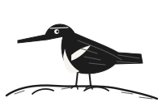
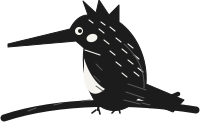
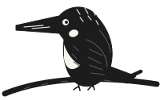
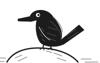
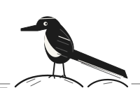
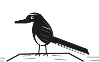

# イソシギActitis hypoleucos

| 項目   | 内容                                                   |
| ------ | ------------------------------------------------------ |
| 大きさ | 全長20cm。ムクドリより小さく尾は短め。                 |
| 時期   | 留鳥または漂鳥。冬は暖地へ移る。                       |
| 環境   | 河川の河原、湖沼のほとり、海岸や干潟。                 |
| 分布   | 全国。北海道と本州で繁殖し、冬は南へ移る。             |
| 羽色   | 上面は灰褐色、下面は白い。肩の前に白い切れ込みが入る。 |
| 虹彩   | 褐色。                                                 |
| 嘴     | 黒褐色でまっすぐ。頭よりやや短い。                     |
| 脚     | 黄色みを帯びた灰緑色。                                 |
| 食性   | 水辺の昆虫や甲殻類、小さな水生動物。                   |
| 行動   | 体の後半を上下に振りながら歩く。低く飛んで移動する。   |
| その他 | 河原の草地や堤防の斜面に巣を作る。                     |

<aside class="note">

**観察メモ**

水際の石の上を歩く姿を目で追うとよい。体の後半を振る動きが手がかりになる。

</aside>

<aside class="note">

**観察メモ**

飛び立っても少し先の河原に降りる。追いすぎず、同じ場所で待つほうがよく見られる。

</aside>

## 分布

北海道と本州の河川や湖沼で繁殖し、冬には本州以南の河原、干潟、海岸へ移動する。全国で見られ、都市の中を流れる川の河原にも入る。単独かつがいで行動し、大きな群れになることは少ない。水際の石や砂の上を歩きながら餌を探し、人が近づくと低く飛んで少し先へ移る。繁殖期には河原の草地や堤防の斜面に巣を作るため、河川敷の管理の時期が繁殖の成否を左右することがある。渡りの時期には海岸や干潟でも見られ、ほかのシギの仲間に混じることがある。

## 識別

全長20cmほどでムクドリより小さい。上面は灰褐色、下面は白く、胸の脇の白い部分が翼の付け根の前へ食い込んで見える。この肩の白い切れ込みが最大の識別点になる。嘴はまっすぐで頭よりやや短く、脚は黄色みを帯びる。飛ぶと翼の中ほどに白い帯が現れ、翼を細かく震わせながら水面すれすれを飛ぶ。歩くときは体の後半を絶えず上下に振る。幼鳥は上面に淡い縁取りが並び、成鳥より模様が細かく見える。

## さえずり

「ピー、ピー」あるいは「チーリーリー」と細く澄んだ声で鳴き、飛び立つときによく声を出す。声は川面をよく渡り、姿が見えなくても近くにいることが分かる。繁殖期には翼を細かく震わせながら河原の上を低く飛びまわり、続けざまにさえずる。警戒すると短く鋭い声を重ね、水際を移りながら遠ざかっていく。数羽が同時に鳴き交わすと声が重なって聞こえる。ふだんは餌を探しながら短く声を出す程度で、長く鳴き続けることは少ない。

# ヤマセミMegaceryle lugubris

| 項目   | 内容                                                 |
| ------ | ---------------------------------------------------- |
| 大きさ | 全長38cm。ハトほどの大きさ。                         |
| 時期   | 留鳥。通年見られる。                                 |
| 環境   | 山地から丘陵の渓流、湖沼、ダム湖。                   |
| 分布   | 北海道から九州まで。冬は下流へ移る個体も。           |
| 羽色   | 白地に黒い斑が全身にあり、後頭に大きな冠羽が立つ。   |
| 虹彩   | 褐色。                                               |
| 嘴     | 黒色で太く長い。                                     |
| 脚     | 灰黒色。                                             |
| 食性   | 魚類のほか、カエルや水生昆虫もとる。                 |
| 行動   | 岩や張り出した枝から水面に飛び込む。停空飛翔もする。 |
| その他 | 川岸の土の崖に横穴を掘って営巣する。                 |

<aside class="note">

**観察メモ**

渓流沿いでは張り出した枝や岩の上を順に探すとよい。声が聞こえたら上流と下流の両方を見渡す。

</aside>

<aside class="note">

**観察メモ**

営巣中の崖には近づかない。遠くから見守り、繁殖の妨げにならないよう心がけたい。

</aside>

## 分布

北海道から九州まで広く分布する留鳥で、山地から丘陵の渓流、ダム湖、湖沼など、流れの見通しがよく水の澄んだ環境に生息する。冬期には結氷や増水を避けて下流や平地の川へ移る個体もある。営巣には土の崖が必要で、止まり場となる張り出した枝や岩とあわせて、その両方がそろう場所に定着する。護岸工事で崖が失われると姿を消しやすい。一つの流域に生息するつがいの数は多くなく、たがいに距離を保って縄張りを構える。

## 識別

全長38cmほどでハトくらいの大きさがあり、日本のカワセミの仲間では最も大きい。全身が白地に黒の細かい斑で覆われ、後頭には逆立った大きな冠羽がある。嘴は黒く太くて長い。飛ぶと翼と尾の白黒の斑が目立ち、遠くからでもよく分かる。雌雄で胸や翼の下面に出る褐色みの強さが異なる。幼鳥は全体に斑が粗く、冠羽も短い。水面の上で停空飛翔することがあり、そのときの姿もよく目立つ。大きさと冠羽で他の種と間違えることはない。

## さえずり

「キャラッ、キャラッ」と大きく響く声で鳴き、渓流の水音の中でもよく通る。飛びながら鳴くことが多く、姿を見つけるより先に声で気づくことが多い。警戒したときにはこの声を短く連ね、飛び去りながら遠ざかっていく。繁殖期にはつがいが向かい合って鳴き交わすこともある。ふだんは止まり場で長い時間じっとしており、そのあいだは声を出さない。渓谷では反響で声の方向を誤りやすい。

# カワセミAlcedo atthis

| 項目   | 内容                                                                   |
| ------ | ---------------------------------------------------------------------- |
| 大きさ | 全長17cm。スズメよりやや大きい。                                       |
| 時期   | 留鳥。通年見られる。                                                   |
| 環境   | 清流や池、沼、河口など、水辺に生息する。                               |
| 分布   | 全国に分布するが、北海道では夏鳥。                                     |
| 羽色   | 上面は鮮やかな青緑色。下面は橙色。頭側線は白く、嘴は黒くて長い。       |
| 虹彩   | 褐色。                                                                 |
| 嘴     | 黒色でまっすぐ、先端は鋭い。                                           |
| 脚     | 赤橙色。                                                               |
| 食性   | 主に小魚をとる。水中に飛び込み、魚を嘴で捕らえる。                     |
| 行動   | 枝や杭に止まり、水面を見つめて魚を狙う。水中にダイビングして捕食する。 |
| その他 | 巣穴を掘る。川岸や土手の崖に穴を掘り、内部に産卵・子育てを行う。       |

<aside class="note">

**観察メモ**

水辺の見通しのよい場所で、静かに観察するとよい。双眼鏡があると行動や羽色の確認に役立つ。

</aside>

<aside class="note">

**観察メモ**

警戒心が強く、人が近づくとすぐに飛び去ることが多い。距離をとり、そっと見守ることが大切。

</aside>

## 分布

全国に分布する留鳥で、平地から山地の河川、湖沼、ため池、用水路、河口の汽水域などの水辺に生息する。北海道では夏鳥として渡来し、本州以南で繁殖する。繁殖期はつがいで行動することが多い。冬期でも餌が確保できる環境では同じ場所にとどまる個体が多い。都市近郊の公園や池でも見られることがあり、環境適応力は高いが、水質汚濁や河川改修による生息環境の悪化が個体数の減少要因となっている。各地で保護の対象とされている。

## 識別

全長17cmほどで、スズメよりやや大きい。体型はずんぐりして首が短く、頭が大きい。嘴はまっすぐで太く、長く鋭い。上面は光沢のある青緑色で、腰や尾は明るい青色。下面は橙色で、喉から胸にかけて白い部分がある。頬の後方に白い斑があり、頭側線も白い。嘴と脚の色のコントラストがはっきりしている。飛翔は速く、直線的に水面すれすれを飛ぶ。オスとメスの羽色はほぼ同じで、若鳥は嘴の下側が赤黒く、下面の橙色がやや淡い。似た種はいないため識別は容易。

## さえずり

繁殖期の早朝や夕方によくさえずる。澄んだ高い声で「チィーッ、チィーッ」と連続して鳴き、ピッ、ピッ、ピッという単調な声を繰り返すこともある。さえずりは縄張りの宣言やつがい間の連絡に使われる。普段はほとんど声を出さず、鳴くときも短い。飛びながら「ピーッ」と鋭く鳴くこともある。警戒時には「キッ、キッ」と乾いた声を出す。水辺の静けさの中で澄んだ声がよく響き、探鳥の際の手がかりになる。

# カワガラスCinclus pallasii

| 項目   | 内容                                             |
| ------ | ------------------------------------------------ |
| 大きさ | 全長22cm。ムクドリほどの大きさ。                 |
| 時期   | 留鳥。通年見られる。                             |
| 環境   | 山地の渓流。冬は下流の川にも下りる。             |
| 分布   | 北海道から九州まで。山地を中心に分布。           |
| 羽色   | 全身がこげ茶色。幼鳥は下面が淡く鱗状の斑が出る。 |
| 虹彩   | 褐色。白い瞬膜が目立つ。                         |
| 嘴     | 黒色で短い。                                     |
| 脚     | 黒褐色で太い。                                   |
| 食性   | 水生昆虫の幼虫のほか、小魚や川エビもとる。       |
| 行動   | 水中に潜って川底を歩く。尾を立てて上下に振る。   |
| その他 | 滝の裏や橋げたに苔で球形の巣を作る。             |

<aside class="note">

**観察メモ**

白い瞬膜のまたたきが目印。岩の上で体を上下に振る動きを探すと見つけやすい。

</aside>

<aside class="note">

**観察メモ**

増水した川には近づかない。橋の上など安全な場所から観察したい。

</aside>

## 分布

北海道から九州までの山地の渓流に生息する留鳥で、流れが速く岩の多い上流部を好む。冬期には結氷を避けて下流や平地の川へ下りる個体もある。一年を通して同じ流れにとどまり、つがいは川筋に沿って細長い縄張りを構える。繁殖は冬の終わりから始まり、多くの鳥に先立って早春には巣立ちを迎える。水生昆虫が豊富な清らかな流れが生息の条件で、その分布は水辺の環境を映す目安ともされる。

## 識別

全長22cmほど。全体にずんぐりして首が短く、尾は短くて上に立てて止まる。全身がこげ茶色一色で、光の当たり方によっては黒く見える。まばたきのたびに白い瞬膜がひらめき、暗い体色の中でよく目立つ。脚は太く丈夫で、濡れた岩の上でも確実に立つ。幼鳥は下面が淡く、細かな鱗のような斑が出る。翼は短く丸みがあり、飛ぶときはまっすぐ速く水面を進む。体を上下に振る動作を繰り返すので、遠くからでも見分けやすい。

## さえずり

「ビィッ、ビィッ」と鋭く濁った声で鳴き、流れの音にかき消されずによく届く。飛びながら鳴くことが多く、川面すれすれを直線的に移動しながら声を残していく。繁殖期には岩の上で体を震わせるようにして、細かい節を長く続ける複雑なさえずりを聞かせる。真冬から歌い始めるため、雪の残る渓谷で最初に耳にする鳥の声になることも多い。つがいはたがいの声で位置を確かめ合い、流れの上を行き来する。雪の音のない静けさの中に、この声だけが響くことも珍しくない。

# キセキレイMotacilla cinerea

| 項目   | 内容                                                       |
| ------ | ---------------------------------------------------------- |
| 大きさ | 全長20cm。スズメより細身で尾が長い。                       |
| 時期   | 留鳥または漂鳥。冬は低地へ移る。                           |
| 環境   | 山地の渓流や河原。冬は平地の水辺にも。                     |
| 分布   | 全国に分布する。                                           |
| 羽色   | 上面は灰色、下面はあざやかな黄色。白い眉斑がある。         |
| 虹彩   | 褐色。                                                     |
| 嘴     | 黒色で細い。                                               |
| 脚     | 肉色を帯びた暗褐色。                                       |
| 食性   | 水生昆虫や飛んでいる虫を、歩きながら、また飛びついてとる。 |
| 行動   | 尾を上下に振りながら歩く。波を描くように飛ぶ。             |
| その他 | 岩の隙間や橋、建物の隙間などに営巣する。                   |

<aside class="note">

**観察メモ**

尾を振りながら歩く姿を追うと観察しやすい。飛ぶときは波形の軌跡が目印になる。

</aside>

<aside class="note">

**観察メモ**

みなみのはら川の上流では、石の上を移りながら採餌する姿がよく見られる。

</aside>

## 分布

全国に分布し、山地の渓流や河原で繁殖する。標高の高い沢筋から低地の小川まで幅広く見られ、冬期には平地の水辺や市街地の用水路、水田などに移る個体が多い。繁殖期には流れに沿って縄張りを構え、つがいで行動する。セキレイの仲間の中では最も上流側を好み、水の澄んだ石の多い流れに多い。人家の近くにも入り、建物の隙間を巣に使うこともある。秋には標高の高い場所から順に姿を消していき、冬には市街地を流れる川の下流でも見かける機会が増える。

## 識別

全長20cmほどでスズメより細く、尾が長い。上面は灰色、腰は黄緑色を帯び、下面はあざやかな黄色。白い眉斑がはっきり出る。夏羽のオスは喉が黒くなり、冬にはこれが白く変わる。飛ぶと翼の白い帯が目立つ。ハクセキレイやセグロセキレイと比べて体つきが細く、尾がより長く見える。下面の黄色は冬でも残るので、いつでも識別の手がかりになる。幼鳥は黄色みが淡く、胸に細かい斑が出ることがある。

## さえずり

「チチン、チチン」と二音を重ねるように歩きながら鳴き、飛び立つときには「チチッ」と短く声を出す。飛翔は波を描くように上下し、その波の頂点ごとに鳴くので、声と動きが結びついて覚えやすい。繁殖期には石や屋根の上でやや長く続く節をさえずる。渓流では水音が高いため、声よりも尾を振る動作で気づくことのほうが多い。単独で越冬する個体も、朝夕には短い声を繰り返す。

# セグロセキレイMotacilla grandis

| 項目   | 内容                                           |
| ------ | ---------------------------------------------- |
| 大きさ | 全長21cm。スズメより大きく尾が長い。           |
| 時期   | 留鳥。通年見られる。                           |
| 環境   | 河川の中流から下流の河原。水田にも出る。       |
| 分布   | 本州から九州が中心。ほぼ日本だけに分布。       |
| 羽色   | 上面と胸は黒く、腹は白い。白い眉斑が通る。     |
| 虹彩   | 褐色。                                         |
| 嘴     | 黒色で細い。                                   |
| 脚     | 黒色。                                         |
| 食性   | 河原の昆虫やクモをとる。                       |
| 行動   | 尾を振りながら河原を歩く。波を描くように飛ぶ。 |
| その他 | 石の隙間や橋の構造物に営巣する。               |

<aside class="note">

**観察メモ**

河原では白と黒の配色に注目する。眉斑の位置を確かめると近縁種と区別できる。

</aside>

<aside class="note">

**観察メモ**

声の濁り具合を聞き分ける練習をすると、姿が見えなくても種を判断できる。

</aside>

## 分布

本州から九州を中心に分布し、一年を通して見られる留鳥。河川の中流から下流の、砂礫や石の広がる開けた河原を好み、川沿いの水田や造成地にも出る。分布がほぼ日本国内に限られる種で、国外で見る機会は少ない。近年は都市部に進出したハクセキレイと生息場所が重なり、河原ではセグロセキレイ、市街地ではハクセキレイという住み分けが見られることが多い。川幅の広い河川では一定の間隔でつがいが並び、縄張りが連なる。

## 識別

全長21cmほど。上面と、喉から胸にかけてが黒く、腹は白い。顔は黒く、白い眉斑がくっきりと通る。この黒い顔に白い眉という配色が最大の識別点で、白い顔に黒い過眼線をもつハクセキレイとはちょうど逆になる。冬羽では黒みがやや褐色を帯びる。飛ぶと翼の白い帯と、外側の白い尾羽が目立つ。幼鳥は上面が灰褐色を帯び、胸の黒みも淡いため、成鳥より地味に見える。歩きながら尾を上下に振る動作はセキレイの仲間に共通する。

## さえずり

「ジジッ、ジジッ」と濁った声で鳴き、ハクセキレイの澄んだ声に比べて明らかに濁って聞こえる。河原を歩きながら断続的に鳴き、飛び立つときにも同じ声を続ける。繁殖期には石の上で羽を震わせ、濁った声に細かい節を混ぜてさえずる。声だけでも近縁種と区別できるので、姿が見えない距離では声が有力な手がかりになる。ねぐらでは日暮れどきに多くの個体が集まり、声がひときわにぎやかになる。
