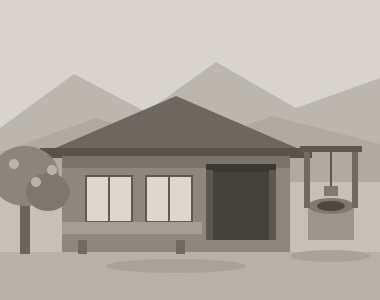

# 生まれた家 {#birth-house}

私が生まれたのは昭和十七年の春、{青沼町|あおぬまちょう}の{寝観音山|ねかんのんやま}のふもとに建つ小さな家だった。板壁は潮風に{灼|や}かれて白茶け、雨の日には土間の隅がいつも湿っていた。

{間口|まぐち}は四間ほどだったろうか。玄関を入るとすぐ土間で、その奥に{囲炉裏|いろり}の切られた板の間があり、さらに六畳と四畳半が並んでいた。{竈|かまど}は土間の左手にあって、朝はきまって母がそこにしゃがんでいた。

祖母は私が生まれたときすでに七十を越えていて、耳が遠かった。それでも私が泣くと必ず気づき、背に負ぶったまま庭を行ったり来たりしたという。庭には{枇杷|びわ}の木が一本あり、初夏になると実が重たげに垂れた。

戦争の記憶は、正直に書けばほとんどない。{半鐘|はんしょう}の音、灯を{覆|おお}った暗い部屋、母の膝の匂い。それが自分の記憶なのか、あとから何度も聞かされた話なのか、いまの私にはもう区別がつかない[^1]。

終戦の日、私は三つだった。母は「あの日の浜は、やけに静かだった」と言っていた。町の男たちが沖のほうを向いたまま、しばらく誰も動かなかったのだそうだ。

父が{復員|ふくいん}してきたのは、その翌年の秋である。土間に立った{痩|や}せた男を、私は知らない人だと思って泣いた。「お父さんだよ」と母に言われても、その日はとうとう近寄れなかった。父はそれを晩年まで笑い話にしていた。

父はまもなく駅裏の青沼製材所に職を得た。夕方になると木の匂いをまとって帰ってきて、作業着の{襟|えり}や袖口には細かい{鋸屑|のこくず}がはさまっていた。それを縁側ではたき落とすのが、母の日課だった。

米は足りなかったが、海があった。{鰯|いわし}の{豊漁|ほうりょう}の年には、家じゅうが{目刺|めざし}を{焙|あぶ}る煙でいっぱいになった。姉の君子は私を連れて浜へ下り、波打ち際で小さな貝を拾っては{笊|ざる}に入れた。

夜、囲炉裏の火が細くなるころ、祖母はきまって同じ話をした。この町の名は、昔、山からしみ出した水が浜のそばに青い沼をつくっていたことに由来するのだという[^2]。沼はとうに埋め立てられて、もうどこにもない。それでも私は長いあいだ、町のどこかにその青い水があるものと信じていた。

いま思えば、私の暮らしの根はすべてあの家にある。傾いた柱も、湿った土間も、いつまでも抜けない潮の匂いも、私という人間の{型|かた}をつくった。

[^1]: 青沼町の空襲被害は軽く、焼けたのは山手の納屋一棟だけだったと聞いている。

[^2]: 「青沼」の地名の由来には諸説あり、湧き水を指す古い言葉が{訛|なま}ったという説もある。
