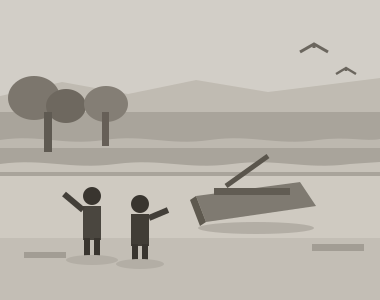

# 浜の子ども {#shigihama}

昭和二十四年の春、私は青沼小学校に入った。木造二階建ての校舎で、廊下を走ると床板がよく鳴った。教室の窓からは、松林のむこうに{鴫浜|しぎはま}の白い波が見えた。

学校が終わると、私たちはまっすぐ浜へ行った。{鞄|かばん}を松の根もとに放り出し、日が{傾|かたむ}くまで遊んだ。潮の引いた岩場には小さな{潮溜|しおだま}りがいくつもでき、{磯巾着|いそぎんちゃく}や{寄居虫|やどかり}がいた。

浜には漁協の{艀|はしけ}が引き上げてあって、私たちはその陰を秘密の場所にしていた。{正吉|しょうきち}という同級生は船大工の子で、{碇|いかり}や{櫓|ろ}の名を得意そうに教えてくれた。舟底に寝ころぶと、木の{脂|やに}と潮の匂いが混ざって、いつまでも{嗅|か}いでいられた。

三年生の秋、大きな台風が来た。一晩じゅう雨戸が鳴り、朝になると浜の松が何本も倒れていた。防波堤の内側まで海藻が打ち上げられ、道は泥と流木でふさがった。学校は三日休みになったが、私たちは片づけに駆り出され、大人にまじって流木を運んだ[^1]。

{芦名|あしな}先生は、五年と六年の担任だった。背が低く、いつも{褪|あ}せた背広を着ていた。作文の時間になると、先生は必ず「見たものを、見たとおりに書きなさい」と言った。うまい言葉を探すな、というのである。

あるとき私は、浜で拾った{硝子|ガラス}の{浮|う}きのことを書いた。波に洗われて角の取れた、青緑の玉である。先生はそれに丸をつけ、余白に「よく見ている」とだけ書いた。あの短い一行を、私は六十年たったいまも覚えている。

姉の君子は私より四つ上で、母の手伝いをよくした。私の帰りが遅いと、松林の入口まで迎えに来て、何も言わずに先を歩いた。怒っているのだと思っていたが、あれは心配していたのだと気づいたのは、ずっとあとのことだ。

冬になると町は静かになった。海は{鉛色|なまりいろ}になり、{時化|しけ}の日は舟が出ない。そういう日、父は家で{鉋|かんな}を{研|と}いでいた。刃を光にかざして{覗|のぞ}きこむ横顔を、私は飽きずに眺めていた[^2]。

[^1]: 昭和二十六年の台風では、青沼町でも小舟が七{隻|せき}流されたという。

[^2]: 父は製材所で{目立|めた}て——鋸の刃を{整|ととの}える仕事——を任されていた。
