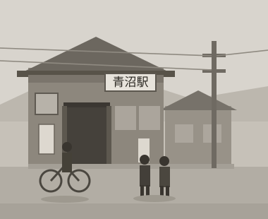

# 青沼の海と製材所 {#seizaisho}

{青沼町|あおぬまちょう}の海は、子どもの頃から私の原風景だ。朝になると、浜から潮の匂いが風にのって家の縁側まで届き、遠くでカモメの声が聞こえた。

町は小さく、駅から海まで歩いて二十分もあれば着いてしまう。家の裏には山がせまり、表へ出ればすぐに漁港があった。

父の勤めていた製材所は、駅の裏手にあった。大きな丸太が運ばれてくると{帯鋸|おびのこ}[^1]の音が一日中ひびき、樹の香りが漂った。私はその匂いが好きで、裏木戸から入りこんでは木くずにまみれて遊んだ。

製材所は町の暮らしを支えていた。家を建てる材木も、船を直す板も、みなそこから出ていった。働く人たちは無口だったが、祭りの日には子どもたちに飴をくれた。

丸太は山から{橇|そり}と馬車で下ろされ、のちにはトラックが入るようになった。{土場|どば}に積まれた丸太の山は、子どもの目にはちょっとした{砦|とりで}で、私たちはその上を跳んで渡った。見つかれば{叱|しか}られたが、本気で怒る大人はいなかった。

製材所の裏には鋸屑の山があった。踏むとやわらかく沈み、冬でもほのかに温かい。手を突っこむと奥のほうはまだ{発酵|はっこう}していて、湯気のような匂いがした。

秋の祭りには、製材所の{職工|しょっこう}たちが山車を出した。前の年に{挽|ひ}いた{欅|けやき}の板で組み直したのだと、父が珍しく自慢げに話した[^2]。

中学に上がると、私は放課後に土場の手伝いをするようになった。{天秤棒|てんびんぼう}で{楔|くさび}を運び、{墨壺|すみつぼ}の糸を張るのを見習った。父は仕事のことを家では話さなかったが、現場ではよく{喋|しゃべ}った。木の{癖|くせ}を読め、というのが口癖だった。

同じ丸太でも、山の南に立っていたものと北に立っていたものでは{目|め}の{詰|つ}まり方が違う。それを見きわめてから鋸を入れるのだと父は言った。当時の私には半分もわからなかったが、あとになって、あれは仕事のすべてを言い当てた言葉だったと思うようになった。

私は中学を卒業すると、町を出て{柏沼|かしわぬま}の高校へ通うことになった[^3]。汽車の窓から見える青沼の海は、いつも同じようでいて、なぜか毎回ちがって見えた。あの景色が私の心の根っこにあると気づいたのは、ずいぶん後のことだ。

[^1]: 帯鋸とは、丸太を板に挽く大きな鋸。

[^2]: 青沼の秋祭りは、いまも十月の第二日曜に行われている。

[^3]: 当時、柏沼の高校へは汽車で片道二時間かかった。
