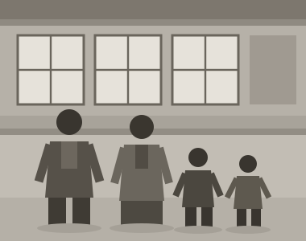

# 妻と子どもたち {#kazoku}

{節子|せつこ}と知り合ったのは、会社の{慰安旅行|いあんりょこう}だった。彼女は経理にいて、私は帰りのバスでたまたま隣の席になった。話したのは、たしか故郷のことだったと思う。彼女も海のある町の生まれだった。

昭和四十四年の秋に式を挙げた。青沼から父と母、姉夫婦が出てきた。父は{紋付|もんつき}の袖を{持|も}てあまし、写真ではずっと肩に力が入っている。

社宅は二間で、風呂は共同だった。壁が薄く、隣の{咳|せき}まで聞こえた。それでも節子は台所の窓に{朝顔|あさがお}を{這|は}わせ、狭い部屋をよく片づけていた。

昭和四十六年に長男の{和彦|かずひこ}が、四十九年に長女の{千夏|ちなつ}が生まれた。和彦は夜泣きがひどく、私は寝不足のまま工場へ通った。千夏は逆によく眠る子で、節子は「同じ親から生まれたと思えない」と笑った。

夏になると、子どもらを連れて青沼へ帰った。和彦は{磯|いそ}で足を切り、千夏は波を{怖|こわ}がって浜に下りようとしなかった。それでも祖父母のところで過ごした数日のことは、二人ともよく覚えているという。

昭和五十三年の冬、父が倒れたという電報が来た。夜行に飛び乗ったが、間に合わなかった。製材所はその前の年に{畳|たた}まれていて、父は町の作業所で{嘱託|しょくたく}をしていたと、あとで母から聞いた。私は何も知らなかった。

{葬儀|そうぎ}のあと、私は一人で製材所の跡を見に行った。土場には{雑草|ざっそう}が伸び、あれほど高かった丸太の山も、鋸屑の山もなかった。それでも地面に{膝|ひざ}をついて{嗅|か}いでみると、木の匂いがまだ残っているような気がした[^1]。

母は一人になった。姉が近くにいたので当面の心配はなかったが、平成に入ってから体を悪くし、しばらく私たちの家で暮らした。孫たちに囲まれた母は、青沼の話をあまりしなかった。かわりに、和彦と千夏の学校の話をよく聞いていた[^2]。

四十を過ぎたころ、私は{現場|げんば}を離れて設計の部屋に移った。図面を引く側になってみると、削る者の苦労がよく見えた。寸法をどこで{詰|つ}め、どこで{逃|に}がすか。丹野さんに教わったことを、そのまま若い者に言っている自分に気づいて{可笑|おか}しかった。

和彦は高校を出ると機械の学校へ進み、千夏は{保育|ほいく}の仕事に就いた。どちらも私が勧めたわけではない。ただ、和彦が食卓で図面の話をするようになったときは、内心うれしかった。

子どもらが手を離れると、家のなかは急に静かになった。節子と二人、日曜の朝に近所を歩くのが習慣になった。歩きながら話すのは、たいてい昔のことである。私が青沼の浜の話をすると、節子は自分の育った町の話をした。二つの海はずいぶん違うようで、聞いているうちに同じものに思えてくるのが不思議だった。

節子は体の丈夫な人ではなかった。それでも三十年、弁当をつくり、子どもの{支度|したく}をし、私の{愚痴|ぐち}を聞いた。感謝を口にしたことは、正直、数えるほどしかない。この本を書くと決めたとき、まずそれを{詫|わ}びておこうと思った。

家族というのは、気がつくとできているものだと思う。私は何かを決めた覚えがない。ただ毎朝出かけ、夜に帰り、日曜に買い物へ行き、それを三十年続けた。それだけのことが、いつのまにか一つの家になっていた。

[^1]: 青沼製材所は昭和五十二年に{廃業|はいぎょう}。最盛期には二十人ほどが働いていたという。

[^2]: 母は平成十八年、八十九歳で亡くなった。
