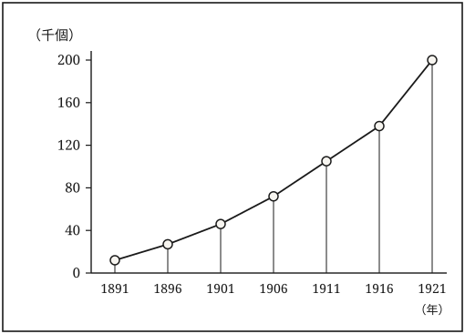

## 度量衡統一の前史

明治維新後の新政府は、殖産興業を推進するうえで、取引の公正と物資流通の円滑化が不可欠であると認識した。その基礎となる度量衡の統一は、幕府や諸藩の再三の試みにもかかわらず、領域ごとに基準が異なり、商品流通や課税の場で多くの{弊害|へいがい}を生んでいた[^1]。同じ商品でも取引のたびに目方や容積が違う事態は、商人と消費者の双方にとって大きな負担であった。

そこで新政府は、国家が単一の基準を定め、それを全国に普及させることが不可欠であると考えた[^2]。明治初期には、府県庁に度量衡掛が置かれ、計量器の検査や違反の取締が行われたが、その権限や手続は府県ごとにまちまちで、全国的な統一には程遠い状態にあった。

政府は太政官布告や諸布達によって度量衡の統一を再三通達したが、公布だけでは実効を伴わず、地方の実施は遅れた[^3]。

## メートル法導入と度量衡取締

明治二十四年（一八九一）、政府は度量衡法を公布した。尺はメートル{原器|げんき}の三十三分の十、貫はキログラム原器の四分の十五とし、慣れ親しんだ在来の単位を、国際的な原器から導き直すという方式である。施行は二年後の明治二十六年一月一日と定められた。

{#fig-kentei}

もっとも、この法は尺貫法を廃したわけではない。日本はすでに明治十九年（一八八六）にメートル条約に加盟し、まもなく国際原器の複製を受け取っていた。法が定めたのは、慣れた単位の名をそのまま残し、その{拠|よ}りどころだけを国際原器に付け替えるという迂回路である[^4]。取引の場では従来どおり尺と貫を使ってよい。ただし、その尺と貫の背後には、はるか西欧の分銅と物差しが控えている。そういう仕組みであった。

二元的といえば聞こえは悪いが、これは移行期の知恵でもあった。単位の名まで変えてしまえば、桝も{秤|はかり}も、帳簿の書きかたも、値の勘定のしかたも、いっせいに改めねばならない。名を残して基準だけを差し替えるなら、変わるのは器の目盛の刻みかたにとどまり、社会の側は当面それと気づかずにいられる。

とはいえ、目盛の刻みかたが変わるとは、器そのものを作り直すということである。施行と同時に、府県は基準器の配布と計量器の検定に追われた。基準器は中央から府県へ、府県から市町村へと段階を追って配られ、各段階での比較検査によって末端の誤差を一定の幅に収める。基準器そのものが狂えば末端まで狂うから、その保管と点検は{厳格|げんかく}を極めた[^5]。

は、施行後の三十年間に検定を受けた計量器の数を示している。明治二十年代の伸びはゆるやかだが、日露戦争後に傾きが変わり、大正期に入ると急な立ち上がりを見せる。工業化の進展と、器を新調する商工業者の増加とが、この曲線には重なっている。検定数の増加は、制度が浸透した{証|あかし}であると同時に、制度が向き合うべき対象の増加でもあった。

制度が一度で完成したわけではないことも、付け加えておかねばならない。明治四十二年（一九〇九）の全部改正では、英米との取引を考慮してヤード・ポンド法も公認された。尺貫法・メートル法・ヤード・ポンド法という三つの体系が並び立ち、統一のための法が、かえって混乱の温床となる皮肉が生じたのである[^6]。

## 検定という仕事

法と勅令が定めるのは枠組みにすぎない。制度を紙の上から現実へ引き下ろすのは、名を残さない役人たちの手仕事である。

検定の現場は、想像されるほど華やかなものではない。検定吏員は桝や秤を一つひとつ手に取り、分銅を載せ、目盛を読み、合格したものには{烙印|らくいん}を押す。繁忙期には一日に数百点を扱うこともあった。単調な作業だが、気をゆるめれば誤差を見落とす。

同じ動作の繰り返しに見えて、そこには判断がある。わずかに規格を外れた器を、直させるのか、その場で使えなくさせるのか。生活の道具を取り上げることの重みを、吏員たちは日々の記録に書き残している。

{苫緒|とまお}郡役所に残る明治三十年代の日誌には、検定の日に商家が店を閉め、器をまとめて役所へ運ぶ様子が記されている[^7]。検定は行政の手続であると同時に、町の年中行事でもあった。

その日誌には、郡書記{梶尾清蔵|かじおせいぞう}の手になる短い記述が散見される。「{室生屋|むろうや}の一斗桝、二合の不足あり。主人、亡父の代よりのものと申し立つ」。二合の不足は一斗の二分にあたる。米で量れば売り手か買い手のどちらかが損をする差だが、店にとっては父から受け継いだ道具でもあった。

梶尾は続けて書いている。「新調を{諭|さと}す。主人、しばし{黙|もく}す」。不合格の器は、その場で{鏨|たがね}を入れて使えなくされた。制度の側から見れば当然の措置だが、器の側から見れば、家の歴史が一つ断ち切られたことになる。

検定手数料も商家の負担であった。器一点あたりの額は{僅少|きんしょう}でも、商家の持つ桝や秤は十点二十点にのぼる。加えて新調の費用がかかる。検定期日の前に器の数を減らし、必要最小限だけを届け出る商家もあったという[^8]。制度は、それを守る側にも{相応|そうおう}の算段を強いたのである。

## 帳簿のなかの尺貫

制度の浸透を測るなら、検定数よりも商家の帳簿を見るほうが確かである。器は法によって作り変えられるが、数の書きかたは、書く人の習慣に従うからだ。

苫緒の乾物問屋室生屋に伝わる帳簿を追うと、明治二十年代から昭和初期にかけて、単位の書きかたが少しずつ変わっていく様子が見てとれる[^9]。明治期の帳面は、ほとんど貫と{匁|もんめ}で埋まっている。大正に入ると、仕入先からの送り状に{瓩|キログラム}や{瓲|トン}の字が現れ、帳面の欄外に換算の走り書きが増える。

興味深いのは、併記の期間が長く続くことである。同じ品目を「三十貫（百十二瓩五百）」のように二重に記す例が、昭和十年代まで珍しくない。二つの体系のあいだで、商人は当面どちらも捨てなかった。捨てられなかったというより、捨てる必要がなかったというべきだろう。仕入は新しい単位で、店先は古い単位で、それぞれ回っていたからである。

換算表は、この時期の商家の必需品だった。三十貫が百十二瓩五百であることを暗算できる者は少なく、帳場の柱には刷り物の対照表が貼られていた。学校の算術でも換算は繰り返し練習され、教科書には尺貫とメートルを行き来する問題が並ぶ。単位の切り替えは、器の切り替えであると同時に、計算の作法の切り替えでもあった。

生活の側では、単位はさらに長く残った。反物は{鯨尺|くじらじゃく}で{裁|た}たれ、酒は升で量られ、家は間と坪で測られる。これらは取引の単位であると同時に、身体と道具に{馴染|なじ}んだ寸法であり、法が変わったからといって手が忘れるものではない。単位が生活に根を張るとは、そういうことである。

## 工場が求めた精度

商家が併記でしのげたのは、取引の相手が顔の見える範囲にとどまるかぎりのことである。相手が国外の商社になり、注文が図面で届くようになれば、事情は変わる。

器械工業では、部品を交換可能に作ることが生産の前提となる。そのためには、設計図と工作機械と検査具とが、同じ基準を共有していなければならない。図面に記された寸法が、工場のどの{罫書|けがき}台でも同じ長さを意味すること。これが互換性生産の最低条件であった。

尺貫法に細かさが足りなかったわけではない。寸を分に、分を{厘|りん}に、厘を{毛|もう}に刻めば、必要な精度には十分に届く。問題は細かさではなく、桁の上がりかたと、国外の図面との接続にあった。三十三分の十という{端数|はすう}をはさんで変換を繰り返せば、そのたびに丸めの誤差が入りこむ。

第一次世界大戦期の好況を経て、日本の工業製品は国外の市場へ出ていくことになる。規格の統一を進めるうえで、二重三重の単位体系は{足枷|あしかせ}でしかなかった。大正十年（一九二一）四月、度量衡法はメートル法に一本化する改正を受ける。ただし改正法の施行は大正十三年七月からとされ、官庁に十年、民間に二十年という長い猶予が付された[^10]。

猶予は、実務への配慮であると同時に、抵抗への譲歩でもあった。尺貫法の擁護を唱える運動は根強く、統一の期日は繰り返し先送りされ、やがて事実上の無期延期に至る[^11]。ものさしは、いつのまにか国のかたちを語る言葉になっていたのである。

## ものさしを取り替える

決着は戦後に持ち越された。昭和二十六年（一九五一）に計量法が公布され、翌年三月に施行されて、六十年にわたって計量行政の骨格であった度量衡法は廃止される。新法は対象とする単位の範囲を大きく広げ、事業者の規律も組み替えた[^12]。

そして昭和三十三年の末をもって、取引と証明に尺貫法を用いることは禁じられた。土地と建物の計量については、なお昭和四十一年三月末まで猶予が置かれている[^13]。度量衡法の公布から数えて、およそ七十年。ものさしを取り替えるのに、日本社会はそれだけの時間を費やしたことになる。

なぜこれほど時間がかかったのか。単位が、器と帳簿と身体感覚の三つに宿るからだ、と答えておきたい。器は買い替えられる。帳簿は書き改められる。だが、一升の重さや一間の広がりを手と目で覚えた身体は、法によって書き換えることができない。制度が最後に相手取ったのは、まさにこの三つ目であった。

今日でも、畳の寸法や土地の坪は日常の言葉として生きている。尺に相当する目盛りを刻んだ物差しは、大工道具として正規に作られ続けており、これは黙認ではなく制度上の位置づけを与えられたものである[^14]。廃止されたのは単位そのものではなく、取引と証明の場でそれを用いることであった。

もっとも、日常語として生き残った単位は、もはや厳密な量ではない。一坪はおよそ三・三平方メートルと{丸|まる}めて語られ、一間は間取り図のうえの目安として通用する。厳密さを引き受けたのはメートル法の側であり、尺貫は寸法の{勘|かん}どころを伝える言葉として残った。二つのものさしは、いつのまにか役割を分け合っているのである。

振り返ってみれば、明治二十四年の法は、単位の名を残したまま拠りどころだけを入れ替えるという、きわめて慎重な設計であった。その慎重さが移行の{摩擦|まさつ}を小さくし、同時に移行そのものを長引かせもした。制度を設計するとは、どこで摩擦を引き受けるかを選ぶことでもある。度量衡の七十年は、その{機微|きび}をよく教えてくれる。

度量衡の統一とは、器を揃えることではなく、何を等しいと見なすかについて社会が合意することであった。合意は法によって宣言されるが、法だけでは成立しない。基準器を運ぶ人、目盛を読む人、帳面に二重に書きつける人、そして換算表を柱に貼る人がいて、はじめて基準は基準になる。次章では、この合意が学校教育を通じてどのように育てられたのかを見ていきたい。

[^1]: {高城汀子|たかしろていこ}『計量の社会史――秤と桝の近代』雲間書店、一九九八年、二三頁。

[^2]: {棚倉惟史|たなくらこれふみ}『度量衡行政の形成』三日月坂出版、二〇〇四年、五七頁。

[^3]: 同前、六二―六五頁。府県間の照会文書の分析による。

[^4]: 高城前掲書、四一頁。

[^5]: 棚倉前掲書、九八頁。基準器の点検簿の書式には府県ごとの差があった。

[^6]: 同前、一二七頁。

[^7]: 『苫緒郡役所日誌』明治三十一年三月十八日条（苫緒町立資料館蔵）。

[^8]: 高城前掲書、一〇六頁。

[^9]: 「室生屋文書」仕入帳・大福帳（苫緒町立資料館蔵）。高城前掲書、一三二―一四〇頁に一部が{翻刻|ほんこく}されている。

[^10]: 棚倉前掲書、一八四頁。

[^11]: 同前、二〇一頁。擁護運動の言説については第五章であらためて扱う。

[^12]: 高城前掲書、二一八頁。

[^13]: 同前、二二四頁。

[^14]: 棚倉前掲書、二四七頁。
